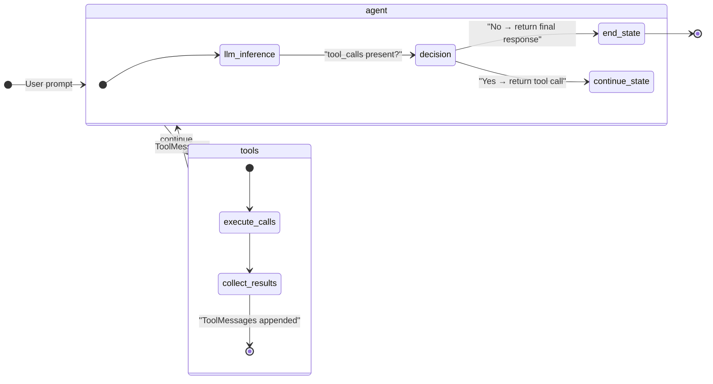
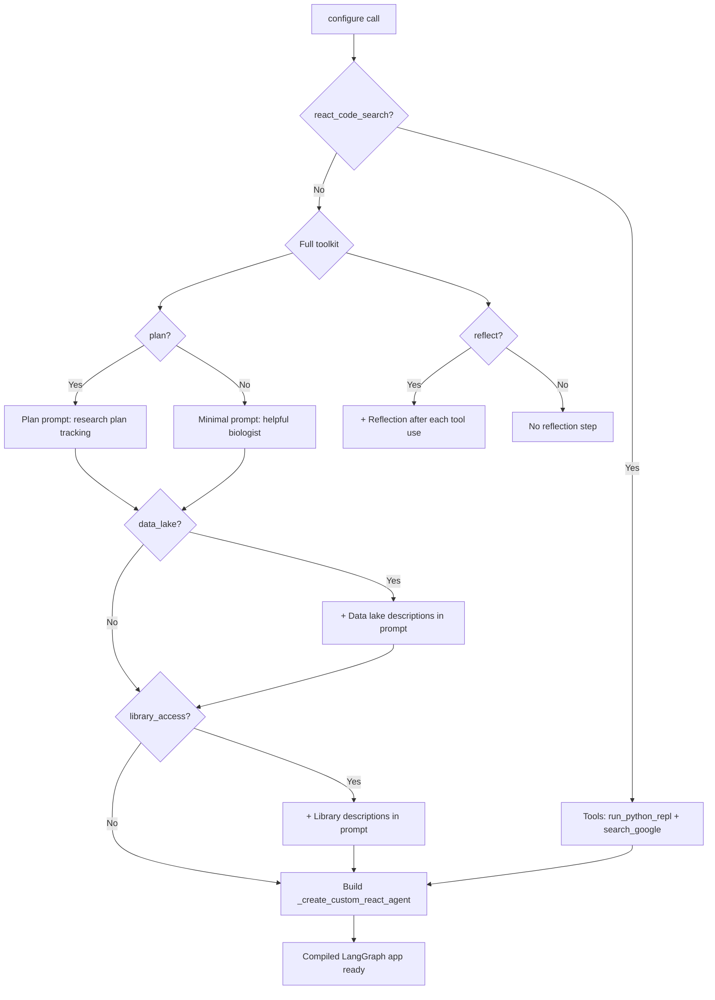

The `react` class in [biomni/agent/react.py](biomni/agent/react.py) implements the foundational **Reasoning + Acting** loop that powers BioMni's earlier agent architecture. Built on LangGraph's `StateGraph`, it provides a two-node cyclic graph where the LLM reasons about tool calls and a dedicated tool-execution node materializes those decisions — repeating until the model produces a final answer without further tool calls. While the newer [A1 Agent Core Class](9-a1-agent-core-class) supersedes this engine in production, the `react` class remains valuable for understanding the base reasoning loop, for lightweight deployments, and as a reference implementation for custom agent wiring.

## Core Architecture: Two-Node LangGraph Cycle

The entire reasoning engine reduces to a deterministic two-node directed cycle. At initialization the constructor discovers every registered tool via `read_module2api()`, converts each API schema into a LangChain `StructuredTool` through `api_schema_to_langchain_tool`, wraps each tool with a multiprocessing-based timeout, and stores the resulting tool list ([react.py#L64-L71](biomni/agent/react.py#L64-L71)). The graph itself is constructed inside [`_create_custom_react_agent`](biomni/agent/react.py#L268-L345), which follows the canonical ReAct pattern with three components:



The **agent node** ([L277-L282](biomni/agent/react.py#L277-L282)) prepends the system prompt as a `SystemMessage`, invokes the LLM with all accumulated messages, and returns the model's response — which either contains `tool_calls` (triggering a loop continuation) or a plain text response (ending the loop). The **tools node** ([L285-L307](biomni/agent/react.py#L285-L307)) iterates over every tool call in the last AI message, looks up the tool by name in a dictionary, invokes it with the provided arguments, and serializes the result into a `ToolMessage`. Errors are caught gracefully and returned as error-bearing `ToolMessage` objects, preventing a single tool failure from crashing the entire loop. The **conditional edge** [`should_continue`](biomni/agent/react.py#L310-L319) inspects the last message: if `tool_calls` is empty or absent it routes to `END`, otherwise to the `tools` node. The graph is compiled with a recursion limit of 50 iterations ([L438](biomni/agent/react.py#L438)).

| Component | Location | Responsibility |
|---|---|---|
| `call_model` | [L277-L282](biomni/agent/react.py#L277-L282) | Prepend system prompt, invoke LLM, return response |
| `tool_node` | [L285-L307](biomni/agent/react.py#L285-L307) | Execute tool calls, serialize results to `ToolMessage` |
| `should_continue` | [L310-L319](biomni/agent/react.py#L310-L319) | Route to `END` or `tools` based on presence of `tool_calls` |
| `StateGraph` | [L322-L345](biomni/agent/react.py#L322-L345) | Wire nodes, edges, and compile the runnable graph |

Sources: [react.py](biomni/agent/react.py#L268-L345)

## Tool Timeout Isolation

Every tool function is wrapped in a **multiprocessing-based timeout** during initialization via [`_add_timeout_to_tools`](biomni/agent/react.py#L90-L152). The factory function `create_timed_func` spawns each tool invocation in an isolated `Process`, communicates results through a `multiprocessing.Queue`, and enforces a configurable timeout (default 600 seconds from [`BiomniConfig`](biomni/config.py#L33)). If the process exceeds the timeout, it is first asked to terminate gracefully, then killed with `SIGKILL` if unresponsive. The timeout mechanism is crucial because biomedical tools — sequence BLASTs, PDB queries, image processing — can hang unpredictably on external services. The `react` class wraps tools at initialization ([L86](biomni/agent/react.py#L86)), and newly added tools via [`add_tool`](biomni/agent/react.py#L154-L164) are automatically wrapped before being appended to the tool list.

> [!TIP]
> The timeout wrapper uses `multiprocessing.Process` rather than `threading.Timer` because it enables true OS-level process isolation via `SIGKILL` — essential when a tool spawns subprocesses or opens network connections that would survive thread cancellation.

Sources: [react.py](biomni/agent/react.py#L90-L152), [config.py](biomni/config.py#L33)

## Configuration Modes: Plan, Reflect, and Resource Access

The [`configure`](biomni/agent/react.py#L166-L266) method accepts five boolean flags that compose the system prompt and determine which tools and resources the agent can access. These flags are mutually combinable, producing four distinct prompt strategies:

| `plan` | `reflect` | Prompt Strategy | Behavior |
|---|---|---|---|
| `False` | `False` | **Direct** ([L193-L194](biomni/agent/react.py#L193-L194)) | Straightforward tool-use without meta-reasoning |
| `True` | `False` | **Plan** ([L196-L202](biomni/agent/react.py#L196-L202)) | Agent maintains a Research Plan tracking high-level strategy, completed steps, and short conclusions |
| `False` | `True` | **Reflect** ([L203-L206](biomni/agent/react.py#L203-L206)) | After each tool use the agent reflects: what does the observation mean, what caused errors, how to debug |
| `True` | `True` | **Plan + Reflect** ([L208-L216](biomni/agent/react.py#L208-L216)) | Full meta-cognitive loop with research plan maintenance and post-action reflection, plus explicit `write_python_code` and `run_python_repl` tool instructions for data-heavy tasks |

The `data_lake` flag ([L218-L234](biomni/agent/react.py#L218-L234)) appends descriptions of all files found in `{path}/data_lake/` to the system prompt, giving the agent awareness of available datasets. The `library_access` flag ([L236-L250](biomni/agent/react.py#L236-L250)) appends available software library descriptions from `library_content_dict`. Both are purely prompt-level augmentations — they instruct the agent to use `run_python_repl` for data access but do not inject new tools into the graph. There is also a special `react_code_search` mode ([L178-L189](biomni/agent/react.py#L178-L189)) that restricts the tool set to only `run_python_repl` and `search_google`, stripping away the full biomedical toolkit for pure code+search tasks.



Sources: [react.py](biomni/agent/react.py#L166-L266)

## Retrieval-Augmented Tool Selection

When `use_tool_retriever` is `True` (the default per [`BiomniConfig`](biomni/config.py#L40)), the agent does not blindly pass all registered tools to the LLM. Instead, at execution time inside [`go`](biomni/agent/react.py#L347-L445), it performs a **prompt-based retrieval** step that narrows the tool set to a query-relevant subset before constructing the LangGraph. This is the same retrieval mechanism documented in [Retrieval-Augmented Tool Selection](13-retrieval-augmented-tool-selection), integrated here as an optional pre-execution phase.

The retrieval process works as follows:

1. **Resource assembly** ([L375-L379](biomni/agent/react.py#L375-L379)): All registered tools, data lake items (with descriptions from `data_lake_dict`), and library entries (from `library_content_dict`) are collected into a unified resources dictionary.

2. **Prompt-based selection** ([L382](biomni/agent/react.py#L382)): The [`ToolRetriever.prompt_based_retrieval`](biomni/model/retriever.py#L14-L132) method constructs a selection prompt that lists all available resources with indices and asks the LLM to output index lists for each category. The retriever's guidelines ([retriever.py#L77-L87](biomni/model/retriever.py#L77-L87)) are deliberately generous — it prefers inclusion over exclusion, particularly for database tools and molecular biology tools.

3. **Graph reconstruction** ([L414-L435](biomni/agent/react.py#L414-L435)): Selected tool names are matched back to their LangChain tool objects. The `run_python_repl` tool is always force-included if not already selected ([L428-L431](biomni/agent/react.py#L428-L431)), as it serves as the agent's fallback code execution environment. The LangGraph is then **recompiled** with only the retrieved tool subset via `_create_custom_react_agent`.

This approach dramatically reduces the token overhead of tool schemas in the LLM context window, which is critical when the full registry contains hundreds of biomedical tools across genomics, proteomics, imaging, and other domains.

Sources: [react.py](biomni/agent/react.py#L347-L445), [retriever.py](biomni/model/retriever.py#L14-L132)

## Execution Flow: The `go` Method

The [`go`](biomni/agent/react.py#L347-L445) method is the single entry point for executing a query. It accepts a natural-language prompt and returns a tuple of `(log, final_response)`. The execution proceeds in three phases:

**Phase 1 — Retrieval (conditional).** If `use_tool_retriever` is enabled, the retrieval phase described above runs, narrowing the tool set and recompiling the graph.

**Phase 2 — Streaming execution.** The compiled LangGraph app is invoked with `stream_mode="values"` ([L441](biomni/agent/react.py#L441)), yielding the full message state after each graph step. This means every intermediate step — LLM reasoning, tool calls, tool results — is available in real time through the stream. Each yielded message is processed through `pretty_print` for console output and appended to `self.log`.

**Phase 3 — Result extraction.** After the stream completes, the final message content is returned as the response string. The full conversation log is stored in `self.log` for downstream processing.

> [!TIP]
> The `recursion_limit` is hardcoded to 50 at [L438](biomni/agent/react.py#L438). Each tool invocation counts as one recursion step. For complex multi-step biological analyses, this limit can be reached — if you see `GraphRecursionError`, consider raising this value or simplifying the task.

Sources: [react.py](biomni/agent/react.py#L347-L445)

## Result Formatting

The [`result_formatting`](biomni/agent/react.py#L447-L465) method provides structured output extraction from the conversation log. It invokes the same LLM as a "evaluateGPT" role, passing the full conversation history along with a `task_intention` string that describes the expected output schema. The LLM is invoked with `with_structured_output(output_class)`, which forces it to produce a response conforming to the provided Pydantic model or TypedDict. This enables downstream evaluation pipelines to extract structured answers from the agent's free-form reasoning chain — a pattern used extensively in [Biomni-Eval1 Benchmark Results](7-biomni-eval1-benchmark-results).

Sources: [react.py](biomni/agent/react.py#L447-L465)

## Relationship to the A1 Agent

The `react` class is the **predecessor** to the production [`A1`](biomni/agent/a1.py#L56) agent. While `react` uses a minimal two-node `StateGraph` with `Annotated[Sequence[BaseMessage], add_messages]` state ([react.py#L31-L35](biomni/agent/react.py#L31-L35)), A1 introduces a richer state model with `next_step` routing ([a1.py#L51-L53](biomni/agent/a1.py#L51-L53)), memory checkpointing via `MemorySaver`, multi-step planning with `START` nodes, know-how document integration, MCP server support, conversation persistence, and a Gradio web interface. The `react` class is **not exported** from [`biomni/agent/__init__.py`](biomni/agent/__init__.py) — only `A1` is — but `react` can be imported directly from `biomni.agent.react` for lightweight use cases.

| Feature | `react` class | `A1` class |
|---|---|---|
| State model | `AgentState` with `messages` only | `AgentState` with `messages` + `next_step` |
| Graph complexity | 2-node cycle | Multi-node with `START`, conditional routing |
| Memory persistence | None | `MemorySaver` checkpointing |
| Know-how integration | No | Yes, via `KnowHowLoader` |
| Tool retrieval | Built-in, per-execution | Built-in, with richer resource types |
| MCP support | No | Yes |
| Conversation export | No | Markdown + PDF export |
| Gradio UI | No | Yes, built-in |
| Self-critic / test-time scaling | No | Yes ([Self-Critic and Test-Time Scaling](11-self-critic-and-test-time-scaling)) |

Sources: [react.py#L31-L35](biomni/agent/react.py#L31-L35), [a1.py#L51-L53](biomni/agent/a1.py#L51-L53), [__init__.py](biomni/agent/__init__.py)

## Minimal Usage Example

For developers who want a lightweight agent without the full A1 feature set, the `react` class provides a straightforward API:

```python
from biomni.agent.react import react

# Initialize with defaults (Claude Sonnet 4.5, tool retriever enabled)
agent = react()

# Configure with planning mode and data lake access
agent.configure(
    plan=True,
    reflect=True,
    data_lake=True,
    library_access=False,
)

# Execute a query
log, response = agent.go(
    "Design a CRISPR guide RNA targeting the BRCA1 gene exon 5"
)
print(response)
```

The `configure` call must precede `go` — attempting to call `go` before `configure` will raise an error because `self.app` (the compiled graph) has not been created.

## Continuing the Architecture Tour

The ReAct reasoning engine defines the base reasoning loop that underpins BioMni's agent system. To understand the production agent that builds upon this foundation — with memory, self-criticism, know-how integration, and MCP support — proceed to [A1 Agent Core Class](9-a1-agent-core-class). For the meta-cognitive enhancements layered on top of the base loop, see [Self-Critic and Test-Time Scaling](11-self-critic-and-test-time-scaling). To understand how tools are discovered, registered, and filtered before being passed into this engine, explore [Tool Registry and Discovery](12-tool-registry-and-discovery) and [Retrieval-Augmented Tool Selection](13-retrieval-augmented-tool-selection).