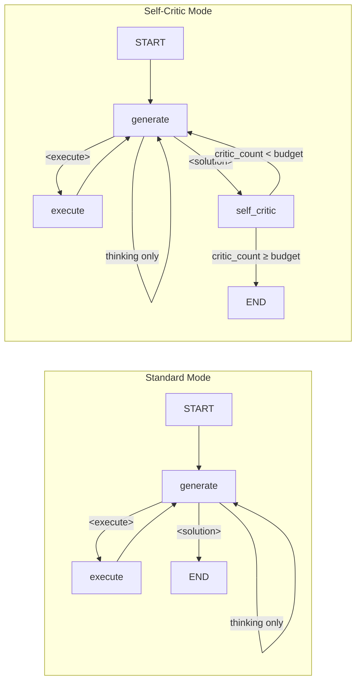

Biomni's agent framework incorporates two complementary inference-time strategies—**self-criticism** and **test-time scaling**—that transform a single-pass generation into an iterative refinement loop. Rather than accepting the first solution produced by the LLM, these mechanisms force the agent to re-examine its own reasoning, identify deficiencies, and produce improved answers. Both are controlled through the `A1.configure()` method and implemented as a dedicated node within the LangGraph state machine.

## Architectural Motivation: Why Self-Criticism?

The default A1 agent operates in a single-attempt mode: the generate node reasons and emits either an `<execute>` block (for tool interaction) or a `<solution>` block (for a final answer), and once a solution is emitted, the workflow terminates. For complex biomedical tasks—multi-step experimental design, cross-database analysis, or protocol generation—a single pass often yields incomplete or suboptimal results. Self-criticism addresses this by inserting an adversarial review step between solution emission and final termination, creating a feedback loop that mimics iterative peer review.

Sources: [a1.py](biomni/agent/a1.py#L1579-L1604)

## The Self-Critic Node: Internal Adversarial Feedback

The `execute_self_critic` function is the computational core of this strategy. When activated, it intercepts the workflow after the agent produces its first `<solution>` response. Instead of terminating, the state machine routes to this node, which performs three operations:

1. **Task reminder injection**: The node prepends the original user task (`self.user_task`) into a feedback prompt, ensuring the critic never loses sight of the ground-truth objective.
2. **Harsh criticism generation**: The agent's own LLM is invoked with the full conversation history plus a directive to "critic harshly" on what could be improved, what is missing, and what remains to solve the task. The feedback is explicitly constrained—no questions allowed, only constructive critique.
3. **State transition**: The criticism is injected as a synthetic `HumanMessage` into the message list, framed as "this is not enough to solve the task," and the workflow routes back to the `generate` node for another attempt.

The critical design insight is that the same LLM serves dual roles: as both the **solver** and the **critic**. This eliminates the need for a separate critic model while leveraging the model's own capacity for self-evaluation. The `critic_count` instance variable on the `A1` class tracks how many criticism cycles have elapsed ([a1.py](biomni/agent/a1.py#L1766-L1767)).

Sources: [a1.py](biomni/agent/a1.py#L1579-L1604), [a1.py](biomni/agent/a1.py#L1766-L1767)

## Test-Time Scaling: Budget-Controlled Iteration

Test-time scaling in Biomni is implemented as a bounded repetition mechanism controlled by the `test_time_scale_round` parameter. This integer determines the maximum number of self-criticism cycles the agent will perform before being forced to terminate. The relationship between the two mechanisms is direct: self-criticism provides the *logic* of improvement, while test-time scaling provides the *budget* that governs how many improvement iterations are permitted.

When `execute_self_critic` is called, it checks `self.critic_count < test_time_scale_round`. If the budget is exhausted, the node routes directly to `"end"` rather than back to `"generate"`. This creates a predictable compute-time/compute-quality tradeoff that scales linearly with the round count.

Sources: [a1.py](biomni/agent/a1.py#L1289-L1296), [a1.py](biomni/agent/a1.py#L1579-L1604)

## State Machine Topology

The following diagram contrasts the two workflow configurations. The left graph shows standard (non-critic) execution, where a `<solution>` tag immediately terminates. The right graph shows the self-critic variant, where solution emission routes through the critic node before either looping back or terminating.



The routing functions differ between modes. Standard mode uses `routing_function` which maps `"end"` directly to the terminal `END` node ([a1.py](biomni/agent/a1.py#L1555-L1566)). Self-critic mode uses `routing_function` for the generate node but maps `"end"` to the `self_critic` node ([a1.py](biomni/agent/a1.py#L1613-L1624)), then uses `routing_function_self_critic` which only recognizes `"generate"` and `"end"`—deliberately excluding `"execute"` since the critic should not trigger code execution directly ([a1.py](biomni/agent/a1.py#L1568-L1577)).

Sources: [a1.py](biomni/agent/a1.py#L1606-L1641)

## System Prompt Modifications for Self-Critic Mode

When `self_critic=True` is passed to `_generate_system_prompt`, the system prompt receives an additional instruction block that prepares the agent for iterative refinement. This instruction tells the agent it "may or may not receive feedback from human" and to "address the feedbacks by following the same procedure of multiple rounds of thinking, execution, and then coming up with a new solution" ([a1.py](biomni/agent/a1.py#L1146-L1149)). This is critical because the synthetic criticism messages injected by `execute_self_critic` appear as `HumanMessage` instances—the agent must be primed to treat them as legitimate feedback rather than unexpected interruptions.

Sources: [a1.py](biomni/agent/a1.py#L1146-L1149)

## Activation and Configuration

Both mechanisms are activated through the `configure()` method on the `A1` class. Since `configure()` is called automatically during `__init__` ([a1.py](biomni/agent/a1.py#L223)), enabling self-criticism requires a two-step pattern: instantiate the agent, then re-configure.

| Parameter | Type | Default | Description |
|-----------|------|---------|-------------|
| `self_critic` | `bool` | `False` | Enables the self-critic review node in the workflow graph |
| `test_time_scale_round` | `int` | `0` | Maximum number of self-criticism iterations before forced termination |

**Usage pattern:**

```python
from biomni.agent import A1

agent = A1(llm="claude-sonnet-4-5")
agent.configure(self_critic=True, test_time_scale_round=3)
log, answer = agent.go("Design a CRISPR screening experiment...")
```

> [!TIP]
> The `critic_count` and `user_task` attributes are initialized at the start of each `go()` or `go_stream()` call ([a1.py](biomni/agent/a1.py#L1766-L1767)), not during `configure()`. This means the same agent instance can safely handle multiple sequential queries without state leakage between critic cycles.

Sources: [a1.py](biomni/agent/a1.py#L1289-L1296), [a1.py](biomni/agent/a1.py#L1759-L1789)

## Execution Lifecycle During Self-Critic Iterations

Each full iteration through the self-critic loop follows a predictable message sequence in the conversation state. Understanding this pattern is essential for debugging and for consuming streamed outputs:

1. **Generate phase**: The LLM receives the accumulated message history (including prior criticisms) and produces either a new `<execute>` block or a revised `<solution>` block.
2. **Execute phase** (if applicable): Tool invocations are run through the Python/R/Bash REPL with timeout enforcement. Results are appended as `<observation>` messages.
3. **Solution emission**: When the LLM finally emits a `<solution>`, the `routing_function` maps `"end"` to the `self_critic` node (in critic mode).
4. **Critic invocation**: The `execute_self_critic` node calls the LLM with the full history plus the criticism prompt, producing a feedback string.
5. **Feedback injection**: The feedback is wrapped in a synthetic `HumanMessage`: "Wait... this is not enough to solve the task. Here are some feedbacks for improvement:\n{feedback}" ([a1.py](biomni/agent/a1.py#L1594-L1598)).
6. **Budget check**: If `critic_count` has reached `test_time_scale_round`, the workflow terminates; otherwise, control returns to the generate phase.

The `recursion_limit` in the stream config is set to 500 ([a1.py](biomni/agent/a1.py#L1774)), providing ample headroom for multi-round critic loops even on complex tasks with many intermediate execution steps.

Sources: [a1.py](biomni/agent/a1.py#L1774), [a1.py](biomni/agent/a1.py#L1594-L1598)

## Interaction with Tool Retrieval

Self-criticism operates orthogonally to the tool retrieval system. When `use_tool_retriever=True` (the default in [config.py](biomni/config.py#L40)), the `go()` method first performs prompt-based resource retrieval before entering the workflow ([a1.py](biomni/agent/a1.py#L1769-L1771)). This means the selected tool set is determined once at invocation time and remains fixed across all critic iterations. The critic reviews the agent's *use* of those tools, not the tool selection itself. This separation ensures that test-time scaling does not compound retrieval costs across iterations.

Sources: [a1.py](biomni/agent/a1.py#L1769-L1771), [config.py](biomni/config.py#L40)

## Streaming Compatibility

The `go_stream()` method supports self-critic and test-time scaling identically to `go()`. The `critic_count` and `user_task` are reset at stream initialization ([a1.py](biomni/agent/a1.py#L1803-L1804)), and each state update—including critic feedback messages—is yielded as part of the generator output. This enables real-time UI rendering of the critique-and-revise cycle in the Gradio interface, though the current Gradio demo does not expose self-critic as a user-togglable option—it always uses whatever configuration the agent was initialized with.

Sources: [a1.py](biomni/agent/a1.py#L1791-L1828)

## Cost and Latency Considerations

Each self-critic iteration adds a full LLM invocation (the criticism generation) plus whatever subsequent generate-execute cycles the agent performs in response. The total compute cost scales approximately as `base_cost × (1 + N × k)` where `N` is `test_time_scale_round` and `k` is the average number of generate-execute cycles per revision attempt. There is no mechanism for early stopping based on solution quality—all configured rounds are executed.

> [!TIP]
> For production deployments where latency matters, start with `test_time_scale_round=1` (single revision pass) and increase only if evaluation metrics justify the additional compute. The `BiomniEval1` benchmark ([biomni_eval1.py](biomni/eval/biomni_eval1.py)) can be used to quantify the accuracy lift from additional scaling rounds.

## Relationship to Other Agent Modes

The self-critic mechanism is exclusive to the A1 agent class. The `react` agent ([react.py](biomni/agent/react.py)) implements its own reflection capability via the `reflect` parameter in `configure()` ([react.py](biomni/agent/react.py#L166-L173)), which is a structurally different approach using LangGraph's built-in reflection patterns. The `qa_llm` agent ([qa_llm.py](biomni/agent/qa_llm.py)) is a single-shot Q&A wrapper with no iteration capability. For a full architectural comparison of these agent modes, see [ReAct Reasoning Engine](10-react-reasoning-engine) and [A1 Agent Core Class](9-a1-agent-core-class).
