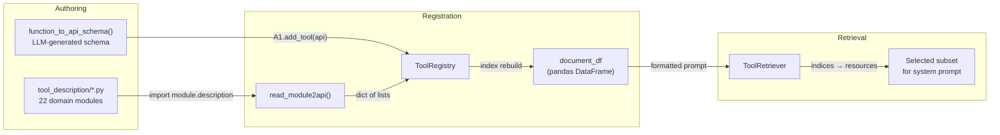

The Biomni platform manages hundreds of bioinformatics tools across 22 life-science domains through a centralized registry and intelligent retrieval pipeline. Understanding how tools are authored, registered, discovered, and selected at runtime is essential for extending the system or diagnosing agent behavior. This page traces the full lifecycle — from static tool description files through registry construction to prompt-based tool retrieval — and explains the data contracts that bind each stage together.

## The Tool Lifecycle: From Description to Retrieval

Biomni's tool system follows a three-phase pipeline: **authoring**, **registration**, and **retrieval**. Tool descriptions live as Python data structures in domain-organized modules; at startup they are loaded into a `ToolRegistry` that assigns stable integer IDs and builds an index dataframe; during agent inference a `ToolRetriever` consults an LLM to select the most relevant subset for the user's query. Each phase has a clear data contract, and the boundaries between them are deliberately simple — raw dictionaries flow from description to registry, and registry entries flow to the retriever.



The following sections examine each phase in detail, with exact source references.

## Tool Description Format

Every tool in Biomni is described by a dictionary conforming to a lightweight schema enforced by `ToolRegistry.validate_tool()`. The three mandatory keys are `name`, `description`, and `required_parameters`; an `optional_parameters` key is present in the vast majority of tools but is not formally required by validation logic.

| Key | Type | Required | Description |
|---|---|---|---|
| `name` | `str` | ✅ | Unique function name used as the dispatch identifier |
| `description` | `str` | ✅ | Natural-language summary used by both the LLM agent and the retriever |
| `required_parameters` | `list[dict]` | ✅ | Parameters without defaults; each entry has `name`, `type`, `description`, `default` |
| `optional_parameters` | `list[dict]` | ❌ | Parameters with defaults; same sub-key structure as required |

Each parameter entry within the lists carries four sub-keys: `name` (string), `type` (string, e.g. `"str"`, `"int"`, `"List[str]"`), `description` (string), and `default` (value or `None`). This structure is consistent across all 22 domain modules in `biomni/tool/tool_description/`. For example, the `query_uniprot` tool in the database module demonstrates the canonical shape:

```python
{
    "description": "Query the UniProt REST API using either natural language or a direct endpoint.",
    "name": "query_uniprot",
    "optional_parameters": [
        {"default": None, "description": "Full or partial UniProt API endpoint URL…", "name": "endpoint", "type": "str"},
        {"default": 5, "description": "Maximum number of results to return", "name": "max_results", "type": "int"},
    ],
    "required_parameters": [
        {"default": None, "description": "Natural language query about proteins…", "name": "prompt", "type": "str"}
    ],
}
```

Sources: [tool_description/database.py](/biomni/tool/tool_description/database.py#L1-L22), [tool_registry.py](/biomni/tool/tool_registry.py#L32-L34)

## Static Description Modules

Tool descriptions are organized as Python source files under `biomni/tool/tool_description/`, with one file per scientific domain. Each module exports a single list variable named `description` containing all tool dictionaries for that domain. The `read_module2api()` function in `biomni/utils.py` orchestrates loading by iterating over a hardcoded list of 22 field names, importing the corresponding `biomni.tool.tool_description.<field>` module, and mapping the module's import path to its `description` list.

The 22 registered domains and their module keys are:

| Domain | Module Key | Description Scope |
|---|---|---|
| Literature | `literature` | PubMed search, paper retrieval |
| Biochemistry | `biochemistry` | Enzyme kinetics, metabolic pathways |
| Bioimaging | `bioimaging` | Microscopy image analysis |
| Bioengineering | `bioengineering` | Tissue engineering, biomaterials |
| Biophysics | `biophysics` | Molecular dynamics, structural modeling |
| Glycoengineering | `glycoengineering` | Glycan design and analysis |
| Cancer Biology | `cancer_biology` | Oncology analysis tools |
| Cell Biology | `cell_biology` | Cell culture, flow cytometry |
| Molecular Biology | `molecular_biology` | PCR, cloning, sequence manipulation |
| Genetics | `genetics` | Variant calling, genotype analysis |
| Genomics | `genomics` | scRNA-seq annotation, genomic pipelines |
| Immunology | `immunology` | Immune repertoire, antibody analysis |
| Microbiology | `microbiology` | Pathogen identification, antimicrobial |
| Pathology | `pathology` | Histopathology, diagnostic markers |
| Pharmacology | `pharmacology` | Drug interaction, dose-response |
| Physiology | `physiology` | Physiological modeling |
| Synthetic Biology | `synthetic_biology` | Circuit design, genetic constructs |
| Systems Biology | `systems_biology` | Network analysis, pathway modeling |
| Support Tools | `support_tools` | REPL execution, code reading, data download |
| Database | `database` | 30+ external database APIs |
| Lab Automation | `lab_automation` | Robotic protocols, PyLabRobot |
| Protocols | `protocols` | Wet-lab protocol generation |

The resulting `module2api` dictionary uses the fully-qualified module path (e.g. `"biomni.tool.database"`) as keys, pointing to the list of tool dictionaries. This two-level structure — module then tool list — is preserved throughout the registry and system prompt generation pipeline.

Sources: [utils.py](/biomni/utils.py#L845-L876)

## Database Schema Serialization

In addition to the Python description files, 34 pre-serialized database schemas are stored as pickle files under `biomni/tool/schema_db/`. These correspond to the `database` domain's tool descriptions and cover major bioinformatics databases: UniProt, PDB, KEGG, ChEMBL, ClinVar, dbSNP, gnomAD, Reactome, Ensembl, STRING, Open Targets, GWAS Catalog, JASPAR, ENCODE, cBioPortal, and many others. These `.pkl` files are consumed by database tool implementations to provide structured API metadata without runtime generation overhead.

Sources: [schema_db/](/biomni/tool/schema_db/)

## ToolRegistry Class

The `ToolRegistry` class in `biomni/tool/tool_registry.py` is the central in-memory index for all tools. It is constructed with a `module2api` dictionary and performs three operations at initialization: iterates over every module's tool list, validates and registers each tool with an auto-incrementing integer ID, and builds a pandas DataFrame mapping `docid` to full tool dictionaries for downstream retrieval.

### Construction and Initialization

```python
registry = ToolRegistry(module2api)
# Internally: for each module's tool list → register_tool(tool) → assign ID
# Then: builds document_df with columns ["docid", "document_content"]
```

The constructor's nested loop flattens the module-keyed dictionary into a single linear list, giving each tool a globally unique integer ID starting from zero. This ID is the primary key used by the retriever to reference tools by index.

Sources: [tool_registry.py](/biomni/tool/tool_registry.py#L7-L18)

### CRUD Operations

The registry exposes a symmetric set of lookup and mutation methods, all operating on the internal `self.tools` list:

| Method | Signature | Returns | Notes |
|---|---|---|---|
| `register_tool` | `(tool: dict) → None` | — | Validates, assigns `id`, appends; raises `ValueError` on invalid format |
| `validate_tool` | `(tool: dict) → bool` | `bool` | Checks for `name`, `description`, `required_parameters` keys |
| `get_tool_by_name` | `(name: str) → dict \| None` | Tool dict or `None` | Linear scan by `name` field |
| `get_tool_by_id` | `(tool_id: int) → dict \| None` | Tool dict or `None` | Linear scan by `id` field |
| `get_id_by_name` | `(name: str) → int \| None` | Integer ID or `None` | Inverse lookup |
| `get_name_by_id` | `(tool_id: int) → str \| None` | Tool name or `None` | Inverse lookup |
| `list_tools` | `() → list[dict]` | `[{"name", "id"}, …]` | Summary list without full schemas |
| `remove_tool_by_id` | `(tool_id: int) → bool` | Success flag | Filters out tool; does not re-index remaining IDs |
| `remove_tool_by_name` | `(name: str) → bool` | Success flag | Same as above by name |
| `save_registry` | `(filename: str) → None` | — | Pickles entire registry to disk |
| `load_registry` | `(filename: str) → ToolRegistry` | Registry instance | Static method; unpickles from disk |

The lookup methods use linear scans, which is acceptable given the registry size (typically a few hundred tools). The `remove` methods filter the list in-place but do not compact IDs, meaning removed IDs create gaps — a design choice that preserves referential stability if any external system has cached an ID.

Sources: [tool_registry.py](/biomni/tool/tool_registry.py#L24-L88)

### Persistence

The registry supports serialization via Python's `pickle` module through `save_registry()` and `load_registry()`. This enables snapshotting the full registry state (including all tool dictionaries, the ID counter, and the document DataFrame) for caching or transfer. The `load_registry` method is annotated as `@staticmethod`, so it does not require an existing instance.

Sources: [tool_registry.py](/biomni/tool/tool_registry.py#L79-L89)

## Connection to the A1 Agent

The `ToolRegistry` is instantiated inside `A1.__init__()` but only when the `use_tool_retriever` flag is `True` (it defaults to the `default_config.use_tool_retriever` value). The `module2api` dictionary — loaded via `read_module2api()` — is passed directly to the `ToolRegistry` constructor, and a `ToolRetriever` instance is created alongside it.

The `module2api` dictionary is always loaded regardless of the retriever flag, because it is also used to build the system prompt when retrieval is disabled (tools are listed directly in the prompt text via `textify_api_dict()`). When retrieval is enabled, the registry and retriever take over the responsibility of narrowing the tool set before system prompt construction.

Sources: [a1.py](/biomni/agent/a1.py#L195-L213)

## Runtime Tool Registration

Biomni supports adding tools at runtime via `A1.add_tool(api)`, which accepts any callable Python function and performs a multi-step registration pipeline:

1. **Schema generation** — The function's source code is extracted via `inspect.getsource()` and passed to `function_to_api_schema()` along with the agent's LLM. This utility uses a structured-output prompt to convert raw Python code into the canonical tool dictionary format, retrying up to 7 times on parse failures.
2. **Schema validation and enrichment** — Missing `name`, `description`, or `required_parameters` fields are backfilled. The originating module name is attached under a `module` key.
3. **Registry update** — If a `tool_registry` exists, the schema is registered via `ToolRegistry.register_tool()`. The registry's `document_df` is then fully rebuilt to include the new entry.
4. **Module map update** — The tool is appended to `module2api[module_name]` (or updates an existing entry if the name already exists).
5. **Execution environment injection** — The function is stored in `builtins._biomni_custom_functions` and `self._custom_functions`, making it available both for direct REPL execution and for tool-call parsing.

After registration, `A1.configure()` is called to rebuild the agent's system prompt and workflow graph, ensuring the new tool is visible to the LLM on subsequent turns.

> [!TIP]
> When adding tools at runtime, `add_tool()` calls `self.configure()` internally, which fully rebuilds the LangGraph workflow. Avoid adding tools inside a loop or during an active agent turn — batch all additions before calling `go()`.

Sources: [a1.py](/biomni/agent/a1.py#L225-L348), [utils.py](/biomni/utils.py#L251-L289)

## The Retrieval Gateway

When `use_tool_retriever` is enabled, the `ToolRetriever` class in `biomni/model/retriever.py` acts as the gateway between the full registry and the agent's system prompt. Rather than embedding-based similarity search, Biomni uses a **prompt-based retrieval** strategy: the retriever formats all available tools, data lake items, software libraries, and know-how documents into a structured prompt, asks the LLM to select relevant indices, and returns a filtered subset.

The retriever's `prompt_based_retrieval()` method receives a `resources` dictionary with four optional keys (`tools`, `data_lake`, `libraries`, `know_how`), each containing a list. It formats each list as an indexed enumeration (e.g., `"0. query_uniprot: Query the UniProt REST API…"`) and instructs the LLM to return index lists for each category. The response is parsed via regex patterns matching `TOOLS: [0, 3, 5]`, `DATA_LAKE: [1, 2]`, etc.

The retrieval prompt includes domain-specific heuristics — it instructs the LLM to "be generous," prioritize database tools, always include literature search tools, and include molecular biology tools for wet-lab sequence queries. This bias toward inclusion reduces the risk of missing relevant tools at the cost of slightly larger system prompts.

Sources: [retriever.py](/biomni/model/retriever.py#L14-L132)

## System Prompt Integration

Whether retrieval is enabled or not, the final tool set is rendered into the agent's system prompt. The `textify_api_dict()` utility in `biomni/utils.py` converts the module-keyed tool dictionary into a structured text format with section headers, method names, descriptions, and parameter tables. Each tool becomes a block that the LLM reads as part of its available API surface:

```
Import file: biomni.tool.database
================================
Method: query_uniprot
  Description: Query the UniProt REST API using either natural language or a direct endpoint.
  Required Parameters:
    - prompt (str): Natural language query about proteins [Default: None]
  Optional Parameters:
    - endpoint (str): Full or partial UniProt API endpoint URL [Default: None]
    - max_results (int): Maximum number of results to return [Default: 5]
```

This text representation is the contract between the tool system and the LLM reasoning engine — the agent writes Python code that imports from these modules and calls these functions, and the execution layer resolves the imports accordingly.

Sources: [utils.py](/biomni/utils.py#L807-L842)

## Architectural Summary

The tool registry and discovery system is deliberately simple in its data structures (plain Python dictionaries and pandas DataFrames) while leveraging LLM intelligence at two critical points: schema generation for runtime-added tools, and prompt-based retrieval for query-time tool selection. This design keeps the registry lightweight and debuggable while offloading the semantic matching problem to the same LLM that powers the agent's reasoning — an elegant example of "use the model as the API."

```mermaid
classDiagram
    class ToolRegistry {
        +list~dict~ tools
        +int next_id
        +DataFrame document_df
        +register_tool(tool)
        +validate_tool(tool) bool
        +get_tool_by_name(name) dict
        +get_tool_by_id(tool_id) dict
        +get_id_by_name(name) int
        +get_name_by_id(tool_id) str
        +list_tools() list
        +remove_tool_by_id(tool_id) bool
        +remove_tool_by_name(name) bool
        +save_registry(filename)
        +load_registry(filename)$ ToolRegistry
    }

    class ToolRetriever {
        +prompt_based_retrieval(query, resources, llm) dict
        -_format_resources_for_prompt(resources) str
        -_parse_llm_response(response) dict
    }

    class A1 {
        +ToolRegistry tool_registry
        +ToolRetriever retriever
        +dict module2api
        +add_tool(api) dict
        +list_custom_tools() list
        +remove_custom_tool(name)
    }

    A1 --> ToolRegistry : creates when use_tool_retriever=True
    A1 --> ToolRetriever : instantiates alongside registry
    A1 --> "read_module2api()" : loads at init
    ToolRetriever --> ToolRegistry : reads document_df via A1
```

## Next Steps

To continue exploring the tool system's deeper mechanisms:

- **[Retrieval-Augmented Tool Selection](13-retrieval-augmented-tool-selection)** — How the `ToolRetriever` formats, prompts, and filters resources in detail, including the `_prepare_resources_for_retrieval` pipeline within A1.
- **[Domain Tool Implementations](14-domain-tool-implementations)** — How individual tool modules (genomics, cell biology, etc.) implement the functions described in their schema dictionaries.
- **[Custom Tools and Data](18-custom-tools-and-data)** — End-to-end guide for adding your own tools, data lake items, and software libraries at runtime.
- **[A1 Agent Core Class](9-a1-agent-core-class)** — The full `A1` class API including `add_tool()`, `add_data()`, `add_software()`, and the `configure()` lifecycle.