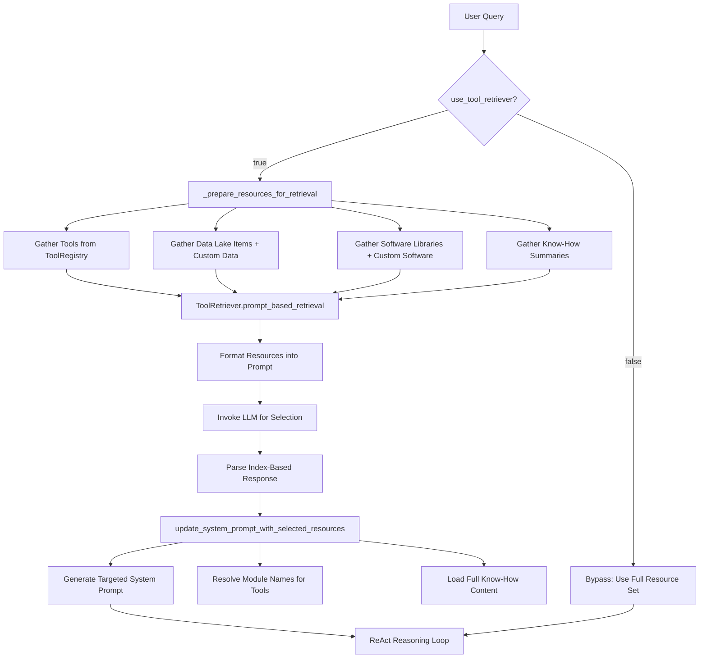

Biomni's tool ecosystem spans hundreds of domain-specific functions across genomics, molecular biology, immunology, and more. Supplying the LLM with every tool description on every query would exceed practical context limits and introduce noise that degrades reasoning quality. Retrieval-Augmented Tool Selection solves this by dispatching an LLM-powered selection phase *before* the reasoning loop begins, curating a query-specific subset of tools, datasets, software libraries, and know-how documents that are injected into the system prompt.

This page dissects the retrieval architecture end-to-end: the resource gathering pipeline, the LLM-based selection mechanism, response parsing, and how selected resources are materialized into the agent's working context.

## Architecture Overview

The retrieval subsystem operates as a pre-processing stage that sits between the user's query and the ReAct reasoning loop. It is controlled by a single configuration flag (`use_tool_retriever`) and executes identically for both synchronous (`go()`) and streaming (`go_stream()`) execution paths.



Sources: [a1.py](biomni/agent/a1.py#L1759-L1772), [retriever.py](biomni/model/retriever.py#L14-L132)

## The Resource Universe: Four Categories

The retriever operates over a unified dictionary keyed by four resource categories. Each category pools both built-in and user-extensible items, ensuring that custom additions participate in retrieval on equal footing with the default inventory.

| Category | Source | Description | Format |
|----------|--------|-------------|--------|
| **tools** | `ToolRegistry.tools` + `add_tool()` registrations | Callable function schemas with name, description, required_parameters | `dict` objects with `name`, `description`, `required_parameters` |
| **data_lake** | Filesystem scan of `data_lake/` + `add_data()` registrations | Dataset files with descriptions from `data_lake_dict` | `{"name": str, "description": str}` |
| **libraries** | `library_content_dict` + `add_software()` registrations | Python/R packages available in the execution environment | `{"name": str, "description": str}` |
| **know_how** | `KnowHowLoader` markdown documents | Best-practice guides, protocols, troubleshooting docs | `{"id": str, "name": str, "description": str}` |

All four categories are assembled in `_prepare_resources_for_retrieval()` [Lines 1646–1757](biomni/agent/a1.py#L1646-L1757). Custom data and software items are merged into their respective pools only if they are not already present, avoiding duplicates [Lines 1674–1688](biomni/agent/a1.py#L1674-L1688). Know-how documents, by contrast, use a two-phase strategy: *summaries* (id + name + short description) are sent to the retriever, while the *full content* is loaded only for documents that pass selection [Lines 1727–1744](biomni/agent/a1.py#L1727-L1744).

Sources: [a1.py](biomni/agent/a1.py#L1658-L1699), [loader.py](biomni/know_how/loader.py#L247-L256)

## The ToolRegistry: Index Space Foundation

The `ToolRegistry` class in [tool_registry.py](biomni/tool/tool_registry.py#L6-L89) provides the indexable backing store for all tool schemas. During initialization, it iterates over the `module2api` dictionary — a nested mapping of module names to API lists — and assigns each tool a sequential integer ID [Lines 7–18](biomni/tool/tool_registry.py#L7-L18). Every tool schema must contain at least `name`, `description`, and `required_parameters` to pass validation [Lines 32–34](biomni/tool/tool_registry.py#L32-L34).

The registry also maintains a `document_df` — a pandas DataFrame with columns `docid` and `document_content` — originally structured to support vector-based retrieval (though the current production path uses prompt-based selection exclusively) [Lines 15–18](biomni/tool/tool_registry.py#L15-L18). When custom tools are added via `A1.add_tool()`, the registry is updated in-place and the DataFrame is rebuilt to reflect the new inventory [Lines 300–312](biomni/agent/a1.py#L300-L312).

Sources: [tool_registry.py](biomni/tool/tool_registry.py#L6-L34), [a1.py](biomni/agent/a1.py#L208-L210)

## Prompt-Based Selection: ToolRetriever.prompt_based_retrieval

The core selection logic lives in `ToolRetriever.prompt_based_retrieval()` [Lines 14–132](biomni/model/retriever.py#L14-L132). Rather than using embedding similarity or BM25, Biomni delegates the selection decision entirely to an LLM call, which receives a structured prompt containing every available resource enumerated with positional indices.

### Prompt Structure

The prompt is composed of two sections concatenated together:

**Resource Catalog** — Each category is listed under a header with resources formatted as `"{index}. {name}: {description}"`. The `_format_resources_for_prompt()` method [Lines 134–152](biomni/model/retriever.py#L134-L152) handles three input polymorphisms: `dict` objects (extracting `name` and `description` keys), plain strings (used as-is), and arbitrary objects (reflecting `name` and `description` attributes).

**Response Format Instructions** — The LLM is instructed to return index lists in a strict machine-parseable format:

```
TOOLS: [0, 3, 5, 7, 9]
DATA_LAKE: [1, 2, 4]
LIBRARIES: [0, 2, 4, 5, 8]
KNOW_HOW: [0, 1]
```

The `KNOW_HOW` category is included only if know-how documents are present in the resources dictionary [Lines 48–71](biomni/model/retriever.py#L48-L71).

### Selection Guidelines

Nine explicit guidelines steer the LLM's selection behavior [Lines 77–87](biomni/model/retriever.py#L77-L87). Two are particularly aggressive in their recall bias:

- **Guideline 2**: *"ALWAYS prioritize database tools for general queries — include as many database tools as possible"*
- **Guideline 4**: *"For wet lab sequence type of queries, ALWAYS include molecular biology tools"*

This recall-oriented design philosophy means the retriever errs on the side of inclusion rather than exclusion. The system prompt preamble reinforces this: *"Be generous in your selection — include resources that might be useful for the task, even if they're not explicitly mentioned"* [Lines 35–36](biomni/model/retriever.py#L35-L36). The practical effect is that the context window receives a *curated superset* of resources, trading some context space for higher recall.

> [!TIP]
> The retriever uses the **same LLM instance** as the agent itself. In `A1.__init__()`, the agent's LLM is passed to `_prepare_resources_for_retrieval()` and forwarded to `prompt_based_retrieval()` via the `llm` parameter. If no LLM is explicitly provided, the retriever falls back to `ChatOpenAI(model="gpt-4o")` [Line 93](biomni/model/retriever.py#L93). This means that in a custom LLM deployment (e.g., Ollama, local vLLM), the selection quality is directly tied to that model's instruction-following capability.

Sources: [retriever.py](biomni/model/retriever.py#L14-L132), [a1.py](biomni/agent/a1.py#L1700-L1702)

## Response Parsing: Regex-Based Index Extraction

The `_parse_llm_response()` method [Lines 154–203](biomni/model/retriever.py#L154-L203) extracts selected indices using four case-insensitive regex patterns:

| Category | Regex Pattern |
|----------|---------------|
| tools | `TOOLS:\s*\[(.*?)\]` |
| data_lake | `DATA_LAKE:\s*\[(.*?)\]` |
| libraries | `LIBRARIES:\s*\[(.*?)\]` |
| know_how | `KNOW[-_]HOW:\s*\[(.*?)\]` |

The parser tolerates both hyphenated and underscored variants of `KNOW_HOW`. It also handles two response formats: plain strings (from LangChain's `invoke()`) and Responses API-style lists of content blocks (`[{"type": "text", "text": "..."}]`) [Lines 160–170](biomni/model/retriever.py#L160-L170). All integer parsing is wrapped in `contextlib.suppress(ValueError)` to gracefully skip malformed entries, and a bounds check (`if i < len(resources.get(...))`) prevents index-out-of-range errors [Lines 108–130](biomni/model/retriever.py#L108-L130).

Sources: [retriever.py](biomni/model/retriever.py#L154-L203)

## From Indices to System Prompt: Resource Materialization

Once the retriever returns selected indices, two transformations occur before the reasoning loop begins.

### Tool Module Resolution

`update_system_prompt_with_selected_resources()` [Lines 1829–1941](biomni/agent/a1.py#L1829-L1941) resolves each selected tool's Python module name by cross-referencing against the `module2api` dictionary [Lines 1839–1848](biomni/agent/a1.py#L1839-L1848). This is critical because the system prompt instructs the LLM to import tools via `from [module_name] import [function_name]`. If a module cannot be resolved, the system defaults to `biomni.tool.scRNA_tools` as a fallback [Lines 1851–1853](biomni/agent/a1.py#L1851-L1853).

### Know-How Content Inflation

For selected know-how documents, the system loads the *full document content* (with metadata already stripped by `KnowHowLoader._strip_metadata()`) rather than the summary that was sent to the retriever [Lines 1727–1744](biomni/agent/a1.py#L1727-L1744). This two-phase approach — summaries for selection, full content for context — minimizes the token cost of the retrieval prompt while ensuring the agent receives complete protocol text when it matters.

### Custom Resource Highlighting

Custom tools, data, and software are extracted from the agent's internal `_custom_tools`, `_custom_data`, and `_custom_software` dictionaries and formatted with emoji prefixes (🔧, 📊, ⚙️) in a dedicated "PRIORITY CUSTOM RESOURCES" section of the system prompt [Lines 1157–1210](biomni/agent/a1.py#L1157-L1210). This ensures that user-registered resources receive prominent placement even when the retriever also selects them.

Sources: [a1.py](biomni/agent/a1.py#L1829-L1941), [loader.py](biomni/know_how/loader.py#L165-L224)

## Execution Integration: go() and go_stream()

Both public execution methods follow an identical retrieval pattern. In `A1.go()` [Lines 1759–1789](biomni/agent/a1.py#L1759-L1789):

```python
if self.use_tool_retriever:
    selected_resources_names = self._prepare_resources_for_retrieval(prompt)
    self.update_system_prompt_with_selected_resources(selected_resources_names)
```

The streaming variant `go_stream()` [Lines 1791–1828](biomni/agent/a1.py#L1791-L1828) mirrors this exactly. In both cases, the system prompt is overwritten *per query*, meaning that different invocations of the same agent instance can receive different resource subsets. When `use_tool_retriever` is `False`, the system prompt is generated once during `configure()` with the full resource inventory.

Sources: [a1.py](biomni/agent/a1.py#L1759-L1789), [a1.py](biomni/agent/a1.py#L1791-L1828)

## Configuration and Environment Control

The retrieval subsystem is governed by a single boolean flag, configurable at three levels of increasing precedence:

| Mechanism | Example | Precedence |
|-----------|---------|------------|
| `BiomniConfig` default | `BiomniConfig(use_tool_retriever=True)` | Lowest |
| Environment variable | `export BIOMNI_USE_TOOL_RETRIEVER=false` | Medium |
| Constructor argument | `A1(use_tool_retriever=False)` | Highest |

The default value in `BiomniConfig` is `True` [Line 40](biomni/config.py#L40), meaning retrieval is active out of the box. The environment variable override supports both string representations and is case-insensitive [Line 66](biomni/config.py#L66).

> [!TIP]
> When `use_tool_retriever=True` in **academic mode**, all know-how documents are included in the retrieval pool. In **commercial mode** (`commercial_mode=True`), documents with metadata fields containing `❌`, `Not Allowed`, or `Non-Commercial` are pre-filtered *before* retrieval occurs. This filtering happens in `_filter_know_how_for_commercial_mode()` [Lines 876–896](biomni/agent/a1.py#L876-L896), meaning the retriever never sees excluded documents.

Sources: [config.py](biomni/config.py#L40-L66), [a1.py](biomni/agent/a1.py#L876-L896)

## Diagnostic Output

When retrieval is active, the system prints a structured diagnostic block to stdout during each `go()` or `go_stream()` invocation [Lines 1703–1757](biomni/agent/a1.py#L1703-L1757):

```
============================================================
🔍 RESOURCE RETRIEVAL
============================================================
Using prompt-based retrieval with the agent's LLM

📚 Know-How Documents Retrieved:
  ✓ sgRNA Design Guide

------------------------------------------------------------
📊 RETRIEVAL SUMMARY:
  🔧 Tools: 47 selected
  📊 Data Lake: 12 selected
  ⚙️  Libraries: 8 selected
  📚 Know-How: 1 selected
============================================================
```

This output is useful for debugging retrieval quality and understanding which resources the LLM deemed relevant for a given query.

Sources: [a1.py](biomni/agent/a1.py#L1703-L1757)

## Navigating Further

- **[Tool Registry and Discovery](12-tool-registry-and-discovery)** for the underlying storage layer that provides the tool index space.
- **[Know-How Library](17-know-how-library)** for how documents are structured, loaded, and filtered before entering the retrieval pool.
- **[A1 Agent Core Class](9-a1-agent-core-class)** for the full agent lifecycle including how `use_tool_retriever` is wired through initialization and configuration.
- **[Configuration Reference](21-configuration-reference)** for all environment variables and `BiomniConfig` fields that control retrieval behavior.