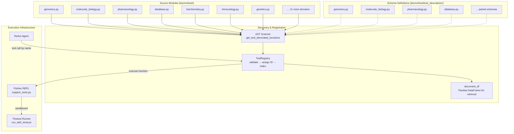
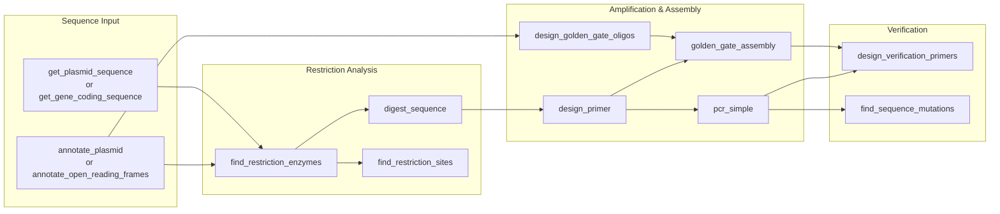

This page documents the complete landscape of Biomni's domain-specific tool implementations — the executable backbone that transforms natural-language research requests into concrete computational biology operations. With over 150 callable tools spanning 18 biological domains plus cross-cutting infrastructure, the system covers the full analytical spectrum from single-cell genomics to drug safety surveillance. Each tool is a self-contained Python function bearing a structured API schema, enabling the agent to invoke them with precise parameterization during ReAct reasoning loops.
Sources: [tool/__init__.py](biomni/tool/__init__.py#L1-L2), [utils.py](biomni/utils.py#L356-L397)

## Architectural Overview

The domain tools follow a deliberately uniform architecture: every module in `biomni/tool/` exports Python functions that are decorated with `@tool` and paired with a corresponding schema definition in `biomni/tool/tool_description/`. The AST-based scanner [`get_tool_decorated_functions()`](biomni/utils.py#L356-L397) walks each module's parse tree, identifies decorated functions, imports the live module, and extracts callable objects for registration in the [`ToolRegistry`](biomni/tool/tool_registry.py#L6-L18). The registry validates that each tool carries the required keys — `name`, `description`, and `required_parameters` — before assigning a sequential integer ID and building a retrieval-ready DataFrame for the embedding-based tool selector.

The critical design constraint is that tools are **plain functions**, not class instances. This keeps invocation trivially serializable and sidesteps state-management complexity. The sole exceptions — `SegmentationTool` and `ImageRegistrationTool` in bioimaging, and `OpenFDAClient` in pharmacology — expose static convenience wrapper functions that internally instantiate the class, preserving the flat-function contract at the registry boundary.
Sources: [tool_registry.py](biomni/tool/tool_registry.py#L32-L34), [bioimaging.py](biomni/tool/bioimaging.py#L30-L579), [pharmacology.py](biomni/tool/pharmacology.py#L3457-L3641)

## Tool Schema Contract

Every tool, regardless of domain, conforms to a single schema contract enforced during registration. The schema is authored as a list of dictionaries in the parallel `tool_description/` modules and merged into the tool registry at startup. The three mandatory fields establish the retrieval vocabulary, while optional parameters and return type hints guide the agent's parameterization decisions.
Sources: [tool_description/genomics.py](biomni/tool/tool_description/genomics.py#L1-L50), [tool_description/database.py](biomni/tool/tool_description/database.py#L1-L50)

| Field | Type | Purpose | Example |
|---|---|---|---|
| `name` | `str` | Unique callable identifier, matches the Python function name | `"annotate_celltype_scRNA"` |
| `description` | `str` | Natural-language summary used for semantic retrieval | *"Annotate cell types based on gene markers and transferred labels using LLM"* |
| `required_parameters` | `list[dict]` | Each dict has `name`, `type`, `description`, `default` | `[{"name": "adata_filename", "type": "str", ...}]` |
| `optional_parameters` | `list[dict]` | Same structure; agent may omit these | `[{"name": "cluster", "default": "leiden", ...}]` |
| `id` | `int` | Auto-assigned sequential ID by ToolRegistry | Assigned at registration |

The `process_bio_retrieval_ducoment()` utility in [`utils.py`](biomni/utils.py#L400-L430) concatenates name, description, required params, and optional params into a single retrieval corpus string — this is what the embedding model sees when the retriever scores candidate tools for a given user query.
Sources: [utils.py](biomni/utils.py#L400-L430)

## Domain Modules: Full Catalog

The following table enumerates every domain implementation module, its scope, the number of exported tools, and representative capabilities. Module size (in lines of code) serves as a proxy for implementation depth.

| Module | LOC | Tools | Representative Functions | Core Dependencies |
|---|---|---|---|---|
| **database.py** | 4,975 | ~30 | `query_uniprot`, `query_alphafold`, `query_kegg`, `blast_sequence`, `query_clinvar`, `query_gnomad`, `query_reactome`, `query_pubchem`, `query_chembl` | REST APIs, Entrez, Biopython |
| **pharmacology.py** | 4,283 | ~22 | `run_diffdock_with_smiles`, `predict_admet_properties`, `query_drug_interactions`, `check_drug_combination_safety`, `analyze_fda_safety_signals` | DiffDock, AutoDock Vina, OpenFDA |
| **genomics.py** | 2,760 | ~18 | `annotate_celltype_scRNA`, `gene_set_enrichment_analysis`, `perform_chipseq_peak_calling_with_macs2`, `generate_transcriptformer_embeddings` | scanpy, popV, MACS2, HOMER |
| **molecular_biology.py** | 2,223 | ~15 | `annotate_plasmid`, `design_knockout_sgrna`, `golden_gate_assembly`, `digest_sequence`, `design_verification_primers` | Biopython, primer3-py |
| **genetics.py** | 1,673 | ~10 | `liftover_coordinates`, `analyze_cas9_mutation_outcomes`, `simulate_demographic_history`, `fit_genomic_prediction_model` | pyliftover, msprime, scikit-allel |
| **immunology.py** | 1,973 | ~9 | `analyze_cfse_cell_proliferation`, `analyze_cytokine_production_in_cd4_tcells`, `track_immune_cells_under_flow` | FlowCytometryTools, TrackPy |
| **synthetic_biology.py** | 1,352 | ~7 | `optimize_codons_for_heterologous_expression`, `simulate_gene_circuit_with_growth_feedback`, `create_biochemical_network_sbml_model` | SBML, tellurium |
| **cell_biology.py** | 743 | 5 | `quantify_cell_cycle_phases_from_microscopy`, `analyze_flow_cytometry_immunophenotyping`, `perform_facs_cell_sorting` | CellProfiler, FlowCytometryTools |
| **cancer_biology.py** | 1,293 | ~5 | `detect_and_annotate_somatic_mutations`, `perform_gene_expression_nmf_analysis`, `analyze_copy_number_purity_ploidy_and_focal_events` | pysam, Snpeff, seaborn |
| **systems_biology.py** | 927 | 6 | `perform_flux_balance_analysis`, `simulate_metabolic_network_perturbation`, `compare_protein_structures` | cobra, PySB, BioPDB |
| **biochemistry.py** | 1,027 | 5 | `analyze_enzyme_kinetics_assay`, `analyze_itc_binding_thermodynamics`, `analyze_protein_conservation` | numpy, scipy, Biopython |
| **bioengineering.py** | 1,388 | ~6 | `analyze_cell_migration_metrics`, `analyze_in_vitro_drug_release_kinetics`, `simulate_whole_cell_ode_model` | TrackPy, scipy.integrate |
| **physiology.py** | 1,360 | ~10 | `analyze_ciliary_beat_frequency`, `perform_cosinor_analysis`, `quantify_amyloid_beta_plaques` | scipy.signal, numpy |
| **pathology.py** | 1,035 | ~7 | `analyze_bone_microct_morphometry`, `segment_and_quantify_cells_in_multiplexed_images`, `analyze_thrombus_histology` | scikit-image, numpy |
| **bioimaging.py** | 1,395 | ~12 | `segment_with_nn_unet`, `quick_rigid_registration`, `quick_affine_registration`, `quick_deformable_registration` | nnUNet, SimpleITK, torch |
| **biophysics.py** | 514 | 3 | `predict_protein_disorder_regions`, `analyze_cell_morphology_and_cytoskeleton`, `analyze_tissue_deformation_flow` | scikit-image, TrackPy |
| **microbiology.py** | 1,619 | ~11 | `annotate_bacterial_genome`, `simulate_generalized_lotka_volterra_dynamics`, `predict_rna_secondary_structure` | Prokka, ViennaRNA |
| **glycoengineering.py** | 147 | 3 | `find_n_glycosylation_motifs`, `predict_o_glycosylation_hotspots`, `list_glycoengineering_resources` | Pure Python (lightweight) |
| **literature.py** | 404 | 7 | `query_pubmed`, `query_arxiv`, `query_scholar`, `extract_pdf_content`, `advanced_web_search_claude` | Biopython, arxiv, scholarly |

## Database Query Integration Layer

The `database.py` module is the system's largest and most interconnected domain module, providing a unified gateway to over 30 external bioinformatics databases and APIs. Each query function follows a consistent two-tier dispatch pattern: the agent provides a natural-language `prompt` (and optionally a specific `endpoint`), and the function resolves the appropriate API call through a schema-driven LLM routing step or a direct endpoint lookup. The schema databases stored as pickle files in [`tool/schema_db/`](biomni/tool/schema_db/) (e.g., `uniprot.pkl`, `kegg.pkl`, `pubchem.pkl`, `chembl.pkl`) pre-define the available endpoints and parameter structures for each external service.
Sources: [database.py](biomni/tool/database.py#L111-L205), [database.py](biomni/tool/database.py#L448-L544)

The query functions fall into four architectural categories based on how they resolve the agent's intent:

**Schema-routed queries** accept a natural-language `prompt` and use an LLM to select the correct API endpoint from the pre-serialized schema. Functions like [`query_uniprot()`](biomni/tool/database.py#L448-L544), [`query_kegg()`](biomni/tool/database.py#L1030-L1119), and [`query_stringdb()`](biomni/tool/database.py#L1119-L1286) follow this pattern. The `_query_llm_for_api()` helper sends the schema, available endpoints, and the user prompt to a small language model, which returns a structured endpoint-and-parameters dict.

**Direct-endpoint queries** allow the agent to specify an explicit API endpoint URL, bypassing LLM routing. This is used when the ReAct agent has already identified the exact resource. Functions like [`query_alphafold()`](biomni/tool/database.py#L544-L693), [`query_pdb()`](biomni/tool/database.py#L800-L917), and [`query_pdb_identifiers()`](biomni/tool/database.py#L917-L1030) accept an `endpoint` parameter for targeted retrieval.

**NCBI Entrez queries** leverage Biopython's Entrez module for standardized access to NCBI databases. The internal [`_query_ncbi_database()`](biomni/tool/database.py#L199-L317) handles E-utilities calls with built-in rate limiting and result formatting.

**GraphQL queries** target APIs like Open Targets, which expose a GraphQL interface. The [`execute_graphql_query()`](biomni/utils.py#L341-L346) utility in `utils.py` provides the transport layer, and [`query_opentarget()`](biomni/tool/database.py#L2315-L2415) wraps it with prompt-driven parameter extraction.

> [!TIP]
> The `prompt` parameter in database query tools is not merely documentation — it is the primary dispatch mechanism. When the ReAct agent calls `query_uniprot(prompt="Find kinase domains in human proteins")`, this string is routed to a small LLM that maps it against the UniProt API schema to select the correct endpoint and parameters. Omitting `prompt` and providing only `endpoint` skips this routing step entirely, yielding faster but more brittle invocations.

## Molecular Biology Workbench

The [`molecular_biology.py`](biomni/tool/molecular_biology.py) module implements a complete in-silico cloning and sequence engineering pipeline. Its tools form a coherent workflow chain: from plasmid annotation through restriction analysis, PCR simulation, primer design, and multi-fragment assembly. This is one of the most deeply integrated modules, where tool outputs naturally feed into downstream tool inputs.
Sources: [molecular_biology.py](biomni/tool/molecular_biology.py#L167-L958)

Key implementation details: [`annotate_plasmid()`](biomni/tool/molecular_biology.py#L167-L252) performs *de novo* ORF detection and feature annotation on arbitrary sequences, supporting both linear and circular topologies. [`digest_sequence()`](biomni/tool/molecular_biology.py#L602-L725) uses BioPython's restriction enzyme library to perform in-silico digests, returning fragment sizes and cut positions. The [`golden_gate_assembly()`](biomni/tool/molecular_biology.py#L1849-L2223) function simulates Type IIS restriction-ligation assembly, checking for compatible overhangs and predicting assembly outcomes.
Sources: [molecular_biology.py](biomni/tool/molecular_biology.py#L167-L252), [molecular_biology.py](biomni/tool/molecular_biology.py#L602-L725), [molecular_biology.py](biomni/tool/molecular_biology.py#L1849-L2223)

## Pharmacology and Drug Safety

The [`pharmacology.py`](biomni/tool/pharmacology.py) module is the second-largest implementation and covers the drug discovery-to-safety continuum. It spans molecular docking, ADMET prediction, drug-drug interaction querying, and FDA regulatory surveillance. Notably, this module contains the [`OpenFDAClient`](biomni/tool/pharmacology.py#L3457-L3641) class — one of the few OOP patterns in the tool layer — which wraps the OpenFDA REST API with retry logic, rate limiting, and structured response parsing.
Sources: [pharmacology.py](biomni/tool/pharmacology.py#L13-L14), [pharmacology.py](biomni/tool/pharmacology.py#L3457-L3641)

| Sub-domain | Tools | Data Sources |
|---|---|---|
| Molecular Docking | `run_diffdock_with_smiles`, `docking_autodock_vina`, `run_autosite` | PDB structures, SMILES inputs |
| ADMET & Binding | `predict_admet_properties`, `predict_binding_affinity_protein_1d_sequence`, `calculate_physicochemical_properties` | Graph neural networks, MPNN models |
| Drug Repurposing | `retrieve_topk_repurposing_drugs_from_disease_txgnn` | TxGNN pretrained model + data lake |
| Drug Interactions | `query_drug_interactions`, `check_drug_combination_safety`, `analyze_interaction_mechanisms`, `find_alternative_drugs_ddinter` | DDInter database (data lake) |
| FDA Surveillance | `query_fda_adverse_events`, `get_fda_drug_label_info`, `check_fda_drug_recalls`, `analyze_fda_safety_signals` | OpenFDA API |
| Preclinical | `analyze_xenograft_tumor_growth_inhibition`, `analyze_accelerated_stability_of_pharmaceutical_formulations`, `grade_adverse_events_using_vcog_ctcae` | CSV/Excel data files |
| Imaging Analysis | `analyze_western_blot`, `analyze_pixel_distribution`, `find_roi_from_image` | Blot images, microscopy |

The drug interaction subsystem is particularly sophisticated. [`query_drug_interactions()`](biomni/tool/pharmacology.py#L2801-L2932) loads the DDInter dataset from the data lake, builds an interaction matrix with standardized drug name mapping, and supports filtering by interaction type and severity. [`check_drug_combination_safety()`](biomni/tool/pharmacology.py#L2932-L3097) extends this to accept an arbitrary drug list and returns a comprehensive safety assessment including mechanism-of-action analysis and clinical management recommendations.
Sources: [pharmacology.py](biomni/tool/pharmacology.py#L2460-L2694), [pharmacology.py](biomni/tool/pharmacology.py#L2801-L2932)

> [!TIP]
> Several pharmacology tools depend on data lake files (e.g., DDInter interaction data, TxGNN model checkpoints) that are not bundled with the repository. The `data_lake_path` parameter is required for `query_drug_interactions`, `check_drug_combination_safety`, and `retrieve_topk_repurposing_drugs_from_disease_txgnn`. If these files are absent, the tools fall back to returning guidance messages rather than raising hard errors. See [Data Lake Management](16-data-lake-management) for setup instructions.

## Single-Cell and Omics Analysis (Genomics)

The [`genomics.py`](biomni/tool/genomics.py) module addresses the single-cell transcriptomics and epigenomics workflow. It provides end-to-end capabilities from raw data processing through embedding generation, cell type annotation, and gene set enrichment. The module is notable for integrating multiple embedding strategies (scVI, Harmony, UCE, STATE, TranscriptFormer) and offering both automated LLM-based and reference-mapping approaches to cell type annotation.
Sources: [genomics.py](biomni/tool/genomics.py#L463-L870)

The [`unsupervised_celltype_transfer_between_scRNA_datasets()`](biomni/tool/genomics.py#L18-L107) function serves as a meta-orchestrator: it accepts an annotated reference and an unannotated query dataset, then runs one or more of ten transfer methods (SCANVI_POPV, KNN-BBKNN, KNN-Harmony, ONCLASS, etc.) selected via boolean flags. This multi-method approach lets the agent compare annotation strategies. The [`annotate_celltype_scRNA()`](biomni/tool/genomics.py#L463-L600) function takes a different approach — it performs Leiden clustering, extracts differentially expressed genes, and sends them to a large language model for semantic cell type naming, bridging computational analysis with domain knowledge.
Sources: [genomics.py](biomni/tool/genomics.py#L18-L107), [genomics.py](biomni/tool/genomics.py#L463-L600)

For epigenomics, [`perform_chipseq_peak_calling_with_macs2()`](biomni/tool/genomics.py#L1617-L1794) wraps the MACS2 peak caller, while [`find_enriched_motifs_with_homer()`](biomni/tool/genomics.py#L1794-L1965) chains peak calling into motif discovery. The [`analyze_chromatin_interactions()`](biomni/tool/genomics.py#L1091-L1424) and [`analyze_genomic_region_overlap()`](biomni/tool/genomics.py#L1965-L2167) functions handle Hi-C data and comparative genomics respectively, completing the epigenomic analysis pipeline.
Sources: [genomics.py](biomni/tool/genomics.py#L1617-L1965), [genomics.py](biomni/tool/genomics.py#L1091-L1424)

## Bioimaging: OOP Within the Flat-Function Paradigm

The [`bioimaging.py`](biomni/tool/bioimaging.py) module is architecturally distinct: it defines two stateful tool classes — [`SegmentationTool`](biomni/tool/bioimaging.py#L30-L579) and [`ImageRegistrationTool`](biomni/tool/bioimaging.py#L579-L868) — but exposes them through stateless convenience functions that the registry can index. This hybrid pattern allows internal complexity (model downloading, environment setup, multi-step pipelines) while maintaining the flat-function contract at the agent boundary.
Sources: [bioimaging.py](biomni/tool/bioimaging.py#L30-L579), [bioimaging.py](biomni/tool/bioimaging.py#L959-L1009)

The segmentation pipeline leverages nnUNet for medical image segmentation with automatic model downloading from Zenodo. [`segment_with_nn_unet()`](biomni/tool/bioimaging.py#L977-L1006) handles the full workflow: modality splitting for BRATS-style multi-channel inputs, environment variable configuration, model inference with optional test-time augmentation, and visualization generation. The registration pipeline uses SimpleITK and provides three transform levels — [`quick_rigid_registration()`](biomni/tool/bioimaging.py#L1034-L1109), [`quick_affine_registration()`](biomni/tool/bioimaging.py#L1110-L1185), and [`quick_deformable_registration()`](biomni/tool/bioimaging.py#L1186-L1263) — each with preprocessing, multi-metric optimization, and similarity scoring.
Sources: [bioimaging.py](biomni/tool/bioimaging.py#L977-L1006), [bioimaging.py](biomni/tool/bioimaging.py#L1034-L1263)

## Literature and Knowledge Retrieval

The [`literature.py`](biomni/tool/literature.py) module provides the agent's window into external scientific knowledge. It implements both direct database queries (PubMed, arXiv, Google Scholar) and broader web search capabilities through Claude-powered search with content extraction. [`query_pubmed()`](biomni/tool/literature.py#L144-L185) uses Biopython's Entrez interface with configurable result limits and retry logic, while [`advanced_web_search_claude()`](biomni/tool/literature.py#L218-L303) chains web search with URL content extraction for accessing paywalled or supplementary materials. The [`fetch_supplementary_info_from_doi()`](biomni/tool/literature.py#L13-L89) function resolves DOIs to supplementary data downloads.
Sources: [literature.py](biomni/tool/literature.py#L13-L303)

## Protocol Retrieval System

The [`protocols.py`](biomni/tool/protocols.py) module operates alongside a curated local protocol library stored in [`tool/protocols/`](biomni/tool/protocols/) containing approximately 100+ text files from two major sources: **Addgene** (47 protocols covering molecular cloning, virus production, and general lab techniques) and **Thermo Fisher Scientific** (38 protocols covering flow cytometry, cell culture, staining, and viability assays). The module provides three operations: [`search_protocols()`](biomni/tool/protocols.py#L29-L133) queries the protocols.io API, [`list_local_protocols()`](biomni/tool/protocols.py#L180-L242) enumerates the local text library with optional source filtering, and [`read_local_protocol()`](biomni/tool/protocols.py#L243-L306) retrieves the full text of a specific protocol. This dual local/remote architecture ensures the agent can access standardized lab procedures even without internet connectivity.
Sources: [protocols.py](biomni/tool/protocols.py#L29-L306), [protocols/](biomni/tool/protocols/)

## Support and Execution Infrastructure

Beyond domain-specific tools, the [`support_tools.py`](biomni/tool/support_tools.py) module provides the runtime execution substrate. Its centerpiece is [`run_python_repl()`](biomni/tool/support_tools.py#L13-L46), a persistent Python REPL that maintains variable state across invocations — this is how the agent chains multi-step analyses where intermediate results must persist. The module also includes automatic matplotlib plot capture through monkey-patching ([`_apply_matplotlib_patches()`](biomni/tool/support_tools.py#L81-L128)), enabling the agent to generate and return visualizations without explicit file I/O. The [`read_function_source_code()`](biomni/tool/support_tools.py#L141-L198) function lets the agent introspect tool implementations at runtime, supporting self-documenting behavior during complex reasoning chains.
Sources: [support_tools.py](biomni/tool/support_tools.py#L13-L198)

## Execution Model and Timeout Safety

All tool functions execute within a timeout wrapper defined by [`run_with_timeout()`](biomni/utils.py#L183-L244), which defaults to 600 seconds per invocation. This threading-based timeout (rather than multiprocessing) is a deliberate choice: it preserves the global variable namespace across calls, which is essential for the persistent REPL pattern. When a timeout occurs, the function returns an error string rather than raising an exception, allowing the agent's ReAct loop to gracefully recover and attempt alternative approaches.
Sources: [utils.py](biomni/utils.py#L183-L244)

## Cross-References

- The mechanism by which the agent selects among these tools at runtime is covered in [Retrieval-Augmented Tool Selection](13-retrieval-augmented-tool-selection).
- How tools are registered, validated, and indexed is detailed in [Tool Registry and Discovery](12-tool-registry-and-discovery).
- For extending the system with new domain tools, see [Custom Tools and Data](18-custom-tools-and-data).
- Database schema files and their role in query routing are described in [Database Query Integrations](15-database-query-integrations).
- Environment dependencies required by these tools are documented in [Environment Setup and Dependencies](22-environment-setup-and-dependencies).