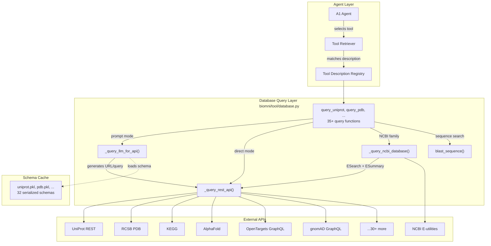
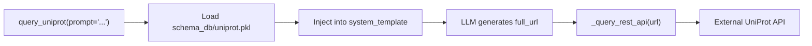
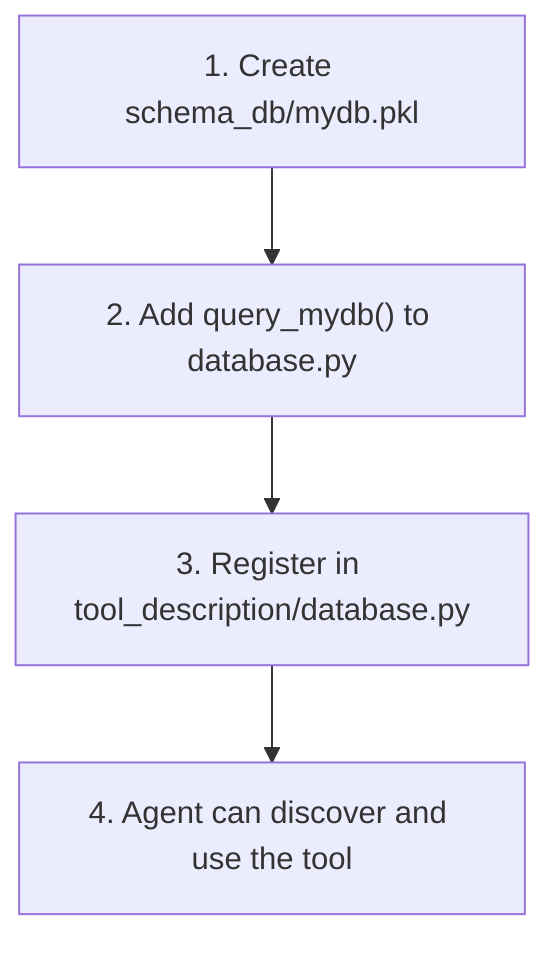

Biomni abstracts over **35+ external biological databases** through a unified natural-language query interface, converting free-form scientific questions into structured API calls. This layer is the primary bridge between the agent's reasoning engine and the vast landscape of publicly available bioinformatics resources — from protein structure databases like AlphaFold and PDB, through genomic variant repositories like ClinVar and gnomAD, to drug databases like ChEMBL and OpenFDA. The entire system is defined in a single, ~5000-line module that follows a remarkably consistent architectural pattern across all integrations.

## Architectural Overview

The database integration layer sits between the agent's tool-selection mechanism and the external API surface. Every query function follows a dual-mode design: it accepts either a **natural language prompt** (which an LLM translates into a structured API call) or a **direct endpoint/parameter** (which bypasses LLM mediation entirely). This duality enables both autonomous agent operation and programmatic direct usage.

The key insight is that **every query function is both a tool for the agent and a standalone API**. The agent discovers them through the tool description registry, but developers can call them directly with either natural language or structured parameters.

Sources: [database.py](biomni/tool/database.py#L1-L16), [database.py](biomni/tool/database.py#L448-L468)

## The Three Integration Patterns

All 35+ database integrations fall into one of three architectural patterns, distinguished by how the natural-language prompt is translated into an API request and what protocol the target database speaks.

### Pattern 1: LLM-Mediated REST API Translation

This is the most common pattern, used by databases that expose REST APIs with complex URL structures and query syntax. The flow is: **prompt → LLM (with schema) → URL construction → REST call**. The LLM receives a serialized API schema from a `.pkl` file and a domain-specific system prompt that encodes the API's conventions. It returns a JSON object containing the complete URL and a description of what the query does.

UniProt exemplifies this pattern perfectly. When a user asks "Find information about human insulin," the function loads `schema_db/uniprot.pkl`, constructs a system prompt that teaches the LLM about UniProt's accession formats, organism taxonomy IDs, and query fields, then sends the natural language to the configured LLM. The LLM returns something like `{"full_url": "https://rest.uniprot.org/uniprotkb/search?query=insulin+AND+organism_id:9606", "description": "..."}`, and the function passes that URL directly to `_query_rest_api()`.

Sources: [database.py](biomni/tool/database.py#L448-L543), [database.py](biomni/tool/database.py#L693-L800)

### Pattern 2: LLM-Mediated Query Generation for Structured APIs

Some databases — particularly GraphQL endpoints and NCBI E-utilities — don't accept URLs with query parameters but instead expect structured JSON or specialized query syntax. Here, the LLM generates a **query object** (a JSON search request for PDB, a GraphQL string for OpenTargets, or a search term string for ClinVar) rather than a URL.

For example, `query_pdb()` asks the LLM to generate a structured RCSB Search API JSON document with terminal nodes, group operators, and return types. `query_clinvar()` asks the LLM to produce a ClinVar-syntax search string like `"BRCA1[gene] AND clinsig_pathogenic[prop]"` which is then passed to `_query_ncbi_database()`. `query_gnomad()` and `query_opentarget()` generate full GraphQL query strings with variable bindings.

Sources: [database.py](biomni/tool/database.py#L1824-L1906), [database.py](biomni/tool/database.py#L2315-L2400), [database.py](biomni/tool/database.py#L2753-L2850)

### Pattern 3: Direct Programmatic APIs

A small number of integrations bypass LLM mediation entirely because their APIs are simple enough (or unique enough) to warrant direct programmatic access. These include `query_alphafold()` (which constructs URLs from a UniProt ID, endpoint type, and model version), `blast_sequence()` (which uses BioPython's `NCBIWWW.qblast`), and the ENCODE Screen API functions `region_to_ccre_screen()` and `get_genes_near_ccre()` which accept genomic coordinates directly.

Sources: [database.py](biomni/tool/database.py#L544-L692), [database.py](biomni/tool/database.py#L2852-L2953), [database.py](biomni/tool/database.py#L3409-L3575)

## Infrastructure Layer: The Shared Query Engine

Four internal helper functions form the backbone of all database integrations. Understanding them is essential for anyone extending the system.

### `_query_rest_api()` — The Universal HTTP Client

This function is the lowest-level building block, handling GET and POST requests with uniform error handling, JSON parsing, and response wrapping. Every REST API integration eventually routes through this function. It returns a standardized dictionary with `success`, `query_info`, and `result` (or `error`) keys, ensuring that all 35+ query functions produce consistent output shapes for downstream consumers.

The error handling is particularly robust: it inspects HTTP error responses for known error key patterns (`messages`, `message`, `error`, `detail`) and extracts the most informative message rather than propagating raw HTTP status text.

Sources: [database.py](biomni/tool/database.py#L111-L198)

### `_query_llm_for_api()` — The NL-to-API Translator

This function takes a natural language prompt, a serialized schema dictionary, and a system prompt template (with a `{schema}` placeholder). It loads the LLM model from the global configuration (`default_config.llm`), formats the schema into the template, invokes the LLM, and then extracts a JSON object from the response by finding the first `{` and last `}` boundaries. This boundary-detection approach gracefully handles LLMs that prepend or append explanatory text around the JSON.

Sources: [database.py](biomni/tool/database.py#L36-L110)

### `_query_ncbi_database()` — The NCBI E-Utilities Pipeline

NCBI hosts multiple databases (ClinVar, GEO, dbSNP, PubChem) through a unified E-utilities interface. This helper implements the two-step NCBI workflow: first an ESearch request to get matching record IDs (using the history server for efficiency), then an ESummary request to fetch details for those IDs. Functions like `query_clinvar()`, `query_geo()`, and `query_dbsnp()` all delegate to this after the LLM generates the appropriate search term.

Sources: [database.py](biomni/tool/database.py#L199-L316)

### `_format_query_results()` — The Response Condenser

Many database APIs return verbose responses with nested structures that would overwhelm the agent's context window. This recursive formatter applies configurable rules: it truncates long strings, summarizes long lists (showing a sample with count metadata), limits recursion depth, and can include or exclude specific top-level keys. The default configuration caps list items at 5, string length at 100 characters, and excludes `raw_response`, `debug_info`, and `request_details` keys.

Sources: [database.py](biomni/tool/database.py#L317-L447)

> [!TIP]
> Every database query function returns a **consistent dictionary shape** — either `{"success": True, "query_info": {...}, "result": ...}` or `{"success": False, "error": "..."}`. When building custom tools or extending the system, always wrap your API calls through `_query_rest_api()` to maintain this contract. The agent's error recovery logic depends on this uniformity.

## Complete Database Catalog

The system integrates with 35+ databases spanning every major domain of biology. The following table provides a comprehensive reference organized by biological domain, including the API protocol and integration pattern used for each.

| Domain | Function | Target Database | Protocol | Pattern |
|--------|----------|----------------|----------|---------|
| **Protein Structure** | `query_alphafold` | AlphaFold DB | REST (direct) | Direct API |
| | `query_pdb` | RCSB PDB | REST POST (search) | LLM → JSON query |
| | `query_pdb_identifiers` | RCSB PDB | REST (data) | Direct API |
| | `query_emdb` | EMDB (cryo-EM) | REST | LLM-mediated |
| **Protein Sequence & Function** | `query_uniprot` | UniProt | REST | LLM-mediated |
| | `query_interpro` | InterPro | REST | LLM-mediated |
| | `query_stringdb` | STRING DB | REST | LLM-mediated |
| | `query_quickgo` | QuickGO | REST | LLM-mediated |
| | `blast_sequence` | NCBI BLAST | BioPython | Direct (BioPython) |
| **Genomics & Genetics** | `query_clinvar` | ClinVar | NCBI E-utils | LLM → search term → E-utils |
| | `query_geo` | GEO | NCBI E-utils | LLM → search term → E-utils |
| | `query_dbsnp` | dbSNP | NCBI E-utils | LLM → search term → E-utils |
| | `query_gnomad` | gnomAD | GraphQL | LLM → GraphQL query |
| | `query_gwas_catalog` | GWAS Catalog | REST | LLM-mediated |
| | `query_ensembl` | Ensembl | REST | LLM-mediated |
| | `query_ucsc` | UCSC Genome Browser | REST | LLM-mediated |
| | `query_kegg` | KEGG | REST | LLM-mediated |
| | `query_encode` | ENCODE | REST | LLM-mediated |
| | `region_to_ccre_screen` | ENCODE Screen | REST POST | Direct API |
| | `get_genes_near_ccre` | ENCODE Screen | REST POST | Direct API |
| | `query_remap` | ReMap | REST | LLM-mediated |
| | `query_regulomedb` | RegulomeDB | REST | LLM-mediated |
| **Pathways & Networks** | `query_reactome` | Reactome | REST | LLM-mediated |
| | `query_kegg` | KEGG | REST | LLM-mediated |
| | `query_stringdb` | STRING DB | REST | LLM-mediated |
| **Genomics & Epigenomics** | `query_monarch` | Monarch Initiative | REST | LLM-mediated |
| **Cancer Biology** | `query_cbioportal` | cBioPortal | REST | LLM-mediated |
| **Pharmacology & Drug Discovery** | `query_pubchem` | PubChem | REST | LLM-mediated |
| | `query_chembl` | ChEMBL | REST | LLM-mediated |
| | `query_unichem` | UniChem | REST | LLM-mediated |
| | `query_openfda` | OpenFDA | REST | LLM-mediated |
| | `query_clinicaltrials` | ClinicalTrials.gov | REST | LLM-mediated |
| | `query_dailymed` | DailyMed | REST | LLM-mediated |
| | `query_gtopdb` | Guide to Pharmacology | REST | LLM-mediated |
| | `query_opentarget` | Open Targets | GraphQL | LLM → GraphQL query |
| **Transcriptomics & Proteomics** | `query_pride` | PRIDE | REST | LLM-mediated |
| | `query_mpd` | Mouse Phenome DB | REST | LLM-mediated |
| | `query_synapse` | Synapse (Sage) | REST | LLM-mediated |
| **Taxonomy & Evolution** | `query_iucn` | IUCN Red List | REST | LLM-mediated |
| | `query_paleobiology` | Paleobiology DB | REST | LLM-mediated |
| | `query_worms` | WoRMS | REST | LLM-mediated |
| **Gene Regulation** | `query_jaspar` | JASPAR | REST | LLM-mediated |

Sources: [database.py](biomni/tool/database.py#L448-L4975), [schema_db/](biomni/tool/schema_db/)

## Schema Cache: How the LLM Learns API Structure

The `schema_db/` directory contains 32 serialized Python pickle files — one for each LLM-mediated database integration. These schemas are loaded at query time by the respective query function and injected into the LLM's system prompt. Each schema captures the API's endpoint structure, available operations, required parameters, and domain-specific conventions.

The file naming convention is straightforward: the pickle file name matches the database name used in the function (e.g., `uniprot.pkl` for `query_uniprot`, `pdb.pkl` for `query_pdb`, `gnomad.pkl` for `query_gnomad`). The contents vary by API complexity — REST API schemas typically document URL patterns, query parameters, and response formats, while GraphQL schemas document types, queries, and mutations.

> [!TIP]
> Schema files are binary pickles, not editable text. To update a database's schema, you must regenerate the `.pkl` file programmatically. When adding a new database integration, follow the convention: create a schema pickle in `schema_db/`, add the query function in `database.py`, and register its description in `tool_description/database.py`.

Sources: [schema_db/](biomni/tool/schema_db/), [database.py](biomni/tool/database.py#L480-L485)

## Tool Discovery: How the Agent Finds Database Tools

The agent doesn't call database functions directly by name. Instead, it uses the [Retrieval-Augmented Tool Selection](13-retrieval-augmented-tool-selection) system, which matches natural language queries against tool descriptions stored in `tool_description/database.py`. This file contains a structured list where each entry specifies the function name, a human-readable description, required parameters, and optional parameters with their types and defaults.

When the agent receives a task like "Find pathogenic BRCA1 variants," the retriever scores all tool descriptions against this query and selects the most relevant ones — in this case, `query_clinvar` and possibly `query_gnomad` or `query_cbioportal`. The agent then invokes the selected tool with an appropriate prompt, which triggers the LLM-mediated translation pipeline described above.

Sources: [tool_description/database.py](biomni/tool/tool_description/database.py#L1-L100), [retriever.py](biomni/model/retriever.py#L8-L16)

## Adding a New Database Integration

To integrate a new database, you need to create artifacts in three locations. The process follows a consistent pattern that mirrors the existing 35+ integrations.

**Step 1 — Create the schema file.** Generate a pickle file capturing the target API's endpoint structure, parameters, and conventions. Place it in `schema_db/<dbname>.pkl`.

**Step 2 — Implement the query function.** Add a `query_<dbname>()` function to `database.py`. Follow the established dual-mode pattern: accept both `prompt` (for LLM-mediated mode) and `endpoint`/`query`/`search_term` (for direct mode). Use `_query_llm_for_api()` with a domain-specific system template for NL translation, and `_query_rest_api()` for the actual HTTP call. Return the standardized dictionary format.

**Step 3 — Register the tool description.** Add an entry to the `description` list in `tool_description/database.py` with the function name, description text, required parameters, and optional parameters (including types and defaults).

For detailed guidance on the full tool registration lifecycle, including testing and validation, see [Custom Tools and Data](18-custom-tools-and-data). For understanding how the agent selects among all available tools at inference time, see [Retrieval-Augmented Tool Selection](13-retrieval-augmented-tool-selection).

Sources: [database.py](biomni/tool/database.py#L36-L110), [database.py](biomni/tool/database.py#L111-L198), [tool_description/database.py](biomni/tool/tool_description/database.py#L1-L100)

## Error Handling and Resilience

Every layer of the database query stack has its own error handling strategy. `_query_rest_api()` catches `requests.exceptions.RequestException` and inspects response bodies for structured error messages. `_query_llm_for_api()` catches `JSONDecodeError` when the LLM fails to produce valid JSON, and wraps all other exceptions with descriptive messages. `blast_sequence()` implements retry logic with a 10-minute timeout for long-running NCBI BLAST jobs. The NCBI pipeline gracefully handles zero-result searches by returning an empty `formatted_results` array with a `total_results: 0` count, allowing the agent to reason about the absence of data rather than encountering an exception.

This layered error handling means that even if an external API is temporarily unavailable or returns unexpected data, the agent receives a structured error response it can reason about — potentially trying an alternative database or adjusting its query strategy.
