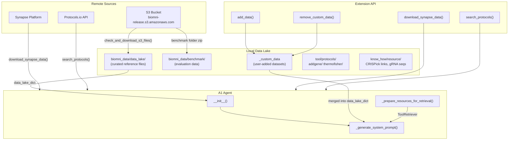
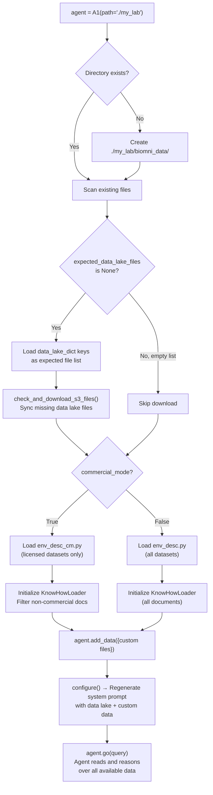

Biomni's data lake is the centralized knowledge substrate that grounds every agent interaction in real biological data. Rather than relying solely on LLM parametric memory, the agent reads, retrieves from, and enriches its reasoning with curated local files — from reference ontologies and gene annotation tables to experiment-specific datasets you provide at runtime. This page covers the architecture, lifecycle, and extensibility of that data layer.

## Architecture Overview

The data lake sits at the intersection of three subsystems: the **agent core** that consumes it, the **S3 sync pipeline** that provisions it, and the **runtime extension API** that lets you grow it. Understanding how these connect clarifies every subsequent management operation.



## Storage Layout and Conventions

When the `A1` agent initializes, it creates a standardized directory tree under the configured `path` (defaulting to `./data`). All curated reference files land inside `biomni_data/data_lake/`, while benchmark evaluation data occupies `biomni_data/benchmark/`. The constructor orchestrates both directories and triggers the download pipeline for any missing artifacts [Sources: [a1.py](/biomni/agent/a1.py#L149-L194)].

```
{path}/                              # Configurable via BiomniConfig.path (default: "./data")
└── biomni_data/
    ├── data_lake/                   # Curated reference files (downloaded from S3)
    │   ├── hp.obo                   # HPO ontology for phenotype annotation
    │   ├── gene_annotation.tsv      # Gene reference data
    │   └── ...                      # Additional reference datasets
    ├── benchmark/                   # Evaluation benchmark data
    │   └── hle/                     # HLE benchmark tasks
    └── (agent working files)
```

The **data lake dictionary** (`data_lake_dict`) defined in [env_desc.py](/biomni/env_desc.py#L1-L80) maps each filename to a human-readable description. This dictionary serves two purposes: it drives the automated S3 download check by listing expected files, and it provides the agent with semantic context about what each file contains when generating the system prompt. In commercial mode, the agent switches to [env_desc_cm.py](/biomni/env_desc_cm.py#L1) which filters out datasets restricted to non-commercial use [Sources: [a1.py](/biomni/agent/a1.py#L100-L113)].

## The S3 Sync Pipeline

On initialization, the agent calls `check_and_download_s3_files()` to reconcile local state against the remote S3 bucket. This function implements a **check-then-download** strategy: it iterates through the expected file list, skips files that already exist locally, and downloads only missing artifacts with progress bars. The data lake files are downloaded individually (for selective recovery), while the benchmark folder is distributed as a zip archive and extracted in bulk [Sources: [utils.py](/biomni/utils.py#L921-L1018)].

The sync behavior is controlled by the `expected_data_lake_files` constructor parameter. When set to `None` (the default), it defaults to `list(self.data_lake_dict.keys())` — meaning all files defined in the environment descriptor are synced. Passing an empty list skips the download entirely, which is useful in sandboxed or offline environments where you pre-provision data manually [Sources: [a1.py](/biomni/agent/a1.py#L163-L192)].

> [!TIP]
> The S3 bucket URL (`https://biomni-release.s3.amazonaws.com`) is hardcoded inside `check_and_download_s3_files()` — not in the config class. To point to a private mirror, you would need to modify the call site in `A1.__init__()` at line 169 or override the function itself.

## How the Agent Consumes the Data Lake

The data lake content flows into the agent through the **system prompt**. During `_generate_system_prompt()`, each entry in `data_lake_dict` is formatted as `"{filename}: {description}"` and injected into the prompt so the LLM knows exactly what local files are available and what they contain. This is critical for grounded reasoning: the agent can reference `hp.obo` for HPO term lookups, read gene annotation files for enrichment analysis, or parse custom datasets you provide — all because it was told they exist [Sources: [a1.py](/biomni/agent/a1.py#L996-L1022)].

When retrieval-augmented tool selection is enabled (`use_tool_retriever=True`), the `_prepare_resources_for_retrieval()` method further filters the data lake to surface only the subset relevant to the current user query, reducing prompt length and improving focus [Sources: [a1.py](/biomni/agent/a1.py#L1646-L1654)].

## Runtime Data Management API

Beyond the pre-provisioned files, the `A1` class exposes a full CRUD-style API for managing custom data at runtime. This is the primary mechanism for injecting domain-specific datasets — your own RNA-seq results, patient cohort files, or specialized annotation tables — into the agent's context without modifying the source code.

### Adding Custom Data

The `add_data()` method accepts a dictionary mapping file paths (or filenames) to descriptions. Each entry is registered in both the internal `_custom_data` dictionary and the shared `data_lake_dict`, ensuring it appears in the system prompt on subsequent reconfiguration. The method automatically calls `self.configure()` to regenerate the system prompt with the new data included [Sources: [a1.py](/biomni/agent/a1.py#L676-L721)].

```python
agent = A1(path="./my_project")

# Add custom datasets to the data lake
agent.add_data({
    "rna_seq_results.csv": "Differential expression results from RNA-seq experiment on treated vs control cells",
    "patient_mutations.vcf": "Somatic mutation calls from whole-exome sequencing of 50 cancer patients",
    "custom_pathway_table.tsv": "Curated signaling pathway annotations for breast cancer subtypes"
})

# The agent now knows these files exist and can read them during execution
agent.go("Analyze the top differentially expressed genes in rna_seq_results.csv and cross-reference with patient_mutations.vcf")
```

### Inspecting and Removing Custom Data

Complementary methods provide read and delete operations. `list_custom_data()` returns name-description pairs, `get_custom_data()` retrieves the full metadata (including file path), and `remove_custom_data()` cleanly deletes from both `_custom_data` and `data_lake_dict` [Sources: [a1.py](/biomni/agent/a1.py#L723-L775)].

| Method | Signature | Returns | Notes |
|--------|-----------|---------|-------|
| `list_custom_data()` | `() -> list[tuple]` | List of `(name, description)` pairs | Empty list if none added |
| `get_custom_data()` | `(name: str) -> dict \| None` | `{path, description}` or `None` | Looks up by filename |
| `remove_custom_data()` | `(name: str) -> bool` | `True` if removed, `False` if not found | Removes from both storage dicts |

## Schema Database for API Query Tools

The `biomni/tool/schema_db/` directory holds 35+ pickled API schema files that power the LLM-driven database query tools. Each `.pkl` file contains the structured endpoint documentation for a specific biological database API. When a `query_*` function like `query_uniprot()` receives a natural language prompt, it loads the corresponding schema pickle, injects it into a system template, and asks the LLM to generate the correct API endpoint URL and parameters [Sources: [database.py](/biomni/tool/database.py#L448-L541)].

| Category | Databases |
|----------|-----------|
| **Protein & Structure** | UniProt, PDB, AlphaFold, EMDB, InterPro, STRING |
| **Genomics & Genetics** | Ensembl, ClinVar, dbSNP, gnomAD, GWAS Catalog, UCSC, ENCODE, ReMap, JASPAR |
| **Pathways & Interactions** | KEGG, Reactome, QuickGO, Open Targets, cBioPortal |
| **Chemistry & Drugs** | PubChem, ChEMBL, UniChem, OpenFDA, DailyMed, ClinicalTrials.gov |
| **Phenotype & Ontology** | HPO (via `hp.obo`), Monarch Initiative |
| **Cross-Domain** | GEO, PRIDE, RegulomeDB, IUCN, WoRMS, MPD, Paleobiology, Synapse, GtoPDb |

> [!TIP]
> The schema pickles are loaded at query time (not at agent init), so adding a new database requires: (1) placing a `.pkl` schema file in `schema_db/`, (2) writing a `query_*` function in `database.py` that loads and uses it, and (3) registering the tool description in `tool_description/database.py`. See [Custom Tools and Data](18-custom-tools-and-data) for the full workflow.

## Supplementary Data Sources

Beyond the core data lake, Biomni integrates several supplementary data channels that the agent can access at runtime.

### Synapse Data Download

The `download_synapse_data()` function in [support_tools.py](/biomni/tool/support_tools.py#L199-L250) provides direct access to the Synapse platform for biomedical datasets. It wraps the `synapse` CLI tool and supports downloading files, datasets, folders, and entire projects by entity ID. Authentication requires the `SYNAPSE_AUTH_TOKEN` environment variable. The function automatically installs `synapseclient` if not present and supports recursive folder downloads and link-following [Sources: [support_tools.py](/biomni/tool/support_tools.py#L199-L250)].

### Local Protocol Library

A curated library of laboratory protocols lives in `biomni/tool/protocols/`, organized by source vendor — currently `addgene/` and `thermofisher/`. These are plain-text protocol files the agent can read directly via `read_local_protocol()`, which searches by filename across all source directories. The companion `list_local_protocols()` function provides a directory listing with filtering by source. This is entirely local (no API calls) and serves as a reference library for wet-lab procedures [Sources: [protocols.py](/biomni/tool/protocols.py#L173-L305)].

### Know-How Resources

The `biomni/know_how/resource/` directory stores supplementary reference materials used by the know-how system — such as CRISPick download links and Addgene gRNA sequence tables. These resources are referenced by the markdown know-how documents and loaded through the `KnowHowLoader` class, providing the agent with actionable reference data for specific experimental workflows [Sources: [loader.py](/biomni/know_how/loader.py#L8-L349)].

### BLAST Sequence Search

The `blast_sequence()` function in [database.py](/biomni/tool/database.py#L2852-L2953) submits sequences to the NCBI BLAST web service, bridging local sequence data with remote homology databases. Combined with the local data lake files, this enables end-to-end workflows where the agent reads a sequence from a local file and blasts it against NCBI's curated databases.

## Academic vs Commercial Data Filtering

The `commercial_mode` configuration flag (set via `BiomniConfig.commercial_mode` or the `A1` constructor) controls which data files the agent is allowed to reference. In **academic mode** (default, `False`), all datasets in `env_desc.py` are available. In **commercial mode** (`True`), the agent switches to `env_desc_cm.py`, which excludes datasets with non-commercial licensing restrictions. This filtering applies to both the data lake dictionary and the know-how documents — the `_filter_know_how_for_commercial_mode()` method removes know-how entries that carry commercial use restrictions when this mode is active [Sources: [a1.py](/biomni/agent/a1.py#L100-L113), [a1.py](/biomni/agent/a1.py#L876-L882)].

| Setting | Data Lake Source | Know-How Filtering | Use Case |
|----------|-----------------|-------------------|----------|
| `commercial_mode=False` | `env_desc.py` (all datasets) | None — all documents loaded | Academic research, personal projects |
| `commercial_mode=True` | `env_desc_cm.py` (licensed only) | Removes non-commercial documents | Industry applications, commercial products |

## Configuration Reference

Data lake management is governed by two configuration touchpoints: the `BiomniConfig` dataclass and the `A1` constructor parameters. Environment variable overrides are supported for CI/CD and containerized deployments.

| Parameter | Config Key | Env Variable | Default | Description |
|-----------|-----------|--------------|---------|-------------|
| `path` | `BiomniConfig.path` | `BIOMNI_PATH` / `BIOMNI_DATA_PATH` | `"./data"` | Root directory for data lake and benchmark files |
| `commercial_mode` | `BiomniConfig.commercial_mode` | `BIOMNI_COMMERCIAL_MODE` | `False` | Exclude non-commercial datasets |
| `timeout_seconds` | `BiomniConfig.timeout_seconds` | `BIOMNI_TIMEOUT_SECONDS` | `600` | Timeout for code execution (affects file I/O operations) |
| `expected_data_lake_files` | (constructor only) | — | `None` (all files) | Explicit file list; empty list skips download |
| `protocols_io_access_token` | `BiomniConfig.protocols_io_access_token` | `PROTOCOLS_IO_ACCESS_TOKEN` | `None` | Token for protocols.io API access |

Sources: [config.py](/biomni/config.py#L12-L99)

## Practical Walkthrough

The following flowchart illustrates the complete lifecycle of data lake management from first initialization through runtime extension.



## Next Steps

- **[Database Query Integrations](15-database-query-integrations)** — Deep dive into how the `query_*` functions translate natural language into API calls using the schema database.
- **[Know-How Library](17-know-how-library)** — How markdown-based expert knowledge complements the structured data lake.
- **[Custom Tools and Data](18-custom-tools-and-data)** — End-to-end guide for adding new data files, schema pickles, and query functions.
- **[Configuration Reference](21-configuration-reference)** — Full reference for all `BiomniConfig` fields and environment variable overrides.