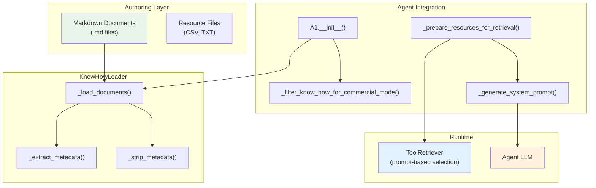
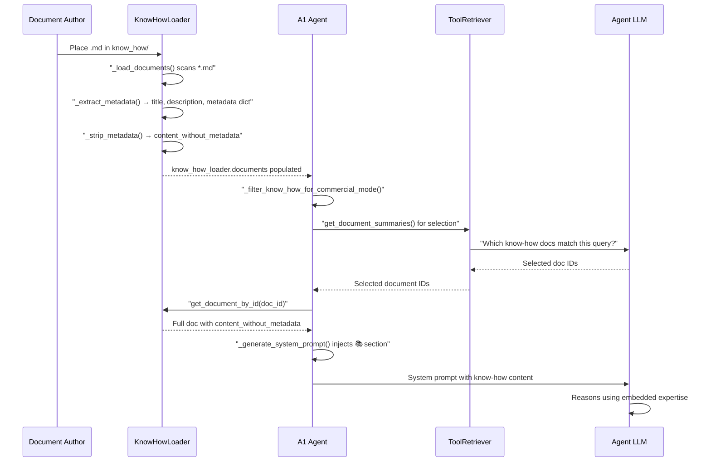

The Know-How Library is Biomni's mechanism for injecting curated domain expertise directly into the agent's reasoning context. Unlike tools that the agent *calls* and data it *reads*, know-how documents are **already-loaded reference materials** — expert protocols, best-practice guides, and troubleshooting references that the agent can cite and follow without any retrieval overhead. This page covers the loader architecture, document authoring conventions, retrieval integration, and how to extend the library with your own domain knowledge.

## Architectural Overview

The Know-How Library sits at the intersection of the knowledge layer and the agent's system prompt. Documents are authored as structured Markdown files, parsed by the `KnowHowLoader` class, filtered by licensing constraints, and selectively injected into the agent's context through the retrieval pipeline. The design intentionally separates *metadata* (used for selection and display) from *content* (used for reasoning), ensuring the agent receives clean, actionable guidance.



## The KnowHowLoader Class

The `KnowHowLoader` class ([loader.py](biomni/know_how/loader.py#L8-L349)) is the sole entry point exposed by the `biomni.know_how` module ([\_\_init\_\_.py](biomni/know_how/__init__.py#L7-L9)). It is exported as `__all__ = ["KnowHowLoader"]` and instantiated automatically by the A1 agent during initialization.

### Initialization and Document Discovery

On construction, the loader resolves the know-how directory to the package's own `know_how/` folder by default, then immediately loads all qualifying Markdown files.

```python
def __init__(self, know_how_dir: str | None = None):
    if know_how_dir is None:
        current_dir = Path(__file__).parent
        know_how_dir = str(current_dir)
    self.know_how_dir = know_how_dir
    self.documents = {}
    self._load_documents()
```

Sources: [loader.py](biomni/know_how/loader.py#L11-L26)

The `_load_documents()` method scans the directory with a `*.md` glob pattern. It intentionally skips meta-files — any Markdown whose filename (without extension) is entirely uppercase (e.g., `README.md`, `QUICK_START.md`) is excluded. This convention allows you to place project documentation like READMEs in the same directory without them being treated as know-how content.

Sources: [loader.py](biomni/know_how/loader.py#L28-L62)

### Metadata Extraction

Each document follows a structured format. The loader extracts three categories of information through `_extract_metadata()`:

| Extracted Field | Source | Fallback |
|---|---|---|
| **Title** | First `# H1` heading in the document | Filename, title-cased with underscores replaced by spaces |
| **Description** | Content under `## Overview` section, truncated to 200 characters; overridden by `**Short Description**` from metadata if present | First non-empty paragraph after the title |
| **Metadata dict** | Key-value pairs from the `## Metadata` section (e.g., Authors, Version, License, Commercial Use) | Empty dict |

The metadata parser recognizes a `**FieldName**:` pattern at the start of lines and captures list items (`- `) as comma-separated values within a single field. This flexible approach supports multi-line metadata entries without requiring strict YAML frontmatter.

Sources: [loader.py](biomni/know_how/loader.py#L64-L163)

### Content Stripping

Before know-how content reaches the agent, the `_strip_metadata()` method removes the entire `## Metadata` section and any surrounding horizontal rule separators. The result — stored as `content_without_metadata` on each document — is what the agent actually sees in its system prompt. This keeps the reasoning context lean and focused on actionable guidance rather than administrative metadata.

Sources: [loader.py](biomni/know_how/loader.py#L165-L224)

### Document Management API

The loader provides a full CRUD surface for managing documents at runtime:

| Method | Purpose | Returns |
|---|---|---|
| `get_all_documents()` | Retrieve every loaded document with full content | `list[dict]` |
| `get_document_by_id(doc_id)` | Look up a single document by its filename stem | `dict \| None` |
| `get_document_summaries()` | Lightweight list with only id, name, description | `list[dict]` |
| `get_document_metadata(doc_id)` | Access only the parsed metadata dict | `dict \| None` |
| `add_custom_document(doc_id, name, description, content, metadata)` | Programmatically inject a document (no file on disk) | `None` |
| `remove_document(doc_id)` | Delete from the in-memory store | `None` |
| `reload()` | Re-scan the directory from disk, discarding all in-memory changes | `None` |
| `print_document_info(doc_id)` | Pretty-print document details including metadata to stdout | `None` |

Sources: [loader.py](biomni/know_how/loader.py#L226-L349)

> [!TIP]
> **Programmatic vs. File-based documents**: Documents added via `add_custom_document()` exist only in memory and will not survive a `reload()` call. If you need persistent custom know-how, either place a properly structured `.md` file in the know-how directory and call `reload()`, or re-add the document after each reload.

## Bundled Know-How Documents

The repository ships with two expert-level guides that demonstrate the full document format, plus companion resource files.

### sgRNA Design Guide

**File**: [sgRNA_design_guide.md](biomni/know_how/sgRNA_design_guide.md) · **Resource**: [addgene_grna_sequences.csv](biomni/know_how/resource/addgene_grna_sequences.csv), [CRISPick_download_links.txt](biomni/know_how/resource/CRISPick_download_links.txt)

This 420-line guide implements a **three-tiered approach** to CRISPR guide RNA design, prioritizing experimentally validated sequences over computational predictions:

1. **Option 1 — Validated Sequences** (recommended first): Search a curated database of 300+ validated sgRNAs sourced from Addgene, with mandatory cross-referencing via web literature search.
2. **Option 2 — CRISPick Pre-Computed Designs**: Download and filter pre-scored sgRNA datasets from the Broad Institute's CRISPick tool, including a complete download URL registry in the companion text file.
3. **Option 3 — De Novo Design Guidelines** (last resort): General rules for on-target efficiency, PAM compatibility, and off-target minimization when no pre-existing data is available.

The guide includes reproducible Python code snippets, a database column reference, citation requirements for both Addgene and CRISPick sources, and quick-start walkthroughs for common tasks (e.g., knocking out TP53, activating OCT4).

Sources: [sgRNA_design_guide.md](biomni/know_how/sgRNA_design_guide.md#L1-L100), [sgRNA_design_guide.md](biomni/know_how/sgRNA_design_guide.md#L146-L420)

### Single Cell RNA-seq Annotation

**File**: [single_cell_annotation.md](biomni/know_how/single_cell_annotation.md)

This 224-page guide distills best practices from the "Single-cell best practices" reference by Luecken, Theis, et al. It covers three complementary annotation strategies:

| Approach | Method | Recommended For |
|---|---|---|
| Manual Marker-Based | Cluster-wise differential expression against known markers | Small datasets, novel cell types |
| Automated | Pre-trained classifiers (CellTypist, scAnnotate) | Standard tissues, large-scale screening |
| Reference-Based Transfer | Label transfer from annotated atlases (scArches, Azimuth, SingleR) | Well-characterized tissues, cross-study integration |

The guide provides a four-step recommended workflow (QC → manual assessment → automated validation → reference refinement), a tool selection matrix keyed to scenario, key marker gene tables by cell lineage (blood/immune, epithelial, stromal), a validation checklist, and a troubleshooting section covering common pitfalls like doublet clusters, ambient RNA contamination, and reference mismatch.

Sources: [single_cell_annotation.md](biomni/know_how/single_cell_annotation.md#L27-L224)

### Resource Files

The `biomni/know_how/resource/` directory contains companion data files referenced by know-how documents:

| File | Purpose | Referenced By |
|---|---|---|
| `addgene_grna_sequences.csv` | Curated database of 300+ validated sgRNA sequences with PubMed IDs, plasmid links, and species/application metadata | sgRNA Design Guide Option 1 |
| `CRISPick_download_links.txt` | Registry of download URLs for pre-computed CRISPick sgRNA design files | sgRNA Design Guide Option 2 |

These files are static assets — the know-how guides instruct the agent on how to programmatically load and query them using `pandas` or `advanced_web_search_claude`.

## Integration with the Agent Pipeline

The Know-How Library is wired into the A1 agent at three critical junctures: initialization, retrieval selection, and system prompt injection.

### Initialization and Commercial Filtering

When the A1 agent is constructed, it instantiates `KnowHowLoader()` with the default directory ([a1.py](biomni/agent/a1.py#L212-L213)). If `commercial_mode=True`, the agent immediately calls `_filter_know_how_for_commercial_mode()` ([a1.py](biomni/agent/a1.py#L876-L896)), which scans every document's metadata for commercial use restrictions — specifically looking for ❌ symbols, "Not Allowed", or "Non-Commercial" in the `commercial_use` field — and removes any restricted documents from the in-memory store. Both bundled documents carry `Commercial Use: ✅ Allowed` in their metadata, so they survive this filter.

Sources: [a1.py](biomni/agent/a1.py#L212-L219), [a1.py](biomni/agent/a1.py#L876-L896)

### Retrieval-Augmented Selection

When tool retrieval is enabled (`use_tool_retriever=True`), the `_prepare_resources_for_retrieval()` method ([a1.py](biomni/agent/a1.py#L1646-L1757)) gathers know-how document summaries (id, name, description only) alongside tools, data lake items, and libraries into a unified resource dictionary. This entire set is passed to the `ToolRetriever.prompt_based_retrieval()` method, which asks the agent's LLM to select the most relevant resources for the current query.

For any know-how documents that the retriever selects, the pipeline fetches the **full stripped content** via `get_document_by_id()` and uses `content_without_metadata` — not the raw content — for the agent context. This two-stage approach means the LLM makes selection decisions from lightweight summaries while receiving complete, actionable content for reasoning.

Sources: [a1.py](biomni/agent/a1.py#L1690-L1746)

### System Prompt Injection

The `_generate_system_prompt()` method ([a1.py](biomni/agent/a1.py#L1087-L1186)) formats selected know-how documents into a dedicated `📚 KNOW-HOW DOCUMENTS` section placed at the top of the system prompt under `PRIORITY CUSTOM RESOURCES`. The prompt explicitly instructs the agent:

> These documents are ALREADY AVAILABLE in your context. You do NOT need to retrieve them or "review" them as a separate step. You can DIRECTLY reference and use the information from these documents.

This is a critical design decision — know-how content is not something the agent must *search for* or *load*. It is already present in the system prompt, and the agent is expected to reference it directly when answering questions, generating protocols, suggesting parameters, or providing troubleshooting guidance.

Sources: [a1.py](biomni/agent/a1.py#L1173-L1186)

## Authoring Custom Know-How Documents

You can extend the library by authoring new Markdown files following the established conventions. The loader is deliberately tolerant of format variations, but adhering to the standard structure ensures correct metadata extraction, proper retrieval behavior, and clean agent context.

### Required Structure

Every know-how document must follow this skeleton:

```markdown
# Your Document Title

---

## Metadata

**Short Description**: A concise one-line summary (used by the retriever for selection decisions).

**Authors**: Author or team name

**Version**: 1.0

**Last Updated**: Month Year

**License**: CC BY 4.0

**Commercial Use**: ✅ Allowed   <!-- or ❌ Not Allowed -->

---

## Overview

This paragraph becomes the document's description field. Keep it focused and informative —
the retriever uses this text to decide whether the document is relevant to a query.

## Your Content Sections

The actual guidance, protocols, code examples, tables, and troubleshooting steps go here.
All of this content (minus the Metadata section) is what the agent sees in its context.
```

### File Placement and Naming Conventions

| Convention | Rule | Example |
|---|---|---|
| **Location** | Place in `biomni/know_how/` directory | `biomni/know_how/flow_cytometry_guide.md` |
| **Filename** | Must be `.md`; must NOT be all-uppercase (those are skipped) | ✅ `flow_cytometry.md` · ❌ `README.md` · ❌ `GUIDE_V2.MD` |
| **Title** | First `# H1` heading | `# Flow Cytometry Panel Design` |
| **Metadata section** | Must be `## Metadata` (case-sensitive) | Required for proper extraction |
| **Overview section** | Must be `## Overview` (case-sensitive) | Used as description fallback |

> [!TIP]
> **Retrieval relevance depends on your Overview and Short Description**: The retriever selects know-how documents based on their summaries (name + description). Write a `Short Description` that includes the key terms a user might mention in their query — tool names, technique names, organism types, and experimental contexts all improve selection accuracy.

### Adding Documents Programmatically

For documents that should exist only within a session (or that are generated dynamically), use the loader's `add_custom_document()` method:

```python
from biomni.know_how import KnowHowLoader

loader = KnowHowLoader()

loader.add_custom_document(
    doc_id="custom_protocol",
    name="Custom Western Blot Protocol",
    description="Step-by-step Western blot protocol for membrane protein detection",
    content="""
## Materials
- PVDF membrane, blocking buffer...

## Procedure
1. Transfer proteins to PVDF membrane...
""",
    metadata={
        "authors": "Your Lab",
        "version": "1.0",
        "commercial_use": "✅ Allowed"
    }
)

# Verify it loaded
loader.print_document_info("custom_protocol")
```

Note that programmatically added documents will not have a `content_without_metadata` field unless you separately strip metadata from the content before passing it. The `_strip_metadata()` method operates on the `## Metadata` section format — if your custom content doesn't include one, the full content is used as-is.

Sources: [loader.py](biomni/know_how/loader.py#L258-L279), [loader.py](biomni/know_how/loader.py#L53-L62)

## End-to-End Data Flow

The following sequence traces a know-how document from authoring through to agent consumption:



## Relationship to Other Resource Layers

The Know-How Library is one of four resource categories the A1 agent can draw upon. Understanding its position in this ecosystem clarifies when to use know-how versus other extension mechanisms:

| Resource Layer | Injection Method | Agent Access Pattern | Typical Content |
|---|---|---|---|
| **Know-How** | Embedded in system prompt (full content) | Direct reference, no retrieval step | Best practices, protocols, troubleshooting |
| **Custom Tools** | Listed in system prompt + importable | `from module import function` | New Python functions, API wrappers |
| **Custom Data** | Listed in system prompt + file path | Read from data lake directory | Datasets, reference files |
| **Custom Software** | Listed in system prompt + importable | `import library` | Additional Python packages |

The key distinction: know-how documents change *what the agent knows*, while tools change *what the agent can do*, data changes *what the agent can read*, and software changes *what the agent can compute with*. For deeper exploration of these complementary systems, see [Tool Registry and Discovery](12-tool-registry-and-discovery), [Data Lake Management](16-data-lake-management), and [Retrieval-Augmented Tool Selection](13-retrieval-augmented-tool-selection).