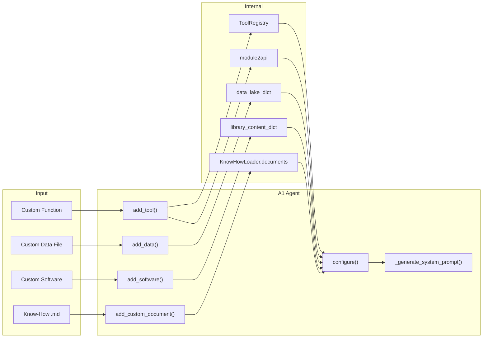
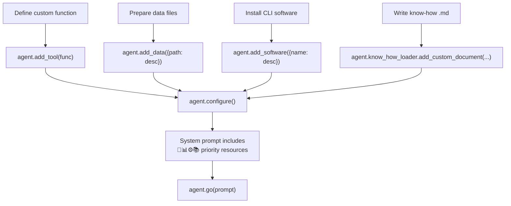

Biomni's extensibility model is built around three distinct resource types — **tools** (callable functions), **data** (files in the data lake), and **software** (CLI/library entries) — each managed through a dedicated CRUD API on the `A1` agent instance. When you add any custom resource, the agent automatically reconfigures its system prompt to surface your additions as **priority resources**, visually distinguished with emoji markers and an explicit directive to use them first. This page covers the full lifecycle: authoring, registering, querying, and removing custom resources, along with the know-how document system for embedding domain expertise directly into the agent's context.

## Architecture Overview

Every custom resource flows through the same general pipeline: registration into an internal data structure, propagation into the system prompt, and exposure to the LLM at inference time. The diagram below shows how the three resource types converge on system prompt generation during `configure()`.



The critical design decision is that all three resource types are **shallowly merged** into their respective master dictionaries (`data_lake_dict`, `library_content_dict`) while also tracked separately in `_custom_data`, `_custom_software`, and `_custom_tools` maps. This dual-tracking allows the system prompt generator to separate custom from default resources and render custom items with special formatting and priority instructions.

Sources: [a1.py](biomni/agent/a1.py#L1289-L1378), [tool_registry.py](biomni/tool/tool_registry.py#L6-L18)

## Adding Custom Tools

Custom tools are Python functions that the agent can call during its reasoning loop. The `add_tool()` method accepts any callable and performs full schema introspection, registration, and injection in a single call.

### The Registration Pipeline

When you call `agent.add_tool(my_function)`, the following sequence executes:

1. **Source inspection**: `inspect.getsource(api)` extracts the function's source code from its module.
2. **Schema generation**: The source code is passed to `function_to_api_schema(function_code, self.llm)` which uses the configured LLM to produce a structured schema dictionary. This schema must contain `name`, `description`, and `required_parameters` to pass validation.
3. **Registry insertion**: The schema is registered into `ToolRegistry` via `register_tool()`, which assigns an auto-incrementing integer `id` and appends it to the tools list. The registry's `document_df` DataFrame is then rebuilt to include the new tool for retrieval-augmented tool selection.
4. **Module mapping**: The schema is added to `module2api[module_name]`, keyed by the function's `__module__` attribute (defaulting to `"custom_tools"`). Duplicate tool names within the same module are updated in-place rather than duplicated.
5. **REPL injection**: The original callable is stored in `builtins._biomni_custom_functions[name]` so the Python REPL execution environment can invoke it directly via `_inject_custom_functions_to_repl()`.
6. **Agent reconfiguration**: `self.configure()` is called to regenerate the system prompt with the new tool surfaced as a priority resource.

Sources: [a1.py](biomni/agent/a1.py#L225-L348)

### Authoring Requirements

Your custom function should be a well-documented Python callable. The LLM-based schema generator relies on the function signature, docstring, and type annotations to produce accurate parameter descriptions. Here is a minimal example:

```python
# before: no tool available
def calculate_gc_content(dna_sequence: str) -> str:
    """Calculate GC content percentage of a DNA sequence.
    
    Args:
        dna_sequence: A string of nucleotide characters (A, T, G, C)
        
    Returns:
        GC content as a percentage string
    """
    gc = dna_sequence.upper().count('G') + dna_sequence.upper().count('C')
    total = len(dna_sequence)
    return f"GC content: {(gc / total * 100):.2f}%"

agent.add_tool(calculate_gc_content)
```

| Requirement | Detail |
|---|---|
| Callable | Must be a Python function or callable object |
| Docstring | Used by the LLM schema generator; include parameter descriptions |
| Type hints | Annotated types guide schema generation accuracy |
| Return value | Should be a string or JSON-serializable for the REPL to display |

> [!TIP]
> The `function_to_api_schema()` call in `add_tool()` is **asynchronous in nature** — it invokes the configured LLM to parse your function. If your LLM is misconfigured or returns malformed output, the method raises a `ValueError`. Always verify your LLM connection before adding tools.

### Managing Custom Tools at Runtime

The `A1` class exposes a full CRUD interface for custom tools after registration:

| Method | Signature | Returns |
|---|---|---|
| `add_tool` | `add_tool(api: Callable) -> dict` | The generated schema |
| `list_custom_tools` | `list_custom_tools() -> list` | List of custom tool names |
| `get_custom_tool` | `get_custom_tool(name: str) -> dict \| None` | Tool metadata or `None` |
| `remove_custom_tool` | `remove_custom_tool(name: str) -> bool` | Success flag |

Removing a tool clears it from `_custom_tools`, `module2api`, and `_custom_functions` (the REPL injection namespace), then reconfigures the agent. Note that removal from the `ToolRegistry`'s internal `tools` list is not performed — only the custom tracking maps are cleaned. If you need full registry removal, use `tool_registry.remove_tool_by_name()` directly.

Sources: [a1.py](biomni/agent/a1.py#L589-L674)

## Adding Custom Data

The data lake is Biomni's file-level context system. It tells the agent which files exist and what they contain so the LLM can reason about which data to load. The `add_data()` method lets you register your own files alongside the default data lake contents.

### Registration

```python
agent.add_data({
    "path/to/my_experiment.csv": "Single-cell RNA-seq counts from patient tumor biopsy",
    "results/blast_hits.fasta": "BLAST alignment results against NCBI nr database"
})
```

Internally, the method iterates over the dictionary, extracts the basename from each path for storage, and populates two structures simultaneously: `_custom_data[filename]` with `{"path": ..., "description": ...}`, and `data_lake_dict[filename]` with the description string. This ensures the file appears in both the custom tracking layer and the master data lake dictionary used by the system prompt generator. After insertion, `self.configure()` is called automatically.

Sources: [a1.py](biomni/agent/a1.py#L676-L721)

### CRUD Interface for Data

| Method | Signature | Returns |
|---|---|---|
| `add_data` | `add_data(data: dict) -> bool` | Success flag |
| `list_custom_data` | `list_custom_data() -> list` | `[(name, description), ...]` |
| `get_custom_data` | `get_custom_data(name: str) -> dict \| None` | `{path, description}` or `None` |
| `remove_custom_data` | `remove_custom_data(name: str) -> bool` | Success flag |

> [!TIP]
> The `add_data()` method does **not** copy files — it only registers paths. The files must already exist at the specified locations when the agent attempts to access them during execution.

Sources: [a1.py](biomni/agent/a1.py#L723-L775)

## Adding Custom Software

Software entries represent CLI tools, R packages, or Python libraries installed in the environment that the agent can invoke via Bash, R, or Python execution blocks. The `add_software()` method follows the same dual-tracking pattern as data.

### Registration

```python
agent.add_software({
    "plink2": "Genome-wide association study analysis toolset",
    "cellranger": "10x Genomics single-cell RNA-seq processing pipeline"
})
```

The method validates that the input is a dictionary with string keys and values, stores each entry in `_custom_software[software_name]` with `{name, description}`, and mirrors it into `library_content_dict[software_name]` for system prompt generation. It then calls `self.configure()`.

Sources: [a1.py](biomni/agent/a1.py#L777-L820)

### CRUD Interface for Software

| Method | Signature | Returns |
|---|---|---|
| `add_software` | `add_software(software: dict) -> bool` | Success flag |
| `list_custom_software` | `list_custom_software() -> list` | `[(name, description), ...]` |
| `get_custom_software` | `get_custom_software(name: str) -> dict \| None` | `{name, description}` or `None` |
| `remove_custom_software` | `remove_custom_software(name: str) -> bool` | Success flag |

Sources: [a1.py](biomni/agent/a1.py#L822-L875)

## How Custom Resources Appear in the System Prompt

When any custom resources exist, the `_generate_system_prompt()` method inserts a **PRIORITY CUSTOM RESOURCES** section at the top of the prompt, before the default tools, data lake, and software listings. Each resource type receives a distinct emoji prefix and formatting:

| Resource Type | Prefix | Format |
|---|---|---|
| Custom tools | 🔧 | `🔧 tool_name (from module): description` |
| Custom data | 📊 | `📊 filename: description` |
| Custom software | ⚙️ | `⚙️ software_name: description` |
| Know-how docs | 📚 | `📚 doc_name:\n full_content` |

The prompt includes an explicit directive: *"PRIORITIZE using these resources as they are directly relevant to your task. Always consider these FIRST and in the meantime using default resources."* This ensures the LLM treats your additions as first-class resources rather than afterthoughts. Default resources are listed separately below, filtered to exclude any items already present in the custom lists to avoid duplication.

Sources: [a1.py](biomni/agent/a1.py#L1053-L1199)

## Know-How Documents

The know-how system provides a fourth extensibility channel specifically for **procedural knowledge** — best practices, protocols, parameter recommendations, and troubleshooting guides. Unlike tools (which are executable), know-how documents are markdown files injected verbatim into the system prompt as reference material.

### How Documents Are Loaded

The `KnowHowLoader` class scans the `biomni/know_how/` directory for `.md` files on initialization. It skips meta-documents (filenames that are all uppercase, like `README.md`) and processes each file through a metadata extraction pipeline:

1. **Title extraction**: The first `# H1` heading is used; falls back to a title-cased filename.
2. **Metadata parsing**: Content under `## Metadata` is parsed for `**Field**:` patterns (e.g., `**Authors**:`, `**Topics**:`, `**License**:`) into a structured dictionary.
3. **Description extraction**: Content under `## Overview` (up to 200 characters) is used; falls back to the first non-empty paragraph after the title.
4. **Content stripping**: The `_strip_metadata()` method removes the metadata section from the full content, producing `content_without_metadata` that is used in system prompts.

Sources: [loader.py](biomni/know_how/loader.py#L8-L163)

### Document Metadata Format

The expected markdown structure for a know-how document is:

```markdown
# Document Title

## Metadata
**Authors**: Research team name
**Topics**: CRISPR, guide RNA design, off-target analysis
**License**: MIT

## Overview
Brief description of what this document covers and when to reference it.

## Detailed Content
Full procedural content, parameters, troubleshooting steps, etc.
```

Key metadata fields recognized by the loader include `short_description` (overrides the extracted overview), `authors`, `topics`, and `license`. The `license` field is particularly important — when the agent runs in **commercial mode**, documents with non-commercial license restrictions are filtered out by `_filter_know_how_for_commercial_mode()`.

Sources: [loader.py](biomni/know_how/loader.py#L28-L62), [a1.py](biomni/agent/a1.py#L876-L896)

### Adding Custom Know-How Documents at Runtime

You can add know-how documents programmatically without placing files on disk:

```python
agent.know_how_loader.add_custom_document(
    doc_id="my_protocol",
    name="Custom Western Blot Protocol",
    description="Step-by-step western blot with ECL detection",
    content="# Custom Western Blot\n## Steps\n1. Prepare samples...\n2. Run SDS-PAGE...",
    metadata={"authors": "Lab Team", "topics": "western blot, protein detection"}
)
agent.configure()  # Reconfigure to pick up new know-how
```

The `add_custom_document()` method stores the document in the same structure as disk-loaded documents. The method also supports a `metadata` dictionary argument for programmatic metadata injection. After adding, call `agent.configure()` to regenerate the system prompt with the new document included.

| Method | Signature | Purpose |
|---|---|---|
| `add_custom_document` | `add_custom_document(doc_id, name, description, content, metadata=None)` | Register a new document |
| `get_all_documents` | `get_all_documents() -> list[dict]` | List all loaded documents |
| `get_document_by_id` | `get_document_by_id(doc_id) -> dict \| None` | Retrieve specific document |
| `get_document_summaries` | `get_document_summaries() -> list[dict]` | List documents without full content |
| `remove_document` | `remove_document(doc_id)` | Remove a document |
| `reload` | `reload()` | Re-scan the know-how directory from disk |

Sources: [loader.py](biomni/know_how/loader.py#L258-L347)

## Built-in Know-How Resources

The repository ships with two default know-how documents in the `biomni/know_how/` directory, each accompanied by reference resource files in `biomni/know_how/resource/`:

| Document | Resource Files | Purpose |
|---|---|---|
| `sgRNA_design_guide.md` | `CRISPick_download_links.txt`, `addgene_grna_sequences.csv` | Expert guidance on single guide RNA design for CRISPR experiments |
| `single_cell_annotation.md` | — | Best practices for single-cell RNA-seq cell type annotation |

These documents are loaded automatically during agent initialization and included in full (metadata-stripped) in the initial system prompt. In commercial mode, any know-how document with a non-commercial license is excluded via the `_filter_know_how_for_commercial_mode()` method.

Sources: [loader.py](biomni/know_how/loader.py#L19-L26), [a1.py](biomni/agent/a1.py#L212-L219)

## Tool Registry Internals

The `ToolRegistry` class is the low-level storage engine for all tools (both built-in and custom). Understanding its validation rules is essential if you bypass `add_tool()` and construct schemas manually.

### Validation Contract

Every tool must be a dictionary containing these three keys:

| Required Key | Type | Purpose |
|---|---|---|
| `name` | `str` | Unique tool identifier used for lookup and REPL invocation |
| `description` | `str` | Human-readable description for LLM reasoning and retrieval |
| `required_parameters` | `list` | Array of parameter definitions consumed by the LLM |

Optional keys include `optional_parameters`, `module` (source module name), and `id` (auto-assigned integer). The `validate_tool()` method raises `ValueError` on missing required keys.

### Registry Operations

The registry supports bidirectional lookup by name or ID, persistence via `save_registry()`/`load_registry()` (using Python pickle), and removal by either identifier. When `add_tool()` adds a new tool, it also rebuilds the `document_df` DataFrame — a two-column DataFrame of `[docid, document_content]` used by the retrieval-augmented tool selection system.

Sources: [tool_registry.py](biomni/tool/tool_registry.py#L24-L89)

## Quick Reference: Complete Customization Workflow



| Action | Method | Triggers Reconfigure |
|---|---|---|
| Add tool | `agent.add_tool(func)` | ✅ Automatic |
| Remove tool | `agent.remove_custom_tool(name)` | ❌ Manual |
| Add data | `agent.add_data({path: desc})` | ✅ Automatic |
| Remove data | `agent.remove_custom_data(name)` | ❌ Manual |
| Add software | `agent.add_software({name: desc})` | ✅ Automatic |
| Remove software | `agent.remove_custom_software(name)` | ❌ Manual |
| Add know-how | `agent.know_how_loader.add_custom_document(...)` | ❌ Manual |
| Remove know-how | `agent.know_how_loader.remove_document(id)` | ❌ Manual |

For removal operations that do not auto-reconfigure, you must call `agent.configure()` explicitly to regenerate the system prompt and pick up the changes.

---

For integration with external tool servers via the Model Context Protocol, see [MCP Server Integration](19-mcp-server-integration). To understand how tools are discovered at runtime through retrieval, refer to [Retrieval-Augmented Tool Selection](13-retrieval-augmented-tool-selection). For the full tool schema format used by built-in tools, consult [Domain Tool Implementations](14-domain-tool-implementations).