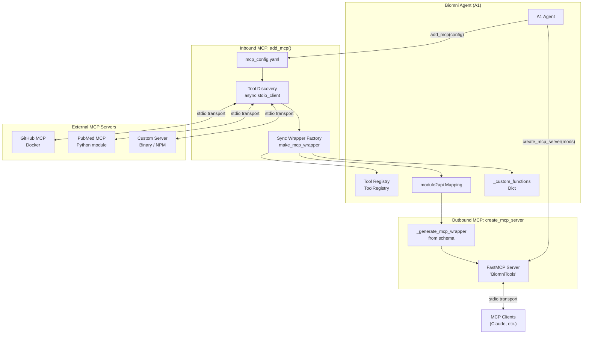
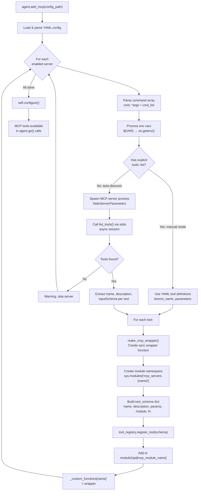

Biomni's MCP (Model Context Protocol) integration provides a bidirectional bridge between its internal tool ecosystem and the broader MCP ecosystem. This dual-mode architecture lets you import tools from any MCP-compatible server into Biomni's agent workflow, and conversely, expose Biomni's native domain tools as MCP servers consumable by external AI clients. The implementation lives primarily in the [`A1`](biomni/agent/a1.py#L56) agent class, with two complementary methods — [`add_mcp()`](biomni/agent/a1.py#L350) for inbound tool ingestion and [`create_mcp_server()`](biomni/agent/a1.py#L1995) for outbound tool exposure.

Sources: [a1.py](biomni/agent/a1.py#L56-L56), [mcp_integration.md](docs/mcp_integration.md#L1-L11)

## Architectural Overview

The MCP integration layer operates at the boundary between Biomni's synchronous agent execution model and the inherently asynchronous MCP protocol. All communication with external MCP servers uses the **stdio transport** — servers are spawned as child processes, and tools are invoked through structured message passing over stdin/stdout. This architecture avoids network complexity while maintaining isolation between the agent and external tool services.



The two integration directions share a common foundation but differ in their data flow. Inbound integration reads a YAML manifest, spawns MCP server processes, discovers their tool schemas, then generates synchronous Python wrappers that are injected into Biomni's tool registry. Outbound integration reverses this: it reads Biomni's internal `module2api` schema, wraps each tool function with proper MCP-compliant parameter annotations, and registers them on a `FastMCP` server instance.

Sources: [a1.py - add_mcp](biomni/agent/a1.py#L350-L410), [a1.py - create_mcp_server](biomni/agent/a1.py#L1995-L2060), [tool_registry.py](biomni/tool/tool_registry.py#L24-L34)

## Integration Mode Comparison

Before diving into implementation details, it helps to understand the structural differences between the two MCP integration patterns. Each serves a distinct workflow and operates under different constraints.

| Aspect | Inbound (`add_mcp`) | Outbound (`create_mcp_server`) |
|---|---|---|
| **Purpose** | Import external tools into Biomni agent | Expose Biomni tools to external MCP clients |
| **Configuration** | YAML file (`mcp_config.yaml`) | Python arguments (`tool_modules` list) |
| **Transport** | stdio client (connects to child processes) | stdio server (listens for client connections) |
| **Schema Source** | MCP server's `inputSchema` or manual YAML definitions | Biomni's `module2api` schema format |
| **Async Handling** | `nest_asyncio` + `asyncio.run()` to bridge sync agent with async MCP | `FastMCP` handles async natively |
| **Registration Target** | `ToolRegistry` + `module2api` + `_custom_functions` | `FastMCP` server object |
| **Tool Discovery** | Automatic (via `list_tools()`) or manual (YAML `tools:` list) | Schema-driven from registered modules |
| **Use After** | Call `agent.go("...")` with MCP tools available | Call `mcp.run(transport="stdio")` to start server |

Sources: [a1.py - add_mcp](biomni/agent/a1.py#L350-L350), [a1.py - create_mcp_server](biomni/agent/a1.py#L1995-L1995), [mcp_integration.md](docs/mcp_integration.md#L7-L10)

## Inbound Integration: Adding External MCP Servers

The inbound integration path lets you bring tools from any MCP-compatible server into Biomni's agent loop. The entry point is the [`add_mcp()`](biomni/agent/a1.py#L350) method on the `A1` agent instance. It accepts a single argument — the path to a YAML configuration file — and handles the entire lifecycle of tool discovery, wrapper generation, and registry insertion.

### Configuration File Format

MCP servers are declared under the top-level `mcp_servers` key in a YAML file. Each server entry requires a `command` array (the process invocation), supports an `enabled` flag, optional `env` variables with `${VAR}` substitution, and either automatic tool discovery or explicit manual tool definitions.

```yaml
mcp_servers:
  # Auto-discovery mode: no 'tools' key → discovers all tools from the server
  github:
    command: ["docker", "run", "-i", "--rm", "-e", "GITHUB_PERSONAL_ACCESS_TOKEN", "ghcr.io/github/github-mcp-server"]
    enabled: true
    env:
      GITHUB_PERSONAL_ACCESS_TOKEN: "${GITHUB_TOKEN}"

  # Manual mode: explicit 'tools' list with Biomni-specific schema
  pubmed:
    command: ["python", "-m", "biomni.tool.example_mcp_tools.pubmed_mcp"]
    enabled: true
    tools:
      - biomni_name: search_pubmed
        description: "Search PubMed"
        parameters:
          query:        {type: str, required: true,  description: "PubMed search term"}
          max_results:  {type: int, required: false, default: 10, description: "Max results"}
      - biomni_name: get_article_abstract
        description: "Fetch PubMed abstract"
        parameters:
          pmid: {type: str, required: true, description: "PubMed ID"}
```

The `command` field follows the same pattern regardless of server packaging type. The table below summarizes the common invocation patterns:

| Server Type | `command` Format | Prerequisites |
|---|---|---|
| **Docker container** | `["docker", "run", "-i", "--rm", ...]` | Docker daemon running |
| **NPM package** | `["npx", "-y", "@scope/server-name"]` | Node.js and npm installed |
| **Python module** | `["python", "-m", "package.module"]` | Package in `PYTHONPATH` |
| **Binary executable** | `["./my-server", "--config", "path"]` | Executable with run permission |

Sources: [mcp_config.yaml](tutorials/examples/add_mcp_server/mcp_config.yaml#L1-L26), [mcp_integration.md](docs/mcp_integration.md#L16-L32)

### The Tool Discovery and Registration Pipeline

When `add_mcp()` is called, it executes a multi-stage pipeline that transforms remote MCP tool definitions into locally callable Python functions integrated into Biomni's tool ecosystem. Understanding this pipeline is essential for debugging and for building custom MCP servers that integrate cleanly.



The critical technical detail is the **async-to-sync bridging**. MCP's `stdio_client` is inherently async, but Biomni's agent executes tools synchronously within its ReAct loop. The [`make_mcp_wrapper()`](biomni/agent/a1.py#L415) function resolves this by creating a closure that spawns a new event loop for each tool invocation via `asyncio.run()`, with `nest_asyncio` applied to the main thread to allow nested loop creation. For each tool call, a fresh `StdioServerParameters` connection is established, the session is initialized, and the tool is invoked with the forwarded keyword arguments.

> [!TIP]
> **Connection lifecycle**: Each MCP tool call creates a **new child process** and establishes a fresh session. There is no persistent connection pooling. This means containerized servers (Docker) will incur startup overhead on every invocation. For latency-sensitive workflows, prefer Python-module-based MCP servers or pre-warmed Docker containers.

Sources: [a1.py - add_mcp](biomni/agent/a1.py#L350-L588), [a1.py - make_mcp_wrapper](biomni/agent/a1.py#L415-L444), [mcp_integration.md](docs/mcp_integration.md#L86-L104)

### Manual vs. Automatic Tool Definitions

The configuration supports two modes for specifying which tools to import, and the difference affects how parameter schemas are interpreted.

**Manual mode** (explicit `tools:` list in YAML): Tool names use the `biomni_name` key. Parameters are defined in Biomni's native schema format — a flat dictionary where each key is a parameter name, and each value is a dict with `type`, `required`, and `description`. The `required` field is per-parameter.

**Auto-discovery mode** (no `tools:` key): The system calls `list_tools()` on the MCP server and reads each tool's `inputSchema` (JSON Schema format). Parameters come from `inputSchema.properties`, and the `required` list lives at the top level of `inputSchema`. Tool names are taken directly from the server's tool `name` attribute.

| Property | Manual Mode | Auto-Discovery Mode |
|---|---|---|
| Tool name source | `biomni_name` key | MCP server's `tool.name` |
| Parameter format | `{name: {type, required, desc}}` | JSON Schema `inputSchema` |
| Required determination | Per-param `required: true` | Top-level `inputSchema.required` array |
| Granularity | Select specific tools | All server tools imported |
| Best for | Large servers where you need a subset | Small, purpose-built servers |

Sources: [a1.py - tool registration](biomni/agent/a1.py#L512-L576), [mcp_config.yaml](tutorials/examples/add_mcp_server/mcp_config.yaml#L12-L25)

### Registration into Biomni's Tool System

Regardless of definition mode, every MCP tool undergoes the same four-part registration. The tool schema is validated by [`ToolRegistry.register_tool()`](biomni/tool/tool_registry.py#L24), which requires `name`, `description`, and `required_parameters` keys. It's then added to the `module2api` dictionary under a synthetic module namespace (`mcp_servers.{server_name}`), stored in the `_custom_functions` instance dict for direct invocation, and finally the agent is re-configured via [`self.configure()`](biomni/agent/a1.py#L1289) to rebuild its system prompt and tool retrieval index with the newly available tools.

Sources: [a1.py - registration](biomni/agent/a1.py#L570-L587), [tool_registry.py](biomni/tool/tool_registry.py#L24-L34)

### Basic Usage Example

```python
from biomni.agent import A1

agent = A1()

# Import MCP servers from a YAML configuration
agent.add_mcp(config_path="./mcp_config.yaml")

# MCP tools are now available in agent queries
result = agent.go("Please list all repositories in the github account of the user.")
```

The configuration file referenced above is provided at [`tutorials/examples/add_mcp_server/mcp_config.yaml`](tutorials/examples/add_mcp_server/mcp_config.yaml#L1-L26) and includes both a GitHub Docker-based server (auto-discovery) and a PubMed Python-based server (manual definitions). The example notebook [`mcp_example.ipynb`](tutorials/examples/add_mcp_server/mcp_example.ipynb#L1-L36) demonstrates end-to-end usage with GitHub token configuration and combined MCP + native tool workflows.

Sources: [mcp_example.ipynb](tutorials/examples/add_mcp_server/mcp_example.ipynb#L1-L36), [mcp_integration.md](docs/mcp_integration.md#L67-L84)

## Building a Custom MCP Server for Biomni

Biomni includes a reference implementation of a custom MCP server at [`biomni/tool/example_mcp_tools/pubmed_mcp.py`](biomni/tool/example_mcp_tools/pubmed_mcp.py#L1-L38). This file demonstrates the minimal pattern for creating a Biomni-consumable MCP server using the `FastMCP` framework.

```python
from mcp.server.fastmcp import FastMCP
from pydantic import BaseModel

mcp = FastMCP("pubmed-live")

class Article(BaseModel):
    pmid: str
    title: str | None = None
    journal: str | None = None

@mcp.tool()
def search_pubmed(query: str, max_results: int = 10) -> list[Article]:
    """Search PubMed for articles matching the query."""
    # ... implementation ...
    return articles

@mcp.tool()
def get_article_abstract(pmid: str) -> str:
    """Fetch the abstract for a given PubMed ID."""
    # ... implementation ...
    return abstract_text

if __name__ == "__main__":
    mcp.run()
```

The key design decisions visible in this reference implementation: `FastMCP` handles the stdio transport and tool registration automatically, Pydantic models provide type-safe structured outputs, and the `@mcp.tool()` decorator exposes functions with their signatures and docstrings as tool schemas. When used with manual mode in the YAML config (as shown in the `pubmed` server definition), the `biomni_name` field maps the MCP tool's internal name to a Biomni-friendly name, while the manual `parameters` block lets you control exactly which parameters are exposed and how they're documented to the agent.

> [!TIP]
> **Parameter naming alignment**: When using manual tool definitions, ensure the `biomni_name` and the `parameters` key names exactly match the MCP server's actual tool name and parameter names. The wrapper generated by `make_mcp_wrapper()` passes keyword arguments directly to `session.call_tool(tool_name, kwargs)`, so a mismatch will result in silent argument dropping or server-side validation errors.

Sources: [pubmed_mcp.py](biomni/tool/example_mcp_tools/pubmed_mcp.py#L1-L38), [a1.py - make_mcp_wrapper](biomni/agent/a1.py#L415-L444)

## Outbound Integration: Exposing Biomni as MCP Server

The reverse integration path — making Biomni's tools available to external MCP clients — is handled by the [`create_mcp_server()`](biomni/agent/a1.py#L1995) method. This creates a `FastMCP` server instance that wraps Biomni's internal tool functions with MCP-compliant signatures, allowing any MCP-compatible client (Claude Desktop, custom agents, etc.) to invoke Biomni tools.

### How Tool Wrapping Works

The [`create_mcp_server()`](biomni/agent/a1.py#L1995) method iterates over the specified tool modules (or all modules in `self.module2api` if none are specified). For each tool schema, it retrieves the actual function from the module, then generates a wrapper via [`_generate_mcp_wrapper_from_biomni_schema()`](biomni/agent/a1.py#L2541). This wrapper performs three critical transformations: it filters incoming `kwargs` to only include declared parameters, it wraps all exceptions into `{"error": str(e)}` response dicts rather than propagating them, and it normalizes non-dict return values into `{"result": value}` envelopes.

The type mapping system converts Biomni's string-based type annotations to Python type objects for proper MCP schema generation:

| Biomni Schema Type | Python Type | MCP JSON Schema |
|---|---|---|
| `str` | `str` | `string` |
| `int` | `int` | `integer` |
| `float` | `float` | `number` |
| `bool` | `bool` | `boolean` |
| `List[str]` | `list[str]` | `array` |
| `dict` | `dict` | `object` |

Required parameters are registered as keyword-only with no default, while optional parameters receive a `None` default with a union type annotation (`T | None`).

Sources: [a1.py - create_mcp_server](biomni/agent/a1.py#L1995-L2060), [a1.py - wrapper generation](biomni/agent/a1.py#L2541-L2625)

### Running the Server

The production-ready server launcher is at [`tutorials/examples/expose_biomni_server/run_mcp_server.py`](tutorials/examples/expose_biomni_server/run_mcp_server.py#L1-L13):

```python
from biomni.agent.a1 import A1

agent = A1()
mcp = agent.create_mcp_server(tool_modules=["biomni.tool.database"])

if __name__ == "__main__":
    print("Starting Biomni MCP server...")
    mcp.run(transport="stdio")
```

You can specify any subset of Biomni's tool modules. The `module2api` mapping includes modules like `biomni.tool.genetics`, `biomni.tool.cell_biology`, `biomni.tool.database`, and dozens more. The server logs the total count of registered tools on startup, making it straightforward to verify that the expected tools were loaded.

### Testing the Server

A comprehensive test client is provided at [`test_mcp_server.py`](tutorials/examples/expose_biomni_server/test_mcp_server.py#L1-L174). This script uses the MCP client SDK's `stdio_client` to connect to the server, lists all available tools with their schemas, and invokes a specified tool with test arguments. It includes pre-configured test cases for tools like `query_uniprot`, `blast_sequence`, and `region_to_ccre_screen` that can be activated by uncommenting the relevant configuration block.

```python
# Configuration in test_mcp_server.py
TOOL_TO_TEST = "query_uniprot"
TEST_ARGS = {"prompt": "Find information about human insulin protein"}
```

The test script performs structured output parsing — it attempts JSON deserialization of results and displays them in a readable format with type-aware truncation for large lists and dicts. This makes it invaluable for validating that tool responses conform to expected schemas before integrating with production MCP clients.

Sources: [run_mcp_server.py](tutorials/examples/expose_biomni_server/run_mcp_server.py#L1-L13), [test_mcp_server.py](tutorials/examples/expose_biomni_server/test_mcp_server.py#L1-L174), [mcp_integration.md](docs/mcp_integration.md#L121-L156)

## Environment Variable Substitution

Both integration modes support environment variable injection. In the YAML config, the `${VARIABLE_NAME}` syntax triggers substitution via `os.getenv()` at config-load time [source](biomni/agent/a1.py#L478-L487). The substitution is **not recursive** — only one level of `${...}` is resolved. Static string values are passed through unchanged.

```yaml
env:
  GITHUB_PERSONAL_ACCESS_TOKEN: "${GITHUB_TOKEN}"  # Resolved from environment
  NCBI_EMAIL: "${NCBI_EMAIL}"                      # Resolved from environment
  DEBUG_MODE: "true"                                # Static string, passed as-is
```

For the outbound server, environment variables flow through to child processes via `os.environ.copy()` in the `StdioServerParameters` construction, ensuring that any credentials needed by the underlying Biomni tools (API keys for database queries, etc.) are available to the server process.

> [!TIP]
> **Missing variable behavior**: If a `${VAR}` reference points to an unset environment variable, `os.getenv(var_name, "")` substitutes an empty string. This will not raise an error at config-load time but will likely cause authentication failures at tool-invocation time. Always verify that required environment variables are set before calling `add_mcp()`.

Sources: [a1.py - env processing](biomni/agent/a1.py#L478-L487), [mcp_integration.md](docs/mcp_integration.md#L106-L119)

## Troubleshooting Guide

| Symptom | Likely Cause | Resolution |
|---|---|---|
| `Failed to discover tools` | MCP server process fails to start | Verify the `command` array is correct; check that Docker/Node/Python is available in `PATH` |
| `Warning: No tools discovered from {server}` | Server starts but reports no tools | Test the server manually: run the command and check for stderr output |
| `MCP tool execution failed for '{name}'` | Runtime error in tool invocation | Check environment variables; test the tool directly against the MCP server |
| Tool call succeeds but returns unexpected data | Async-to-sync bridging issue | Verify `nest_asyncio` is installed; check for event loop conflicts in your runtime |
| `Invalid tool format` | Schema validation failure in `ToolRegistry` | Ensure the tool schema has `name`, `description`, and `required_parameters` keys |
| Duplicate tool name warnings | Two servers expose the same tool name | Use manual mode with unique `biomni_name` values to disambiguate |

The `test_mcp_server.py` script provides the most effective diagnostic path for outbound integration issues. For inbound problems, adding `print()` statements inside the `sync_tool_wrapper` closure (in [`make_mcp_wrapper`](biomni/agent/a1.py#L415)) will reveal whether the MCP server process is launching correctly and returning data.

Sources: [mcp_integration.md](docs/mcp_integration.md#L181-L203), [tool_registry.py](biomni/tool/tool_registry.py#L32-L34)

## Quick Reference

```
Project layout for MCP integration
├── biomni/tool/example_mcp_tools/
│   └── pubmed_mcp.py              # Reference MCP server implementation
├── tutorials/examples/
│   ├── add_mcp_server/
│   │   ├── mcp_config.yaml        # Inbound: example config (GitHub + PubMed)
│   │   └── mcp_example.ipynb      # Inbound: usage notebook
│   └── expose_biomni_server/
│       ├── run_mcp_server.py      # Outbound: server launcher
│       └── test_mcp_server.py     # Outbound: test client
├── biomni/agent/a1.py
│   ├── add_mcp()                  # L350 — Inbound MCP tool ingestion
│   ├── create_mcp_server()        # L1995 — Outbound MCP server creation
│   ├── make_mcp_wrapper()         # L415 — Sync wrapper factory
│   └── _generate_mcp_wrapper...() # L2541 — Outbound tool schema wrapper
└── biomni/tool/tool_registry.py   # Tool validation and registration
```

Sources: [pubmed_mcp.py](biomni/tool/example_mcp_tools/pubmed_mcp.py#L1-L38), [mcp_config.yaml](tutorials/examples/add_mcp_server/mcp_config.yaml#L1-L26), [run_mcp_server.py](tutorials/examples/expose_biomni_server/run_mcp_server.py#L1-L13), [test_mcp_server.py](tutorials/examples/expose_biomni_server/test_mcp_server.py#L1-L174)

## Next Steps

- For understanding how MCP-imported tools participate in the agent's reasoning loop, see [ReAct Reasoning Engine](10-react-reasoning-engine).
- To learn about the underlying tool discovery and retrieval system that MCP tools integrate with, see [Tool Registry and Discovery](12-tool-registry-and-discovery).
- For adding tools directly (without MCP), see [Custom Tools and Data](18-custom-tools-and-data).
- To configure the LLM backend that drives tool selection and agent reasoning, see [API Key Configuration](3-api-key-configuration).