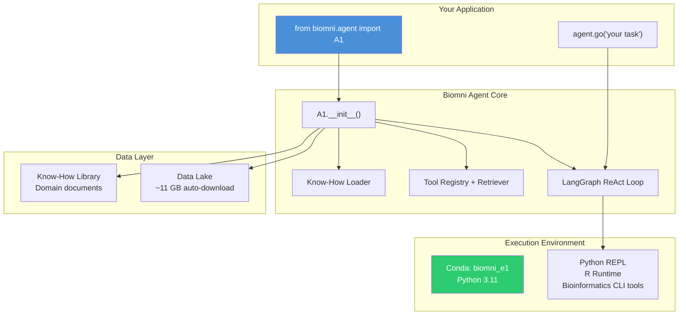
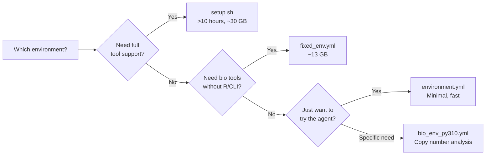
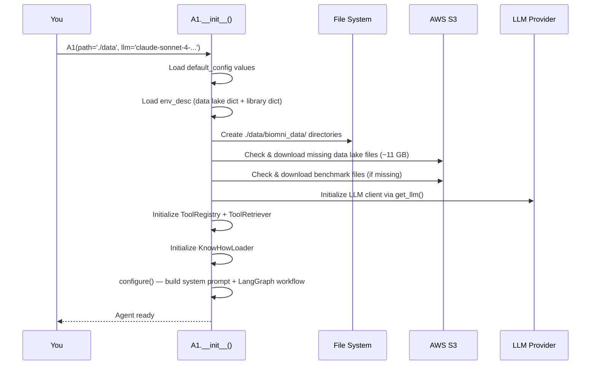

Get Biomni running in under ten minutes. This guide walks you through environment setup, package installation, API key configuration, and your first biomedical AI agent invocation — each step verified against the actual codebase.


## Architecture at a Glance

Before diving into installation, it helps to understand the three-layer architecture you are setting up. The diagram below shows the dependency flow from your Python code down to the execution environment.



The **Agent Core** (layer 2) is what you install via pip. The **Execution Environment** (layer 3) is what you install via conda — it provides the Python 3.11 runtime, bioinformatics tools, and R packages that the agent's code executor calls into at runtime. The **Data Layer** is downloaded automatically on first run.

Sources: [a1.py](biomni/agent/a1.py#L56-L68), [pyproject.toml](pyproject.toml#L13-L18)

---

## Prerequisites

Biomni requires a specific stack. Make sure you have these before proceeding.

| Requirement | Minimum Version | Purpose |
|---|---|---|
| **Conda** (or Micromamba) | Any recent version | Environment management for the execution layer |
| **Python** | 3.11 | Runtime for the Biomni package itself |
| **LLM API Key** | — | Anthropic (Claude), OpenAI, or another supported provider |
| **Disk Space** | ~30 GB (full), ~13 GB (reduced) | For the conda environment and data lake downloads |
| **OS** | Ubuntu 22.04 64-bit (tested) | The full `setup.sh` script is validated on this platform |

Sources: [pyproject.toml](pyproject.toml#L17), [biomni_env/README.md](biomni_env/README.md#L1-L75)

---

## Step 1 — Set Up the Execution Environment

Biomni ships four environment options, each representing a different trade-off between completeness and setup time. Choose the one that matches your needs:



### Option A — Full Environment (all tools, R, CLI)

This is the recommended option for production use. Clone the repository and run the setup script inside the `biomni_env/` directory.

```bash
git clone https://github.com/snap-stanford/Biomni.git
cd Biomni/biomni_env
bash setup.sh
```

The script is interactive — it will prompt you to confirm each optional component. The full installation takes over 10 hours and requires at least 30 GB of free disk space. It installs conda packages, R packages, and bioinformatics CLI tools (BLAST, Bowtie2, BWA, FastQC, MAFFT, and more) via the [install_cli_tools.sh](biomni_env/install_cli_tools.sh) script.

Sources: [setup.sh](biomni_env/setup.sh#L1-L80), [biomni_env/README.md](biomni_env/README.md#L20-L28)

### Option B — Reduced Environment (bio tools, no R/CLI)

A middle ground that includes most scientific Python packages and bioinformatics libraries from both `environment.yml` and `bio_env.yml`, but skips R and CLI tool installations. Requires approximately 13 GB.

```bash
git clone https://github.com/snap-stanford/Biomni.git
cd Biomni/biomni_env
conda env create -f fixed_env.yml
```

This environment includes pre-pinned versions of over 200 conda packages including Biopython, bedtools, BLAST, bowtie2, BWA, diamond, entrez-direct, FastQC, gseapy, htslib, MAFFT, and pandas — all with exact version pins for reproducibility.

Sources: [fixed_env.yml](biomni_env/fixed_env.yml#L1-L40), [biomni_env/README.md](biomni_env/README.md#L31-L37)

### Option C — Minimal Environment (agent only)

The fastest path to a working agent. This installs only the Python packages needed to run the A1 agent core — no bioinformatics tools.

```bash
git clone https://github.com/snap-stanford/Biomni.git
cd Biomni/biomni_env
conda env create -f environment.yml
```

Sources: [biomni_env/README.md](biomni_env/README.md#L15-L19), [environment.yml](biomni_env/environment.yml#L1-L40)

### Activate the Environment

Regardless of which option you chose, activate it before proceeding:

```bash
conda activate biomni_e1
```

Sources: [biomni_env/README.md](biomni_env/README.md#L43-L45)

---

## Step 2 — Install the Biomni Package

With the conda environment active, install the Biomni Python package. Two options are available:

```bash
# Option 1: PyPI release (stable)
pip install biomni --upgrade

# Option 2: Latest from GitHub main branch
pip install git+https://github.com/snap-stanford/Biomni.git@main
```

The package installs three core dependencies: **pydantic**, **langchain**, and **python-dotenv**. All other dependencies (numpy, pandas, scipy, etc.) are provided by the conda environment you created in Step 1.

> [!TIP]
> The package version is currently `0.0.8`. If you install from GitHub, you always get the latest main-branch code, which may include features and fixes not yet released to PyPI.

Sources: [pyproject.toml](pyproject.toml#L1-L21), [version.py](biomni/version.py#L1-L2)

---

## Step 3 — Configure Your API Key

Biomni needs access to an LLM provider. The A1 constructor automatically loads a `.env` file if one exists in your working directory. The simplest approach:

Create a `.env` file in your project directory with at least one provider key:

```env
# Required for Claude models (recommended)
ANTHROPIC_API_KEY=sk-ant-xxxxxxxxxxxx

# Optional: for OpenAI models
OPENAI_API_KEY=sk-xxxxxxxxxxxx
```

Alternatively, export environment variables directly in your shell:

```bash
export ANTHROPIC_API_KEY="sk-ant-xxxxxxxxxxxx"
```

The agent auto-detects which provider to use based on the model name prefix you pass to the constructor — `claude-` routes to Anthropic, `gpt-` routes to OpenAI, `gemini-` routes to Google, and so on. This detection logic lives in the `get_llm()` function in [biomni/llm.py](biomni/llm.py#L1-L276).

For the complete list of supported providers and advanced configuration (Azure, Bedrock, Groq, Ollama, custom endpoints), see [API Key Configuration](3-api-key-configuration).

Sources: [a1.py](biomni/agent/a1.py#L47-L50), [config.py](biomni/config.py#L1-L100)

---

## Step 4 — Run Your First Task

You are now ready to invoke the agent. The following code initializes A1, downloads the data lake (on first run only), and executes a biomedical task using natural language.

```python
from biomni.agent import A1

# Initialize the agent
# First run: ~11 GB data lake files are downloaded automatically
agent = A1(path='./data', llm='claude-sonnet-4-20250514')

# Execute a biomedical task
agent.go("Plan a CRISPR screen to identify genes that regulate T cell exhaustion, generate 32 genes that maximize the perturbation effect.")
```

### What Happens When You Initialize A1

The constructor performs several setup steps in sequence. Understanding this flow helps with troubleshooting.



### Constructor Parameters Reference

| Parameter | Type | Default | Description |
|---|---|---|---|
| `path` | `str` | `"./data"` | Root directory for data lake storage |
| `llm` | `str` | `"claude-sonnet-4-5"` | Model name (auto-detects provider from prefix) |
| `source` | `str` | `None` (auto-detect) | Explicit provider: `"OpenAI"`, `"Anthropic"`, `"Gemini"`, etc. |
| `use_tool_retriever` | `bool` | `True` | Enable retrieval-augmented tool selection |
| `timeout_seconds` | `int` | `600` | Code execution timeout per step |
| `commercial_mode` | `bool` | `False` | If `True`, excludes non-commercial datasets |
| `expected_data_lake_files` | `list` | `None` (all files) | Pass `[]` to skip data lake download |

Sources: [a1.py](biomni/agent/a1.py#L56-L68), [a1.py](biomni/agent/a1.py#L130-L180)

### More Task Examples

Biomni spans a wide range of biomedical domains. Here are examples that exercise different tool sets:

```python
# Single-cell RNA-seq annotation
agent.go("Perform scRNA-seq annotation at /path/to/data.h5ad and generate meaningful hypothesis")

# Drug property prediction
agent.go("Predict ADMET properties for this compound: CC(C)CC1=CC=C(C=C1)C(C)C(=O)O")

# Literature and database queries
agent.go("Find FDA-approved drugs targeting the EGFR pathway with their mechanism of action")

# Genomic analysis
agent.go("Identify potential causal genes for the GWAS lead variant rs12345 near BRCA1 locus")
```

---

## Step 5 — Skip Data Lake Download (Optional)

If you want to iterate quickly during development, or if you are working in a bandwidth-limited environment, you can skip the ~11 GB automatic data lake download:

```python
agent = A1(path='./data', llm='claude-sonnet-4-20250514', expected_data_lake_files=[])
```

This initializes the agent with only the in-memory tool registry and know-how library. Some tools that depend on specific data files (e.g., pre-built indexes, reference genomes) will not function without their corresponding data lake entries.

> [!TIP]
> Use `expected_data_lake_files=[]` for rapid prototyping and testing of the agent's reasoning loop. Switch back to the default (full download) when you need the complete tool ecosystem.

Sources: [a1.py](biomni/agent/a1.py#L160-L175)

---

## Step 6 — Launch the Web Interface (Optional)

Biomni includes a built-in Gradio web UI for interactive, no-code usage. Install the Gradio dependency and launch:

```bash
# Install Gradio (requires 5.x, not 6.x)
pip install "gradio>=5.0,<6.0"
```

```python
from biomni.agent import A1

agent = A1(path='./data', llm='claude-sonnet-4-20250514')
agent.launch_gradio_demo()
```

The interface becomes available at `http://localhost:7860`. Key options:

| Parameter | Default | Effect |
|---|---|---|
| `share` | `False` | Create a public shareable Gradio link |
| `server_name` | `"0.0.0.0"` | Bind address; use `"127.0.0.1"` for localhost-only |
| `require_verification` | `False` | Require access code (default: `"Biomni2025"`) |

For more details on the web interface, see [Gradio Web Interface](4-gradio-web-interface).

Sources: [a1.py](biomni/agent/a1.py#L2627-L2650), [README.md](README.md#L1-L200)

---

## Streaming Execution

For long-running tasks or when you need real-time visibility into the agent's reasoning steps, use `go_stream()` instead of `go()`. It returns a generator that yields each step as a dictionary:

```python
for step in agent.go_stream("Identify druggable targets in the Wnt signaling pathway"):
    print(step["output"])
```

This is particularly useful when building your own front-end or logging system on top of Biomni. Both `go()` and `go_stream()` share the same LangGraph workflow — the difference is purely in how results are delivered to your code.

Sources: [a1.py](biomni/agent/a1.py#L1791-L1828)

---

## Troubleshooting Common Issues

| Symptom | Likely Cause | Resolution |
|---|---|---|
| `ImportError: langchain-openai` | Missing langchain provider package | `pip install langchain-openai` or `langchain-anthropic` |
| `ImportError: Gradio is not installed` | Gradio not in environment | `pip install "gradio>=5.0,<6.0"` |
| Data lake download stalls | Network issues or S3 timeout | Use `expected_data_lake_files=[]` to skip, retry later |
| `gpt-5` model returns 400 error | Responses API incompatibility | Handled automatically in code — ensure latest pip version |
| Tool X not found at runtime | Tool requires data lake file | Ensure data lake fully downloaded (remove `expected_data_lake_files=[]`) |
| Conda env creation fails | Package conflicts | Try `fixed_env.yml` instead of full `setup.sh` |

For a complete list of known package conflicts (hyperimpute, langchain_aws, cnvkit, panhumanpy), see [docs/known_conflicts.md](docs/known_conflicts.md).

Sources: [known_conflicts.md](docs/known_conflicts.md#L1-L35)

---

## Next Steps

Now that you have Biomni running, here is a recommended reading progression to deepen your understanding:

- **[API Key Configuration](3-api-key-configuration)** — Configure multiple providers, Azure, Bedrock, Ollama, and custom model endpoints
- **[Gradio Web Interface](4-gradio-web-interface)** — Full guide to deploying the interactive UI with authentication
- **[Architecture Overview](8-architecture-overview)** — Deep dive into the ReAct reasoning loop, tool registry, and retrieval system
- **[A1 Agent Core Class](9-a1-agent-core-class)** — Complete API reference for the A1 class including `add_tool()`, `add_data()`, and `add_software()`
- **[Biomni 101 Notebook](../tutorials/biomni_101.ipynb)** — Interactive tutorial covering basic concepts and first steps