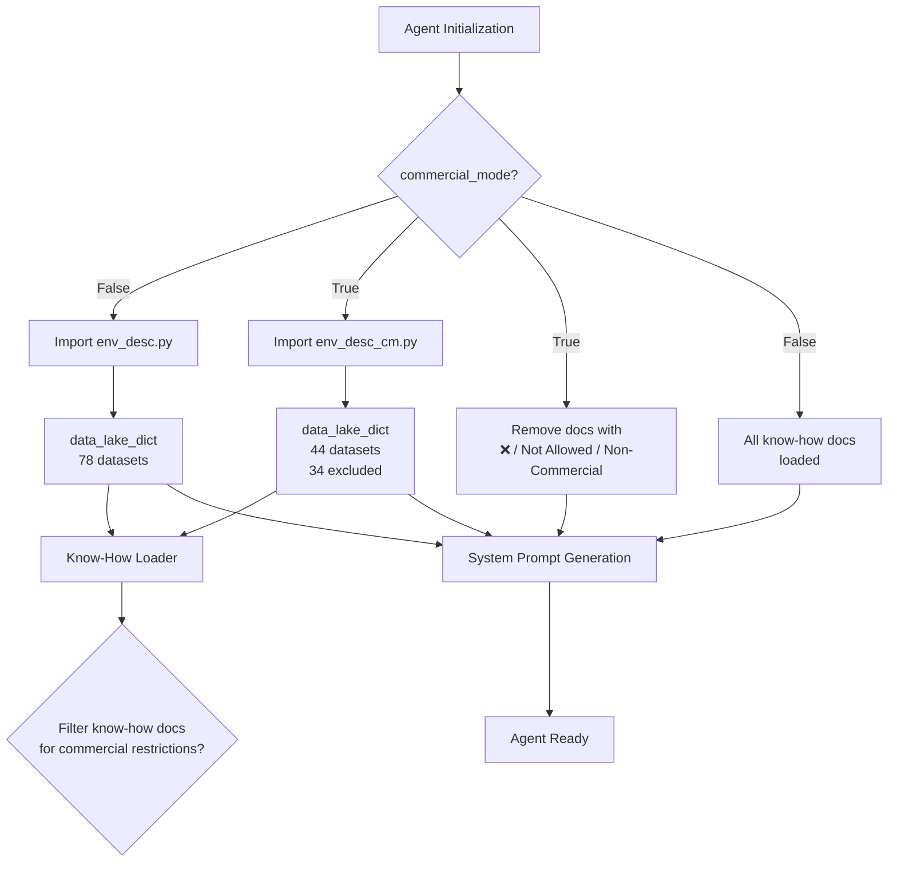
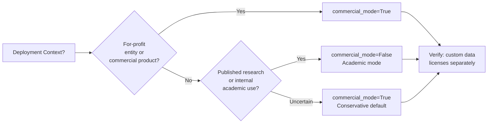

Biomni operates across two distinct licensing regimes that govern which datasets, knowledge resources, and retrieval contexts the agent can access. The mode is not a feature toggle that changes agent behavior — it is a **data governance boundary** that determines which resources are injected into the agent's system prompt, thereby shaping every downstream reasoning and tool-selection decision.

## Architectural Overview

The commercial mode implementation follows a strategy pattern: at agent initialization time, the `A1` constructor selects one of two parallel environment description modules, each containing a pre-filtered `data_lake_dict`. A secondary filter is then applied to the know-how document library. Both mechanisms execute **before** the system prompt is generated, meaning the agent never sees excluded resources and cannot attempt to access them.



Sources: [a1.py](biomni/agent/a1.py#L56-L230), [config.py](biomni/config.py#L12-L68)

## Configuration Methods

There are three equivalent paths to enable commercial mode, each resolved in a strict priority order. The constructor parameter takes precedence over the environment variable, which in turn overrides the `BiomniConfig` default.

| Method | Syntax | Priority | Scope |
|--------|--------|----------|-------|
| **Constructor argument** | `A1(commercial_mode=True)` | Highest (evaluated first) | Per-agent instance |
| **Environment variable** | `BIOMNI_COMMERCIAL_MODE=true` | Medium (overridden by constructor) | Process-wide |
| **Config dataclass** | `BiomniConfig(commercial_mode=True)` | Lowest (fallback default) | Shared across instances |

The `__post_init__` method in `BiomniConfig` reads the environment variable during instantiation ([config.py#L67-L68](biomni/config.py#L67-L68)), but the `A1.__init__` constructor applies its own cascade: any explicitly-passed parameter overrides the `default_config` singleton ([a1.py#L93-L95](biomni/agent/a1.py#L93-L95)). This means setting `commercial_mode=True` on a specific `A1` instance will work regardless of the environment variable state, while leaving the parameter as `None` defers to whatever `BiomniConfig` resolved.

When commercial mode activates, the constructor emits a diagnostic line to stdout:
- Academic mode: `"🎓 Academic mode: Using all datasets (including non-commercial)"`
- Commercial mode: `"🏢 Commercial mode: Using commercial-licensed datasets only"`

Additionally, the configuration block printed at startup displays the resolved mode as either `"Commercial (licensed datasets only)"` or `"Academic (all datasets)"` ([a1.py#L110-L113](biomni/agent/a1.py#L110-L113)).

Sources: [config.py](biomni/config.py#L43-L68), [a1.py](biomni/agent/a1.py#L85-L126)

## Data Lake Exclusions

The data lake is the primary resource affected by mode switching. The academic module [env_desc.py](biomni/env_desc.py) exposes the full catalog of 78 datasets, while the commercial module [env_desc_cm.py](biomni/env_desc_cm.py) comments out 34 entries that carry non-commercial licensing. The software library (`library_content_dict`) is **identical** between both modules — no Python packages, R packages, or CLI tools are excluded regardless of mode.

### Excluded Datasets by License Category

| License Category | Datasets Excluded | Key Affected Domains |
|---|---|---|
| **CC BY-NC-SA 4.0** | DDInter (8 files), DisGeNET, McPAS-TCR | Drug-drug interactions, gene-disease associations, TCR specificity |
| **CC BY-NC 4.0** | miRTarBase (3 files) | Validated microRNA-target interactions |
| **Commercial license required** | MSigDB (10 files), OMIM, BindingDB | Gene set enrichment, genetic disorders, drug-target binding |
| **Proprietary / permission required** | EveBio (7 files), Enamine REAL | Screening assay results, compound libraries |
| **Non-commercial use only** | miRDB | Predicted microRNA targets |

This removes entire analytical domains from the agent's awareness. For example, with MSigDB's 10 gene set collections excluded, the agent loses access to hallmark gene sets, oncogenic signatures, immunologic signatures, and curated positional gene sets — all critical for pathway enrichment analysis. The omission of DDInter's 8 drug-drug interaction files similarly blinds the agent to a comprehensive pharmacovigilance resource.

Sources: [env_desc_cm.py](biomni/env_desc_cm.py#L1-L80), [env_desc.py](biomni/env_desc.py#L1-L80)

### Impact on Downstream Capabilities

The data lake dictionary is not merely a file inventory — each entry includes a human-readable description that is injected verbatim into the system prompt. When a dataset is excluded, its description disappears from the prompt entirely. This means:

1. **The agent cannot discover excluded datasets** through tool retrieval, since the retriever operates over the system prompt's resource catalog.
2. **The agent cannot reference excluded datasets in code**, because the dataset descriptions serve as the agent's primary knowledge about available file paths and their contents.
3. **Query routing is affected**: the agent's `use_tool_retriever` path ([a1.py#L1646-L1655](biomni/agent/a1.py#L1646-L1655)) selects resources from the already-filtered catalog before generating the prompt.

Sources: [a1.py](biomni/agent/a1.py#L898-L940), [a1.py](biomni/agent/a1.py#L1646-L1655)

## Know-How Document Filtering

In addition to the data lake, commercial mode applies a secondary filter to the know-how library — the collection of curated methodology guides and best-practice documents stored as markdown files under `biomni/know_how/`. The `_filter_know_how_for_commercial_mode()` method inspects each document's `commercial_use` metadata field and removes any document containing the markers `❌`, `Not Allowed`, or `Non-Commercial` ([a1.py#L876-L893](biomni/agent/a1.py#L876-L893)).

```python
# Detection logic (simplified)
for doc_id, doc in self.know_how_loader.documents.items():
    commercial_use = metadata.get("commercial_use", "")
    if "❌" in commercial_use or "Not Allowed" in commercial_use or "Non-Commercial" in commercial_use:
        docs_to_remove.append(doc_id)
```

Each know-how document includes a YAML-like metadata section parsed by `KnowHowLoader._extract_metadata()` ([loader.py#L64-L100](biomni/know_how/loader.py#L64-L100)). Documents that permit commercial use mark this explicitly with `**Commercial Use**: ✅ Allowed` (as seen in both [single_cell_annotation.md](biomni/know_how/single_cell_annotation.md#L1-L30) and [sgRNA_design_guide.md](biomni/know_how/sgRNA_design_guide.md#L1-L30)). Documents without any `commercial_use` metadata field are **retained by default** — the filter only acts on explicit prohibitions.

Excluded documents are removed from the in-memory `documents` dictionary via `KnowHowLoader.remove_document()` and cannot be recovered without reloading the entire document set.

> [!TIP]
> The know-how filter is additive: you can add custom know-how documents at runtime via `KnowHowLoader.add_custom_document()` and include a `commercial_use` metadata field to control their visibility under commercial mode. The filtering runs only once during `__init__`, so documents added after construction bypass the filter entirely unless you manually invoke `_filter_know_how_for_commercial_mode()`.

Sources: [a1.py](biomni/agent/a1.py#L876-L893), [loader.py](biomni/know_how/loader.py#L28-L100), [single_cell_annotation.md](biomni/know_how/single_cell_annotation.md#L1-L30)

## What Remains Unchanged

Two resource layers are **not affected** by commercial mode:

1. **Software library** (`library_content_dict`): Both [env_desc.py](biomni/env_desc.py#L81-L222) and [env_desc_cm.py](biomni/env_desc_cm.py#L81-L220) contain identical package and tool inventories. All Python packages (rdkit, scanpy, biopython, etc.), R packages (DESeq2, clusterProfiler, etc.), and CLI tools (samtools, bedtools, etc.) remain available in both modes.

2. **Custom resources**: Any tools, data, or software added at runtime via `A1.add_tool()`, `A1.add_data()`, or `A1.add_software()` are not subject to mode filtering. These custom entries are maintained in separate dictionaries and appended to the system prompt independently ([a1.py#L676-L786](biomni/agent/a1.py#L676-L786)).

This design is intentional: the software tools themselves carry compatible open-source licenses, while the licensing restrictions apply to the **data** those tools operate on and the **knowledge** resources that guide their use.

Sources: [env_desc_cm.py](biomni/env_desc_cm.py#L81-L220), [a1.py](biomni/agent/a1.py#L676-L860)

## Practical Guidance

### When to Use Academic Mode

Academic mode (`commercial_mode=False`, the default) provides maximum analytical breadth. Use it for research, exploratory analysis, and any work that falls squarely under non-commercial or academic licensing terms. The additional 34 datasets significantly expand the agent's ability to perform drug repurposing analysis, gene set enrichment, miRNA target prediction, and drug-drug interaction checks.

### When to Use Commercial Mode

Commercial mode (`commercial_mode=True`) should be activated for any deployment where results may be used in a commercial context — pharmaceutical R&D at for-profit entities, contract research, or commercial product development. It provides a compliance boundary by construction: the agent physically cannot access excluded resources, eliminating the risk of inadvertent licensing violations in generated code or analysis outputs.

### Mode Selection Decision Flow



Sources: [config.py](biomni/config.py#L43-L43), [a1.py](biomni/agent/a1.py#L95-L102)

### Runtime Verification

After agent instantiation, you can verify the active mode by inspecting the `commercial_mode` attribute or checking the size of the loaded resource catalogs:

```python
agent = A1(commercial_mode=True)
print(agent.commercial_mode)               # True
print(len(agent.data_lake_dict))           # ~44 (vs ~78 in academic mode)
print(len(agent.know_how_loader.documents)) # Reduced if non-commercial docs exist
```

The agent prints a full configuration summary at startup, including the resolved mode and data statistics ([a1.py#L108-L126](biomni/agent/a1.py#L108-L126)).

## Continuing Your Exploration

- **[Configuration Reference](21-configuration-reference)** — Full parameter reference for `BiomniConfig` and all supported environment variables.
- **[Know-How Library](17-know-how-library)** — How know-how documents are structured, authored, and how to add custom methodology guides.
- **[Custom Tools and Data](18-custom-tools-and-data)** — Extending the agent with domain-specific tools and datasets that bypass mode filtering.
- **[Data Lake Management](16-data-lake-management)** — Understanding how datasets are downloaded, stored, and made available to the agent.