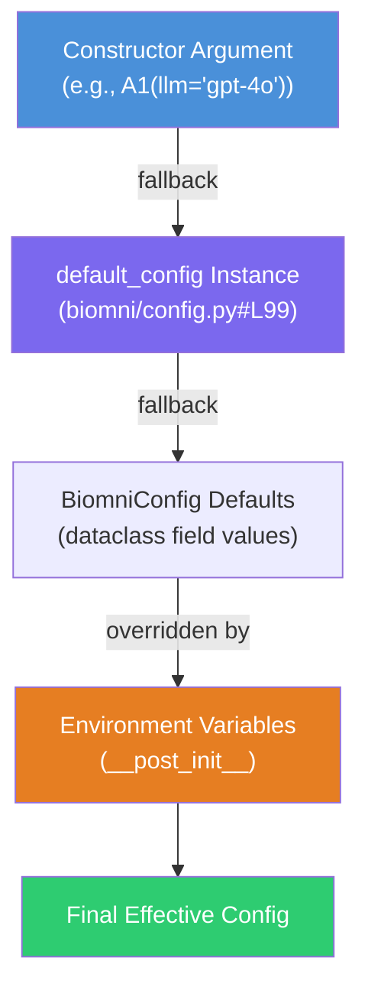
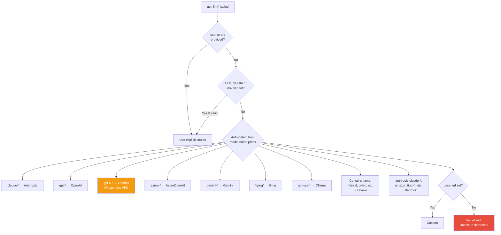

Biomni exposes a layered configuration system centered on the `BiomniConfig` dataclass. Configuration values flow downward from programmatic constructor arguments, through a global default instance, to environment variable overrides at the lowest level. This reference documents every configurable parameter, its resolution priority, and the behavioral effect each setting produces on the agent at runtime.

## Configuration Architecture

The configuration system follows a three-tier resolution chain. When any parameter is left unspecified, the system walks down this chain until it finds a concrete value:



The key insight is that **environment variables always win** over both constructor arguments and the global defaults, because `__post_init__` runs after the dataclass fields are assigned and unconditionally overwrites them if the corresponding env var is present. This design choice ensures that deployment environments (Docker, CI, HPC) can override any setting without modifying Python code.

Sources: [config.py](/biomni/config.py#L12-L99), [config.py](/biomni/config.py#L55-L81)

## The BiomniConfig Dataclass

All configuration is defined in a single `@dataclass` in `biomni/config.py`. A module-level singleton `default_config` is instantiated at import time and consumed by both the `A1` and `react` agent classes whenever their constructor arguments are `None`.

### Data and Execution Settings

| Parameter | Type | Default | Env Override | Description |
|-----------|------|---------|-------------|-------------|
| `path` | `str` | `"./data"` | `BIOMNI_PATH` or `BIOMNI_DATA_PATH` | Root directory for data lake and benchmark files. Created automatically if it doesn't exist. The agent creates subdirectories `biomni_data/data_lake/` and `biomni_data/benchmark/` beneath this path. |
| `timeout_seconds` | `int` | `600` | `BIOMNI_TIMEOUT_SECONDS` | Maximum execution time for any single tool call or code block, applied via a threading-based timeout wrapper. |

The `timeout_seconds` parameter is passed through to the `_add_timeout_to_tools` method in both `A1` and `react` agents, where each tool function is wrapped with a `run_with_timeout` call from `biomni/utils.py`. This uses threading (not multiprocessing) so that global namespace variables persist between tool invocations within the same session.

Sources: [config.py](/biomni/config.py#L31-L33), [utils.py](/biomni/utils.py#L183-L188), [react.py](/biomni/agent/react.py#L90-L92)

### LLM Settings

| Parameter | Type | Default | Env Override | Description |
|-----------|------|---------|-------------|-------------|
| `llm` | `str` | `"claude-sonnet-4-5"` | `BIOMNI_LLM` or `BIOMNI_LLM_MODEL` | Model identifier string passed to `get_llm()`. The value is interpreted differently depending on the `source` parameter — see [LLM Source Resolution](#llm-source-resolution). |
| `temperature` | `float` | `0.7` | `BIOMNI_TEMPERATURE` | Sampling temperature for generation. Note that `gpt-5-*` models force this to `1.0` at the payload level because those models only accept the default value. |
| `source` | `str \| None` | `None` (auto-detect) | `BIOMNI_SOURCE` | Explicit provider override. When `None`, `get_llm()` uses a prefix-matching heuristic to determine the provider (see below). |
| `base_url` | `str \| None` | `None` | `BIOMNI_CUSTOM_BASE_URL` | Custom endpoint URL for self-hosted LLM serving (e.g., `"http://localhost:8000/v1"`). Only used when `source` is `"Custom"`. |
| `api_key` | `str \| None` | `None` | `BIOMNI_CUSTOM_API_KEY` | API key for custom model endpoints. **Not** used for provider keys (Anthropic, OpenAI, etc.) — those are read directly from provider-specific env vars like `ANTHROPIC_API_KEY`. |

Sources: [config.py](/biomni/config.py#L35-L50), [llm.py](/biomni/llm.py#L13-L21)

## LLM Source Resolution

The `get_llm()` function in `biomni/llm.py` supports eight distinct provider backends. The resolution logic follows a clear priority chain: explicit `source` argument → `LLM_SOURCE` env var → model-name heuristic.



### Provider Reference Table

| Source | Model Prefix Pattern | Required Package | Required Env Vars | Special Behavior |
|--------|---------------------|-----------------|-------------------|-----------------|
| **Anthropic** | `claude-*` | `langchain-anthropic` | `ANTHROPIC_API_KEY` | Falls back to reading from `~/.bash_profile`; `max_tokens=8192` |
| **OpenAI** | `gpt-*` (non-5) | `langchain-openai` | `OPENAI_API_KEY` | Standard Chat Completions API |
| **OpenAI (Responses)** | `gpt-5-*` | `langchain-openai` | `OPENAI_API_KEY` | Forces Responses API; drops `stop` and `temperature` from payload to avoid 400 errors |
| **AzureOpenAI** | `azure-*` | `langchain-openai` | `OPENAI_API_KEY`, `OPENAI_ENDPOINT` | Strips `azure-` prefix for deployment name; API version `2024-12-01-preview` |
| **Gemini** | `gemini-*` | `langchain-openai` | `GEMINI_API_KEY` | Routed through OpenAI-compatible endpoint at `generativelanguage.googleapis.com` |
| **Groq** | `*groq*` (case-insensitive) | `langchain-openai` | `GROQ_API_KEY` | Routed through OpenAI-compatible endpoint at `api.groq.com` |
| **Ollama** | `gpt-oss-*`, `*llama*`, `*mistral*`, `*qwen*`, etc. | `langchain-ollama` | None (local) | Also triggered by `/` in model name |
| **Bedrock** | `anthropic.claude-*`, `amazon.titan-*`, `meta.llama-*`, etc. | `langchain-aws` | AWS credentials | Defaults to `us-east-1`; region configurable via `AWS_REGION` |
| **Custom** | Any (when `base_url` set) | `langchain-openai` | None (self-hosted) | **Requires** `base_url`; `max_tokens=8192` |

The Anthropic backend includes a unique fallback mechanism: if `ANTHROPIC_API_KEY` is not found in the environment, it attempts to source it from `~/.bash_profile` via a subprocess call, which can be useful in HPC environments where keys are loaded at shell login.

Sources: [llm.py](/biomni/llm.py#L56-L143), [llm.py](/biomni/llm.py#L200-L276)

## Tool System Configuration

| Parameter | Type | Default | Env Override | Description |
|-----------|------|---------|-------------|-------------|
| `use_tool_retriever` | `bool` | `True` | `BIOMNI_USE_TOOL_RETRIEVER` | When enabled, the agent uses `ToolRetriever` for LLM-based prompt-driven retrieval to select a relevant subset of tools, data lake files, and library packages for each query. When disabled, the full tool catalog is injected into the system prompt. |

When `use_tool_retriever` is `True`, the `A1` agent initializes both a `ToolRegistry` (holding all registered tool metadata) and a `ToolRetriever` instance. Before each call to `go()` or `go_stream()`, the retriever calls `_prepare_resources_for_retrieval()` which formats the available resources and asks the LLM to select the most relevant subset. This reduces context window pressure and improves tool selection precision.

When disabled, all tools from every module are loaded into the system prompt at `configure()` time, which increases token usage but provides the agent with complete visibility into all available tools.

Sources: [config.py](/biomni/config.py#L40-L41), [a1.py](/biomni/agent/a1.py#L179-L181), [a1.py](/biomni/agent/a1.py#L1646-L1655)

## Licensing Mode: Commercial vs. Academic

| Parameter | Type | Default | Env Override | Description |
|-----------|------|---------|-------------|-------------|
| `commercial_mode` | `bool` | `False` | `BIOMNI_COMMERCIAL_MODE` | Controls which datasets and know-how documents are available. |

This setting triggers a fundamentally different data environment. The `A1.__init__()` method conditionally imports from either `biomni/env_desc.py` (academic) or `biomni/env_desc_cm.py` (commercial):

```python
if commercial_mode:
    from biomni.env_desc_cm import data_lake_dict, library_content_dict
else:
    from biomni.env_desc import data_lake_dict, library_content_dict
```

In **academic mode** (the default), the agent has access to the full catalog of 80+ data lake files including BindingDB drug affinities, DisGeNET gene-disease associations, MSigDB gene sets, OMIM genetic disorder data, Enamine compound libraries, EveBio screening results, miRTarBase microRNA interactions, and McPAS-TCR immune receptor data.

In **commercial mode**, 23 datasets are excluded because they carry non-commercial licenses (CC BY-NC-SA 4.0, CC BY-NC 4.0) or proprietary restrictions. The filtered datasets include: all DDInter drug-drug interaction files, DisGeNET, Enamine REAL library, all EveBio tables, McPAS-TCR, miRDB, all miRTarBase files, all MSigDB collections, and OMIM. The remaining ~57 datasets with permissive or unspecified licenses remain available.

Additionally, the `_filter_know_how_for_commercial_mode()` method removes any know-how documents that have commercial-use restrictions from the `KnowHowLoader` index at startup.

Sources: [config.py](/biomni/config.py#L43-L44), [a1.py](/biomni/agent/a1.py#L109-L116), [env_desc_cm.py](/biomni/env_desc_cm.py#L1-L80), [a1.py](/biomni/agent/a1.py#L876-L882)

## Agent-Level Configuration

Beyond `BiomniConfig`, both the `A1` and `react` agent classes expose additional configuration points through their constructors and methods.

### A1 Constructor Parameters

The `A1` class accepts every `BiomniConfig` field as an optional constructor argument, with one addition:

| Parameter | Type | Default | Description |
|-----------|------|---------|-------------|
| `expected_data_lake_files` | `list \| None` | `None` (all files) | When explicitly provided (non-None), the agent skips automatic S3 data lake download. Set to an empty list `[]` to disable download entirely. |

The constructor falls back to `default_config` for any unspecified parameter, then prints a formatted configuration summary to stdout showing both the default config values and any agent-level overrides.

Sources: [a1.py](/biomni/agent/a1.py#L57-L68), [a1.py](/biomni/agent/a1.py#L121-L181)

### A1.configure() Parameters

The `configure()` method, called automatically at the end of `__init__`, accepts runtime behavioral flags:

| Parameter | Type | Default | Description |
|-----------|------|---------|-------------|
| `self_critic` | `bool` | `False` | Enables self-critic mode where the agent reviews and potentially revises its own output before finalizing. |
| `test_time_scale_round` | `int` | `0` | Number of additional reasoning rounds for test-time compute scaling. Higher values increase reasoning depth at the cost of latency and token usage. |

These parameters modify the agent's LangGraph workflow structure — specifically, they change how the system prompt is generated and how many reasoning iterations the graph allows before terminating.

Sources: [a1.py](/biomni/agent/a1.py#L1289-L1297)

### react Constructor Parameters

The lightweight `react` agent accepts a subset of configuration:

| Parameter | Type | Default | Description |
|-----------|------|---------|-------------|
| `path` | `str \| None` | From `default_config` | Data directory path |
| `llm` | `str \| None` | From `default_config` | LLM model name |
| `use_tool_retriever` | `bool \| None` | From `default_config` | Tool retrieval toggle |
| `timeout_seconds` | `int \| None` | From `default_config` | Execution timeout |

The `react` agent does **not** support `source`, `base_url`, `api_key`, or `commercial_mode` — it always uses the global default config for LLM resolution and always operates in academic mode.

Sources: [react.py](/biomni/agent/react.py#L39-L53)

## Execution Parameters

Several configuration values are hardcoded within the agent internals rather than exposed through `BiomniConfig`:

| Parameter | Value | Location | Description |
|-----------|-------|----------|-------------|
| `recursion_limit` | `500` | `A1.go()`, `A1.go_stream()`, `launch_gradio_demo()` | Maximum number of LangGraph node traversals per agent invocation. Acts as a safety bound against infinite loops in the reasoning graph. |
| `thread_id` | `42` | `A1.go()`, `launch_gradio_demo()` | LangGraph checkpointing thread identifier. Change this to isolate conversation states. |
| `stop_sequences` | `["</execute>", "</solution>"]` | `A1.__init__()` | Custom stop tokens that tell the LLM when to end its code-generation or solution-generation phase. |
| `max_tokens` | `8192` | `get_llm()` for Anthropic, Custom | Maximum output token count for Anthropic and custom-served models. |

Sources: [a1.py](/biomni/agent/a1.py#L1766-L1767), [a1.py](/biomni/agent/a1.py#L1791-L1792), [llm.py](/biomni/llm.py#L139-L142), [llm.py](/biomni/llm.py#L257-L264)

## Gradio Interface Configuration

The `launch_gradio_demo()` method exposes its own set of launch parameters independent of `BiomniConfig`:

| Parameter | Type | Default | Description |
|-----------|------|---------|-------------|
| `thread_id` | `int` | `42` | LangGraph checkpoint thread for the Gradio session. |
| `share` | `bool` | `False` | Create a public Gradio shareable link (useful for remote demos). |
| `server_name` | `str` | `"0.0.0.0"` | Network interface to bind. Use `"127.0.0.1"` for local-only access. |
| `require_verification` | `bool` | `False` | When enabled, presents an access code gate before the chat interface. Default access code is `"Biomni2025"`. |

Sources: [a1.py](/biomni/agent/a1.py#L2627-L2636)

## Third-Party Integrations

| Parameter | Type | Default | Env Override | Description |
|-----------|------|---------|-------------|-------------|
| `protocols_io_access_token` | `str \| None` | `None` | `PROTOCOLS_IO_ACCESS_TOKEN` or `BIOMNI_PROTOCOLS_IO_ACCESS_TOKEN` | Authentication token for the Protocols.io API, used for retrieving experimental protocols. The env var resolution prefers the specific `PROTOCOLS_IO_ACCESS_TOKEN` over the `BIOMNI_`-prefixed alias. |

Sources: [config.py](/biomni/config.py#L53-L54), [config.py](/biomni/config.py#L78-L81)

## Complete Environment Variable Reference

The following table consolidates every environment variable the configuration system recognizes, including backward-compatible aliases:

| Environment Variable | Primary / Alias | Maps To | Accepted Values |
|---------------------|-----------------|---------|-----------------|
| `BIOMNI_PATH` | Primary | `BiomniConfig.path` | Directory path string |
| `BIOMNI_DATA_PATH` | Alias | `BiomniConfig.path` | Directory path string |
| `BIOMNI_TIMEOUT_SECONDS` | Primary | `BiomniConfig.timeout_seconds` | Integer string |
| `BIOMNI_LLM` | Primary | `BiomniConfig.llm` | Model identifier string |
| `BIOMNI_LLM_MODEL` | Alias | `BiomniConfig.llm` | Model identifier string |
| `BIOMNI_TEMPERATURE` | Primary | `BiomniConfig.temperature` | Float string |
| `BIOMNI_USE_TOOL_RETRIEVER` | Primary | `BiomniConfig.use_tool_retriever` | `"true"` / `"false"` (case-insensitive) |
| `BIOMNI_COMMERCIAL_MODE` | Primary | `BiomniConfig.commercial_mode` | `"true"` / `"false"` (case-insensitive) |
| `BIOMNI_CUSTOM_BASE_URL` | Primary | `BiomniConfig.base_url` | URL string |
| `BIOMNI_CUSTOM_API_KEY` | Primary | `BiomniConfig.api_key` | API key string |
| `BIOMNI_SOURCE` | Primary | `BiomniConfig.source` | `OpenAI`, `AzureOpenAI`, `Anthropic`, `Ollama`, `Gemini`, `Bedrock`, `Groq`, `Custom` |
| `LLM_SOURCE` | Provider-level | `get_llm()` source resolution | Same valid sources as above |
| `PROTOCOLS_IO_ACCESS_TOKEN` | Primary | `BiomniConfig.protocols_io_access_token` | Token string |
| `BIOMNI_PROTOCOLS_IO_ACCESS_TOKEN` | Alias | `BiomniConfig.protocols_io_access_token` | Token string |
| `ANTHROPIC_API_KEY` | Provider | Anthropic backend | Anthropic API key |
| `OPENAI_API_KEY` | Provider | OpenAI, AzureOpenAI, Gemini, Groq backends | Provider API key |
| `OPENAI_ENDPOINT` | Provider | AzureOpenAI backend | Azure endpoint URL |
| `GEMINI_API_KEY` | Provider | Gemini backend | Google API key |
| `GROQ_API_KEY` | Provider | Groq backend | Groq API key |
| `AWS_REGION` | Provider | Bedrock backend | AWS region (default: `us-east-1`) |

> [!TIP]
> **Priority trap**: Because `__post_init__` runs after dataclass field assignment, an environment variable will **always** override a constructor argument. If you need programmatic control in an environment that has `BIOMNI_LLM` set, you must either unset the env var before constructing the agent or set it explicitly after construction via `agent.llm = get_llm("your-model")`.

Sources: [config.py](/biomni/config.py#L55-L81), [llm.py](/biomni/llm.py#L67-L77)

## Configuration Examples

### Minimal: Use All Defaults

```python
from biomni.agent import A1

agent = A1()
# Uses: claude-sonnet-4-5, temperature=0.7, ./data, academic mode, tool retriever on
```

### Override via Constructor

```python
agent = A1(
    llm="gpt-4o",
    temperature=0.3,
    timeout_seconds=1200,
    commercial_mode=True,
)
```

### Override via Environment Variables

```bash
export BIOMNI_LLM="gpt-4o"
export BIOMNI_TEMPERATURE="0.3"
export BIOMNI_COMMERCIAL_MODE="true"
export ANTHROPIC_API_KEY="sk-ant-..."  # Still needed for Anthropic tools' internal LLM
python -c "from biomni.agent import A1; a = A1()"
```

### Custom Model Serving (e.g., SGLang)

```python
agent = A1(
    llm="meta-llama/Llama-3-70B-Instruct",
    source="Custom",
    base_url="http://localhost:8000/v1",
    api_key="not-needed",
)
```

### Configure Self-Critic Mode

```python
agent = A1(llm="claude-sonnet-4-5")
agent.configure(self_critic=True, test_time_scale_round=2)
```

## Next Steps

- For a walkthrough of setting up API keys for each provider, see [API Key Configuration](3-api-key-configuration).
- To understand how configuration flows into the agent's reasoning workflow, see [A1 Agent Core Class](9-a1-agent-core-class).
- For the differences between commercial and academic datasets in detail, see [Commercial vs Academic Mode](20-commercial-vs-academic-mode).
- For environment setup and dependency installation, see [Environment Setup and Dependencies](22-environment-setup-and-dependencies).