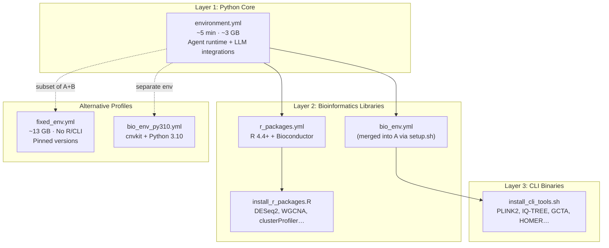
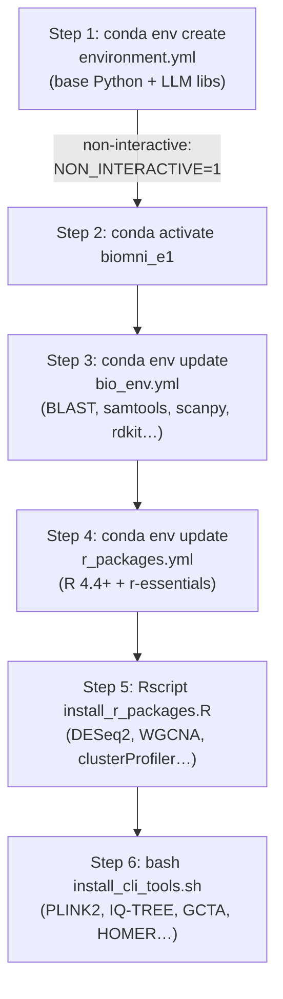

Biomni's dependency landscape is divided into two cleanly separated layers: a **Python package layer** managed through `pyproject.toml` and `environment.yml`, and a **bioinformatics tool layer** managed through conda-forge/bioconda channels plus a JSON-driven CLI tool installer. The project requires Python ≥ 3.11 and is officially tested only on Ubuntu 22.04 (64-bit). This page walks you through each installation tier, the tradeoffs between them, and how to incrementally update an existing environment.

Sources: [pyproject.toml](pyproject.toml#L1-L16), [README.md](biomni_env/README.md#L1-L30)

## Architecture of the Environment Tiers

Biomni provides four distinct environment profiles, each occupying a different point on the spectrum of completeness versus setup time and disk usage. The diagram below illustrates the layered relationship between these tiers and how they compose.



Sources: [setup.sh](biomni_env/setup.sh#L152-L191), [README.md](biomni_env/README.md#L12-L44)

## Environment Profile Comparison

| Profile | Conda File | Env Name | Disk Space | Setup Time | Includes | Best For |
|---|---|---|---|---|---|---|
| **Basic Agent** | `environment.yml` | `biomni_e1` | ~3 GB | ~5 min | LangChain, MCP, basic Python libs | Quick start, custom tool integration, API-only usage |
| **Full E1** | `setup.sh` (orchestrator) | `biomni_e1` | ~30 GB | >10 hours | Everything below | Benchmark evaluation, full tool coverage |
| **Reduced/Fixed** | `fixed_env.yml` | `biomni_e1` | ~13 GB | ~30 min | Pinned conda + bioinformatics (no R, no CLI) | Stable development, reproducible builds |
| **Python 3.10** | `bio_env_py310.yml` | `bio_env_py310` | ~2 GB | ~10 min | cnvkit + samtools + bedtools | Copy number analysis only |

Sources: [README.md](biomni_env/README.md#L12-L46), [pyproject.toml](pyproject.toml#L6-L16), [fixed_env.yml](biomni_env/fixed_env.yml#L1-L6), [bio_env_py310.yml](biomni_env/bio_env_py310.yml#L1-L8)

## Tier 1: Basic Agent Environment

The `environment.yml` file defines the minimal viable environment for running the Biomni agent. It targets Python 3.11 and installs all core LLM integration packages via pip within a conda wrapper. The three channels—`conda-forge`, `defaults`, and `bioconda`—are declared here even though the basic tier doesn't use bioconda packages directly; this ensures that subsequent `conda env update` operations from higher-tier files resolve correctly against the same channel priority.

The pip dependency set in `environment.yml` includes the LangChain ecosystem (`langchain`, `langgraph==0.3.18`, `langchain-openai`, `langchain-anthropic`, `langchain-ollama`, `langchain-community`), the MCP protocol library (`mcp`), the `tooluniverse` package for tool discovery, and scientific computing staples (`numpy==2.1`, `pandas`, `scipy`, `scikit-learn`, `statsmodels`). Gradio is included here for web interface support, and `transformers` + `sentencepiece` provide local model inference capabilities.

To create this environment:

```bash
git clone https://github.com/snap-stanford/Biomni.git
cd Biomni/biomni_env
conda env create -f environment.yml
conda activate biomni_e1
```

Sources: [environment.yml](biomni_env/environment.yml#L1-L39), [README.md](biomni_env/README.md#L1-L16)

## Tier 2: Full E1 Environment (setup.sh)

The full environment is the one used for Biomni-Eval1 benchmark evaluation. It is built by the orchestrator script `setup.sh`, which executes six sequential steps, each corresponding to a distinct installation layer. This script includes error handling with interactive fallback prompts (or non-interactive continuation via the `NON_INTERACTIVE` environment variable) and supports both conda and micromamba as the package manager backend.

The six-step installation flow proceeds as follows:



Sources: [setup.sh](biomni_env/setup.sh#L1-L34), [setup.sh](biomni_env/setup.sh#L152-L191)

### Bioinformatics Libraries (bio_env.yml)

The `bio_env.yml` file extends the base environment with conda-forge/bioconda system-level tools and a large set of Python bioinformatics packages. On the conda side, it installs sequence alignment tools (`blast`, `bowtie2`, `bwa`), variant calling infrastructure (`samtools`, `bedtools`), quality control (`fastqc`, `trimmomatic`), multiple sequence alignment (`mafft`), and CRISPR screening analysis (`mageck`). The pip section is substantially larger, covering single-cell analysis (`scanpy`, `scvelo`, `scvi-tools`, `harmony-pytorch`, `scrublet`), structural biology (`rdkit`, `openmm`, `biotite`), genomic data formats (`pysam`, `pyfaidx`, `pyranges`, `pybedtools`, `cooler`, `cyvcf2`), systems biology (`cobra` for metabolic models, `pyscenic` for gene regulatory networks), drug discovery (`pytdc==0.4.0`), literature mining (`pymed`, `scholarly`, `arxiv`), and imaging (`cellpose`, `scikit-image`). Notably, `faiss-cpu` provides the vector similarity search backend used by the retrieval-augmented tool selection system.

Sources: [bio_env.yml](biomni_env/bio_env.yml#L1-L71)

### R Packages

R support is split across two stages. First, `r_packages.yml` installs `r-essentials` and `r-base>=4.4` via conda. Then `install_r_packages.R` uses R's native package manager and BiocManager to install domain-specific packages: CRAN packages including `ggplot2`, `lme4`, `harmony`, and the Tidyverse suite, plus Bioconductor packages `DESeq2`, `dada2`, `xcms`, `flowCore`, `edgeR`, and `limma`. The script also installs `WGCNA` with its complex dependency chain (including Bioconductor packages `impute`, `preprocessCore`, `GO.db`, `AnnotationDbi`) and `clusterProfiler` for functional enrichment analysis. Each package is wrapped in an `install_if_missing` guard to support idempotent re-runs.

Sources: [r_packages.yml](biomni_env/r_packages.yml#L1-L8), [install_r_packages.R](biomni_env/install_r_packages.R#L1-L133)

### CLI Tools (install_cli_tools.sh)

The CLI tool installer is the most architecturally sophisticated component of the environment system. Rather than hardcoding tool installations, it reads from a declarative JSON configuration file (`cli_tools_config.json`) that specifies each tool's name, description, platform-specific download URLs (Linux, macOS Intel, macOS ARM64), binary path within the archive, and version command. The installer supports three archive formats (`.zip`, `.tar.gz`, and raw binary) and includes special-case handlers for tools that require compilation (`FastTree` compiled with GCC, `BWA` compiled via `make`) or custom installation workflows (`HOMER` installed via its Perl-based `configureHomer.pl` script).

All tools are installed to a configurable directory (default: `./biomni_tools`) and symlinked into a `bin/` subdirectory that is added to `PATH`. The script generates helper files (`setup_path.sh`, `test_tools.sh`, `fix_path.sh`) and can optionally modify the user's shell profile for persistent PATH configuration. It also handles shell command hash table invalidation (`hash -r` / `rehash`) to prevent stale path caching issues.

The seven tools currently configured in `cli_tools_config.json`:

| Tool | Domain | Installation Method |
|---|---|---|
| **PLINK 2.0** | GWAS / whole-genome association | Pre-built binary (per-platform) |
| **IQ-TREE 2.2.2.7** | Phylogenetic ML inference | Pre-built binary (per-platform) |
| **GCTA 1.94.x** | Genome-wide complex trait analysis | Pre-built binary (per-platform) |
| **BWA** | Short-read alignment | Git clone + `make` compilation |
| **FastTree** | Approximate-ML phylogenetic trees | Source compilation with GCC |
| **MUSCLE 5.3** | Multiple sequence alignment | Raw binary download |
| **HOMER** | Motif discovery / ChIP-seq analysis | Perl installer script |

To install CLI tools standalone (without the full setup.sh pipeline), set `BIOMNI_AUTO_INSTALL=1` for non-interactive mode or run the script directly for an interactive menu:

```bash
cd biomni_env
export BIOMNI_TOOLS_DIR="$HOME/biomni_tools"
export BIOMNI_AUTO_INSTALL=1
bash install_cli_tools.sh
source ~/biomni_tools/setup_path.sh
```

> [!TIP]
> If you encounter "No such file or directory" errors after installation, your shell is likely caching stale binary paths. Run `hash -r` (bash) or `rehash` (zsh), or use the generated fix script: `source $TOOLS_DIR/fix_path.sh`. This is the single most common post-installation issue.

Sources: [cli_tools_config.json](biomni_env/cli_tools_config.json#L1-L94), [install_cli_tools.sh](biomni_env/install_cli_tools.sh#L66-L103), [install_cli_tools.sh](biomni_env/install_cli_tools.sh#L408-L453)

## Tier 3: Reduced/Fixed Environment

The `fixed_env.yml` file provides a middle ground between the basic agent and the full E1 environment. It is a single monolithic conda environment file with **pinned versions** for every dependency (743 lines total), combining the Python packages from `environment.yml` and the bioinformatics conda packages from `bio_env.yml` into one reproducible specification. It deliberately excludes R packages and CLI tools, reducing the disk footprint to approximately 13 GB. Some packages from `bio_env.yml` that had dependency issues are commented out (e.g., `mageck`, `plannotate`), reflecting the maintainers' effort to produce a conflict-free environment.

This is the recommended profile for **development and testing** where you need bioinformatics library support but don't want to invest in the full multi-hour setup process.

```bash
conda env create -f fixed_env.yml
conda activate biomni_e1
```

Sources: [fixed_env.yml](biomni_env/fixed_env.yml#L1-L10), [fixed_env.yml](biomni_env/fixed_env.yml#L142-L186), [README.md](biomni_env/README.md#L32-L38)

## Incremental Updates (new_software_v008.sh)

When new packages are introduced in a release, the `new_software_v008.sh` script provides an incremental update path for existing environments. The current version installs or updates packages including `transformers`, `sentencepiece`, `langchain-google-genai`, `langchain_ollama`, `mcp`, `lazyslide`, `uv`, `pybiomart`, `fair-esm` (protein language models), `nnunet`/`nibabel`/`nilearn` (medical imaging), `pylabrobot` (lab automation), and `weasyprint`. Some packages require non-standard installation methods: `transcriptformer` is installed via `uv pip install` due to build constraints, `popV` is installed from a specific GitHub PR branch, and `arc-state` is installed as a `uv tool`. The script also initializes git-lfs support for large file handling.

```bash
conda activate biomni_e1
cd biomni_env
bash new_software_v008.sh
```

Sources: [new_software_v008.sh](biomni_env/new_software_v008.sh#L1-L19)

## Python Package Installation via pip

For developers who want to install the Biomni Python package itself (rather than just its dependencies), `pyproject.toml` defines a minimal set of three runtime dependencies: `pydantic`, `langchain`, and `python-dotenv`. The project uses setuptools with dynamic versioning sourced from `biomni/version.py`, and includes an optional `gradio` extra for web interface support. The `MANIFEST.in` file ensures that tool schema databases (`*.pkl` files under `biomni/tool/schema_db/`) and all environment configuration files are included in distribution packages.

```bash
pip install -e .                   # Editable install with core deps
pip install -e ".[gradio]"         # With Gradio web interface
```

Sources: [pyproject.toml](pyproject.toml#L1-L32), [MANIFEST.in](MANIFEST.in#L1-L28)

## LLM Provider Extensions

The base environment includes LangChain integrations for three providers: OpenAI (`langchain-openai`), Anthropic (`langchain-anthropic`), and Ollama (`langchain-ollama`) for local model serving. Additional providers require manual installation:

```bash
pip install langchain-google-genai   # Google Gemini
pip install langchain-aws            # Amazon Bedrock
```

Note that `langchain_aws` is documented as having known dependency conflicts with the main environment. If Bedrock support is required, you should install it in a separate virtual environment or with careful version pinning. See [known_conflicts.md](docs/known_conflicts.md) for the full conflict registry.

Sources: [README.md](biomni_env/README.md#L58-L74), [known_conflicts.md](docs/known_conflicts.md#L1-L35)

## Known Package Conflicts

Several packages are deliberately excluded from the default environment due to irreconcilable dependency conflicts. These are documented in `docs/known_conflicts.md` and summarized here:

| Package | Conflict Reason | Workaround |
|---|---|---|
| `hyperimpute` | Dependency conflicts with main environment | Install in separate env |
| `langchain_aws` | Conflicts with other langchain packages; requires uncommenting Bedrock code | Manual install + code changes |
| `cnvkit` | Requires Python 3.10; conflicts with Python 3.11 packages | Use `bio_env_py310.yml` |
| `panhumanpy` | Requires TensorFlow 2.17 + scikit-learn 1.6.0 (specific versions) | Install in dedicated env |

The cnvkit workaround is integrated into the environment system: running `conda env create -f bio_env_py310.yml` creates a `bio_env_py310` environment that can be invoked via `conda run -n bio_env_py310 <command>` for copy number analysis tasks without contaminating the main environment.

Sources: [known_conflicts.md](docs/known_conflicts.md#L1-L35), [bio_env_py310.yml](biomni_env/bio_env_py310.yml#L13-L20)

## Configuration via Environment Variables

Once the environment is activated, runtime behavior can be tuned through environment variables that are read by the `BiomniConfig` dataclass. These are orthogonal to the dependency installation process but are worth noting here because some (like `BIOMNI_PATH`) affect which tools and data the agent can access:

| Variable | Default | Purpose |
|---|---|---|
| `BIOMNI_PATH` / `BIOMNI_DATA_PATH` | `./data` | Data directory for tool outputs |
| `BIOMNI_LLM` / `BIOMNI_LLM_MODEL` | `claude-sonnet-4-5` | LLM model selection |
| `BIOMNI_TIMEOUT_SECONDS` | `600` | Per-tool execution timeout |
| `BIOMNI_USE_TOOL_RETRIEVER` | `true` | Enable retrieval-augmented tool selection |
| `BIOMNI_COMMERCIAL_MODE` | `false` | Exclude non-commercial datasets |
| `BIOMNI_CUSTOM_BASE_URL` | `None` | Custom LLM endpoint URL |
| `BIOMNI_SOURCE` | `None` | Auto-detected LLM source override |
| `PROTOCOLS_IO_ACCESS_TOKEN` | `None` | Protocols.io API access token |

Sources: [config.py](biomni/config.py#L12-L81)

## Troubleshooting Common Setup Issues

| Symptom | Cause | Resolution |
|---|---|---|
| `conda env create` fails on channel resolution | Network issues or channel priority | Ensure `conda-forge` is highest priority; try `conda env create -f environment.yml --dry-run` first |
| R packages fail to compile | Missing system libraries (e.g., `libcurl`, `libxml2`) | Install via `conda install -c conda-forge r-base r-essentials` before running `install_r_packages.R` |
| CLI tools report "command not found" | PATH not updated or shell hash cache | Run `source $TOOLS_DIR/setup_path.sh && hash -r` |
| `langgraph` version mismatch | `langgraph==0.3.18` is pinned for compatibility | Do not upgrade; check [Configuration Reference](21-configuration-reference) for version requirements |
| `setup.sh` takes >10 hours | This is expected for the full E1 environment | Use `fixed_env.yml` for a faster alternative (~30 min) |
| Python 3.10 tool fails in 3.11 env | cnvkit requires Python 3.10 | Use `conda run -n bio_env_py310 <command>` to invoke tools from the separate environment |

---

For next steps in your setup journey, configure your LLM provider API keys in [API Key Configuration](3-api-key-configuration), then explore the agent's runtime behavior in [Architecture Overview](8-architecture-overview). If you plan to extend the tool system with your own bioinformatics packages, refer to [Custom Tools and Data](18-custom-tools-and-data) and the [Tool Registry and Discovery](12-tool-registry-and-discovery) documentation.