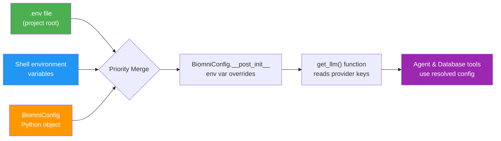
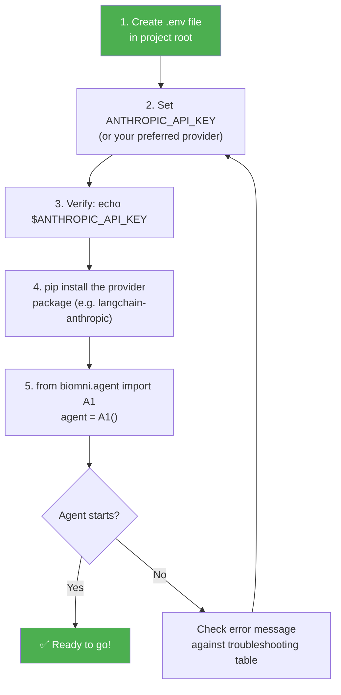

Biomni communicates with external LLM providers and third-party services through API keys. This page explains exactly which keys you need, where the code reads them from, and how to configure them step by step — so you can get the agent running without guessing.

## Where API Keys Enter the System

Before diving into specific keys, it helps to understand the loading pipeline. Biomni uses a layered configuration system with three tiers of priority:



The entry point is the `A1` agent class in [biomni/agent/a1.py](biomni/agent/a1.py#L46-L48), which calls `load_dotenv(".env")` on initialization. Then `BiomniConfig.__post_init__()` in [biomni/config.py](biomni/config.py#L55-L81) checks for environment variable overrides and applies them. Finally, `get_llm()` in [biomni/llm.py](biomni/llm.py#L13-L21) reads the provider-specific API key (e.g., `ANTHROPIC_API_KEY`, `OPENAI_API_KEY`) directly from `os.environ` at model instantiation time.

**Priority order**: Constructor parameters > Runtime `default_config` modifications > Environment variables > Hardcoded defaults. This means if you set `ANTHROPIC_API_KEY` in both `.env` and `~/.bashrc`, the `.env` file value wins (it is loaded first and `override=False` is used).
Sources: [a1.py](biomni/agent/a1.py#L46-L48), [config.py](biomni/config.py#L55-L81), [llm.py](biomni/llm.py#L13-L21)

## Supported LLM Providers and Their API Keys

Biomni supports eight LLM sources. Each one requires a different API key. The table below maps every supported provider to its required environment variable, the default model, and which LangChain package it depends on.

| Provider | `source` value | Required Env Var | Default Model | Required Package |
|---|---|---|---|---|
| **Anthropic** | `"Anthropic"` | `ANTHROPIC_API_KEY` | `claude-sonnet-4-5` | `langchain-anthropic` |
| **OpenAI** | `"OpenAI"` | `OPENAI_API_KEY` | — | `langchain-openai` |
| **Azure OpenAI** | `"AzureOpenAI"` | `OPENAI_API_KEY` + `OPENAI_ENDPOINT` | — (prefix `azure-`) | `langchain-openai` |
| **Google Gemini** | `"Gemini"` | `GEMINI_API_KEY` | — | `langchain-openai` |
| **Groq** | `"Groq"` | `GROQ_API_KEY` | — | `langchain-openai` |
| **AWS Bedrock** | `"Bedrock"` | `AWS_BEARER_TOKEN_BEDROCK` + `AWS_REGION` | — | `langchain-aws` |
| **Ollama (local)** | `"Ollama"` | *None* | — | `langchain-ollama` |
| **Custom endpoint** | `"Custom"` | `BIOMNI_CUSTOM_API_KEY` + `BIOMNI_CUSTOM_BASE_URL` | — | `langchain-openai` |

The `SourceType` literal in [biomni/llm.py](biomni/llm.py#L9-L10) defines the exact set of valid source strings. If you don't specify a source, `get_llm()` auto-detects it from the model name prefix — for example, models starting with `claude-` route to Anthropic, models starting with `gpt-` route to OpenAI, and models containing `groq` route to Groq.
Sources: [llm.py](biomni/llm.py#L56-L95)

## Method 1: The `.env` File (Recommended)

Create a `.env` file in your **project root directory** (the same folder where you run your Python scripts). The A1 agent automatically loads this file on startup via `load_dotenv()`.

```bash
# .env — place in your project root

# ─── REQUIRED: At least one LLM provider key ───────────────
# Anthropic Claude (default model for Biomni)
ANTHROPIC_API_KEY=sk-ant-xxxxx

# OpenAI (if you want to use GPT models)
# OPENAI_API_KEY=sk-xxxxx

# ─── OPTIONAL: Other LLM providers ─────────────────────────
# GEMINI_API_KEY=AIzaxxxxx
# GROQ_API_KEY=gsk_xxxxx
# AWS_BEARER_TOKEN_BEDROCK=xxxxx
# AWS_REGION=us-east-1

# Azure OpenAI (requires both key and endpoint)
# OPENAI_ENDPOINT=https://your-resource.openai.azure.com/

# ─── OPTIONAL: Force a specific provider ───────────────────
# LLM_SOURCE=Anthropic

# ─── OPTIONAL: Custom/self-hosted model serving ────────────
# BIOMNI_CUSTOM_BASE_URL=http://localhost:8000/v1
# BIOMNI_CUSTOM_API_KEY=your_key

# ─── OPTIONAL: Protocols.io integration ────────────────────
# PROTOCOLS_IO_ACCESS_TOKEN=your_token
```

> [!TIP]
> Only **one** LLM provider key is strictly required. Since Biomni defaults to `claude-sonnet-4-5`, setting `ANTHROPIC_API_KEY` alone is sufficient to get started. Add other keys only when you want to switch providers or use multiple models.

The `.env` file is loaded with `override=False`, meaning environment variables already present in the shell will **not** be overwritten. This is intentional — it lets your CI/CD pipeline set keys at the container level while still allowing local `.env` overrides during development. Source: [a1.py](biomni/agent/a1.py#L46-L48)

## Method 2: Shell Environment Variables

If you prefer to set keys globally (e.g., for use across multiple projects), add exports to your shell profile:

```bash
# Add to ~/.bashrc or ~/.zshrc
export ANTHROPIC_API_KEY="sk-ant-xxxxx"
export OPENAI_API_KEY="sk-xxxxx"          # optional
export GEMINI_API_KEY="AIzaxxxxx"         # optional
export GROQ_API_KEY="gsk_xxxxx"           # optional
export AWS_BEARER_TOKEN_BEDROCK="xxxxx"   # optional
export AWS_REGION="us-east-1"             # optional for Bedrock
export OPENAI_ENDPOINT="https://your-resource.openai.azure.com/"  # Azure only
```

After editing, reload your profile with `source ~/.bashrc` (or restart your terminal). Verify the key is loaded:

```bash
echo $ANTHROPIC_API_KEY
```

For Anthropic specifically, Biomni has a **fallback mechanism**: if `ANTHROPIC_API_KEY` is not found in the environment when an Anthropic model is requested, the code in [biomni/llm.py](biomni/llm.py#L168-L182) attempts to source it from `~/.bash_profile` via a subprocess call. This provides an extra safety net but is not reliable for all shell configurations. Source: [llm.py](biomni/llm.py#L168-L182)

## Method 3: Python Runtime Configuration

You can also configure API keys and model settings directly in Python code. This approach is useful for scripting and testing.

```python
from biomni.config import BiomniConfig, default_config

# Modify the global default config (affects all agents created after this point)
default_config.llm = "gpt-4"
default_config.source = "OpenAI"
default_config.temperature = 0.5
```

For **custom model serving** (e.g., SGLang, vLLM, or any OpenAI-compatible endpoint), you must set both `base_url` and `api_key` on the config object. These are the only fields on `BiomniConfig` that directly hold an API key value — all other providers read their keys from environment variables. Source: [config.py](biomni/config.py#L46-L47)

```python
from biomni.config import default_config

# Custom local model (e.g., served by Ollama, SGLang, or vLLM)
default_config.source = "Custom"
default_config.base_url = "http://localhost:8000/v1"
default_config.api_key = "local_key"       # Only used for Custom source
default_config.llm = "Llama-3-70B-Instruct"

from biomni.agent import A1
agent = A1()
```

> [!TIP]
> The `api_key` field on `BiomniConfig` is **only** used when `source` is set to `"Custom"`. For all other providers (Anthropic, OpenAI, Gemini, etc.), the key is read from the corresponding environment variable (`ANTHROPIC_API_KEY`, `OPENAI_API_KEY`, etc.) — **not** from this config field. This is a common source of confusion for beginners.

## Third-Party Service Keys

Beyond LLM providers, one additional service requires an API key:

### Protocols.io Access Token

The protocols integration in [biomni/tool/protocols.py](biomni/tool/protocols.py#L24-L26) reads a bearer token to search and retrieve biological protocols. The token is resolved in this priority order:

1. `PROTOCOLS_IO_ACCESS_TOKEN` environment variable
2. `BIOMNI_PROTOCOLS_IO_ACCESS_TOKEN` environment variable
3. `BiomniConfig.protocols_io_access_token` Python attribute

```bash
# In your .env or shell profile
PROTOCOLS_IO_ACCESS_TOKEN=your_token_here
```

Or in Python:

```python
from biomni.config import default_config
default_config.protocols_io_access_token = "your_token_here"
```

Without this token, protocol search tools will raise a `ValueError` at runtime but will not prevent the agent from starting. Source: [protocols.py](biomni/tool/protocols.py#L24-L26)

## Advanced: Web Search with Anthropic API

The `advanced_web_search_claude()` function in [biomni/tool/literature.py](biomni/tool/literature.py#L246-L262) uses Anthropic's native web search tool via the `anthropic` Python SDK directly (not through LangChain). It reads the API key from `BiomniConfig.api_key`, falling back to the `ANTHROPIC_API_KEY` environment variable. This feature requires a **Claude model** specifically and will raise a `ValueError` if a non-Claude model is configured. Source: [literature.py](biomni/tool/literature.py#L246-L262)

## All Environment Variables Reference

The following table lists every environment variable that Biomni reads for API key and model configuration purposes, grouped by category.

### LLM Provider Keys

| Variable | Used By | Required? | Default |
|---|---|---|---|
| `ANTHROPIC_API_KEY` | `get_llm()` for Anthropic models | Yes (default model) | — |
| `OPENAI_API_KEY` | `get_llm()` for OpenAI/Azure models | Only if using OpenAI | — |
| `OPENAI_ENDPOINT` | `get_llm()` for Azure OpenAI | Only if using Azure | — |
| `GEMINI_API_KEY` | `get_llm()` for Gemini models | Only if using Gemini | — |
| `GROQ_API_KEY` | `get_llm()` for Groq models | Only if using Groq | — |
| `AWS_BEARER_TOKEN_BEDROCK` | `get_llm()` for Bedrock models | Only if using Bedrock | — |
| `AWS_REGION` | `get_llm()` for Bedrock models | Only if using Bedrock | `us-east-1` |

### Model Source Override

| Variable | Used By | Required? | Default |
|---|---|---|---|
| `LLM_SOURCE` | `get_llm()` auto-detection override | No | Auto-detect from model name |

### Custom Model Serving

| Variable | Used By | Required? | Default |
|---|---|---|---|
| `BIOMNI_CUSTOM_BASE_URL` | `BiomniConfig.__post_init__()` | Only for Custom source | `None` |
| `BIOMNI_CUSTOM_API_KEY` | `BiomniConfig.__post_init__()` | Only for Custom source | `None` |

### Third-Party Integrations

| Variable | Used By | Required? | Default |
|---|---|---|---|
| `PROTOCOLS_IO_ACCESS_TOKEN` | `protocols.py` module-level | Only for protocol search | `None` |
| `BIOMNI_PROTOCOLS_IO_ACCESS_TOKEN` | `protocols.py` (alternate name) | Only for protocol search | `None` |

### Biomni Behavioral Settings

| Variable | Used By | Required? | Default |
|---|---|---|---|
| `BIOMNI_LLM` / `BIOMNI_LLM_MODEL` | `BiomniConfig.__post_init__()` | No | `claude-sonnet-4-5` |
| `BIOMNI_TEMPERATURE` | `BiomniConfig.__post_init__()` | No | `0.7` |
| `BIOMNI_PATH` / `BIOMNI_DATA_PATH` | `BiomniConfig.__post_init__()` | No | `./data` |
| `BIOMNI_TIMEOUT_SECONDS` | `BiomniConfig.__post_init__()` | No | `600` |
| `BIOMNI_USE_TOOL_RETRIEVER` | `BiomniConfig.__post_init__()` | No | `true` |
| `BIOMNI_COMMERCIAL_MODE` | `BiomniConfig.__post_init__()` | No | `false` |
| `BIOMNI_SOURCE` | `BiomniConfig.__post_init__()` | No | `None` (auto-detect) |

Sources: [config.py](biomni/config.py#L55-L81), [llm.py](biomni/llm.py#L56-L95), [protocols.py](biomni/tool/protocols.py#L24-L26)

## Troubleshooting Common Issues

| Symptom | Likely Cause | Fix |
|---|---|---|
| `Unable to determine model source` | Model name not recognized and no `source`/`LLM_SOURCE` set | Set `LLM_SOURCE` explicitly, or use a recognized model prefix (`claude-`, `gpt-`, `gemini-`, etc.) |
| `base_url must be provided for customly served LLMs` | Using `source="Custom"` without setting `base_url` | Set `BIOMNI_CUSTOM_BASE_URL` or `default_config.base_url` |
| `anthropic` package not found errors | Missing `langchain-anthropic` dependency | Install with `pip install langchain-anthropic` |
| Agent starts but protocol search fails | Missing `PROTOCOLS_IO_ACCESS_TOKEN` | Set the token in `.env` or via `default_config.protocols_io_access_token` |
| `.env` keys appear ignored | `.env` file in wrong directory | Ensure `.env` is in the **working directory** where you run Python, not in the package directory |

## Quick Start Checklist

Follow these steps in order to configure your API keys:



## What's Next

Now that your API keys are configured, you can:

- **Launch the agent**: Head to [Quick Start](2-quick-start) for your first biomedical task
- **Try the web interface**: See [Gradio Web Interface](4-gradio-web-interface) for the interactive UI
- **Fine-tune model selection**: Explore cost optimization with different models for agent reasoning vs. database queries in [Configuration Reference](21-configuration-reference)
- **Switch providers**: Learn about all eight supported LLM sources in [Architecture Overview](8-architecture-overview)