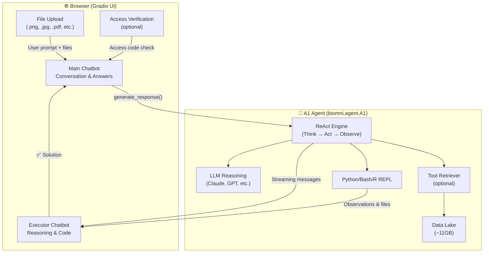
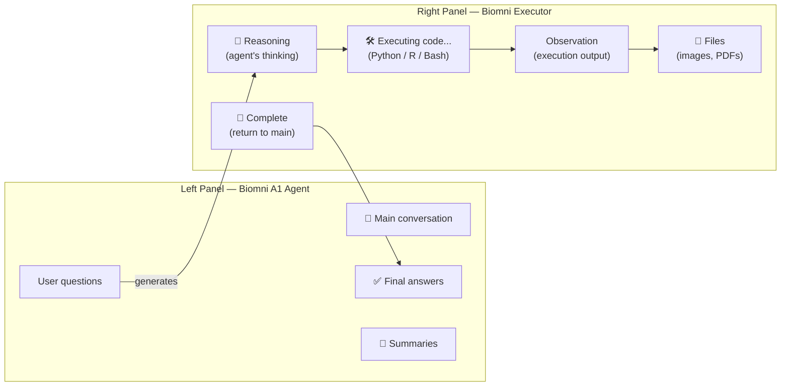
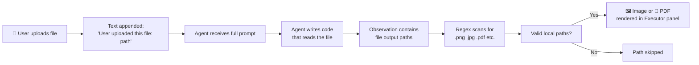

The Gradio web interface provides a fully interactive, no-code way to converse with the Biomni A1 agent directly from your browser. Rather than writing Python scripts and calling `agent.go()` in a loop, you get a dual-panel chat environment where the agent reasons, executes code, and returns results in real time — all streamed live into your browser window. This page walks you through every step of launching, configuring, and using the interface.


## Architecture Overview

The Gradio interface wraps the same `A1` agent you use programmatically, but adds a browser-based UX layer on top. Understanding how these pieces connect helps you troubleshoot and customize effectively.



When you type a question and press Enter, the `generate_response()` function inside [`launch_gradio_demo()`](biomni/agent/a1.py#L2627) takes over. It converts your message into LangChain `HumanMessage` objects, feeds them into the agent's LangGraph workflow, and streams every intermediate step — reasoning thoughts, code blocks, execution outputs, and final answers — back to the two chat panels.

Sources: [a1.py](biomni/agent/a1.py#L2627-L3002), [pyproject.toml](pyproject.toml#L28-L29)

## Prerequisites

Before launching the interface, you need three things in place: the Biomni environment, the pip package, and an API key. If you have already completed the [Quick Start](2-quick-start) guide, you can skip ahead to [Installing Gradio](#installing-gradio).

| Requirement | Purpose | How to Verify |
|---|---|---|
| Conda environment `biomni_e1` | Provides R, Bash, and scientific tools the agent may invoke | `conda activate biomni_e1` |
| `biomni` pip package | The core agent library | `pip show biomni` |
| API key (e.g., Anthropic) | Powers the LLM behind the agent | Check your `.env` file or `echo $ANTHROPIC_API_KEY` |

If you haven't set up the environment yet, follow the instructions in [biomni_env/README.md](biomni_env/README.md) first, then install the package:

```bash
conda activate biomni_e1
pip install biomni --upgrade
```

For API key configuration, see the [API Key Configuration](3-api-key-configuration) page for detailed instructions on setting up Anthropic, OpenAI, Gemini, Groq, or custom model providers.

## Installing Gradio

Biomni requires **Gradio 5.x** specifically. Gradio 6.0 introduced breaking API changes that are incompatible with the current interface implementation. Install it as an optional dependency:

```bash
pip install "gradio>=5.0,<6.0"
```

This exact version constraint is declared in the project's [`pyproject.toml`](pyproject.toml#L28-L29) under `[project.optional-dependencies]`. If you accidentally have Gradio 6.x installed, the interface will throw attribute errors at runtime — in that case, downgrade with:

```bash
pip install "gradio>=5.0,<6.0" --force-reinstall
```

> [!TIP]
> If you encounter `ImportError: Gradio is not installed` when calling `launch_gradio_demo()`, the function itself catches this and raises a clear error message directing you to the correct pip command. This guard is implemented at [line 2640–2644 of a1.py](biomni/agent/a1.py#L2640-L2644).

## Launching the Interface

The minimal launch requires just two lines of Python:

```python
from biomni.agent import A1

agent = A1(path='./data', llm='claude-sonnet-4-20250514')
agent.launch_gradio_demo()
```

After running this, you will see output like:

```
Launching Gradio demo on 0.0.0.0:7860
Running on local URL:  http://0.0.0.0:7860
```

Open **http://localhost:7860** in your browser to see the interface.

The [`launch_gradio_demo()`](biomni/agent/a1.py#L2627) method accepts four parameters that control how the server behaves:

| Parameter | Default | Description |
|---|---|---|
| `thread_id` | `42` | Conversation thread ID for the agent's internal memory. Each unique thread maintains separate conversation history. |
| `share` | `False` | Creates a temporary public Gradio share link (e.g., `https://xxxx.gradio.live`). Useful for demos but not for production. |
| `server_name` | `"0.0.0.0"` | Network binding. Use `"127.0.0.1"` for local-only access (more secure), or `"0.0.0.0"` to allow connections from other machines on your network. |
| `require_verification` | `False` | When `True`, displays an access code entry screen before the main interface. Default code is `"Biomni2025"`. |

Here are common launch patterns depending on your use case:

```python
# Local-only development (most secure)
agent.launch_gradio_demo(server_name="127.0.0.1")

# Share with a colleague via public link
agent.launch_gradio_demo(share=True)

# Deploy on a server with access control
agent.launch_gradio_demo(server_name="0.0.0.0", require_verification=True)
```

Sources: [a1.py](biomni/agent/a1.py#L2627-L2639), [README.md](README.md#L143-L160)

## Interface Layout

The Gradio UI uses a dual-panel design built with `gr.Blocks()` and two side-by-side `gr.Chatbot` components, both set to `type="messages"` for rich message rendering. This layout is defined at [lines 2946–2997 of a1.py](biomni/agent/a1.py#L2946-L2997).



### Main Chatbot (Left Panel)

The **left panel** is your primary conversation partner. It shows your questions (as user messages) and the agent's **final answers** (marked with ✅). This is where you read the cleaned-up, human-readable results. If the agent doesn't produce a formal `<solution>` tag, it falls back to a cleaned summary (marked with 📝) instead.

### Executor Chatbot (Right Panel)

The **right panel** is the agent's "workbench." It streams every intermediate step in real time:

| Step | Icon | What You See |
|---|---|---|
| Reasoning | 🤔 | The agent's thinking text before any code execution |
| Code execution | 🛠️ | Syntax-highlighted code blocks (Python, R, or Bash) with a "pending" status indicator |
| Observation | — | Raw execution output, collapsible by default |
| File previews | 📁/🖼️/📄 | Automatically detected images and PDFs from execution output |
| Completion | 🔄 | A "Returning the result to the main interface…" message |

At the bottom of the interface sits a **multimodal text input** that accepts both typed text and file uploads. Supported file extensions are: `.png`, `.jpg`, `.jpeg`, `.gif`, `.bmp`, `.webp`, and `.pdf` — defined as [`SUPPORTED_EXTENSIONS`](biomni/agent/a1.py#L2650) inside the method. Uploaded files are passed to the agent with an appended note: `"User uploaded this file: {path}. Please use it if needed."`

Sources: [a1.py](biomni/agent/a1.py#L2649-L2650), [a1.py](biomni/agent/a1.py#L2668-L2687), [a1.py](biomni/agent/a1.py#L2946-L2997)

## How Streaming Works

The interface uses Python generators (`yield`) to stream updates to both chat panels as the agent works. The [`generate_response()`](biomni/agent/a1.py#L2668) function processes the agent's output message by message, parsing three XML-style tags that the agent emits during its reasoning loop:

**`<reasoning>`** — Free-text thinking that appears before any action. Extracted by finding text preceding the first action tag ([lines 2747–2766](biomni/agent/a1.py#L2747-L2766)).

**`<execute>...</execute>`** — Code blocks the agent wants to run. The parser detects shebang lines (`#!R`, `#!BASH`, `#!CLI`) to determine the execution language ([lines 2784–2807](biomni/agent/a1.py#L2784-L2807)).

**`<observation>...</observation>`** — The output returned after code execution, which may contain file paths for automatic image/PDF preview ([lines 2810–2895](biomni/agent/a1.py#L2810-L2895)).

**`<solution>...</solution>`** — The agent's final answer, which gets routed to the main chatbot panel ([lines 2769–2781](biomni/agent/a1.py#L2769-L2781)).

Each `yield` call pushes updated chat histories to both panels simultaneously, so you see reasoning appear on the right while the left panel waits for the final answer.

Sources: [a1.py](biomni/agent/a1.py#L2736-L2897), [a1.py](biomni/agent/a1.py#L2899-L2939)

## Access Verification

When you enable verification by passing `require_verification=True`, the interface first shows a locked screen with a password input. Only users who enter a valid access code can see the main chat interface.

The default access code is `"Biomni2025"`, stored in the [`available_access_codes`](biomni/agent/a1.py#L2655) list. The verification logic at [lines 2658–2666](biomni/agent/a1.py#L2658-L2666) checks the entered code against this list and either reveals the main interface or displays an error message.

This is useful when you deploy the interface on a shared server or a cloud instance with `server_name="0.0.0.0"`, preventing unauthorized access. Note that the access codes are currently hardcoded — for production deployments, you should modify this list or add your own authentication layer.

Sources: [a1.py](biomni/agent/a1.py#L2654-L2666)

## File Upload and Preview

The interface supports uploading multiple files at once through the `gr.MultimodalTextbox` component. Here's how uploaded files flow through the system:



When the agent's execution output contains file paths matching supported extensions, the interface automatically tries to resolve them — checking the absolute path, the current working directory, and the agent's data directory in order ([lines 2866–2875](biomni/agent/a1.py#L2866-L2875)). Images are rendered inline using `gr.Image()`, while PDFs are shown as clickable links.

Sources: [a1.py](biomni/agent/a1.py#L2683-L2687), [a1.py](biomni/agent/a1.py#L2841-L2895)

## Conversation History

The interface maintains conversation history across multiple turns. Internally, it keeps a copy of the full conversation in `self.main_history_copy` ([line 2652](biomni/agent/a1.py#L2652)). Each time you submit a new prompt, all previous messages are converted back into LangChain `HumanMessage` and `AIMessage` objects and passed to the agent, giving it full context of the ongoing dialogue ([lines 2688–2696](biomni/agent/a1.py#L2688-L2696)).

The `thread_id` parameter controls which LangGraph conversation thread is used (via `configurable: {"thread_id": thread_id}` at [line 2700](biomni/agent/a1.py#L2700)). If you restart the Python script and use the same `thread_id`, the agent's internal LangGraph memory (checkpointer) will retain prior context. To start a fresh conversation, use a different `thread_id` or re-instantiate the agent.

Sources: [a1.py](biomni/agent/a1.py#L2652), [a1.py](biomni/agent/a1.py#L2688-L2700)

## Security Considerations

**⚠️ Important:** The Gradio interface executes LLM-generated code with full system privileges — the same as running the agent programmatically. This means the agent can read files, execute shell commands, make network requests, and install packages on your machine.

| Risk | Mitigation |
|---|---|
| Arbitrary code execution | Run in a Docker container or VM; never on a machine with sensitive data |
| Network exposure with `server_name="0.0.0.0"` | Enable `require_verification=True` and use a firewall |
| Public `share=True` link | Treat as temporary; expires when the process stops |
| Access code `"Biomni2025"` is well-known | Change the code in [`available_access_codes`](biomni/agent/a1.py#L2655) before deploying publicly |

For production or shared environments, consider the [commercial mode](20-commercial-vs-academic-mode) configuration and always run inside an isolated sandbox.

Sources: [README.md](README.md#L404-L407), [a1.py](biomni/agent/a1.py#L2654-L2655)

## Troubleshooting

| Symptom | Likely Cause | Fix |
|---|---|---|
| `ImportError: Gradio is not installed` | Gradio not in environment | `pip install "gradio>=5.0,<6.0"` |
| `AttributeError` on `ChatMessage` or other Gradio types | Gradio 6.x installed | `pip install "gradio>=5.0,<6.0" --force-reinstall` |
| Interface loads but agent never responds | Missing or invalid API key | Verify `.env` file or environment variables per [API Key Configuration](3-api-key-configuration) |
| "Executor is working on it" but nothing happens | Data lake download in progress | First run downloads ~11GB; see [Quick Start](2-quick-start) for `expected_data_lake_files=[]` option |
| Images not appearing in Executor panel | File path resolution failed | Ensure generated files are in the current working directory or the agent's data path |
| Timeout after long tasks | Default 600s timeout exceeded | Increase via `A1(timeout_seconds=1200)` or `default_config.timeout_seconds = 1200` |

## Complete Example

Here is a ready-to-run script that sets up the agent with all recommended settings and launches the interface with verification enabled:

```python
from biomni.config import default_config
from biomni.agent import A1

# Configure global defaults
default_config.llm = "claude-sonnet-4-20250514"
default_config.timeout_seconds = 1200

# Initialize agent
agent = A1(path='./data')

# Launch with security settings
agent.launch_gradio_demo(
    server_name="0.0.0.0",
    require_verification=True,
)
```

Access the interface at `http://localhost:7860`, enter the access code `Biomni2025`, and start asking biomedical questions or uploading data files for analysis.

## Next Steps

Now that you have the Gradio interface running, here are logical next pages to explore:

- **[API Key Configuration](3-api-key-configuration)** — If you need to switch LLM providers or add multiple API keys
- **[Configuration Reference](21-configuration-reference)** — Full details on every `BiomniConfig` field and environment variable
- **[Architecture Overview](8-architecture-overview)** — Deep dive into how the A1 agent's ReAct loop and tool system work under the hood
- **[Custom Tools and Data](18-custom-tools-and-data)** — Extend the agent with your own domain-specific functions and datasets before launching the UI
- **[MCP Server Integration](19-mcp-server-integration)** — Connect external tools via the Model Context Protocol for even richer capabilities