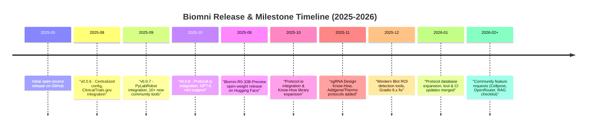

Biomni has evolved rapidly since its initial open-source release in mid-2025. What started as a bioRxiv preprint has grown into a living ecosystem -- new tools, new reasoning models, wet-lab automation partnerships, and an increasingly active contributor base. This page tracks the most significant changes across recent release cycles and highlights what developers and researchers should pay attention to right now.

---

## Release Timeline

---

## v0.0.8 (October 2025): Protocol Integration and Multi-Model Support

The [v0.0.8 release](https://github.com/snap-stanford/Biomni/releases) landed in late October 2025 and brought several notable additions to the Biomni environment:

**Protocol.io Integration.** PR #251, merged by Serena Zhang, connected Biomni to [protocols.io](https://www.protocols.io) -- a widely-used platform for sharing and versioning experimental protocols. This allows the A1 agent to retrieve and reference structured, peer-reviewed protocols directly within its reasoning loop, rather than relying solely on static know-how documents. This is a meaningful step toward grounding agent actions in real lab practice.

**PyLabRobot Integration.** PR #210 by @serena2z introduced a bridge to [PyLabRobot](https://github.com/PyLabRobot/PyLabRobot), the open-source, hardware-agnostic Python library for liquid handling robots (Hamilton STAR, Tecan Freedom EVO, Opentrons OT-2, and more). Kexin Huang [announced on LinkedIn](https://www.linkedin.com/posts/kexinhuang_announcing-biomni-pylabrobot-a-step-activity-7382082491798622209-KAH6): "Biomni x PyLabRobot -- a step toward an AI biologist that can think, design, and execute wet-lab experiments end-to-end." The collaboration involved Retro Biosciences and PyLabRobot creator Rick Wierenga. This marks the first time Biomni crossed the boundary from purely computational analysis into physical lab automation.

**GPT-5 Mini Support.** PR #246 by @mickaelleclercq added compatibility with GPT-5 mini, expanding the range of LLM providers users can plug into the agent framework. Combined with existing support for Claude, Gemini, Groq, Bedrock, Ollama, and Azure OpenAI, the agent now supports **eight LLM providers** out of the box.

**New Community Tools.** The release also absorbed contributions from multiple new contributors:
- @igor-sadalski added [State embeddings](https://github.com/snap-stanford/Biomni/pull/224) and [Transcripformer embeddings](https://github.com/snap-stanford/Biomni/pull/227) for gene representation
- @divyesh-htree fixed [Reactome API endpoints](https://github.com/snap-stanford/Biomni/pull/244) to use 2025-compatible URLs
- @zhanxw fixed package name casing issues

| Feature | PR | Contributor |
|---|---|---|
| PyLabRobot integration | #210 | @serena2z |
| Protocol.io integration | #251 | @serena2z |
| State embeddings tool | #224 | @igor-sadalski |
| Transcripformer embeddings tool | #227 | @igor-sadalski |
| GPT-5 mini support | #246 | @mickaelleclercq |
| Reactome API endpoint fix | #244 | @divyesh-htree |
| Package casing fix | #232 | @zhanxw |
| Eval improvements | #238 | @kexinhuang12345 |
| UI updates | #247 | @kexinhuang12345 |

---

## v0.0.7 (September 2025): The Community Expansion Release

The [v0.0.7 release](https://github.com/snap-stanford/Biomni/releases) was arguably the most contributor-heavy cycle to date. It introduced 25+ merged PRs and welcomed five first-time contributors.

**Key highlights:**

- **10 SOTA cell-type transfer algorithms** (PR #201, @igor-sadalski) -- a substantial addition for single-cell analysis workflows.
- **Gene name conversion across species** (PR #204) and **ESM embeddings from Ensembl gene IDs** (PR #205), also from @igor-sadalski.
- **Glycoengineering tools** (PR #212, @shantanusharma) for glycobiology workflows.
- **Bioimaging tools** (PR #207, @MintaYLu) covering pre-processing, segmentation, and registration -- directly relevant to the later Western Blot ROI detection work.
- **PDF conversation export** (PR #217, @igor-sadalski) enabling researchers to save agent execution traces as PDF reports for documentation and reproducibility.
- **Synapse data integration** (PR #173, @anngvu) for searching and downloading datasets from the Synapse platform.
- **Lazyslide support** (PR #156, @ryanDing26) for whole-slide image analysis.
- **Commercial mode configuration** (PR #200, @lxasqjc) for license-aware data filtering.
- **MCP tool parameter parsing fix** (PR #181, @Edison-A-N) addressing a structural bug in how auto-discovered MCP tools mapped required vs optional parameters.

---

## Post-Release Development (November 2025 - January 2026)

After the v0.0.8 tag, development continued on `main` with several impactful merges:

### Know-How Library Expansion

In early November, Yuanhao Qu added an [sgRNA Design know-how document](https://github.com/snap-stanford/Biomni/commit/e875ed42f89892f67d0ba8bd03a1f37729851725) describing a three-tiered approach to guide RNA design. This was followed by additional resource documents and minor fixes from Kexin Huang across the [know_how branch](https://github.com/snap-stanford/Biomni/pull/252).

### Protocol Database: Addgene and Thermo Fisher

Serena Zhang contributed a [protocol database expansion](https://github.com/snap-stanford/Biomni/commit/6603b4aa43694d2a2eb8565c484c16264dc68daf) incorporating protocols from [Addgene](https://www.addgene.org) and Thermo Fisher Scientific. This was merged in [PR #259](https://github.com/snap-stanford/Biomni/pull/259) on January 15, 2026, adding curated wet-lab protocol references directly into the agent's retrieval pipeline.

### Western Blot ROI Detection Tools

Contributor @nevergreendd added two new bioimaging tools in December 2025:
- `analyze_pixel_distribution` -- analyzes pixel intensity distributions across Western blot images
- `find_roi_from_image` -- detects regions of interest from blot images

These were merged via [PR #266](https://github.com/snap-stanford/Biomni/pull/266). This work complements the broader bioimaging toolset introduced in v0.0.7 and demonstrates how community contributors are filling domain-specific gaps.

### Gradio Version Compatibility Fix

Andrew Su (from the [Scripps Research Institute team](https://github.com/andrewsu)) identified and fixed a breaking change: Gradio 6.0 removed the `type="messages"` parameter from `Chatbot.__init__()`. The [fix in PR #268](https://github.com/snap-stanford/Biomni/pull/268) constrained the Gradio dependency to `>=5.0,<6.0` in `pyproject.toml` and updated the README installation instructions. As Andrew noted in the commit: "Users can now install with `pip install 'biomni[gradio]'` or manually with `pip install 'gradio>=5.0,<6.0'`."

### Pre-commit CI Housekeeping

The [pre-commit.ci bot](https://pre-commit.ci) kept linting tools current: biomejs/pre-commit was updated from v2.3.1 to v2.3.10, and ruff-pre-commit from v0.14.2 to v0.14.11, both via [PR #253](https://github.com/snap-stanford/Biomni/pull/253).

---

## The Biomni-R0 Reasoning Model

While not a code update per se, the release of [Biomni-R0-32B-Preview](https://huggingface.co/biomni/Biomni-R0-32B-Preview) on Hugging Face in September 2025 is the single most impactful recent event for the project. Announced by [Jure Leskovec on LinkedIn](https://www.linkedin.com/posts/leskovec_biomni-r0-32b-preview-is-now-open-weight-activity-7384241679408631826-qsRe) as "beating GPT-5 and Claude Sonnet 4," the model is built on Qwen-32B and trained with end-to-end reinforcement learning using the Biomni-E1 environment.

The [technical report](https://biomni.stanford.edu/blog/biomni-r0-technical-report) describes a two-phase pipeline: supervised fine-tuning on high-quality Claude trajectories (rejection-sampled), followed by RL optimizing for both correctness and structured output formatting. Results on [Biomni-Eval1](https://huggingface.co/datasets/biomni/Eval1) are striking:

| Model | Eval1 Score | Notes |
|---|---|---|
| Biomni-R0-32B | 0.669 | Best on 7/10 tasks |
| Biomni-R0-8B | 0.588 | Outperforms Claude 4 Sonnet & GPT-5 |
| Qwen-32B (base) | 0.346 | 2x improvement after RL |
| Claude 4 Sonnet | Lower | Best on 1/10 tasks |
| GPT-5 | Lower | Best on 2/10 tasks |

The model can be served locally via SGLang and plugged into the A1 agent as a reasoning backend while keeping database queries on a separate API provider -- a hybrid architecture that the project explicitly recommends. The v0.0.8 release included README updates from @RyanLi0802 to document this workflow.

---

## Forward-Looking: Community Requests and Biomni-E2

The [issues tracker](https://github.com/snap-stanford/Biomni/issues) reveals an active community pushing the project in several directions:

**Imaging tool requests.** The [Cellpose integration proposal](https://github.com/snap-stanford/Biomni/issues/202) seeks to incorporate the [MouseLand/cellpose](https://github.com/MouseLand/cellpose) cell and nucleus segmentation model, which would complement the existing bioimaging toolset and the new Western Blot ROI detection capabilities.

**LLM provider flexibility.** The [OpenRouter integration request](https://github.com/snap-stanford/Biomni/issues/90) proposes adding OpenRouter as a unified gateway to 50+ LLM providers. The contributor even drafted a code snippet showing how it could work with the existing `source`/`base_url` routing logic.

**Reliability concerns.** Multiple issues -- [R0 example stuck in loop](https://github.com/snap-stanford/Biomni/issues/257), [stuck loops and parsing errors](https://github.com/snap-stanford/Biomni/issues/272), and [Claude Sonnet 4.6 prefill error](https://github.com/snap-stanford/Biomni/issues/284) -- highlight a recurring structural challenge: the agent's response parser expects specific tag formats (`<think`, `<execute`, `<solution>`), and different LLMs produce different output patterns. One user reported that GLM-4.7 responds with `reasoning` instead of `think`, causing the identifier to loop indefinitely. These are real friction points for anyone using non-default LLM backends.

**Environment setup.** The [setup.sh dependency issue](https://github.com/snap-stanford/Biomni/issues/283) with pystan requiring `Cython>=0.22` and numpy, and the [outdated README time estimates](https://github.com/snap-stanford/Biomni/issues/267) for setup on Apple Silicon, suggest that documentation could use a refresh.

**RAG safety framework.** A particularly thoughtful [feature request](https://github.com/snap-stanford/Biomni/issues/282) proposes integrating a structured RAG failure taxonomy (the WFGY ProblemMap, cited by Harvard MIMS Lab and others) into Biomni's documentation. This would give users a systematic way to classify and debug retrieval failures -- a clear need for a system that stitches together 59 databases.

**The Biomni-E2 call to action.** The README prominently features a call for contributors to help build [Biomni-E2](https://github.com/snap-stanford/Biomni#-call-for-contributors-help-build-biomni-e2) -- a next-generation environment "developed with and for the community." Contributors with 10+ significant tool integrations are offered co-authorship on the upcoming E2 paper. Given the velocity of community contributions in v0.0.7 and v0.0.8, this is an ambitious but plausible target.

---

## Summary: What to Watch

The trajectory is clear: Biomni is moving from a computational-only agent toward a **full-stack AI research assistant** that can reason, retrieve, analyze images, and increasingly, orchestrate physical lab equipment. The most significant recent shifts are:

1. **Wet-lab bridge via PyLabRobot** -- the agent can now generate protocols that run on real liquid handling robots.
2. **Domain-specific vision tools** -- Western Blot ROI detection and bioimaging preprocessing indicate a push into image analysis.
3. **Protocol grounding** -- Protocol.io and Addgene/Thermo protocol databases give the agent structured, real-world experimental references.
4. **Custom reasoning model** -- Biomni-R0-32B achieves expert-level biomedical reasoning through RL, and can serve as a local, cost-effective alternative to frontier API models.
5. **Growing contributor velocity** -- v0.0.7 alone welcomed five new contributors; the codebase is absorbing external expertise at an accelerating rate.

For developers, the practical takeaway is straightforward: if you are building biomedical workflows that involve multi-step reasoning across heterogeneous tools and databases, Biomni is worth watching closely. But if you need rock-solid reliability with non-standard LLM backends, you should expect to do some parser patching. The project is transparent about this -- the README itself notes that "many current tools are not optimized" and explicitly welcomes fixes.