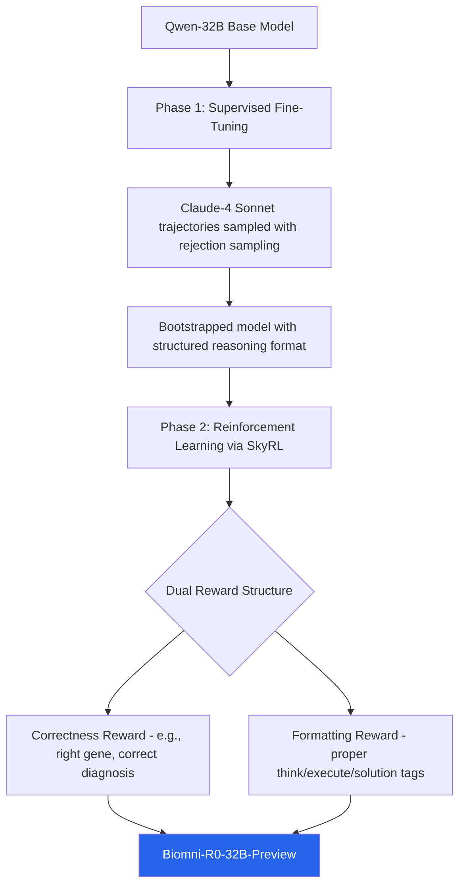

**Biomni-R0** is the first open-weight reasoning model trained specifically for biomedical agentic tasks. Rather than slapping a generic LLM into a bio-agent scaffold and hoping for the best, the Biomni team -- in collaboration with UC Berkeley's SkyRL group -- took a fundamentally different approach: they trained the model *end-to-end* inside the Biomni-E1 environment using reinforcement learning. The result is a domain-specialized model that turns out to be more than a curiosity -- it outperforms frontier closed-source models on the team's own benchmark across most tasks, and does so at 32 billion parameters.

This page covers the model's design, training, deployment, and the practical realities of using it.

---

## Why a Dedicated Reasoning Model?

The Biomni agent framework (covered in the [Architecture Overview](8-architecture-overview) and [A1 Agent Core Class](9-a1-agent-core-class)) is LLM-agnostic by design. You can plug in Claude, GPT-4, or any OpenAI-compatible model as the reasoning engine. But here is the structural problem: a general-purpose model has never *seen* biomedical tool calls, code execution in a bioinformatics environment, or the structured think-execute-solution loop that Biomni relies on during training. As [Kexin Huang noted on X](https://x.com/KexinHuang5/status/1962916295055442005), R0 is "nearly 2x stronger than its open-source base" and ">10% better than frontier closed-source models."

The premise is straightforward -- if you want a model that reasons well *within* a specific environment, you should train it *inside* that environment. Biomni-R0 is that bet.

---

## Model Lineup

Biomni-R0 comes in two sizes, both built on Qwen as the base architecture:

| Variant | Parameters | Base Model | Status |
|---------|-----------|------------|--------|
| Biomni-R0-8B | ~8B | Qwen2.5-8B (implied) | Referenced in technical report; not yet publicly released |
| **Biomni-R0-32B-Preview** | ~32B | Qwen-32B | Available on [HuggingFace](https://huggingface.co/biomni/Biomni-R0-32B-Preview) |

The publicly available **Biomni-R0-32B-Preview** is a research preview. The weights are hosted at `biomni/Biomni-R0-32B-Preview` on HuggingFace, and quantized GGUF variants are also available through community contributors like [mradermacher](https://huggingface.co/mradermacher/Biomni-R0-32B-Preview-GGUF).

---

## Training Methodology

The training pipeline is described in the [technical report](https://biomni.stanford.edu/blog/biomni-r0-technical-report) and represents a collaboration between Stanford's Biomni team (Ryan Li, Kexin Huang, Yuanhao Qu, Jure Leskovec) and UC Berkeley's [SkyRL](https://sky.cs.berkeley.edu/project/skyrl) group (Shiyi Cao et al.). The process follows a two-phase approach:



### Phase 1: Supervised Fine-Tuning (SFT)

The base Qwen-32B model was first fine-tuned on high-quality trajectories sampled from Claude-4 Sonnet using **rejection sampling**. The purpose was not to make the model a Claude clone -- it was to bootstrap it into following the structured reasoning format that the Biomni-E1 environment expects: thinking blocks, executable code blocks, and solution blocks.

### Phase 2: Reinforcement Learning

This is where the interesting work happens. Using [SkyRL](https://github.com/NovaSky-AI/SkyRL), Berkeley's RL training infrastructure for multi-turn tool-use LLMs, the team optimized the model with two reward signals:

1. **Correctness reward**: Does the agent produce the right biological answer? (e.g., identifying the correct causal gene, making the right diagnosis)
2. **Formatting reward**: Does the agent output properly structured responses with the expected XML-like tags?

The RL training was done *within the Biomni-E1 environment*, meaning the model received rewards based on actual tool execution results, database queries, and multi-turn interactions -- not just text prediction quality.

### Key Engineering Decisions

Several infrastructure choices made this training pipeline feasible:

- **Asynchronous rollout scheduling**: Environment execution (tool calls, database queries) was decoupled from model inference. This prevented GPU starvation during long-running tool executions and kept training throughput reasonable.
- **Extended context window**: The context length was expanded to 64k tokens (via YaRN RoPE scaling), enabling the model to maintain coherent reasoning across long multi-step biomedical workflows.
- **Longer reasoning traces correlated with better performance**: The RL-trained models consistently produced lengthier, more structured responses, and this correlated strongly with better task outcomes -- suggesting that the model learned that *depth of reasoning* matters in biomedicine.

---

## Benchmark Results

Biomni-R0 was evaluated on [Biomni-Eval1](7-biomni-eval1-benchmark-results), a benchmark of 433 instances across 10 biomedical reasoning tasks. The headline numbers, as reported in the technical report and summarized by [third-party coverage](https://metaailabs.com/biomni-r0-new-agentic-llms-trained-end-to-end-with-multi-turn-reinforcement-learning-for-expert-level-intelligence-in-biomedical-research):

| Model | Aggregate Score | Notes |
|-------|----------------|-------|
| Qwen-32B (base) | 0.346 | No biomedical RL training |
| **Biomni-R0-8B** | **0.588** | 8B model with RL; outperforms Claude 4 Sonnet and GPT-5 |
| **Biomni-R0-32B** | **0.669** | Top performer on 7 out of 10 tasks |
| Claude 4 Sonnet | ~0.56 | Frontier closed-source model |
| GPT-5 | ~0.56 | Frontier closed-source model; top on 2 tasks |

**Most striking individual results:**

- **Rare disease diagnosis**: Biomni-R0-32B scored **0.67**, compared to Qwen-32B's **0.03** -- a **20x improvement**. This is arguably the strongest signal that domain-specific RL training matters.
- **GWAS variant prioritization**: Score jumped from **0.16** (base) to **0.74** (R0-32B).
- GPT-5 led on 2 tasks, Claude 4 on 1 task.

The fact that an 8B parameter model (R0-8B) outperforms frontier closed-source models is notable and speaks to the efficiency of the training methodology. But keep in mind: this is self-reported on their own benchmark, and independent replication would be valuable.

---

## Deployment and Serving

Biomni-R0 is served via [SGLang](https://github.com/sgl-project/sglang), an efficient serving framework that provides an OpenAI-compatible API. This is important because it means the Biomni agent can talk to R0 through the same interface it uses for Claude or GPT -- just pointed at a local endpoint.

### Hardware Requirements

Per the [HuggingFace model card](https://huggingface.co/biomni/Biomni-R0-32B-Preview):

- **Minimum**: 2 GPUs with 80GB VRAM (tensor parallelism `--tp 2`)
- **Alternative**: 4 GPUs with 40GB VRAM (`--tp 4`)

This is not a model you run on a consumer GPU. If you lack this hardware, quantized GGUF versions (down to ~7.4GB at IQ1_S) are available for inference via llama.cpp, though with expected quality degradation.

### Launch Command

```bash
python -m sglang.launch_server \
    --model-path biomni/Biomni-R0-32B-Preview \
    --port 30000 \
    --host 0.0.0.0 \
    --mem-fraction-static 0.8 \
    --tp 2 \
    --trust-remote-code \
    --json-model-override-args '{
        "rope_scaling": {
            "rope_type": "yarn",
            "factor": 1.0,
            "original_max_position_embeddings": 32768
        },
        "max_position_embeddings": 131072
    }'
```

**RoPE scaling notes**: The model's native context is 32,768 tokens. The configuration above extends it to 131,072 (128k) using YaRN scaling with `factor=1.0`. If your tasks produce even longer reasoning traces, you can increase the factor up to `4.0`, but the HuggingFace card warns that this **may degrade performance on shorter-trajectory tasks**. Tune accordingly.

### Wiring It Into the Agent

The recommended pattern is a **hybrid setup**: use Biomni-R0 for agent reasoning, but keep a capable API model (Claude, GPT) for database queries and retrieval tasks. This separation is important because R0, while excellent at reasoning, is a smaller model and may struggle with the nuances of complex retrieval prompts.

```python
from biomni.config import default_config
from biomni.agent import A1

# Database queries use a capable API model
default_config.llm = "claude-3-5-sonnet-20241022"
default_config.source = "Anthropic"

# Agent reasoning uses local Biomni-R0
agent = A1(
    llm="biomni/Biomni-R0-32B-Preview",
    source="Custom",
    base_url="http://localhost:30000/v1",
    api_key="EMPTY",
)

agent.go("Plan a CRISPR screen to identify genes regulating T cell exhaustion")
```

This configuration pattern is also documented in the [Configuration Reference](21-configuration-reference).

---

## Known Issues and Practical Considerations

Despite the impressive benchmark numbers, the community has reported several real-world friction points. If you are planning to deploy Biomni-R0 in production, these are worth understanding upfront.

### Parsing Errors and Infinite Loops

The most frequently reported issue class involves the model failing to produce the expected structured tags, causing the agent to enter an infinite retry loop. This was reported in [issue #257](https://github.com/snap-stanford/Biomni/issues/257) and discussed at length in [issue #272](https://github.com/snap-stanford/Biomni/issues/272).

The core problem: the agent's response parser expects specific tags (`<think reasoning="...">`, `<execute>`, `<solution>`). When R0 (or any substitute model) fails to emit these tags, the agent injects a corrective prompt and re-requests the response. If the model consistently fails to format correctly, you get an infinite loop of retries:

```
parsing error...
Each response must include thinking process followed by either <execute> or <solution> tag.
parsing error...
Each response must include thinking process followed by either <execute> or <solution> tag.
...
```

**Contributing factors:**

- **Non-standard response patterns**: As one user documented in [issue #272](https://github.com/snap-stanford/Biomni/issues/272), different LLMs use different reasoning keywords. GLM-4.7, for example, uses "reasoning" where the prompt expects "think", causing the identifier to miss the tag entirely.
- **R0's self-correction limits**: In hybrid mode (R0 for reasoning, API model as fallback), R0 may attempt to fix its own errors but reuse the same failing code repeatedly, creating a different kind of loop.
- **Newer model incompatibilities**: [Issue #284](https://github.com/snap-stanford/Biomni/issues/284) reports that Claude Sonnet 4.6 removed support for assistant message prefill, causing a 400 error when used as the agent LLM.

### Missing Internal Module

[Issue #285](https://github.com/snap-stanford/Biomni/issues/285) reports that `biomni.agent.base_agent` -- which `PaperTaskExtractor` inherits from -- is missing from the installed package. This suggests a packaging or export issue in the current release that the team has not yet addressed.

### Offline and Resource-Constrained Environments

Users trying to run Biomni-R0 in fully offline environments, as documented in the now-closed [issue #271](https://github.com/snap-stanford/Biomni/issues/271), encounter input length errors and connection failures. The model's large system prompt (37k+ tokens in some configurations) can exceed the default context limit, requiring `--allow-auto-truncate` at the cost of potential information loss.

### The Fundamental Tension

These issues point to a deeper architectural tension: the structured tag-based response format is simultaneously the mechanism that enables RL training and a source of fragility when models diverge from the expected pattern. The R0 model, having been trained specifically for this format, should in theory be the most reliable at producing it -- but in practice, deployment conditions (quantization, different serving frameworks, hardware constraints) can still cause deviations.

---

## How Biomni-R0 Fits Into the Ecosystem

Understanding R0's role requires seeing where it sits in the broader agent pipeline:

```mermaid
flowchart LR
    subgraph "User Layer"
        U[Natural Language Query]
    end

    subgraph "Agent Layer (Biomni A1)"
        P[Retrieval-Augmented Planning]
        R[R0 or API Model<br/>Multi-step Reasoning]
    end

    subgraph "Execution Layer"
        T[Tool Execution<br/>150 tools / 59 DBs / 105 software]
        E[Code Interpreter]
    end

    subgraph "Knowledge Layer"
        K[Know-How Library]
        DL[Data Lake ~11GB]
    end

    U --> P
    P --> R
    R --> T
    R --> E
    P --> K
    P --> DL
    T --> R
    E --> R
    R --> U

    style R fill:#2563eb,color:#fff,stroke:#1d4ed8
```



R0 occupies the **reasoning slot** -- it is the model that decides *what to do next* given the current context. It does not replace the tool system, the data layer, or the retrieval mechanism. In practice, the most robust deployments use R0 for reasoning while delegating retrieval and database queries to more capable API models.

---

## Citation

If you use Biomni-R0 in your research, cite both the main Biomni paper and the R0 technical report:

```bibtex
@article{huang2025biomni,
  title={Biomni: A General-Purpose Biomedical AI Agent},
  author={Huang, Kexin and Zhang, Serena and Wang, Hanchen and others},
  journal={bioRxiv},
  year={2025},
  publisher={Cold Spring Harbor Laboratory}
}

@misc{biomnir0,
  title     = {Biomni-R0: Using RL to Hill-Climb Biomedical Reasoning Agents to Expert-Level},
  author    = {Ryan Li and Kexin Huang and Shiyi Cao and Yuanhao Qu and Jure Leskovec},
  year      = {2025},
  month     = {September},
  note      = {Technical Report}
}
```

---

## Further Reading

- [Biomni-R0-32B-Preview on HuggingFace](https://huggingface.co/biomni/Biomni-R0-32B-Preview) -- model weights and serving instructions
- [Biomni-R0 Technical Report](https://biomni.stanford.edu/blog/biomni-r0-technical-report) -- full training methodology and analysis
- [SkyRL: RL Training Pipeline](https://sky.cs.berkeley.edu/project/skyrl) -- the Berkeley infrastructure behind R0's RL training
- [Biomni-Eval1 Benchmark Results](7-biomni-eval1-benchmark-results) -- the evaluation benchmark R0 was optimized against
- [A1 Agent Core Class](9-a1-agent-core-class) -- how to wire R0 into the agent framework
- [Configuration Reference](21-configuration-reference) -- all configuration options including custom model endpoints