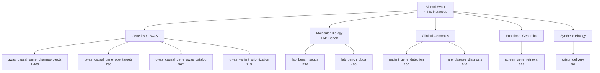
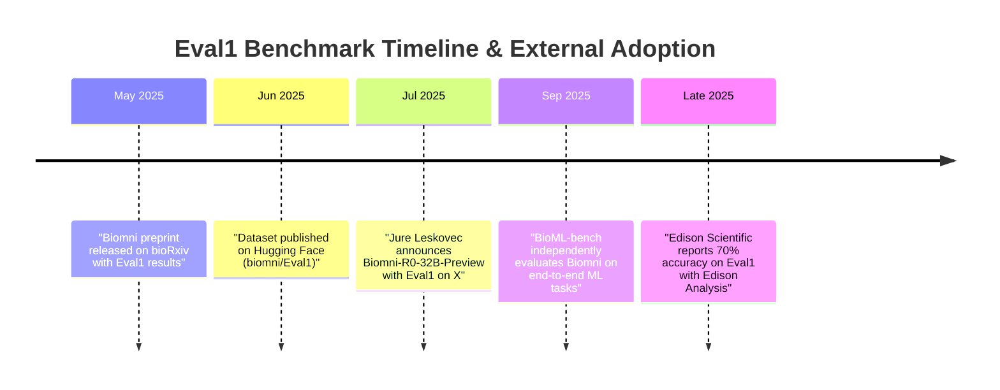

## What Is Biomni-Eval1?

Biomni-Eval1 is the first standardized evaluation benchmark released alongside the Biomni agent, designed to measure **biological reasoning capabilities** across a genuinely heterogeneous set of tasks rather than narrow Q&A slices. As [Jure Leskovec announced on X](https://x.com/jure/status/1978470668732928310), the benchmark ships with **4,880 instances** (4,447 train + 433 validation) spanning **10 distinct biological reasoning tasks** -- everything from GWAS causal gene identification to rare disease diagnosis to CRISPR delivery method selection.

The dataset is hosted on Hugging Face at [biomni/Eval1](https://huggingface.co/datasets/biomni/Eval1) and is accessible programmatically through the `BiomniEval1` class bundled in the `biomni` pip package.

The full methodology and results are described in the [Biomni preprint on bioRxiv](https://www.biorxiv.org/content/10.1101/2025.05.30.656746v1) (also indexed on [PubMed](https://pubmed.ncbi.nlm.nih.gov/40501924/)).

---

## Task Breakdown

The 10 tasks in Eval1 cover a deliberately wide cross-section of biomedical reasoning -- from literature-driven database lookups to multi-step clinical inference. Here is the full distribution as documented on the [Hugging Face dataset card](https://huggingface.co/datasets/biomni/Eval1):

| Task | Train | Val | Total | Domain |
|------|-------|-----|-------|--------|
| `gwas_causal_gene_pharmaprojects` | 1,353 | 50 | 1,403 | Genetics / Genomics |
| `gwas_causal_gene_opentargets` | 680 | 50 | 730 | Genetics / Genomics |
| `gwas_causal_gene_gwas_catalog` | 512 | 50 | 562 | Genetics / Genomics |
| `lab_bench_seqqa` | 480 | 50 | 530 | Molecular Biology (Q&A) |
| `lab_bench_dbqa` | 416 | 50 | 466 | Molecular Biology (DB access) |
| `patient_gene_detection` | 400 | 50 | 450 | Clinical Genomics |
| `screen_gene_retrieval` | 278 | 50 | 328 | Functional Genomics |
| `gwas_variant_prioritization` | 172 | 43 | 215 | Genetics |
| `rare_disease_diagnosis` | 116 | 30 | 146 | Clinical Genomics |
| `crispr_delivery` | 40 | 10 | 50 | Synthetic Biology |
| **Total** | **4,447** | **433** | **4,880** | |

Validation splits are capped at 50 instances per task (or fewer if the task has fewer than 50 val instances), which means the held-out test set is small but curated for reliability.

### Task Categories at a Glance



---

## Evaluation Methodology

Each task uses **binary scoring** -- the agent either gets the answer right (1.0) or wrong (0.0). But the validation logic is not uniform; it adapts to the expected answer format for each task type, as documented in the [evaluation source code](https://github.com/snap-stanford/Biomni/blob/main/biomni/eval/biomni_eval1.py):

| Task Name | Expected Answer Format | Validation Logic |
|-----------|----------------------|------------------|
| `gwas_causal_gene_*` | Gene symbol (e.g., `"BRCA1"`) | Case-insensitive exact match |
| `gwas_variant_prioritization` | Variant ID (e.g., `"rs1065852"`) | Exact match |
| `lab_bench_*` | Letter A-Z (e.g., `"C"`) | Case-insensitive exact match |
| `rare_disease_diagnosis` | JSON with `OMIM_ID` field | JSON parsing + OMIM_ID match |
| `crispr_delivery` | Letter a-f (e.g., `"e"`) | Case-insensitive exact match |
| `screen_gene_retrieval` | Gene symbol | Case-insensitive exact match |
| `patient_gene_detection` | JSON with `causal_gene` list | JSON parsing + set intersection (non-empty overlap) |

For JSON-based tasks (`rare_disease_diagnosis`, `patient_gene_detection`), the evaluator tries multiple parsing strategies -- standard `json.loads()`, then `ast.literal_eval()`, then falls back to 0.0 -- which is a pragmatic design choice even if it is somewhat lenient on formatting.

### What This Means for Developers

The binary reward structure makes it straightforward to track progress, but it also means the benchmark is **unforgiving of near-misses**. A gene symbol with a trailing space or a JSON missing a comma both score 0.0. This is by design -- in clinical genomics, you need the exact right gene or the exact right OMIM ID -- but developers should be aware that improving scores requires not just better reasoning but also robust answer formatting.

---

## Key Results from the Paper

The [Biomni preprint](https://www.biorxiv.org/content/10.1101/2025.05.30.656746v1) reports strong zero-shot generalization across the eight novel biomedical scenarios evaluated on Eval1, with Biomni outperforming baseline approaches including bare LLMs and ReAct+Code setups without the Biomni environment.

As noted in [Leskovec's launch announcement](https://x.com/jure/status/1928130906033975768), the headline claims include:

- **Human-level performance on LAB-Bench DbQA and SeqQA**, the two molecular biology Q&A tasks included in Eval1.
- **State-of-the-art results on Humanity's Last Exam (HLE)** biomedical subset -- a notably hard benchmark where, as [Stanford HAI's 2025 AI Index](https://hai.stanford.edu/ai-index/2025-ai-index-report/technical-performance) notes, the top system at the time scored only 8.80%.
- **Up to 402% relative performance gain** on real-world biomedical tasks compared to non-agent baselines (base LLM and ReAct+Code without the Biomni environment).

### Comparative Performance Landscape

While the paper's own internal numbers are the authoritative source, external evaluations provide useful context:

- **Edison Scientific's Edison Analysis** (the successor to FutureHouse's Finch) reports 70% accuracy on Eval1, explicitly surpassing both Biomni and Claude Code on that benchmark, according to their [product announcement](https://edisonscientific.com/articles/introducing-edison-analysis). This is a notable external data point -- it suggests Eval1 is being adopted as a cross-system comparison point beyond the original paper.
- **BioML-bench** ([bioRxiv preprint](https://www.biorxiv.org/content/10.1101/2025.09.01.673319v2)), an independent benchmarking effort evaluating biomedical AI agents on end-to-end ML tasks, includes Biomni as one of four tested agents. They found that biomedical specialization does not consistently confer advantages over generalist agents, and that "agents which employed more diverse ML strategies more often tended to score highest."



---

## Running the Benchmark Yourself

The eval infrastructure is deliberately lightweight -- a single class, a single pip install. Here is the standard workflow, also documented in the [README](https://github.com/snap-stanford/Biomni):

```python
from biomni.eval import BiomniEval1

# Initialize -- downloads dataset from Hugging Face on first run
evaluator = BiomniEval1()

# Quick programmatic check
score = evaluator.evaluate('gwas_causal_gene_opentargets', 0, 'BRCA1')
print(score)  # 1.0 if correct, 0.0 if wrong
```

### End-to-End Agent Evaluation

The more interesting usage pattern wires the evaluator into the full agent loop:

```python
from biomni.eval import BiomniEval1
from biomni.agent import A1

evaluator = BiomniEval1()
agent = A1(path='./data', llm='claude-sonnet-4-20250514')

# Grab a benchmark instance
instance = evaluator.get_instance('rare_disease_diagnosis', 5)
print(f"Prompt: {instance['prompt']}")
print(f"Ground truth: {instance['answer']}")

# Run it through the agent
agent.go(instance['prompt'])

# Extract the answer from agent output and score it
extracted_answer = ...  # parse from agent.conversation_history
score = evaluator.evaluate('rare_disease_diagnosis', 5, extracted_answer)
```

### Batch Evaluation

For systematic benchmarking, the `batch_evaluate()` method handles multiple evaluations with per-instance error isolation -- a single failure returns 0.0 without aborting the batch:

```python
evaluations = [
    ('gwas_causal_gene_opentargets', 0, 'BRCA1'),
    ('gwas_causal_gene_opentargets', 1, 'TP53'),
    ('crispr_delivery', 0, 'e'),
    ('rare_disease_diagnosis', 0, '{"OMIM_ID": "154700"}'),
]
scores = evaluator.batch_evaluate(evaluations)
```

### Dataset Inspection

The `BiomniEval1` class also exposes introspection methods for understanding benchmark composition, useful when planning evaluation runs or selecting subsets:

```python
evaluator = BiomniEval1()

# List all task names
evaluator.list_tasks()
# ['crispr_delivery', 'gwas_causal_gene_genebass', ...]

# Get aggregate statistics
stats = evaluator.get_task_stats()
# {'total_instances': 433, 'train_instances': 346, 'val_instances': 87, ...}

# Per-task breakdown
evaluator.get_task_stats('crispr_delivery')
# {'total_instances': 50, 'train_instances': 40, 'val_instances': 10}
```

---

## Design Critique: Strengths and Gaps

### What Eval1 Does Well

**Genuine breadth.** Most biomedical agent benchmarks focus on a single modality -- either Q&A (like [LAB-Bench](https://github.com/Future-House/LAB-Bench)), coding, or retrieval. Eval1 spans gene prioritization, clinical diagnosis, protocol selection, and database Q&A. That is a much better proxy for what a "general-purpose biomedical agent" actually needs to do.

**Binary, unambiguous scoring.** The reward function is deterministic and inspectable. Gene symbols, variant IDs, and OMIM IDs have canonical forms. There is no fuzzy LLM-as-judge component, which means results are fully reproducible and resistant to prompt sensitivity.

**Tied to the environment.** Eval1 is not a disembodied Q&A benchmark. Tasks like `gwas_causal_gene_*` and `lab_bench_dbqa` implicitly require the agent to use the Biomni-E1 environment's tools and databases to find answers. This makes the benchmark a better test of the full agent pipeline (retrieval, planning, code execution, answer extraction) rather than just the LLM's parametric knowledge.

### Where Eval1 Falls Short

**Small validation set.** With only 433 validation instances across 10 tasks, statistical power is limited -- especially for `crispr_delivery` (10 val instances) and `rare_disease_diagnosis` (30). A single lucky or unlucky guess swings task-level accuracy by 3-10 percentage points. This matters when comparing systems that are close in performance.

**No partial credit.** The binary scoring is clean but harsh. On `patient_gene_detection`, if the ground truth is `["BRCA1", "TP53"]` and the agent returns `["ATM"]`, the set intersection is empty and the score is 0.0 -- even though `ATM` might be a plausible causal gene for that patient. There is no mechanism for awarding partial credit, which could mask meaningful differences between systems.

**Answer format fragility.** The benchmark penalizes formatting errors as harshly as reasoning errors. As multiple [GitHub issues](https://github.com/snap-stanford/Biomni/issues/257) have documented, the agent can sometimes enter parsing loops where it fails to produce properly structured output. In an eval context, this means you cannot always distinguish "the agent reasoned incorrectly" from "the agent reasoned correctly but formatted its answer wrong."

**Retrieval-heavy tasks may conflate environment quality with agent quality.** Several tasks (`gwas_causal_gene_*`, `lab_bench_dbqa`) are primarily exercises in querying the right database with the right parameters. Strong performance on these may reflect the quality of the integrated databases more than the agent's reasoning ability. External benchmarks like BioML-bench, which evaluate end-to-end ML pipelines, provide a complementary perspective.

---

## Relationship to Other Benchmarks

Eval1 occupies a specific niche in the biomedical agent benchmark landscape. It is worth understanding how it relates to other evaluation efforts:

| Benchmark | Focus | Eval Format | Relation to Eval1 |
|-----------|-------|-------------|-------------------|
| **Biomni-Eval1** | Multi-task biomedical reasoning | Binary exact match | This benchmark |
| [LAB-Bench](https://github.com/Future-House/LAB-Bench) | Molecular biology Q&A and DB access | Multiple choice + structured | Eval1 includes LAB-Bench DbQA and SeqQA subsets |
| [BioML-bench](https://www.biorxiv.org/content/10.1101/2025.09.01.673319v2) | End-to-end biomedical ML pipelines | Metric-based (AUROC, Spearman) | Complementary -- tests different skills |
| [Humanity's Last Exam](https://artificialanalysis.ai/evaluations/humanitys-last-exam) | Cross-domain expert-level reasoning | Multiple choice | Eval1 includes an HLE biomedical subset |
| [BetterBench](https://betterbench.stanford.edu) | Meta-evaluation of AI benchmarks | Quality criteria assessment | Framework for assessing benchmarks like Eval1 itself |

Edison Scientific's adoption of Eval1 as a comparison point in their [Edison Analysis announcement](https://edisonscientific.com/articles/introducing-edison-analysis) is a meaningful signal -- it suggests the benchmark is being recognized beyond its original paper as a shared evaluation standard.

---

## Practical Tips for Developers

1. **Start with the validation split.** The 433-instance val set is the intended test set. The training split (4,447 instances) is much larger and should be used for development and debugging, not for reporting final numbers.

2. **Watch for answer extraction.** The evaluator expects a clean string or JSON object. If your agent wraps its answer in markdown code blocks, natural language justification, or XML tags, you will need to parse those out before calling `evaluate()`. The [parsing loop issues](https://github.com/snap-stanford/Biomni/issues/257) reported by users are a real concern in eval contexts.

3. **Use `batch_evaluate()` for systematic runs.** It handles exceptions gracefully and returns a list of scores, making it straightforward to compute per-task and aggregate accuracy.

4. **Track per-task breakdowns, not just averages.** A high overall accuracy can mask weak performance on clinically important tasks like `rare_disease_diagnosis`. The `get_task_stats()` method makes this easy.

5. **Be aware of environment dependency.** Tasks that require database access need the full Biomni-E1 environment (including the ~11GB data lake). You can skip data lake loading for evaluation-only workflows by setting `expected_data_lake_files=[]` if you are only testing non-database tasks.

---

## Resources

- **Dataset:** [biomni/Eval1 on Hugging Face](https://huggingface.co/datasets/biomni/Eval1)
- **Source Code:** [`biomni/eval/biomni_eval1.py`](https://github.com/snap-stanford/Biomni/blob/main/biomni/eval/biomni_eval1.py) (325 lines)
- **Paper:** [Biomni: A General-Purpose Biomedical AI Agent (bioRxiv)](https://www.biorxiv.org/content/10.1101/2025.05.30.656746v1)
- **PubMed Entry:** [PMID 40501924](https://pubmed.ncbi.nlm.nih.gov/40501924/)
- **DeepWiki Analysis:** [Evaluation and Benchmarking (DeepWiki)](https://deepwiki.com/snap-stanford/Biomni/7-evaluation-and-benchmarking)
- **Edison Scientific External Evaluation:** [Introducing Edison Analysis](https://edisonscientific.com/articles/introducing-edison-analysis)
- **Independent Agent Comparison:** [BioML-bench (bioRxiv)](https://www.biorxiv.org/content/10.1101/2025.09.01.673319v2)