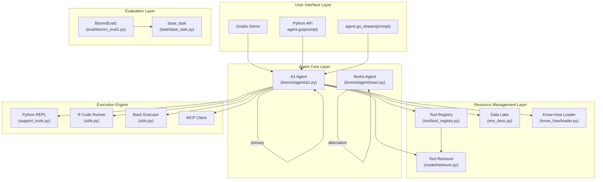
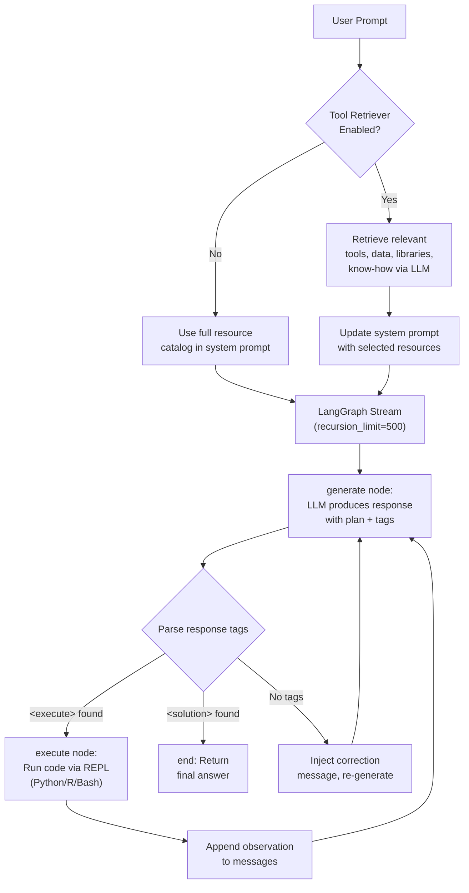

Biomni is a **code-agent framework** designed for autonomous biomedical problem-solving. Rather than wrapping API calls behind a chat interface, it places an LLM inside a stateful coding loop where the model plans, writes code, executes it against real data and tools, observes results, and iterates — all within a single conversational thread. This page maps the layered architecture that makes this possible, from configuration down to code execution, and shows how data flows through the system from your first prompt to a final answer.

## High-Level Architecture

The system follows a **five-layer architecture**: Configuration → Agent Core → Resource Management → Execution Engine → Evaluation. Each layer has a single responsibility and communicates through well-defined interfaces, making the system both extensible and auditable.



At the top, users interact through either a **Gradio web demo** or the **Python API**. Both paths converge on the `A1` agent — the system's primary orchestration class. The A1 agent sits between the user and every resource in the system: it retrieves relevant tools, assembles data and software context, generates a system prompt, and drives the execution loop. Below the agent, the resource management layer provides the *what* (tools, data, knowledge), and the execution engine provides the *how* (Python, R, Bash, MCP). The evaluation layer sits to the side, offering a benchmark harness for measuring agent performance.

Sources: [a1.py](biomni/agent/a1.py#L56-L68), [react.py](biomni/agent/react.py#L38-L46)

## Package Structure

The `biomni/` package is organized into six functional directories, each encapsulating a distinct architectural concern. Understanding this layout is the key to navigating the codebase efficiently.

```
biomni/
├── agent/          # Agent classes (A1, ReAct, FunctionGenerator)
├── tool/           # 20+ domain tool modules, schemas, registry
├── model/          # Retrieval-Augmented tool selection
├── task/           # Benchmark task definitions & evaluation
├── know_how/       # Best-practice documents & protocols
├── eval/           # Evaluation harness (BiomniEval1)
├── config.py       # Centralized configuration
├── llm.py          # Multi-provider LLM factory
├── env_desc.py     # Data lake & software library descriptors
├── env_desc_cm.py  # Commercial-mode filtered descriptors
└── utils.py        # Shared utilities (REPL, parsers, helpers)
```

The **`agent/`** directory contains the orchestrators — classes that combine an LLM with tools and data into a loop. The **`tool/`** directory is the largest, housing domain-specific function modules (genomics, pharmacology, imaging, etc.), pre-computed API schemas for 30+ external databases, and the tool registry. The **`model/`** directory provides retrieval logic that prunes the full resource catalog down to a query-relevant subset. The **`task/`** and **`eval/`** directories handle benchmarking. The **`know_how/`** directory stores curated markdown documents with expert protocols and best practices.

Sources: [a1.py](biomni/agent/a1.py#L225-L232), [tool_registry.py](biomni/tool/tool_registry.py#L6-L18), [retriever.py](biomni/model/retriever.py#L8-L14)

## The A1 Agent: Core Orchestration

The `A1` class in [biomni/agent/a1.py](biomni/agent/a1.py) is the central orchestrator — a 3000-line class that manages the entire lifecycle of a biomedical problem-solving session. It implements a **state-machine workflow** built on LangGraph, where each turn the agent either generates a plan, executes code, or delivers a final solution.

### Agent State Model

The agent tracks its progress through an `AgentState` TypedDict containing two fields: a `messages` list accumulating the full conversation, and a `next_step` string that routes control flow.

| Field | Type | Purpose |
|---|---|---|
| `messages` | `list[BaseMessage]` | Accumulated conversation history (Human, AI, System, Tool messages) |
| `next_step` | `str \| None` | Routing directive: `"generate"`, `"execute"`, or `"end"` |

This state drives a three-node graph inside the `configure()` method: **generate** → **execute** → **generate** (looping) or **end**. The `generate` node invokes the LLM with the system prompt and conversation history, then parses the response for XML tags to determine the next routing. The `execute` node runs the extracted code (Python, R, or Bash) and feeds observations back into the message list.

Sources: [a1.py](biomni/agent/a1.py#L51-L55), [a1.py](biomni/agent/a1.py#L1289-L1369)

### Initialization Pipeline

When you instantiate `A1(path, llm, ...)`, the constructor orchestrates a multi-step initialization pipeline:

1. **Configuration resolution** — Parameters fall back to `BiomniConfig` defaults, which themselves fall back to environment variables like `BIOMNI_LLM`, `BIOMNI_PATH`, and `BIOMNI_COMMERCIAL_MODE`.
2. **Mode selection** — If `commercial_mode=True`, the agent imports from `env_desc_cm` (filtered descriptors) instead of `env_desc`, excluding non-commercial datasets and know-how documents.
3. **Data lake bootstrapping** — Creates `biomni_data/data_lake/` and `biomni_data/benchmark/` directories, then downloads missing files from `https://biomni-release.s3.amazonaws.com`.
4. **LLM instantiation** — Calls `get_llm()` which supports seven providers: OpenAI, AzureOpenAI, Anthropic, Ollama, Gemini, Bedrock, Groq, and a Custom mode for self-hosted endpoints.
5. **Tool loading** — Calls `read_module2api()` which scans all domain modules under `biomni/tool/`, parsing `@tool`-decorated functions into a `module2api` dictionary mapping module names to API schema lists.
6. **Registry creation** — If `use_tool_retriever=True`, a `ToolRegistry` is built from the full module2api dictionary, and a `ToolRetriever` is attached.
7. **Know-how loading** — A `KnowHowLoader` discovers and parses all markdown documents from `biomni/know_how/resource/`, extracting metadata headers and stripping them for agent context.
8. **Initial configuration** — Calls `self.configure()` to build the system prompt and LangGraph workflow.

Sources: [a1.py](biomni/agent/a1.py#L56-L225), [config.py](biomni/config.py#L12-L99), [llm.py](biomni/llm.py#L9-L22)

### The Execution Loop

The `go(prompt)` method triggers the main execution loop, which follows this sequence:



Each `generate` step sends the full message list (system prompt + conversation) to the LLM. The system prompt instructs the model to think with a reasoning block, then either wrap code in `<execute>` tags or wrap the final answer in `<solution>` tags. The parser uses regex matching with fallback patterns for different LLM formatting styles — including recovery for incomplete XML tags and markdown code blocks from OpenAI models. Code execution routes through a **persistent Python REPL** (shared global namespace across turns), an R subprocess runner, or a Bash subprocess, with configurable timeouts.

> [!TIP]
> The agent's persistent REPL means variables defined in one execution step survive into the next. This is intentional — it allows multi-step workflows like loading a dataset, transforming it, and then visualizing it across separate code blocks. The namespace is per-agent-instance, not per-invocation, so state persists across multiple `go()` calls within the same `A1` object.

Sources: [a1.py](biomni/agent/a1.py#L1381-L1488), [a1.py](biomni/agent/a1.py#L1759-L1789), [support_tools.py](biomni/tool/support_tools.py#L13-L16)

## Resource Management Layer

The resource management layer answers a fundamental question for each user query: *which tools, data, software, and knowledge should the agent know about?* This layer is split into two complementary systems — a full catalog used during initial configuration, and a retrieval-based subset selection used at query time.

### Data Lake

The data lake is a collection of **79 pre-indexed biomedical datasets** stored locally in `biomni_data/data_lake/`. These span protein interactions (BioPlex, STRING), cancer genomics (DepMap CRISPR screens, cell line omics), drug data (BindingDB, Broad Repurposing Hub), gene expression (GTEx, CZI Cell Census), variant databases (GeneBASS, GWAS Catalog), pathway and ontology data (MSigDB gene sets, Gene Ontology), and more. Each dataset is described in the `data_lake_dict` dictionary with a human-readable description that helps the agent understand what each file contains.

Sources: [env_desc.py](biomni/env_desc.py#L1-L79)

### Software Library

The `library_content_dict` describes **100+ available software packages** organized by type: Python packages (scanpy, rdkit, pysam, etc.), R packages (DESeq2, clusterProfiler, Seurat), and CLI tools (samtools, bowtie2, bedtools, macs2). Each entry includes its invocation pattern — for example, R packages note the `subprocess.run(['Rscript', '-e', ...])` pattern. These are *available* software, not imported by default; the agent writes import statements or subprocess calls as needed in its generated code.

Sources: [env_desc.py](biomni/env_desc.py#L82-L222)

### Tool System

The tool system is the largest subsystem, organized into **20+ domain-specific modules** that map biological disciplines to callable Python functions:

| Domain Module | Example Functions | Data Sources |
|---|---|---|
| `genomics.py` | Variant queries, gene set enrichment, genome coordinate conversion | Ensembl, NCBI, GWAS Catalog |
| `pharmacology.py` | Drug-target interaction, binding affinity lookup, drug repurposing | ChEMBL, DrugBank, BindingDB |
| `cell_biology.py` | scRNA-seq analysis, cell type annotation, trajectory inference | CZI Census, Scanpy |
| `genetics.py` | Gene ID conversion, genetic interaction lookup, CRISPR screen analysis | Entrez, Ensembl, DepMap |
| `database.py` | Cross-database queries (UniProt, KEGG, Reactome, PDB, etc.) | 30+ pre-built schemas |
| `protocols.py` | Protocol search (Protocols.io), local protocol management | Protocols.io API |
| `support_tools.py` | Python REPL execution, matplotlib plot capture | Local environment |

Each domain module exports `@tool`-decorated functions with complete docstrings and type annotations. The `read_module2api()` utility scans these modules at import time and builds the `module2api` dictionary — a nested mapping of `{module_name: [{name, description, required_parameters, ...}, ...]}` that the agent uses to understand its available functions. The `schema_db/` directory contains 30+ pre-computed API schema pickles for major biomedical databases, avoiding the need for live schema discovery.

Sources: [utils.py](biomni/utils.py#L845-L879), [tool_registry.py](biomni/tool/tool_registry.py#L6-L18), [support_tools.py](biomni/tool/support_tools.py#L13-L16)

### Retrieval-Augmented Resource Selection

When `use_tool_retriever=True` (the default), the `ToolRetriever` in [biomni/model/retriever.py](biomni/model/retriever.py) performs a **prompt-based retrieval** step before each query. Rather than using vector embeddings, it constructs a detailed prompt listing all available tools (with descriptions and parameters), data lake items, software libraries, and know-how documents, then asks the agent's own LLM to select the relevant subset. This produces four filtered lists — tools, data, libraries, and know-how — that replace the full catalog in the system prompt.

The retrieval prompt explicitly instructs the LLM to be "generous in selection" to avoid missing potentially useful resources. The `ToolRetriever` class also handles response parsing for both plain-text and Responses API-style content blocks, making it compatible with multiple LLM providers.

Sources: [retriever.py](biomni/model/retriever.py#L14-L50), [a1.py](biomni/agent/a1.py#L1646-L1757)

### Know-How Library

The `KnowHowLoader` in [biomni/know_how/loader.py](biomni/know_how/loader.py) manages a collection of **curated markdown documents** containing expert protocols, best practices, and troubleshooting guides (e.g., sgRNA design guides, single-cell annotation workflows). Each document has a YAML-like metadata header (name, description, commercial_use license) followed by free-form content. During configuration, all know-how documents are loaded into the initial system prompt so best practices are always available. During retrieval, only query-relevant documents are surfaced with their full content injected into the system prompt.

> [!TIP]
> Know-how documents are always included in the initial system prompt regardless of the retrieval setting. This design ensures that foundational best practices (like experimental design principles) are never missed, while retrieval adds domain-specific depth on top.

Sources: [loader.py](biomni/know_how/loader.py#L8-L30), [a1.py](biomni/agent/a1.py#L1351-L1366)

## Multi-Provider LLM Abstraction

The LLM layer in [biomni/llm.py](biomni/llm.py) provides a unified factory function `get_llm()` that abstracts across seven backend providers. The `SourceType` literal enforces allowed values at the type level, and the factory returns a LangChain `BaseChatModel` instance regardless of provider. This means the entire agent — including the retriever's LLM calls — works identically whether you're using Anthropic Claude, OpenAI GPT, a local Ollama model, or a custom endpoint via `base_url` and `api_key`.

| Provider | Source Type | Key Requirement |
|---|---|---|
| Anthropic Claude | `"Anthropic"` | `ANTHROPIC_API_KEY` env var |
| OpenAI GPT | `"OpenAI"` | `OPENAI_API_KEY` env var |
| Azure OpenAI | `"AzureOpenAI"` | `AZURE_OPENAI_API_KEY` + endpoint |
| Google Gemini | `"Gemini"` | `GOOGLE_API_KEY` env var |
| AWS Bedrock | `"Bedrock"` | AWS credentials configured |
| Groq | `"Groq"` | `GROQ_API_KEY` env var |
| Ollama (local) | `"Ollama"` | Local Ollama server running |
| Custom endpoint | `"Custom"` | `base_url` + `api_key` params |

The default model is `claude-sonnet-4-5`, configurable via `BiomniConfig.llm` or the `BIOMNI_LLM` environment variable. Stop sequences are set to `["</execute>", "</solution>"]` to help the LLM delimit its output correctly.

Sources: [llm.py](biomni/llm.py#L9-L22), [config.py](biomni/config.py#L36-L37)

## Configuration System

The `BiomniConfig` dataclass in [biomni/config.py](biomni/config.py) centralizes all configurable parameters with sensible defaults and a two-tier override mechanism: constructor arguments → environment variables. A global `default_config` singleton is created at module load time, and the `A1.__init__()` constructor resolves each parameter against this singleton.

| Parameter | Default | Environment Variable | Description |
|---|---|---|---|
| `path` | `"./data"` | `BIOMNI_PATH` / `BIOMNI_DATA_PATH` | Root data directory |
| `llm` | `"claude-sonnet-4-5"` | `BIOMNI_LLM` / `BIOMNI_LLM_MODEL` | LLM model identifier |
| `temperature` | `0.7` | `BIOMNI_TEMPERATURE` | LLM sampling temperature |
| `timeout_seconds` | `600` | `BIOMNI_TIMEOUT_SECONDS` | Code execution timeout |
| `use_tool_retriever` | `True` | `BIOMNI_USE_TOOL_RETRIEVER` | Enable retrieval-augmented selection |
| `commercial_mode` | `False` | `BIOMNI_COMMERCIAL_MODE` | Exclude non-commercial datasets |
| `source` | `None` (auto-detect) | `BIOMNI_SOURCE` | LLM provider |
| `base_url` | `None` | `BIOMNI_CUSTOM_BASE_URL` | Custom model endpoint |
| `api_key` | `None` | `BIOMNI_CUSTOM_API_KEY` | Custom model API key |

The `commercial_mode` flag triggers a cascade: it switches the data lake and software descriptors to filtered versions (`env_desc_cm` instead of `env_desc`), and removes know-how documents whose metadata marks them as non-commercial. This is the architectural mechanism that enforces licensing compliance.

Sources: [config.py](biomni/config.py#L12-L99), [a1.py](biomni/agent/a1.py#L57-L82)

## Evaluation Architecture

The evaluation subsystem sits alongside the agent and provides a standardized harness for benchmarking. The `BiomniEval1` class in [biomni/eval/biomni_eval1.py](biomni/eval/biomni_eval1.py) loads a merged Parquet dataset containing all BiomniEval1 task instances, then provides `evaluate(task_name, instance_id, user_answer)` with task-specific reward computation logic. The `base_task` class in [biomni/task/base_task.py](biomni/task/base_task.py) defines a minimal interface for evaluation tasks: `get_example()`, `get_iterator()`, `evaluate()`, `output_class()`, and `get_prompt_from_input()`.

Sources: [biomni_eval1.py](biomni/eval/biomni_eval1.py#L14-L30), [base_task.py](biomni/task/base_task.py#L1-L19)

## Agent Variants

Beyond the primary `A1` agent, the framework provides three auxiliary agent classes, each serving a distinct purpose in the broader workflow:

| Agent | Location | Purpose | Key Difference from A1 |
|---|---|---|---|
| `A1` | `agent/a1.py` | Primary biomedical problem-solver | Full resource management, persistent REPL, XML-tag protocol |
| `react` | `agent/react.py` | LangGraph ReAct agent | Uses standard LangGraph tool-calling, supports plan/reflect modes |
| `FunctionGenerator` | `agent/function_generator.py` | Standalone code generator | Generates executable Python scripts from task descriptions |
| `PaperTaskExtractor` | `agent/env_collection.py` | Academic paper analyzer | Extracts generalizable tasks from papers via chunked processing |
| `qa_llm` | `agent/qa_llm.py` | Simple QA baseline | Direct LLM question-answering without tools |

The `react` class offers an alternative execution paradigm — it uses LangGraph's built-in tool-calling mechanism rather than the XML-tag protocol that A1 uses, and supports explicit planning (`plan=True`) and reflection (`reflect=True`) modes. The `FunctionGenerator` and `PaperTaskExtractor` are specialized utility agents used in benchmark construction rather than end-user interaction.

Sources: [react.py](biomni/agent/react.py#L38-L46), [function_generator.py](biomni/agent/function_generator.py#L22-L25), [env_collection.py](biomni/agent/env_collection.py#L12-L15)

## Extensibility Points

The architecture exposes four primary extension mechanisms that allow you to customize the agent without modifying core internals:

1. **Custom Tools** — `agent.add_tool(api)` registers a new callable function into the tool registry, making it available for retrieval and import in generated code. The agent also tracks custom tools separately and highlights them in the system prompt with a 🔧 prefix.

2. **Custom Data** — `agent.add_data(data)` adds files to the data lake with descriptions, updating both the internal data lake and the descriptor dictionary. Custom data is highlighted with a 📊 prefix.

3. **Custom Software** — `agent.add_software(software)` extends the available library catalog, highlighted with a ⚙️ prefix.

4. **MCP Integration** — `agent.add_mcp(config_path)` connects to external Model Context Protocol servers, importing their tools into the agent's tool registry. `agent.create_mcp_server()` can also expose the agent's own tools as an MCP server for other clients.

Each extension mechanism triggers an automatic `configure()` call to rebuild the system prompt with the updated resource set.

Sources: [a1.py](biomni/agent/a1.py#L225-L232), [a1.py](biomni/agent/a1.py#L676-L685), [a1.py](biomni/agent/a1.py#L777-L786), [a1.py](biomni/agent/a1.py#L350-L360)

---

## Where to Go Next

This overview has mapped the full architectural landscape. Depending on your goal, the following pages provide the natural next level of depth:

- **[A1 Agent Core Class](9-a1-agent-core-class)** — Deep dive into the A1 class API, initialization, and lifecycle management
- **[ReAct Reasoning Engine](10-react-reasoning-engine)** — Detailed analysis of the generate-execute loop, tag parsing, and state transitions
- **[Tool Registry and Discovery](12-tool-registry-and-discovery)** — How tools are discovered, registered, and made available to the agent
- **[Configuration Reference](21-configuration-reference)** — Complete parameter reference with examples for all configuration options
- **[MCP Server Integration](19-mcp-server-integration)** — How to connect Biomni to external tool servers or expose it as one