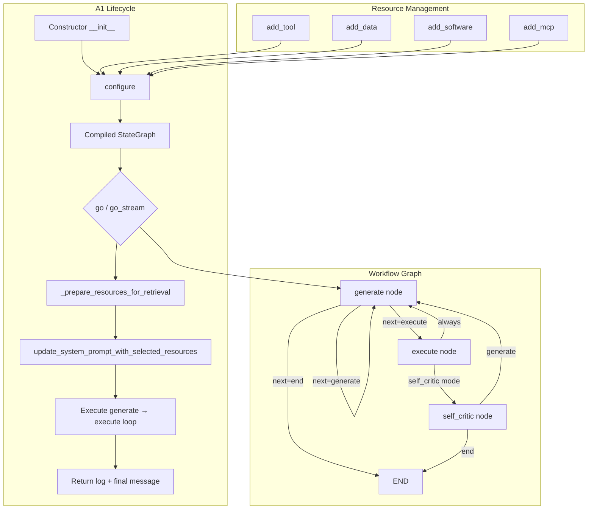

The `A1` class is the central orchestrator of the Biomni system — a biomedical AI agent that combines large language model reasoning with interactive code execution, tool retrieval, and domain-specific knowledge. Instantiating an `A1` object bootstraps the entire agent pipeline: it resolves configuration, downloads required data, registers tools, loads know-how documents, and compiles a LangGraph state-machine workflow ready to accept user prompts. This page dissects the class architecture, its lifecycle, and its public API for developers who need to understand or extend the agent's behavior.

Sources: [a1.py](biomni/agent/a1.py#L1-L50)

## Architectural Overview

At the highest level, `A1` is a stateful agent built on **LangGraph's** `StateGraph` with an in-memory checkpoint saver. Each invocation follows a generate → execute → route loop until the LLM emits a `<solution>` tag, at which point the graph terminates. The class manages four distinct resource domains — tools, data lake files, software libraries, and know-how documents — and selectively injects them into the system prompt either at initialization (full-dump mode) or at query time (retrieval mode).

Sources: [a1.py](biomni/agent/a1.py#L1289-L1650), [a1.py](biomni/agent/a1.py#L1759-L1830)

## AgentState and State Graph

The graph is parameterized by a lightweight `TypedDict` called `AgentState`, carrying only two fields:

| Field | Type | Purpose |
|---|---|---|
| `messages` | `list[BaseMessage]` | Full conversation history including system prompts, human inputs, AI responses, and execution observations |
| `next_step` | `str \| None` | Routing signal set by the `generate` node: `"generate"`, `"execute"`, or `"end"` |

The `generate` node invokes the LLM with the system prompt plus conversation history, parses the response for XML tags (`<execute>`, `<solution>`, thinking delimiters), and sets `next_step` accordingly. The `execute` node runs code extracted from `<execute>` blocks — dispatching to Python REPL, R, or Bash based on leading markers (`#!R`, `#!BASH`, `#!CLI`) — and appends an `<observation>` message. A built-in timeout (default 600s) prevents runaway executions.

Sources: [a1.py](biomni/agent/a1.py#L51-L54), [a1.py](biomni/agent/a1.py#L1380-L1490)

## Constructor and Configuration

The `__init__` method accepts nine optional parameters that layer on top of the global `BiomniConfig` defaults. Any parameter left as `None` falls back to `default_config`, which itself respects environment variables like `BIOMNI_LLM`, `BIOMNI_PATH`, `BIOMNI_COMMERCIAL_MODE`, and others.

| Parameter | Type | Default | Description |
|---|---|---|---|
| `path` | `str \| None` | `"./data"` | Root data directory; `biomni_data/` subfolders are created automatically |
| `llm` | `str \| None` | `"claude-sonnet-4-5"` | LLM model identifier |
| `source` | `SourceType \| None` | Auto-detected | Provider: `"OpenAI"`, `"Anthropic"`, `"Ollama"`, `"Gemini"`, `"Bedrock"`, `"Custom"`, etc. |
| `use_tool_retriever` | `bool \| None` | `True` | Enable retrieval-augmented tool/data selection at query time |
| `timeout_seconds` | `int \| None` | `600` | Maximum execution time per code block |
| `base_url` | `str \| None` | `None` | Custom model endpoint URL (for self-hosted models) |
| `api_key` | `str \| None` | `"EMPTY"` | API key for custom model serving |
| `commercial_mode` | `bool \| None` | `False` | If `True`, excludes non-commercial datasets and know-how documents |
| `expected_data_lake_files` | `list \| None` | All files from `data_lake_dict` | Pass empty list to skip S3 auto-download |

During initialization the constructor performs several critical side-effects: it creates the `biomni_data/benchmark` and `biomni_data/data_lake` directory structure, downloads missing files from the Biomni S3 bucket, initializes the `ToolRegistry` and `ToolRetriever` (when retrieval is enabled), loads all know-how documents via `KnowHowLoader`, and calls `configure()` to compile the initial workflow.

Sources: [a1.py](biomni/agent/a1.py#L57-L224), [config.py](biomni/config.py#L12-L51)

## Resource Extension API

One of the core design patterns in `A1` is its symmetric CRUD interface for three resource types: **tools**, **data**, and **software**. Each resource type follows the same four-method pattern — `add_*`, `get_custom_*`, `list_custom_*`, `remove_custom_*` — with internal storage in `_custom_tools`, `_custom_data`, and `_custom_software` dictionaries. Every `add_*` call triggers `self.configure()` to rebuild the system prompt and recompile the workflow graph, ensuring the LLM always sees an up-to-date environment description.

**Adding tools** is the most involved operation. The `add_tool(api)` method accepts a callable, inspects its source code, generates an API schema via `function_to_api_schema()`, registers it in both `tool_registry` and `module2api`, and injects the function into `builtins._biomni_custom_functions` so it is available during Python REPL execution. This dual-registration ensures custom tools work both as direct imports in code and as retrieval candidates.

**Adding data** via `add_data(data)` accepts a `dict` mapping file paths to descriptions, while `add_software(software)` maps software names to descriptions. Both merge into the agent's internal dictionaries (`data_lake_dict`, `library_content_dict`) so they appear in system prompt generation and retrieval.

Sources: [a1.py](biomni/agent/a1.py#L225-L348), [a1.py](biomni/agent/a1.py#L676-L870), [a1.py](biomni/agent/a1.py#L777-L870)

## System Prompt Generation

The `_generate_system_prompt` method is the largest single method in the class (~390 lines) and is responsible for assembling the full system prompt from four resource categories. It handles two distinct modes controlled by the `is_retrieval` flag:

- **Initial configuration** (`is_retrieval=False`): All tools, data lake items, software libraries, and know-how documents are included with generic introductory text like *"In your code, you will need to import the function location using the following dictionary..."*
- **Post-retrieval** (`is_retrieval=True`): Only the resources selected by the retriever are included, with targeted framing like *"Based on your query, I've identified the following most relevant functions..."*

Custom resources are always highlighted with emoji prefixes (🔧 for tools, 📊 for data, ⚙️ for software, 📚 for know-how) and placed in a dedicated "PRIORITY CUSTOM RESOURCES" section at the top of the prompt. Know-how documents receive special treatment: their full content (with metadata stripped) is embedded directly, and the prompt explicitly instructs the LLM not to waste a step "retrieving" them since they are already in context.

The base prompt defines the agent's behavioral contract: think first with a numbered plan using checkbox notation, then either execute code via `<execute>` tags or provide a final answer via `<solution>` tags. It supports Python (default), R (`#!R`), and Bash (`#!BASH` / `#!CLI`) execution environments.

Sources: [a1.py](biomni/agent/a1.py#L898-L1288), [a1.py](biomni/agent/a1.py#L1075-L1130)

## Execution Flow: go() and go_stream()

The primary entry points for running the agent are `go(prompt)` and `go_stream(prompt)`. Both follow the same internal sequence:

1. Reset `critic_count` and store the user task
2. If `use_tool_retriever` is enabled, call `_prepare_resources_for_retrieval(prompt)` to select relevant tools, data, libraries, and know-how documents, then call `update_system_prompt_with_selected_resources()` to regenerate the system prompt with only those resources
3. Create the initial `AgentState` with the human message
4. Stream through the compiled `StateGraph` with a recursion limit of 500
5. Collect and return the log

The `go()` method returns a tuple of `(log, final_message_content)` after the graph completes. The `go_stream()` method yields `{"output": pretty_printed_message}` dictionaries as a generator, enabling real-time progress monitoring.

> [!TIP]
> The `_prepare_resources_for_retrieval` method delegates to `ToolRetriever.prompt_based_retrieval()`, which uses the agent's own LLM to select resources — not a separate embedding model. This means retrieval quality is directly tied to the configured LLM's capability and the prompt's clarity.

Sources: [a1.py](biomni/agent/a1.py#L1646-L1790), [a1.py](biomni/agent/a1.py#L1759-L1830)

## Self-Critic and Test-Time Scaling

When `configure(self_critic=True, test_time_scale_round=N)` is called, the graph gains an additional `self_critic` node positioned between the generate node and the END state. Once the LLM produces a `<solution>`, instead of terminating immediately, the graph routes to `self_critic`, which asks the LLM to critique its own work against the original user task. This critique is injected as a `HumanMessage` and the generate node runs again, producing a potentially improved solution. The cycle repeats up to `test_time_scale_round` times before terminating.

Sources: [a1.py](biomni/agent/a1.py#L1560-L1645)

## Commercial Mode Filtering

When `commercial_mode=True`, the constructor imports environment descriptors from `biomni.env_desc_cm` (instead of `biomni.env_desc`), which contains only commercially-licensed datasets. Additionally, `_filter_know_how_for_commercial_mode()` scans all loaded know-how documents and removes any whose metadata includes markers like `"❌"`, `"Not Allowed"`, or `"Non-Commercial"` in the `commercial_use` field. This ensures compliance with license terms at every layer of the resource stack.

Sources: [a1.py](biomni/agent/a1.py#L876-L895), [a1.py](biomni/agent/a1.py#L137-L142)

## MCP Integration and Server Creation

The `A1` class provides two MCP-related capabilities. `add_mcp(config_path)` reads a YAML configuration file and dynamically creates synchronous wrapper functions for each tool discovered from external MCP servers via stdio transport. `create_mcp_server(tool_modules)` reverses the direction — it takes the agent's internal `module2api` tool registry and exposes those tools as an MCP server using `FastMCP`, enabling other MCP clients to consume Biomni's native tools.

Both methods bridge the gap between Biomni's internal tool system and the broader MCP ecosystem, making it possible to both consume external tools and serve internal tools through a standardized protocol.

Sources: [a1.py](biomni/agent/a1.py#L350-L588), [a1.py](biomni/agent/a1.py#L1995-L2060)

## Quick Reference: Key Methods

| Method | Purpose | Triggers Reconfigure? |
|---|---|---|
| `__init__(...)` | Full agent bootstrap | Yes (via `configure()`) |
| `configure(self_critic, test_time_scale_round)` | Rebuild system prompt and compile graph | N/A (is the reconfigure) |
| `go(prompt)` | Run agent synchronously, return log + answer | No |
| `go_stream(prompt)` | Run agent as generator, yield steps | No |
| `add_tool(api)` | Register a custom callable as a tool | Yes |
| `add_data(data)` | Register custom data lake files | Yes |
| `add_software(software)` | Register custom software libraries | Yes |
| `add_mcp(config_path)` | Load external MCP server tools | Yes |
| `create_mcp_server(tool_modules)` | Expose internal tools as MCP server | No |
| `result_formatting(output_class, task_intention)` | Extract structured output from conversation | No |
| `save_conversation_history(filepath)` | Export conversation as PDF/Markdown | No |

For details on how the ReAct-style generate-execute loop works under the hood — including tag parsing, error recovery, and the routing logic — see the [ReAct Reasoning Engine](10-react-reasoning-engine) page. To understand how the tool retriever selects resources at query time, continue to [Retrieval-Augmented Tool Selection](13-retrieval-augmented-tool-selection). For a broader view of how `A1` fits within the overall system architecture, refer back to the [Architecture Overview](8-architecture-overview).
