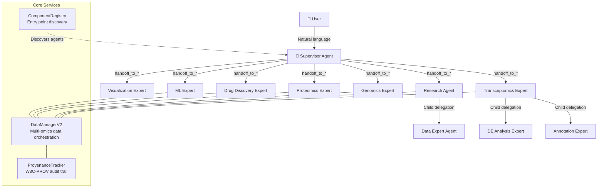
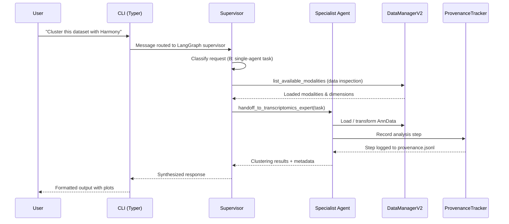

**Lobster AI** is an open-source, multi-agent bioinformatics analysis system that orchestrates 22+ specialist agents across 10 installable domain packages — all coordinated by a LangGraph supervisor and executed locally on your machine. You describe your analysis in plain language; the supervisor classifies, routes, and delegates to the right specialist, which calls validated scientific libraries directly rather than generating scripts. Every step is tracked with W3C-PROV provenance and exportable as a reproducible Jupyter notebook.


Sources: [README.md](/README.md#L1-L50), [lobster/agents/supervisor.py](/lobster/agents/supervisor.py#L57-L95)

## What Lobster Does

Lobster solves a core bottleneck in computational biology: turning a natural-language research request — *"Download this GEO dataset, run QC, integrate batches with Harmony, cluster, and annotate cell types"* — into a fully executed, provenance-tracked analysis pipeline. The system is built on three architectural commitments. **First**, all computation runs locally; patient data and proprietary datasets never leave your hardware. **Second**, agents invoke scientific libraries (Scanpy, PyDESeq2, Harmony, PLINK) through typed tool functions — not by generating ad-hoc code that might hallucinate parameters. **Third**, every data-loading, transformation, and export step is recorded in a W3C-PROV-style provenance log, enabling one-click export to a self-contained Jupyter notebook that any collaborator can re-run.

| Capability | How It Works |
|---|---|
| **Natural-language analysis** | Supervisor agent classifies your request, then delegates to specialist agents via typed handoff tools |
| **Local-first execution** | All analysis runs on your machine; no patient data leaves your hardware |
| **Validated scientific libraries** | Agents call Scanpy, PyDESeq2, Harmony, PLINK, etc. through tool functions — no generated scripts |
| **W3C-PROV provenance** | Every step is tracked in a `provenance.jsonl` log with activity, entity, and agent records |
| **Notebook export** | One-click export of any session as a reproducible Jupyter notebook via `/pipeline export` |
| **Plugin extensibility** | New agents register via Python entry points; `lobster scaffold` generates a contract-compliant package |

Sources: [README.md](/README.md#L122-L160), [lobster/core/provenance/provenance.py](/lobster/core/provenance/provenance.py#L1-L45)

## Architecture at a Glance

The system follows a **supervisor-worker topology**: a single LangGraph supervisor classifies every user message and delegates to specialist agents implemented as ReAct sub-graphs. The supervisor communicates with workers exclusively through typed handoff tools (`handoff_to_<agent_name>`), and workers return results back to the supervisor, which synthesizes a response for the user. This means you, the user, only ever interact with the supervisor — the specialist agents are invisible implementation details.

> [!TIP]
> The Tool Calling pattern is the key architectural decision: every agent delegation is a LangGraph tool invocation, not a message-passing hop. This gives the supervisor native control over parallel vs. sequential execution and enables token-level streaming of agent transitions.



Sources: [lobster/agents/graph.py](/lobster/agents/graph.py#L1-L55), [lobster/agents/supervisor.py](/lobster/agents/supervisor.py#L57-L165), [lobster/core/runtime/data_manager.py](/lobster/core/runtime/data_manager.py#L1-L45)

## The Agent Ecosystem

Lobster ships 22 specialist agents distributed across 12 installable packages. The core `lobster-ai` package provides the supervisor, graph topology, data manager, and shared infrastructure. Domain agents live in separate packages that you install on demand — this keeps the base installation lean and lets you compose exactly the capabilities you need.

| Package | Agents | Domain |
|---|---|---|
| `lobster-transcriptomics` | transcriptomics_expert, annotation_expert, de_analysis_expert | Single-cell & bulk RNA-seq |
| `lobster-research` | research_agent, data_expert_agent | Literature discovery & data management |
| `lobster-proteomics` | proteomics_expert, proteomics_de_analysis_expert, biomarker_discovery_expert | Mass spectrometry & affinity proteomics |
| `lobster-genomics` | genomics_expert, variant_analysis_expert | GWAS, variant annotation, VCF/PLINK |
| `lobster-drug-discovery` | drug_discovery_expert, cheminformatics_expert, clinical_dev_expert, pharmacogenomics_expert | Drug discovery & cheminformatics |
| `lobster-ml` | machine_learning_expert, feature_selection_expert, survival_analysis_expert | ML data preparation & export |
| `lobster-metabolomics` | metabolomics_expert | Metabolomics data analysis |
| `lobster-visualization` | visualization_expert_agent | Single-cell & general visualizations |
| `lobster-metadata` | metadata_assistant | Sample ID mapping & schema standardization |
| `lobster-structural-viz` | protein_structure_visualization_expert | PDB fetching & ChimeraX visualization |

Agents follow a **parent-child hierarchy**: the transcriptomics expert, for example, can delegate to its child annotation expert and DE analysis expert without routing back through the supervisor. Child agents are not directly accessible to the supervisor — they are reached through their parent, which maintains domain coherence.

> [!TIP]
> Only install the packages you need. `pip install lobster-ai lobster-transcriptomics` gives you the supervisor plus transcriptomics agents. Add `lobster-genomics` later when you need GWAS support — the ComponentRegistry discovers newly installed agents automatically on next launch.

Sources: [packages/README.md](/packages/README.md#L1-L113), [lobster/core/component_registry.py](/lobster/core/component_registry.py#L69-L119)

## How Agents Are Discovered

Lobster uses **Python entry points** for zero-coupling plugin discovery. When you install `lobster-transcriptomics`, that package registers its agents in its `pyproject.toml` under the `lobster.agents` entry point group. At runtime, the `ComponentRegistry` scans all installed entry points across six groups — agents, services, adapters, providers, download services, and queue preparers — and builds the available agent roster. This means adding a new agent never requires modifying core code; it only requires publishing a package with the right entry points.

```
pyproject.toml (in lobster-transcriptomics)
  [project.entry-points."lobster.agents"]
  transcriptomics_expert = "lobster.agents.transcriptomics.transcriptomics_expert:AGENT_CONFIG"
  annotation_expert     = "lobster.agents.transcriptomics.annotation_expert:AGENT_CONFIG"
```

Each agent module exposes an `AGENT_CONFIG` dataclass at the top of its file — before any heavy imports — enabling sub-50-millisecond discovery without loading the agent's full dependency tree.

Sources: [packages/README.md](/packages/README.md#L61-L95), [lobster/core/component_registry.py](/lobster/core/component_registry.py#L69-L119), [lobster/config/agent_registry.py](/lobster/config/agent_registry.py#L25-L72)

## Core Infrastructure Layers

Behind the agents, three infrastructure layers make the system work reliably across omics domains.

| Layer | Module | Role |
|---|---|---|
| **Data Orchestration** | `lobster.core.runtime.data_manager` | Manages multi-modal datasets (AnnData, MuData), storage backends (H5AD, MuData), modality adapters, and validation |
| **Provenance Tracking** | `lobster.core.provenance.provenance` | W3C-PROV-style audit trail: activities, entities, and agents logged to `provenance.jsonl` with disk persistence |
| **Component Registry** | `lobster.core.component_registry` | Single source of truth for discovering agents, services, adapters, providers, and queue preparers via entry points |

The **DataManagerV2** is the central data orchestrator. It loads datasets into modality-specific adapters (transcriptomics, proteomics, genomics, metabolomics), stores them in typed backends (H5AD for AnnData, MuData for multi-modal), and validates schema compliance at every step. When a specialist agent asks *"what data is loaded?"*, it queries the DataManager through the `list_available_modalities` tool.

The **ProvenanceTracker** records every data-loading, transformation, and export operation with timestamps, parameter snapshots, and software version fingerprints. This log feeds the notebook export pipeline, which reconstructs a linear, re-runnable Jupyter notebook from the provenance graph.

Sources: [lobster/core/runtime/data_manager.py](/lobster/core/runtime/data_manager.py#L1-L100), [lobster/core/provenance/provenance.py](/lobster/core/provenance/provenance.py#L1-L60), [lobster/core/component_registry.py](/lobster/core/component_registry.py#L1-L60)

## Project Structure

The repository is organized into distinct layers: the core engine, agent packages, external integrations, and the testing scaffold. Understanding this layout helps you navigate the codebase and know where to look when extending the system.

```
lobster/                         # Core engine
├── agents/                      # Supervisor, state definitions, graph topology
│   ├── supervisor.py            #   Supervisor prompt builder & routing logic
│   ├── state.py                 #   OverallState, TodoItem, dynamic state discovery
│   └── graph.py                 #   LangGraph graph factory & delegation tools
├── cli.py                       # Typer CLI (chat, query, init, scaffold, validate)
├── config/                      # LLM providers, agent registry, workspace config
│   ├── agent_registry.py        #   AgentRegistryConfig & facade functions
│   ├── llm_factory.py           #   Provider-agnostic LLM instantiation
│   └── providers/               #   Anthropic, Gemini, Bedrock, Ollama, OpenAI, etc.
├── core/                        # Infrastructure: data, provenance, plugins
│   ├── component_registry.py    #   Entry point discovery for all component types
│   ├── runtime/                 #   DataManagerV2, workspace resolution
│   ├── provenance/              #   W3C-PROV tracker, analysis IR, lineage
│   └── adapters/                #   Modality adapters (transcriptomics, proteomics, etc.)
├── tools/                       # Shared tool functions (downloads, workspace, todos)
│   ├── providers/               #   External data providers (GEO, PubMed, PRIDE, etc.)
│   └── rate_limiter.py          #   Per-provider rate limiting
└── services/                    # Business logic services (analysis, metadata, peptidomics)

packages/                        # Installable agent packages (PEP 420 namespace)
├── lobster-transcriptomics/     #   Single-cell & bulk RNA-seq agents
├── lobster-genomics/            #   GWAS & variant analysis agents
├── lobster-proteomics/          #   Mass spectrometry agents
├── lobster-drug-discovery/      #   Drug discovery & cheminformatics agents
├── lobster-ml/                  #   Machine learning agents
├── lobster-research/            #   Literature & data discovery agents
├── lobster-metabolomics/        #   Metabolomics agent
├── lobster-visualization/       #   Visualization agent
├── lobster-metadata/            #   Sample ID mapping agent
├── lobster-structural-viz/      #   Protein structure visualization agent
├── lobster-vector/              #   Vector/embedding agent
└── lobster-ai-tui/              #   Terminal UI (Go)

lobster-tui/                     # Go-based TUI frontend
tests/                           # Comprehensive test suites (unit, integration, chaos, security)
```

Sources: [packages/README.md](/packages/README.md#L42-L60), [lobster/__main__.py](/lobster/__main__.py#L1-L13), [lobster/core/runtime/workspace.py](/lobster/core/runtime/workspace.py#L1-L45)

## The Request Lifecycle

When you type a message in `lobster chat`, a precise sequence of events unfolds. Understanding this lifecycle demystifies what happens between your keystroke and the agent's response.



The supervisor first **classifies** every incoming request into one of four categories: (A) direct answer, (B) single-agent task, (C) multi-step pipeline, or (D) custom code fallback. For multi-step pipelines, it creates a todo plan via `write_todos` before delegating, then executes steps sequentially. At every handoff, the supervisor passes concise, machine-readable context — not the full conversation — keeping token costs bounded.

Sources: [lobster/agents/supervisor.py](/lobster/agents/supervisor.py#L107-L165), [lobster/agents/graph.py](/lobster/agents/graph.py#L200-L280)

## Where to Go Next

Now that you have the lay of the land, here is a logical reading path through the documentation catalog. Start with the hands-on guides, then dive into the architectural details that interest you most.

1. **Get running first** — [Quick Start](2-quick-start) walks you through installation, LLM configuration, and your first analysis session.
2. **Master the CLI** — [CLI Reference](3-cli-reference) covers every command, slash command, and session-continuation flag.
3. **Understand the architecture** — [Architecture Overview](4-architecture-overview) expands on the diagrams above with full component interaction details.
4. **Follow your interest** — the Deep Dive section breaks down each subsystem:
   - Agent orchestration: [Supervisor Agent and Routing](5-supervisor-agent-and-routing) → [LangGraph State and Graph Topology](6-langgraph-state-and-graph-topology) → [Agent Registry and Discovery](7-agent-registry-and-discovery)
   - Extensibility: [Plugin System and Entry Points](8-plugin-system-and-entry-points) → [AQUADIF Tool Taxonomy](9-aquadif-tool-taxonomy) → [Scaffold and Package Validation](10-scaffold-and-package-validation)
   - Data & provenance: [DataManager and Modality Adapters](11-datamanager-and-modality-adapters) → [Provenance Tracking and IR](12-provenance-tracking-and-ir) → [Notebook Export Pipeline](13-notebook-export-pipeline)
   - Domain packages: [Transcriptomics and Genomics Agents](14-transcriptomics-and-genomics-agents) → [Proteomics and Metabolomics Agents](15-proteomics-and-metabolomics-agents) → [Research, ML, and Visualization Agents](16-research-ml-and-visualization-agents)
   - Configuration: [LLM Provider Configuration](17-llm-provider-configuration) → [Workspace and Session Management](18-workspace-and-session-management)
   - External data: [Provider Registry and Data Access](19-provider-registry-and-data-access) → [Rate Limiting and Download Queue](20-rate-limiting-and-download-queue)
5. **Security** — [Security Policy and Instruction Hierarchy](21-security-policy-and-instruction-hierarchy) details the immutable security layer that governs all agent behavior.
