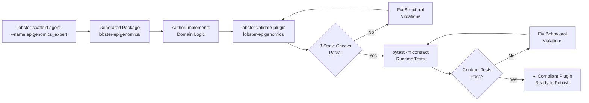

Lobster's plugin architecture demands structural rigor: every domain package must conform to a precise contract governing namespace layout, entry point wiring, agent factory signatures, and AQUADIF metadata. The **scaffold** system generates structurally correct packages from Jinja2 templates, while the **validation** system enforces contract compliance through both static AST analysis and runtime contract test mixins. Together, they form a closed loop — scaffold produces structure, validation certifies it — ensuring that no plugin, whether generated or hand-written, drifts from the canonical pattern.

Sources: [__init__.py](lobster/scaffold/__init__.py#L1-L19), [validators.py](lobster/scaffold/validators.py#L1-L38)

## The Scaffold-to-Validation Lifecycle

The lifecycle of a compliant plugin follows a deterministic path: scaffold generates the package skeleton → the author implements domain logic → static validation checks structural invariants → runtime contract tests verify behavioral compliance. This two-phase validation model catches different classes of defects: static checks catch *structural* violations (missing files, wrong entry points, misplaced config) without importing any code, while runtime contract tests catch *semantic* violations (missing tool metadata, provenance disconnects, bare collection types) by actually invoking the factory.



The separation is deliberate: static validation runs in milliseconds against raw source files with zero dependency imports, making it suitable for CI pre-commit hooks and IDE integration. Runtime contract tests execute the factory with mocked dependencies, making them slower but capable of detecting metadata-runtime disconnects that pure AST analysis cannot.

Sources: [validators.py](lobster/scaffold/validators.py#L40-L65), [contract_mixins.py](lobster/testing/contract_mixins.py#L1-L50)

## Scaffold Generator: Producing the Canonical Package

The `scaffold_agent` function generates a complete, structurally correct plugin package from a Jinja2 template set. It resolves templates via `importlib.resources` for robustness across namespace packages, wheels, and zip installs — never relying on `__file__` traversal. The generator accepts a core parameter set and derives all naming conventions automatically: `_derive_domain` strips the `_expert` suffix to produce the domain directory name, and `_to_class_name` converts snake_case to PascalCase for state class names.

| Parameter | Purpose | Example |
|-----------|---------|---------|
| `name` | Agent name in snake_case | `"epigenomics_expert"` |
| `display_name` | Human-readable label | `"Epigenomics Expert"` |
| `description` | Capability description | `"Epigenomics data analysis"` |
| `tier` | Subscription tier | `"free"`, `"premium"`, `"enterprise"` |
| `children` | Optional child agent names | `["methylation_expert"]` |
| `output_dir` | Target directory | `Path(".")` |

The generator produces the following directory structure, strictly adhering to PEP 420 namespace package rules — note the deliberate absence of `__init__.py` at `lobster/` and `lobster/agents/` levels:

```
lobster-{domain}/
├── pyproject.toml              # Entry points + namespace config
├── README.md
├── lobster/                    # ← NO __init__.py (PEP 420)
│   └── agents/                 # ← NO __init__.py (PEP 420)
│       └── {domain}/
│           ├── __init__.py     # State exports only, no ImportError guards
│           ├── {agent_name}.py # AGENT_CONFIG + factory function
│           ├── shared_tools.py # AQUADIF-categorized tool factory
│           ├── state.py        # Inherits AgentState
│           ├── config.py       # Platform/domain config dataclass
│           ├── prompts.py      # Prompt factory function
│           └── py.typed        # PEP 561 marker
└── tests/
    ├── __init__.py
    ├── test_contract.py        # AgentContractTestMixin subclass
    └── conftest.py             # Mock fixtures
```

When `children` is provided, the generator renders additional `agent.py.j2` files for each child agent within the same domain directory, inheriting the parent's context but with `is_child: True` and `has_children: False`. This co-location pattern keeps related agents discoverable under a single domain namespace.

> [!TIP]
> Never manually add `__init__.py` at `lobster/` or `lobster/agents/` — this violates PEP 420 and will be caught by validation Check 1. The namespace package mechanism relies on these directories being *implicit* namespaces discovered by `setuptools.find` with `namespaces=true` in `pyproject.toml`.

Sources: [agent.py](lobster/scaffold/generators/agent.py#L1-L136), [pyproject.toml.j2](lobster/scaffold/templates/pyproject.toml.j2#L1-L45), [PATTERNS.md](lobster/scaffold/PATTERNS.md#L1-L52)

## Template Anatomy: The Agent Module Contract

The `agent.py.j2` template encodes the most critical structural rule in the plugin contract: **AGENT_CONFIG must appear before heavy imports**. This is not a style preference — it is a performance contract. The agent registry discovers plugins by loading entry point modules, and if AGENT_CONFIG is buried below `langgraph` or `langchain` imports, discovery latency explodes from <50ms to several seconds per agent. The template enforces this by placing only a single lightweight import (`from lobster.config.agent_registry import AgentRegistryConfig`) before the AGENT_CONFIG assignment, with all heavy imports below a visible separator comment.

The factory function generated by the template follows a strict signature contract. The five **standard parameters** — `data_manager`, `callback_handler`, `agent_name`, `delegation_tools`, and `workspace_path` — are required by the plugin system and validated by both static and runtime checks. Additional parameters like `provider_override`, `model_override`, and `store` are permitted extensions. The factory's internal flow is: lazy-import the prompt → configure LLM via `create_llm` → instantiate tools via `create_shared_tools` → compile a `create_react_agent` graph with the assembled components.

The `shared_tools.py.j2` template generates the AQUADIF-compliant tool factory. Each tool is defined as a `@tool`-decorated function inside the `create_shared_tools` closure, with access to `data_manager` and injected services. The template provides four canonical tool categories — IMPORT, QUALITY, ANALYZE, UTILITY — each with a provenance `AnalysisStep` IR object and a `log_tool_usage(ir=ir)` call. This is the provenance contract made concrete: every tool that declares `provenance: True` must construct an `AnalysisStep` and pass it to `data_manager.log_tool_usage`.

> [!TIP]
> The `prompt=` parameter in `create_react_agent` is the correct keyword — **not** `state_modifier=`. Using `state_modifier` is a common migration error from older LangGraph versions. The factory also uses lazy prompt import (`from lobster.agents.{domain}.prompts import ...` inside the factory body) so that AGENT_CONFIG discovery succeeds even before the prompts module exists.

Sources: [agent.py.j2](lobster/scaffold/templates/agent.py.j2#L1-L118), [shared_tools.py.j2](lobster/scaffold/templates/shared_tools.py.j2#L1-L200), [PATTERNS.md](lobster/scaffold/PATTERNS.md#L23-L52)

## Static Validation: Eight Structural Checks

The `validate_plugin` function in `lobster/scaffold/validators.py` performs eight ordered checks against a plugin directory, returning a list of `ValidationResult` dataclasses. Each result carries a `check` name, `passed` boolean, human-readable `message`, and `severity` (default `"error"`, optionally `"warning"`). The checks are ordered by severity — structural violations that would prevent the plugin from loading at all come first, followed by contract violations that would cause runtime errors.

| # | Check | What It Catches | Severity |
|---|-------|-----------------|----------|
| 1 | **PEP 420 compliance** | `__init__.py` at `lobster/` or `lobster/agents/` — breaks namespace package resolution | Error |
| 2 | **Entry points** | Missing `lobster.agents` group in `pyproject.toml`, or entry point value not ending with `:AGENT_CONFIG` | Error |
| 3 | **AGENT_CONFIG position** | AGENT_CONFIG assigned after `langgraph`/`langchain` imports — defeats fast discovery | Error |
| 4 | **Factory signature** | Factory function missing standard parameters (`data_manager`, `callback_handler`, `agent_name`, `delegation_tools`, `workspace_path`) | Error |
| 5 | **AQUADIF metadata** | `@tool` definitions without `.metadata` assignments — breaks tool categorization | Error |
| 6 | **Provenance calls** | Tools declaring `provenance: True` but not calling `log_tool_usage(ir=ir)` — metadata-runtime disconnect | Error |
| 7 | **Import boundaries** | Cross-agent imports from other domains — violates plugin isolation | Error |
| 8 | **No ImportError guard** | `try/except ImportError` in domain `__init__.py` — contradicts entry-point-based discovery | Error |

### Check Mechanics in Detail

**Check 1 (PEP 420)** simply tests for the existence of `lobster/__init__.py` and `lobster/agents/__init__.py`. These files must not exist because `lobster` and `lobster.agents` are implicit namespace packages shared across all installed plugins; an explicit `__init__.py` would short-circuit namespace resolution and hide other packages' contributions.

**Check 3 (AGENT_CONFIG position)** uses Python's `ast` module to walk the parsed syntax tree of each agent module. It locates the `AGENT_CONFIG` assignment node and the earliest `ast.Import` or `ast.ImportFrom` node referencing `langgraph` or `langchain` modules. If the config line number exceeds the heavy import line number, the check fails. Non-agent modules (like `shared_tools.py`, `state.py`, `config.py`, `prompts.py`) are skipped since they don't define `AGENT_CONFIG`.

**Check 6 (Provenance calls)** delegates to the shared `has_provenance_call` function from `lobster.config.aquadif` — a deliberate design choice noted as "Delta 1" in the source to avoid reimplementing the AST walk logic. This function checks whether `log_tool_usage(ir=ir)` appears in the AST, ensuring that the provenance flag declared in metadata actually corresponds to runtime provenance tracking.

**Check 7 (Import boundaries)** uses a regex pattern to detect `from lobster.agents.{other_domain}.{module} import` statements where `{other_domain}` differs from the current plugin's domain. This enforces plugin isolation: domain packages must communicate through the supervisor's delegation tools, not by directly importing each other's internals.

**Check 8 (No ImportError guard)** walks the AST of each domain's `__init__.py` looking for `except ImportError`, `except (..., ImportError)`, or bare `except` handlers. The `try/except ImportError` pattern is a legacy anti-pattern from when agent discovery relied on eager imports; the entry-point mechanism makes it unnecessary and harmful (it silently swallows real import errors during development).

Sources: [validators.py](lobster/scaffold/validators.py#L1-L520)

## Runtime Contract Testing: AgentContractTestMixin

While static validation operates on source files without importing them, `AgentContractTestMixin` performs runtime verification by actually importing the plugin, calling its factory with mocked dependencies, and inspecting the resulting graph and tool objects. It is the authoritative runtime contract enforcer, covering 13 distinct test methods organized into three phases.

### Phase 1: Plugin Contract Tests

These tests verify the structural API that the supervisor and registry depend on:

- **`test_factory_has_standard_params`** — Inspects the factory's `inspect.signature` and asserts all five standard parameters are present. Missing parameters cause the supervisor to fail at graph construction time.
- **`test_no_deprecated_handoff_tools`** — Catches the renamed parameter: `handoff_tools` → `delegation_tools` (Phase 2 rename for semantic clarity).
- **`test_agent_config_exists`** — Verifies `AGENT_CONFIG` is defined at module top level.
- **`test_agent_config_has_name`** and **`test_agent_config_has_tier_requirement`** — Validate the two mandatory `AgentRegistryConfig` fields.

### Phase 2: AQUADIF Contract Tests

These tests enforce the AQUADIF tool taxonomy and provenance contract:

| Test ID | Test Method | What It Validates |
|---------|-------------|-------------------|
| TEST-02 | `test_tools_have_aquadif_metadata` | Every tool has `.metadata` with `categories` and `provenance` keys |
| TEST-03 | `test_categories_are_valid` | All category strings map to `AquadifCategory` enum members |
| TEST-04 | `test_categories_capped_at_three` | No tool exceeds 3 categories |
| TEST-05 | `test_provenance_tools_have_flag` | Tools with provenance-required primary categories declare `provenance: True` |
| TEST-06 | `test_minimum_viable_parent` | Parent agents provide IMPORT + QUALITY + (ANALYZE or DELEGATE) |
| TEST-07 | `test_metadata_objects_are_unique` | No two tools share the same metadata dict object reference |
| TEST-08 | `test_provenance_ast_validation` | Tools declaring `provenance: True` actually call `log_tool_usage(ir=ir)` |
| TEST-09 | `test_provenance_categories_not_buried` | Provenance-required categories aren't hidden behind non-provenance primaries |

### Phase 3: Schema Compatibility Tests

- **`test_tool_params_no_bare_collections`** — Detects bare `list`, `dict`, `tuple`, `set` type hints in tool parameters. Unparameterized collections produce JSON schemas without `items`/`properties` fields, triggering `400 INVALID_ARGUMENT` on Gemini API. The fix is always to use parameterized types: `list[str]`, `dict[str, Any]`, etc.

### The Provenance Integrity Guarantee

The most sophisticated contract test is `test_provenance_ast_validation` (TEST-08), which directly addresses a Phase 1 evaluation finding: **100% of agents copied provenance boilerplate mechanically without adjusting based on metadata flags**. This test closes the gap by parsing the actual source code of each tool function via `inspect.getsource`, building an AST, and verifying that `log_tool_usage(ir=ir)` appears when `provenance: True` is declared. It uses the shared `has_provenance_call` function from `lobster.config.aquadif` — the same function used by static validation Check 6 — ensuring consistency between the two validation paths.

Similarly, `test_provenance_categories_not_buried` (TEST-09) prevents a subtle evasion: reordering categories to place a non-provenance primary (like UTILITY) ahead of a provenance-required secondary (like IMPORT). The rule is strict — if *any* category in the list requires provenance, the primary (first) category must also require provenance. This prevents gaming by reordering categories to dodge the provenance validation.

### Configuring the Mixin

To use `AgentContractTestMixin`, a test class must define `agent_module` and `factory_name` as class variables. The scaffold generator produces a ready-to-use test file via `test_contract.py.j2`:

```python
@pytest.mark.contract
class TestEpigenomicsExpertContract(AgentContractTestMixin):
    agent_module = "lobster.agents.epigenomics.epigenomics_expert"
    factory_name = "epigenomics_expert"
    is_parent_agent = False
    expected_tier = "free"
    tools_required = False  # Set True once factory produces working tools
```

The `tools_required` flag controls how the mixin handles empty tool lists. When `False` (the scaffold default), empty tools trigger a `pytest.skip`. When `True`, empty tools cause a hard failure — use this once your factory is fully implemented. The `is_parent_agent` flag gates `test_minimum_viable_parent`, which is skipped for leaf agents.

Sources: [contract_mixins.py](lobster/testing/contract_mixins.py#L1-L820), [test_contract.py.j2](lobster/scaffold/templates/test_contract.py.j2#L1-L27)

## The Validation-to-Scaffold Feedback Loop

When validation fails, the error messages are designed to point directly at the scaffold pattern that was violated. For example, Check 8's failure message reads: `"except ImportError at line {n} — use entry points for agent discovery"`. This is not generic advice — it references the specific architectural decision documented in `PATTERNS.md` and enforced by the `__init__.py.j2` template, which contains the comment: *"Do NOT use try/except ImportError here — see creating-agents.md."*

The `PATTERNS.md` file serves as the canonical reference document, verified against `packages/lobster-metabolomics/` as the golden package. It specifies exact line positions (AGENT_CONFIG at line 14), required field names, and naming conventions that both the templates and validators are synchronized against. The source code contains an explicit sync note in `validators.py`: *"Standalone equivalent at skills/lobster-dev/scripts/validate_plugin.py — keep checks aligned"*, indicating that a standalone CLI script mirrors these checks for use outside the Python runtime.

Sources: [PATTERNS.md](lobster/scaffold/PATTERNS.md#L1-L52), [validators.py](lobster/scaffold/validators.py#L35-L37), [__init__.py.j2](lobster/scaffold/templates/__init__.py.j2#L1-L8)

## Real-World Package Structure

Examining the reference package `lobster-metabolomics` reveals the mature form of a scaffolded plugin after domain logic has been implemented. Beyond the standard scaffold files, it adds a `services/` directory with three stateless service modules — `analysis`, `annotation`, and `quality` — each containing a single service class. These services are injected into `create_shared_tools` as parameters, following the closure-over-dependencies pattern that the scaffold template anticipates with its `# TODO: Add your stateless service parameters here` placeholders.

```
lobster-metabolomics/lobster/
├── agents/
│   └── metabolomics/
│       ├── __init__.py           # State export only
│       ├── metabolomics_expert.py # AGENT_CONFIG + factory
│       ├── shared_tools.py       # Tool factory with services
│       ├── prompts.py
│       ├── config.py
│       ├── state.py
│       └── py.typed
└── services/
    ├── analysis/
    │   └── metabolomics_analysis_service.py
    ├── annotation/
    │   └── metabolomics_annotation_service.py
    └── quality/
        ├── metabolomics_preprocessing_service.py
        └── metabolomics_quality_service.py
```

This separation between agents and services is architecturally significant: agents are *orchestration* (they compose tools and prompt LLMs), while services are *computation* (they execute domain algorithms). Keeping them in separate module trees ensures that services can be tested independently and that the agent module remains lightweight enough for fast entry point discovery.

Sources: [package structure](packages/lobster-metabolomics/lobster), [shared_tools.py.j2](lobster/scaffold/templates/shared_tools.py.j2#L34-L40)

## Testing Infrastructure: Mocks and Fixtures

The `lobster.testing` module provides shared infrastructure that eliminates duplication across package test suites. The public API includes `MockDataManager` (in-memory `DataManagerV2` with `add_modality` support), `MockLLM` (configurable response sequences), `MockProvenanceTracker` (IR capture), and `AgentContractTestMixin`. The `contract_mixins.py` itself uses `MockDataManager` and `MockLLM` internally when calling factories, patching `create_llm` at both the definition site (`lobster.config.llm_factory.create_llm`) and the factory's module path to handle both `from X import create_llm` and `X.create_llm()` call patterns.

The `fixtures.py` module provides `create_test_workspace` (generates the standard `data/`, `exports/`, `cache/`, `plots/` directory structure) and synthetic data generators: `synthetic_single_cell_data` (negative binomial counts with configurable sparsity, cell type annotations, and QC metrics), `synthetic_bulk_rnaseq_data` (higher counts with balanced experimental design), and `synthetic_proteomics_data`. These generators produce `AnnData` objects that are compatible with `MockDataManager.add_modality`, enabling end-to-end testing from data loading through analysis without requiring real datasets.

Sources: [__init__.py](lobster/testing/__init__.py#L1-L53), [fixtures.py](lobster/testing/fixtures.py#L1-L200), [contract_mixins.py](lobster/testing/contract_mixins.py#L206-L259)

## Navigating the Validation Landscape

The scaffold and validation systems sit within the broader extensibility subsystem. The scaffold generator produces packages that declare entry points consumed by the [Plugin System and Entry Points](8-plugin-system-and-entry-points) mechanism, and the AQUADIF metadata validated here is classified by the [AQUADIF Tool Taxonomy](9-aquadif-tool-taxonomy). Once a plugin passes validation, its tools are discoverable by the [Agent Registry and Discovery](7-agent-registry-and-discovery) system, and its provenance IR is tracked by the [Provenance Tracking and IR](12-provenance-tracking-and-ir) pipeline. For the end-to-end agent implementation patterns that validated packages must follow, see [Transcriptomics and Genomics Agents](14-transcriptomics-and-genomics-agents) and [Proteomics and Metabolomics Agents](15-proteomics-and-metabolomics-agents).