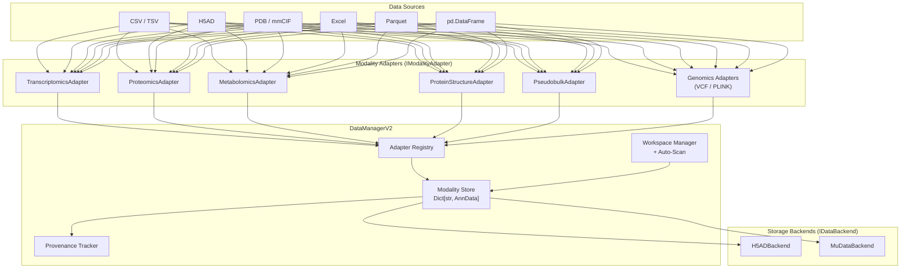
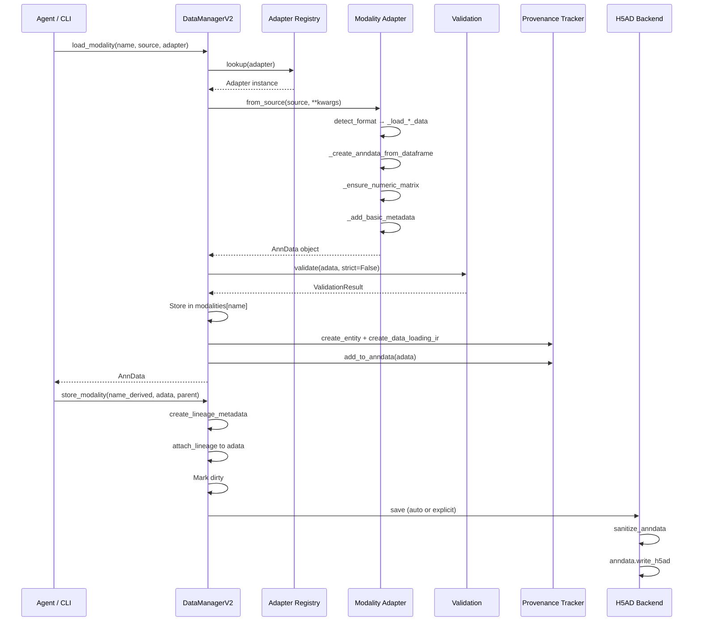

The **DataManagerV2** is Lobster's central orchestration layer for multi-omics data lifecycle management. It coordinates modality adapters, storage backends, and validation into a unified interface that transforms heterogeneous biological data — from single-cell RNA-seq matrices to protein crystal structures — into standardized `AnnData` objects with schema enforcement, provenance tracking, and automatic workspace persistence. Every data flow in Lobster, whether triggered by an agent tool or a CLI command, converges through this layer before reaching downstream analysis.

## Architectural Overview

The data management subsystem follows a three-tier architecture: **Adapters** convert raw files into canonical `AnnData` objects, **Backends** handle persistence to storage media, and the **DataManagerV2** orchestrates both while managing workspace state, provenance, and thread safety. This separation ensures that adding support for a new omics modality requires only a new adapter class — no changes to the orchestration or persistence logic.



Sources: [data_manager.py](lobster/core/runtime/data_manager.py#L260-L399), [adapter.py](lobster/core/interfaces/adapter.py#L19-L103)

## The IModalityAdapter Contract

All modality adapters implement the `IModalityAdapter` abstract base class, which defines the contract for converting raw data into schema-enforced `AnnData` objects. The interface enforces four abstract methods — `from_source`, `validate`, `get_schema`, and `get_supported_formats` — while providing default implementations for format detection, preprocessing, quality metrics, metadata standardization, and provenance annotation. This design means that every adapter, regardless of biological domain, produces data that conforms to the same structural contract.

| Method | Purpose | Return Type |
|---|---|---|
| `from_source(source, **kwargs)` | Convert raw data to AnnData | `anndata.AnnData` |
| `validate(adata, strict)` | Validate against modality schema | `ValidationResult` |
| `get_schema()` | Declare required/optional obs, var, layers, uns | `Dict[str, Any]` |
| `get_supported_formats()` | List supported file extensions | `List[str]` |
| `get_modality_name()` | Return domain name (e.g., "transcriptomics") | `str` |
| `detect_format(source)` | Auto-detect file format from extension | `Optional[str]` |
| `preprocess_data(adata, **kwargs)` | Apply modality-specific preprocessing | `anndata.AnnData` |
| `get_quality_metrics(adata)` | Compute sparsity, memory, dimensions | `Dict[str, Any]` |
| `add_provenance(adata, source_info)` | Attach source tracking to `uns` | `anndata.AnnData` |

The `detect_format` method maps 11 file extensions (`.csv`, `.tsv`, `.txt`, `.h5ad`, `.h5`, `.xlsx`, `.xls`, `.mtx`, `.h5mu`, `.parquet`, `.loom`) to normalized format names, while `add_provenance` appends a timestamped dictionary to `adata.uns["provenance"]` capturing the adapter class, modality, source info, and processing parameters.

Sources: [adapter.py](lobster/core/interfaces/adapter.py#L19-L232)

## BaseAdapter: Shared Ingestion Infrastructure

The `BaseAdapter` provides the concrete scaffolding that all domain-specific adapters inherit from. It implements the common ingestion pipeline — loading data from files or DataFrames, converting to `AnnData`, enforcing numeric matrices, adding basic QC metadata, and filtering internal kwargs before they reach pandas. This eliminates substantial boilerplate; subclasses override only the modality-specific parsing and schema logic.

**File loading** is handled by four private methods, each with automatic delimiter detection and kwargs sanitization:

| Method | Formats | Key Behavior |
|---|---|---|
| `_load_csv_data(path, sep, ...)` | CSV, TSV, TXT | Auto-detects tab vs. comma; filters `_LOBSTER_INTERNAL_KWARGS` |
| `_load_excel_data(path, sheet_name, ...)` | XLSX, XLS | Selects sheet; same kwargs filtering |
| `_load_parquet_data(path, ...)` | Parquet | Validates `pyarrow` availability with install hint |
| `_load_h5ad_data(path)` | H5AD | Direct `anndata.read_h5ad` with shape logging |

The `_LOBSTER_INTERNAL_KWARGS` frozenset (containing keys like `adapter`, `dataset_id`, `orientation`, `protein_id_col`, `transpose`, etc.) is critical: it prevents Lobster-orchestration parameters from leaking into pandas `read_csv` calls, which would raise `TypeError` on unexpected keyword arguments. Subclasses extend this set with their own domain-specific keys.

**The DataFrame-to-AnnData conversion** (`_create_anndata_from_dataframe`) implements several pragmatic heuristics: it strips non-numeric columns with a warning, converts to `float32`, automatically converts to sparse CSR format when sparsity exceeds 80% on matrices larger than 10,000 elements, and enforces unique variable names via `var_names_make_unique()` — a necessity for real-world datasets where gene symbols may be duplicated.

> [!TIP]
> The `_ensure_numeric_matrix` method deliberately **preserves NaN values** rather than coercing them to zero. In proteomics and metabolomics, NaN represents "below detection limit" (MNAR — missing not at random), and replacing with zero corrupts downstream differential expression and imputation. Domain adapters handle NaN via appropriate modality-specific strategies.

Sources: [base.py](lobster/core/adapters/base.py#L23-L399)

## Domain-Specific Adapters

Each adapter specializes the `BaseAdapter` pipeline for a particular biological domain, adding schema validation, domain-specific QC thresholds, and preprocessing logic. The following table summarizes the full adapter catalog and their distinguishing characteristics:

| Adapter | `data_type` Options | Default Transpose | Missing Value Strategy | Schema Module |
|---|---|---|---|---|
| **TranscriptomicsAdapter** | `single_cell`, `bulk` | `True` (genes as rows) | N/A (zeros are valid) | `TranscriptomicsSchema` |
| **ProteomicsAdapter** | `mass_spectrometry`, `affinity` | `False` | `keep`, `fill_zero`, `drop` | `ProteomicsSchema` |
| **MetabolomicsAdapter** | `lc_ms`, `gc_ms`, `nmr` | `False` | `keep`, `fill_zero`, `drop` | `MetabolomicsSchema` |
| **PseudobulkAdapter** | (single type) | `False` | N/A | `TranscriptomicsSchema` (pseudobulk) |
| **ProteinStructureAdapter** | (single type) | N/A | N/A | `ProteinStructureSchema` |
| **VCFAdapter** | (genomics_wgs) | N/A | N/A | Genomics schema |
| **PLINKAdapter** | (genomics_snp_array) | N/A | N/A | Genomics schema |

### TranscriptomicsAdapter

The transcriptomics adapter handles both single-cell and bulk RNA-seq data. It uses a lazy `scanpy` import for 10X matrix loading (`.mtx` format), provides a dedicated `from_quantification_dataframe` method for Kallisto/Salmon output, and enforces QC thresholds from `TranscriptomicsSchema`. The adapter separates metadata fields from processing parameters in `from_source`, storing non-processing kwargs into `adata.uns` after sanitization for H5AD compatibility. [transcriptomics_adapter.py](lobster/core/adapters/transcriptomics_adapter.py#L46-L177)

### ProteomicsAdapter

Proteomics data presents unique challenges: missing values are semantically meaningful (below detection limit), and orientation varies by source tool. The adapter supports an explicit `orientation` kwarg (`"features_as_rows"`, `"features_as_cols"`, or `"unknown"`) for auto-detection, and a `handle_missing_values` strategy parameter. The `_handle_missing_values` method respects the chosen strategy, with `"keep"` as the default to preserve MNAR structure for downstream imputation. [proteomics_adapter.py](lobster/core/adapters/proteomics_adapter.py#L24-L200)

### MetabolomicsAdapter

The metabolomics adapter supports LC-MS, GC-MS, and NMR platforms. It implements `_separate_intensity_metadata_columns` for auto-detecting which DataFrame columns contain intensity values versus metabolite metadata, and `_standardize_metabolomics_metadata` for normalizing column names across different instrument software conventions. [metabolomics_adapter.py](lobster/core/adapters/metabolomics_adapter.py#L24-L198)

### PseudobulkAdapter

The pseudobulk adapter reuses `TranscriptomicsSchema` with the `"pseudobulk"` schema type and adds `_parse_pseudobulk_sample_ids` to decompose sample identifiers following the `{sample_id}_{cell_type}` convention into structured `obs` metadata. It supports `aggregation_metadata` and `original_dataset_info` kwargs that attach single-cell derivation context to the pseudobulk AnnData. [pseudobulk_adapter.py](lobster/core/adapters/pseudobulk_adapter.py#L25-L194)

### ProteinStructureAdapter

The most architecturally distinct adapter, `ProteinStructureAdapter` converts Bio.PDB `Structure` objects into `AnnData` where **atoms are observations** and coordinates are variables. It uses `PDBParser` or `MMCIFParser` depending on file extension, supports NMR multi-model selection via `model_number`, and provides `include_hetero`/`include_waters` filtering. [protein_structure_adapter.py](lobster/core/adapters/protein_structure_adapter.py#L24-L179)

Sources: [transcriptomics_adapter.py](lobster/core/adapters/transcriptomics_adapter.py#L1-L177), [proteomics_adapter.py](lobster/core/adapters/proteomics_adapter.py#L1-L200), [metabolomics_adapter.py](lobster/core/adapters/metabolomics_adapter.py#L1-L198), [pseudobulk_adapter.py](lobster/core/adapters/pseudobulk_adapter.py#L1-L194), [protein_structure_adapter.py](lobster/core/adapters/protein_structure_adapter.py#L1-L179)

## DataManagerV2: The Orchestration Layer

`DataManagerV2` is the single entry point for all data operations in Lobster. It holds the adapter registry, the modality store, backend references, provenance tracker, workspace state, and download/publication queues. Its constructor accepts six configuration parameters that govern behavior across all subsystems:

| Parameter | Default | Purpose |
|---|---|---|
| `default_backend` | `"h5ad"` | Storage backend for save operations |
| `workspace_path` | Resolved via `resolve_workspace()` | Root directory; resolution: explicit > `LOBSTER_WORKSPACE` env > `cwd/.lobster_workspace` |
| `enable_provenance` | `True` | Enable `ProvenanceTracker` and IR recording |
| `session_dir` | `None` | Directory for persisted provenance (survives restarts) |
| `auto_scan` | `True` | Auto-load existing H5AD/tabular files from workspace |
| `backed_mode` | `False` | Enable backed-mode for H5AD files >1GB (also via `LOBSTER_BACKED_MODE=1`) |

### Adapter Registration: Two-Phase Discovery

Adapter registration follows a two-phase strategy. **Phase 1** discovers adapters from entry points via `component_registry.list_adapters()`, allowing plugin packages to contribute adapters without modifying core code. **Phase 2** registers hardcoded fallback adapters — but only for names not already claimed by Phase 1. This ensures that plugin-provided adapters take precedence while core adapters fill gaps.

```python
# Phase 1: Entry-point discovery (plugins first)
for name, adapter_factory in component_registry.list_adapters().items():
    adapter = adapter_factory()
    self.register_adapter(name, adapter)

# Phase 2: Hardcoded fallbacks (only if not already registered)
if "transcriptomics_single_cell" not in self.adapters:
    self.register_adapter("transcriptomics_single_cell",
        TranscriptomicsAdapter(data_type="single_cell"))
```

The default registration creates six adapter instances: `transcriptomics_single_cell`, `transcriptomics_bulk`, `proteomics_ms`, `proteomics_affinity`, `genomics_wgs` (VCF), and `genomics_snp_array` (PLINK) — with proteomics and genomics conditionally registered based on optional dependency availability.

Sources: [data_manager.py](lobster/core/runtime/data_manager.py#L269-L590)

### Workspace Auto-Loading and File Resolution

When `auto_scan=True`, the DataManager scans the `workspace/data/` directory on initialization, loading files in a prioritized two-phase sequence: H5AD files first (they take precedence over same-stem tabular files), then tabular files. The system applies size guards — H5AD files >4GB are skipped (with a suggestion to use `load_modality` explicitly), and tabular files >500MB are skipped due to memory expansion concerns. Corrupted autosave files are silently cleaned up; corrupted regular files are logged as warnings.

The `_resolve_adapter_for_file` method determines which adapter handles a given file extension. H5AD files bypass the adapter system entirely (loaded directly via `anndata.read_h5ad` for speed). When exactly one adapter supports the extension, that adapter is used. When multiple adapters claim the same extension (ambiguous format), a generic `BaseAdapter` instance handles loading. When no adapter matches but `BaseAdapter` supports the format, the generic adapter is used as a fallback.

Sources: [data_manager.py](lobster/core/runtime/data_manager.py#L591-L789)

### Modality Loading and Storing

The `load_modality` method orchestrates the full ingestion pipeline: adapter lookup → `from_source` conversion → optional validation → thread-safe storage → provenance logging → IR recording → callback notification. The `store_modality` method is the recommended path for storing *derived* modalities (e.g., clustered data), as it automatically computes lineage metadata, attaches it to `adata.uns['lineage']`, and tracks dirty state for auto-save.

```python
# Loading: explicit adapter selection
adata = dm.load_modality("pbmc", "data/pbmc.h5ad", adapter="transcriptomics_single_cell")

# Storing: automatic lineage tracking
dm.store_modality(
    name="pbmc_clustered",
    adata=adata_clustered,
    parent_name="pbmc",
    step_summary="Clustered into 12 clusters"
)
```

The `store_modality` method supports a `step` parameter that can be any omics-agnostic string — common values include `raw`, `filtered`, `normalized`, `batch_corrected`, `reduced`, `clustered`, `annotated`, `markers`, `de_results`, `pseudobulk`, and `custom`. When a `modality_backend` is attached, ingestion delegates to the backend; otherwise, the modality is marked dirty for deferred auto-save.

### Backed Mode for Large Files

For datasets exceeding 1GB, the DataManager supports **backed-mode loading** where the HDF5 file remains on disk and `.X` is accessed as an HDF5 dataset rather than a full in-memory array. This is controlled by the `backed_mode` constructor parameter or the `LOBSTER_BACKED_MODE=1` environment variable. The `_read_h5ad_smart` function automatically applies backed mode when both the size threshold and the feature flag are met. Callers that need to mutate `.X` must invoke `materialize_modality()` first, which loads the full matrix into memory.

Sources: [data_manager.py](lobster/core/runtime/data_manager.py#L890-L1089), [data_manager.py](lobster/core/runtime/data_manager.py#L165-L214)

## Storage Backends

Backends implement the `IDataBackend` interface, which defines six abstract methods (`load`, `save`, `exists`, `delete`, `list_files`, `get_metadata`) plus optional methods for format detection and path validation. The `BaseBackend` provides shared path resolution, checksum computation, and directory creation logic.

| Backend | Format | Compression | Special Features |
|---|---|---|---|
| **H5ADBackend** | `.h5ad` | gzip (level 6 default) | S3-ready path parsing; `sanitize_anndata` for H5AD compatibility |
| **MuDataBackend** | `.h5mu` | gzip | Multi-modal MuData support; requires `mudata` package |

The `H5ADBackend.sanitize_anndata` method is a critical pre-save step that converts `OrderedDict` → `dict`, tuples → lists, numpy scalars → Python scalars, replaces `/` in keys with `__` (HDF5-safe), and removes columns with `None` names that would cause `PurePosixPath` errors during serialization. This sanitization uses centralized utilities from `lobster.core.utils.h5ad_utils`.

Sources: [backend.py](lobster/core/interfaces/backend.py#L16-L177), [base.py](lobster/core/backends/base.py#L19-L200), [h5ad_backend.py](lobster/core/backends/h5ad_backend.py#L24-L200)

## Thread Safety and Concurrency

The DataManagerV2 is designed for concurrent access from multiple tool calls (e.g., `execute_custom_code` via `asyncio.to_thread`). Two locks protect mutable state: `_session_lock` guards the session file for multi-process safety, and `_state_lock` guards the `modalities` dictionary and dirty set for in-process thread safety. All mutations to `self.modalities` and `self._modality_dirty` are wrapped in `with self._state_lock:` blocks. An LRU eviction mechanism (`_evict_lru_if_needed`) with a configurable cache cap (default 8 modalities) prevents unbounded memory growth in long-running sessions.

> [!TIP]
> The workspace scan uses a 30-second TTL cache (`_scan_ttl`) to avoid redundant filesystem traversal on repeated `get_available_datasets()` calls. This is configurable and balances responsiveness against disk I/O overhead in interactive sessions.

Sources: [data_manager.py](lobster/core/runtime/data_manager.py#L303-L357), [data_manager.py](lobster/core/runtime/data_manager.py#L698-L710)

## Data Flow: End to End

The following diagram traces the complete lifecycle of a dataset from file ingestion through processing to persistence:



Sources: [data_manager.py](lobster/core/runtime/data_manager.py#L890-L1089), [adapter.py](lobster/core/interfaces/adapter.py#L29-L48)

## Next Steps

- **[Provenance Tracking and IR](12-provenance-tracking-and-ir)** — Understand how every data transformation is recorded as an intermediate representation for reproducibility and notebook export.
- **[Plugin System and Entry Points](8-plugin-system-and-entry-points)** — Learn how Phase 1 adapter discovery works through the component registry and entry point system.
- **[Provider Registry and Data Access](19-provider-registry-and-data-access)** — Explore how external data providers (GEO, PRIDE, MetaboLights) feed into the DataManager via the download queue.