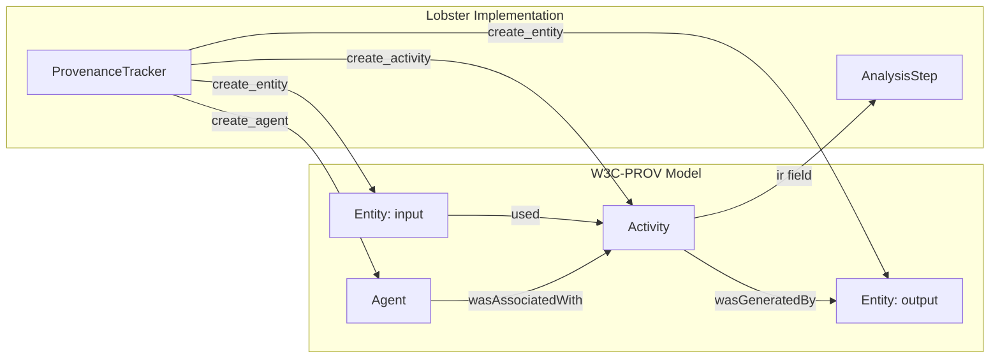
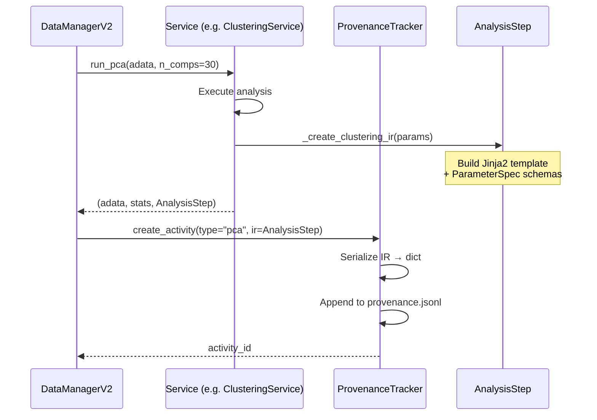
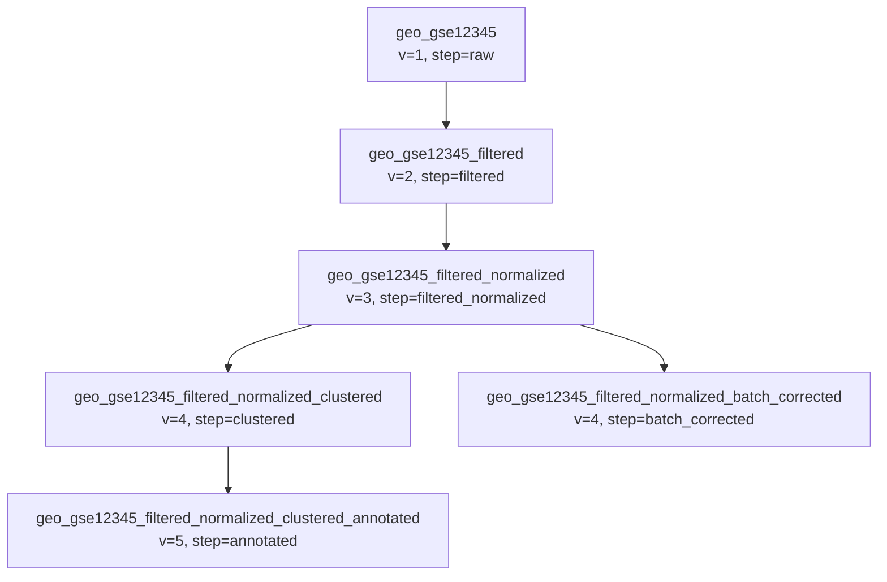
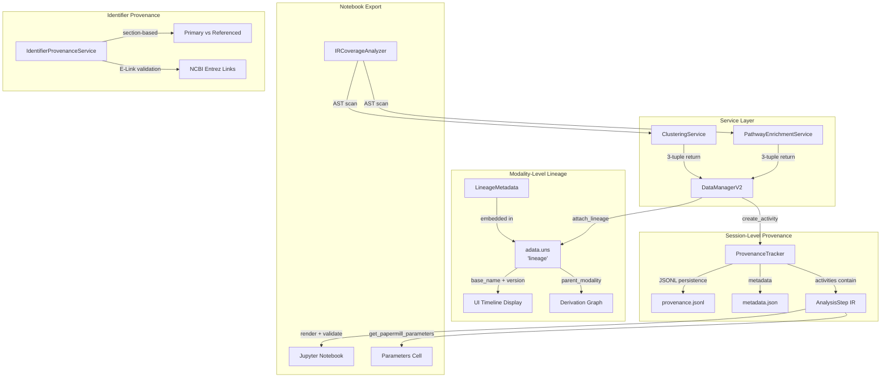

Lobster implements a **dual-layer provenance architecture** that captures both the *what happened* (activity audit trail) and the *how to reproduce it* (executable intermediate representation) for every data-processing operation. The first layer, managed by `ProvenanceTracker`, records W3C-PROV-aligned activities, entities, and agents with crash-safe disk persistence. The second layer, powered by the **Service-Emitted IR** pattern, embeds `AnalysisStep` objects inside each provenance activity — carrying Jinja2 code templates, typed parameter schemas, and Papermill injection flags that enable deterministic Jupyter notebook generation without manual mapping registries. A complementary `LineageMetadata` system tracks per-modality processing chains directly on AnnData objects via `adata.uns['lineage']`, providing the UI-facing timeline and parent-child derivation graph. Together, these three subsystems ensure that every analytical result produced by Lobster is traceable to its inputs, reproducible via exported notebooks, and auditable across sessions.

## ProvenanceTracker: Activity Audit Trail

The `ProvenanceTracker` is the central provenance recording engine. It models data processing as three first-class concepts drawn from the W3C PROV ontology: **Activities** (operations performed), **Entities** (data artifacts consumed or produced), and **Agents** (software components or persons responsible). Each activity record carries a namespace-scoped identifier (`{namespace}:activity:{uuid}`), an ISO timestamp, input/output entity references, parameters, software version snapshots, and — critically — an optional `ir` field holding a serialized `AnalysisStep`. The tracker is instantiated by `DataManagerV2` and participates in every load, process, and save operation through convenience methods like `log_data_loading`, `log_data_processing`, and `log_data_saving`, which automatically create the surrounding entity and agent records.

**Disk persistence** follows a JSONL append-only protocol with `fsync` durability guarantees. When a `session_dir` is provided at construction, each `create_activity` call appends a versioned JSON line (`{"v": 1, ...activity}`) to `provenance.jsonl` and updates a companion `metadata.json` with timestamps, activity count, and software versions. On re-initialization — including crash recovery — the tracker loads existing activities line-by-line, skipping corrupt entries with warnings (line-independent recovery). The `provenance_path` property exposes the JSONL file location for external consumers like cloud S3 sync. Provenance data also round-trips through AnnData objects: `add_to_anndata` serializes the full activity/entity/agent graph into `adata.uns['provenance']`, and `extract_from_anndata` restores it, enabling provenance to travel with the data itself. The `get_lineage(entity_id)` method performs recursive backward tracing from any entity through its producing activities and their input entities, reconstructing the complete derivation chain.

Sources: [provenance.py](lobster/core/provenance/provenance.py#L1-L100), [provenance.py](lobster/core/provenance/provenance.py#L200-L400), [provenance.py](lobster/core/provenance/provenance.py#L400-L600), [provenance.py](lobster/core/provenance/provenance.py#L600-L714)

## AnalysisStep: Service-Emitted Intermediate Representation

The `AnalysisStep` dataclass is the **single source of truth** for how a service operation should be represented in an exported notebook. Rather than maintaining a central registry that maps tool names to code templates (a coupling nightmare), Lobster inverts the dependency: each service *emits* an `AnalysisStep` alongside its result, encapsulating everything needed for deterministic code generation. This design means that adding a new analysis operation requires zero changes to the notebook export pipeline — the service itself defines its reproducible representation.

| Field | Purpose | Example |
|---|---|---|
| `operation` | Fully-qualified operation name | `"scanpy.tl.leiden"` |
| `tool_name` | Original tool name for provenance linking | `"cluster_and_visualize"` |
| `library` | Required library | `"scanpy"` |
| `code_template` | Jinja2 template with `{{ variable }}` placeholders | `"sc.tl.leiden(adata, resolution={{ resolution }})"` |
| `imports` | Import statements for notebook cell | `["import scanpy as sc"]` |
| `parameters` | Actual parameter values from this execution | `{"resolution": 1.0}` |
| `parameter_schema` | Typed specs with Papermill flags per parameter | `{"resolution": ParameterSpec(...)}` |
| `input_entities` / `output_entities` | Data flow references | `["adata"]` / `["adata"]` |
| `execution_context` | Seeds, versions, timestamps | `{"algorithm": "leiden"}` |
| `validates_on_export` | Run AST validation on export | `True` |
| `requires_validation` | Full execution validation recommended | `False` |
| `exportable` | Include in notebook export | `True` |
| `helper_code` | Shared functions injected into notebook helper cell | `["def plot_clusters(...):"]` |

The `ParameterSpec` dataclass provides the type-level contract for each parameter: `param_type` (Python type as string), `papermill_injectable` (whether Papermill can override it at notebook execution time), `default_value`, `required` flag, optional `validation_rule` expression, and `description`. During serialization, `ParameterSpec.to_dict()` enforces JSON-serializability of `default_value` with an explicit `TypeError` on failure — catching non-serializable defaults at IR creation time rather than at export time. Deserialization in `AnalysisStep.from_dict()` reconstructs `ParameterSpec` objects from dictionaries, gracefully handling legacy JSON Schema-style dicts (with `"type"` instead of `"param_type"`) by passing them through unchanged.

The **render pipeline** works in three stages: `validate_template()` parses the Jinja2 template for syntactic correctness; `render(**override_params)` merges override parameters with stored values and produces a Python code string; `validate_rendered_code()` runs `ast.parse()` on the result to verify syntactic validity before any notebook cell is written. The `get_papermill_parameters()` method extracts only the `papermill_injectable=True` parameters, producing the dictionary that populates the notebook's tagged parameters cell for parameterized execution.

Sources: [analysis_ir.py](lobster/core/provenance/analysis_ir.py#L1-L200), [analysis_ir.py](lobster/core/provenance/analysis_ir.py#L200-L400), [analysis_ir.py](lobster/core/provenance/analysis_ir.py#L400-L623)

## The 3-Tuple Return Contract

Services integrate with the provenance system through a consistent **3-tuple return pattern**: every IR-emitting method returns `(result_data, statistics_dict, AnalysisStep)`. The `ClusteringService` demonstrates this pattern concretely — its `run_pca` method, for example, returns `(AnnData, stats_dict, AnalysisStep)`, where the `AnalysisStep` carries a full Jinja2 template for the PCA pipeline (including scaling, feature subsetting, and the PCA call itself), typed parameter schemas for `n_comps`, `scale_data`, and `use_highly_variable`, and an `execution_context` recording the operation type and algorithm details.

The `ClusteringService._create_clustering_ir` method is particularly instructive because it demonstrates **conditional template generation**: when `feature_selection_method == "deviance"`, the Jinja2 template includes deviance-based feature selection (operating on raw counts before normalization), while the `"hvg"` path uses Seurat-style highly variable gene selection (operating on normalized data). Both paths produce complete end-to-end pipeline templates — feature selection through normalization, scaling, PCA, neighbors, clustering, and UMAP — ensuring that the exported notebook reproduces the full analysis rather than isolated steps. This is the key architectural insight: the IR captures *pipeline-level* semantics, not just individual function calls.

Sources: [clustering_service.py](lobster/services/analysis/clustering_service.py#L1-L200), [clustering_service.py](lobster/services/analysis/clustering_service.py#L200-L400)

## LineageMetadata: Per-Modality Processing Chains

While `ProvenanceTracker` operates at the session level (tracking all activities across all modalities), `LineageMetadata` operates at the **individual AnnData level**, embedded directly in `adata.uns['lineage']`. This dual-layer design separates the global audit trail from the local derivation graph, enabling the UI to display per-modality timelines without querying the full provenance store.

The lineage schema contains six fields: `base_name` (original dataset name stripped of processing suffixes), `version` (sequential integer, 1 = raw), `processing_step` (canonical step name like `"filtered_normalized"` or any domain-specific string), `parent_modality` (name of the modality this was derived from, `None` for raw), `step_summary` (human-readable change description), and `created_at` (ISO timestamp). The `CANONICAL_STEPS` set defines standard steps (`raw`, `quality_assessed`, `filtered`, `normalized`, `batch_corrected`, `reduced`, `clustered`, `subclustered`, `annotated`, `markers`, `de_results`, `pseudobulk`, `custom`), but any string is valid — agent packages can define domain-specific steps like `"imputed"` or `"peak_called"` without modifying core.

**Suffix-based inference** provides automatic lineage metadata creation from modality naming conventions. The `extract_base_name` function iteratively strips known suffixes (sorted longest-first for correct matching) from modality names: `geo_gse12345_filtered_normalized_clustered` resolves to base name `geo_gse12345` by stripping `_clustered`, then `_filtered_normalized`. The `infer_processing_step` function maps the outermost suffix to its canonical step string. The `create_lineage_metadata` factory function auto-computes all fields: `base_name` from the modality name or inherited from a parent AnnData, `version` incremented from the parent's version, and `step` inferred from the suffix. For backward compatibility with legacy h5ad files lacking lineage metadata, `ensure_lineage` creates synthetic lineage with a `_synthetic` flag.

Sources: [lineage.py](lobster/core/provenance/lineage.py#L1-L200), [lineage.py](lobster/core/provenance/lineage.py#L200-L324)

## IR Coverage Analysis

The `IRCoverageAnalyzer` provides **static analysis** of IR adoption across the service layer, answering the operational question: *which services emit IR and which methods are still uncovered?* It parses service files using Python's `ast` module, detecting `AnalysisStep` imports and identifying IR-emitting methods by their return pattern — specifically, functions that return a 3-element tuple where the third element's variable name contains `"ir"`, `"step"`, or `"analysis"`. This heuristic matches the standard `(result, stats, AnalysisStep)` convention.

The analyzer produces a `CoverageReport` containing per-service `ServiceCoverage` objects (with `has_ir_import`, `methods_with_ir`, `methods_without_ir`, and `coverage_percentage`) and aggregate statistics (total services, services with IR, overall coverage percentage). The `identify_gaps` method returns a list of `(service_name, method_name)` tuples for all uncovered methods, enabling targeted IR implementation. A CLI entry point (`python -m lobster.core.provenance.ir_coverage`) supports `--services-dir`, `--pattern`, `--verbose`, `--json`, and `--gaps-only` flags, exiting with code 1 if overall coverage falls below the 60% target threshold. This CI-integrable check prevents regression in IR coverage as new services are added.

> [!TIP]
> When adding a new service method, return the 3-tuple `(result, stats, AnalysisStep)` pattern so the `IRCoverageAnalyzer` AST heuristic detects it automatically. Use `create_minimal_ir()` as a scaffolding fallback for methods where full IR isn't yet available — the generated notebook will include a TODO marker, and the method will still count as IR-covered.

Sources: [ir_coverage.py](lobster/core/provenance/ir_coverage.py#L1-L200), [ir_coverage.py](lobster/core/provenance/ir_coverage.py#L200-L473)

## IR Factory Functions and Notebook Integration

The `analysis_ir` module provides factory functions for common I/O operations that every notebook needs: `create_data_loading_ir` generates an `AnalysisStep` for `anndata.read_h5ad` with a Papermill-injectable file path parameter, and `create_data_saving_ir` generates one for `adata.write_h5ad` with configurable compression and output prefix. These are imported and used directly by `DataManagerV2` during load and save operations, ensuring that even the bookend operations of a notebook (read data in, write results out) carry full IR.

The `create_minimal_ir` function serves as the **scaffolding fallback** for operations that haven't received full IR treatment yet. It produces an `AnalysisStep` with `validates_on_export=False` and `requires_validation=True`, embedding a TODO comment in the code template. This allows the notebook export pipeline to function without gaps while signaling that manual review is needed. The `validate_ir_list` utility validates a batch of IR dictionaries — checking deserialization, template syntax, and required field completeness — returning a list of error messages for any issues. The `extract_unique_imports` function deduplicates and sorts imports across multiple IR objects using the stdlib → third-party → local convention, and `extract_unique_helper_code` preserves insertion order while deduplicating helper code blocks.

> [!TIP]
> The `AnalysisStep.render()` method accepts `**override_params` that merge with stored parameters, enabling Papermill to inject runtime values into the Jinja2 template. For parameters that should always be injectable (like file paths and resolution values), mark them `papermill_injectable=True` in the `ParameterSpec` — the notebook exporter uses `get_papermill_parameters()` to populate the tagged parameters cell automatically.

Sources: [analysis_ir.py](lobster/core/provenance/analysis_ir.py#L399-L623), [data_manager.py](lobster/core/runtime/data_manager.py#L1-L80)

## Identifier Provenance: Dataset Ownership Validation

Beyond computational provenance, Lobster implements **identifier provenance** through the `IdentifierProvenanceService` — a specialized service that validates whether a dataset identifier belongs to the study being analyzed or to a referenced study. This addresses a critical correctness issue: extracted identifiers from referenced studies were previously treated identically to the study's own data, leading to wrong datasets being queued for download.

The service implements a two-layer validation system. **Layer 1** (section-based extraction) distinguishes identifiers found in a publication's Data Availability section (marked `"primary"`, confidence 0.95) from those found only in Methods or Body text (marked `"uncertain"`, confidence 0.3). **Layer 2** (E-Link validation) uses NCBI's Entrez link API to verify whether a BioProject identifier links back to the source publication's PMID — if validated, uncertain identifiers are upgraded to `"referenced"` with a confidence boost. The `is_downloadable` flag applies strict logic: only `access_type == "open"` AND `provenance == "primary"` identifiers are auto-queued for download, preventing controlled-access or uncertain-provenance datasets from entering the pipeline without explicit user consent.

Sources: [identifier_provenance_service.py](lobster/services/metadata/identifier_provenance_service.py#L1-L200)

## Architecture Summary

The three provenance subsystems address distinct concerns at different granularity levels. `ProvenanceTracker` provides the **global audit trail** — who did what, when, with what software, connected to what inputs and outputs. `AnalysisStep` IR provides the **reproducibility contract** — exact code templates, typed parameters, and validation flags that enable deterministic notebook generation. `LineageMetadata` provides the **per-modality derivation graph** — version chains and processing steps that enable UI timeline display and parent-child navigation. The `IdentifierProvenanceService` adds a fourth dimension: **dataset ownership validation** that prevents incorrect data from entering the pipeline. Together, they ensure that every result in Lobster is traceable, reproducible, and correct.

Sources: [provenance.py](lobster/core/provenance/provenance.py#L1-L100), [analysis_ir.py](lobster/core/provenance/analysis_ir.py#L1-L100), [lineage.py](lobster/core/provenance/lineage.py#L1-L100), [ir_coverage.py](lobster/core/provenance/ir_coverage.py#L1-L100), [identifier_provenance_service.py](lobster/services/metadata/identifier_provenance_service.py#L1-L100)

## Next Steps

- Learn how provenance-backed IR flows into notebook generation in [Notebook Export Pipeline](13-notebook-export-pipeline)
- Understand how modality adapters populate lineage metadata in [DataManager and Modality Adapters](11-datamanager-and-modality-adapters)
- Explore how agents invoke IR-emitting services in [Supervisor Agent and Routing](5-supervisor-agent-and-routing)