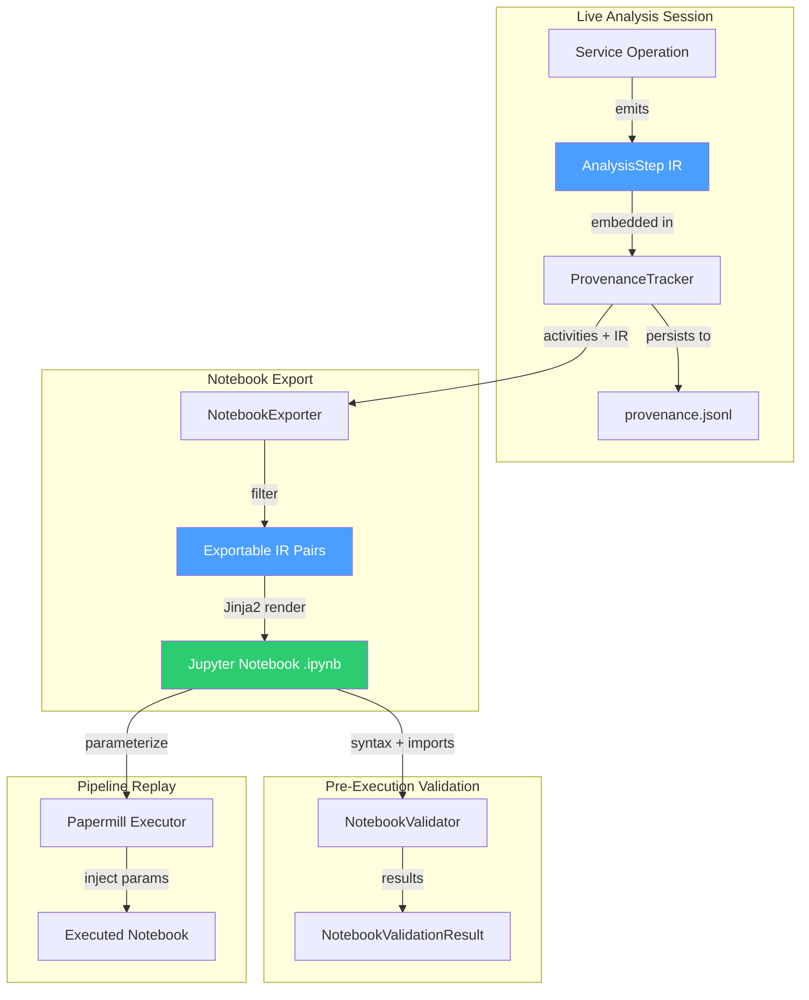
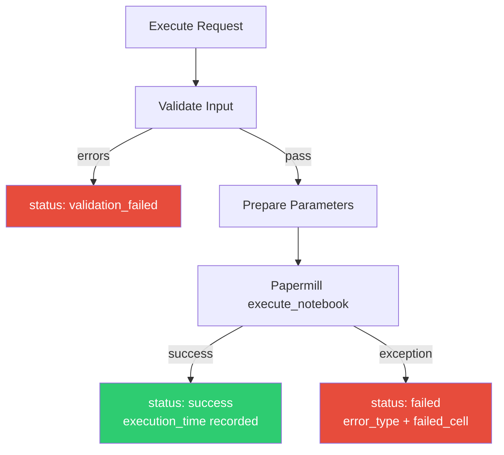

Lobster's Notebook Export Pipeline transforms live analysis sessions into **executable, reproducible Jupyter notebooks** through a Service-Emitted Intermediate Representation (IR) architecture. Rather than relying on brittle manual mapping registries that translate tool calls into code, each service emits structured `AnalysisStep` IR objects containing Jinja2 code templates, import declarations, and parameter schemas — enabling **deterministic, 95%+ executable notebook generation** from provenance records alone. The pipeline spans four stages: provenance capture during analysis, IR-driven code generation during export, multi-level validation, and Papermill-parameterized replay execution.

Sources: [exporter.py](lobster/core/notebooks/exporter.py#L1-L9), [analysis_ir.py](lobster/core/provenance/analysis_ir.py#L1-L8)

## Architectural Overview

The pipeline's central insight is that **provenance and code generation are unified through IR**. When a service performs an operation (e.g., `scanpy.pp.normalize_total`), it records not just *what happened* in the provenance log, but *how to reproduce it* via an embedded `AnalysisStep` object. The exporter then separates exportable analysis steps from provenance-only orchestration activities, rendering each IR into a notebook cell.



Sources: [exporter.py](lobster/core/notebooks/exporter.py#L66-L206), [provenance.py](lobster/core/provenance/provenance.py#L33-L79)

## The AnalysisStep IR: Single Source of Truth

The `AnalysisStep` dataclass is the **canonical contract** between services and the notebook export pipeline. Every field serves a precise purpose in code generation — nothing is decorative.

| Field | Purpose | Example |
|-------|---------|---------|
| `operation` | Fully-qualified operation name | `"scanpy.pp.normalize_total"` |
| `code_template` | Jinja2 template with `{{ variable }}` placeholders | `"sc.pp.normalize_total(adata, target_sum={{ target }})"` |
| `imports` | Required import statements | `["import scanpy as sc"]` |
| `parameters` | Actual parameter values from execution | `{"target": 1e4}` |
| `parameter_schema` | `ParameterSpec` entries with Papermill flags | `{"target": ParameterSpec(...)}` |
| `helper_code` | Shared functions injected into helper cell | `["def _filter_cells(adata, min_genes): ..."]` |
| `exportable` | Whether to include in notebook export | `True` (default) or `False` for orchestration |
| `validates_on_export` | Run AST validation on export | `True` (default) |

> [!TIP]
> The `exportable` field is the **critical filter gate** — services that perform orchestration (publication processing, metadata extraction) set `exportable=False` so their activities remain in the provenance audit trail but are excluded from the executable notebook. This prevents non-reproducible orchestration steps from breaking pipeline replay.

Sources: [analysis_ir.py](lobster/core/provenance/analysis_ir.py#L104-L183)

### ParameterSpec and Papermill Integration

Each parameter within `parameter_schema` carries a `ParameterSpec` that declares its type, injectability, and validation rules. Parameters marked `papermill_injectable=True` are extracted into a dedicated **Papermill-tagged parameters cell**, enabling downstream users to override values via the command line without editing the notebook:

```bash
papermill notebook.ipynb output.ipynb \
    -p input_data "new_dataset.h5ad" \
    -p min_genes 200
```

The `get_papermill_parameters()` method on `AnalysisStep` collects all injectable parameters, and the exporter merges them into the parameters cell while deduplicating against standard parameters (`input_data`, `output_prefix`, `random_seed`).

Sources: [analysis_ir.py](lobster/core/provenance/analysis_ir.py#L19-L101), [analysis_ir.py](lobster/core/provenance/analysis_ir.py#L321-L336), [exporter.py](lobster/core/notebooks/exporter.py#L565-L622)

## Export Pipeline: From Provenance to Notebook

### Activity Filtering

The `NotebookExporter.export()` method begins by filtering provenance activities based on a `filter_strategy`:

| Strategy | Behavior |
|----------|----------|
| `"successful"` | Exclude activities with `error` markers or `type="failed_operation"` |
| `"all"` | Include every recorded activity |
| `"manual"` | Falls back to `"successful"` (not yet implemented) |

After filtering, `_get_exportable_activity_ir_pairs()` further separates activities into two categories: **exportable pairs** (activity + `AnalysisStep` where `exportable=True`) and **provenance-only activities** (no IR, or `exportable=False`). This two-tier filtering ensures notebooks contain only executable code while the complete audit trail remains in provenance.

Sources: [exporter.py](lobster/core/notebooks/exporter.py#L208-L230), [exporter.py](lobster/core/notebooks/exporter.py#L271-L320)

### Notebook Cell Generation Order

The exporter assembles cells in a precise sequence designed for top-to-bottom execution:

```mermaid
flowchart LR
    H[Header<br/>Markdown] --> IM[Integrity Manifest<br/>Markdown]
    IM --> I[Imports<br/>Code]
    I --> HC[Helper Functions<br/>Code]
    HC --> P[Parameters<br/>Code + Papermill Tag]
    P --> DL[Data Loading<br/>Code]
    DL --> S1["Step N: Doc<br/>Markdown"]
    S1 --> S2["Step N: Code<br/>Code"]
    S2 --> DS[Data Saving<br/>Code]
    DS --> PS[Provenance Summary<br/>Markdown]
    PS --> F[Footer<br/>Markdown]

    style P fill:#e67e22,color:#fff
    style DL fill:#2ecc71,color:#fff
    style DS fill:#2ecc71,color:#fff
```



| Cell | Source | Notes |
|------|--------|-------|
| Header | `_create_header_cell()` | Session stats, IR coverage percentage, Lobster version |
| Integrity Manifest | `_create_integrity_manifest_cell()` | SHA-256 hashes for ALCOA+ / 21 CFR Part 11 compliance |
| Imports | `_create_imports_cell()` | Deduplicated via `extract_unique_imports()` — sorted stdlib → third-party → local |
| Helper Functions | `_create_helper_code_cell()` | Shared functions from `ir.helper_code`, deduplicated by exact match |
| Parameters | `_create_parameters_cell()` | Tagged `"parameters"` for Papermill; merges IR-derived + standard params |
| Data Loading | `_create_data_loading_cell()` | Skipped if download activity provides its own load code |
| Analysis Steps | `_ir_to_code_cell()` | One doc + one code cell per exportable IR; `load_dataset`/`save_dataset` types skipped |
| Data Saving | `_create_data_saving_cell()` | Renders `save_dataset` IR if present, otherwise fallback H5AD write |
| Provenance Summary | `_create_provenance_summary_cell()` | Table of executable vs. provenance-only activity counts |
| Footer | `_create_footer_cell()` | Papermill usage instructions, IR coverage explanation |

> [!TIP]
> The **data loading cell is conditionally omitted** when a download activity (e.g., `geo_service.download_dataset`, `sra_download`, `pride.download.download_dataset`, `metabolights.download.download_dataset`) is present in the exportable IR pairs. Download IRs produce their own data-loading code, so the generic `ad.read_h5ad(input_data)` cell would fail by referencing a non-existent `input_data` parameter.

Sources: [exporter.py](lobster/core/notebooks/exporter.py#L124-L206), [exporter.py](lobster/core/notebooks/exporter.py#L322-L344), [exporter.py](lobster/core/notebooks/exporter.py#L513-L563)

### Code Rendering from IR Templates

Each `AnalysisStep.code_template` is a **Jinja2 template** rendered with the step's `parameters` dictionary. The `render()` method merges parameters with optional overrides and returns executable Python:

```python
# Template: "sc.pp.normalize_total(adata, target_sum={{ target }})"
# Parameters: {"target": 1e4}
# Rendered:   "sc.pp.normalize_total(adata, target_sum=10000.0)"
```

When `validates_on_export=True`, the rendered code is run through `ast.parse()` to catch syntax errors before writing the notebook. Failures are annotated inline rather than causing export abort — the problematic code is preserved with a `# SYNTAX ERROR` comment prefix for manual review.

Sources: [analysis_ir.py](lobster/core/provenance/analysis_ir.py#L270-L319), [exporter.py](lobster/core/notebooks/exporter.py#L806-L848)

### Data Integrity and Compliance

The integrity manifest cell records **SHA-256 cryptographic hashes** of all input data files, provenance records, and system state. This satisfies ALCOA+ (Attributable, Legible, Contemporaneous, Original, Accurate) principles and 21 CFR Part 11 electronic record requirements:

- **Provenance hash**: SHA-256 of serialized `namespace`, `activities_count`, `entities_count`
- **Input file hashes**: SHA-256 of each modality's `.h5ad` file (chunked 4096-byte reads for memory efficiency)
- **System info**: Lobster version, Python version, platform, Git commit hash (8-char short)

Sources: [exporter.py](lobster/core/notebooks/exporter.py#L394-L511)

## Validation Layer

The `NotebookValidator` provides **two validation modes** that run before notebook execution:

| Mode | Method | Scope |
|------|--------|-------|
| Full | `validate()` | Syntax + import resolution + anti-pattern detection |
| Quick | `validate_quick()` | AST syntax check only, no import resolution |

Full validation produces a `NotebookValidationResult` containing:

- **Syntax errors**: Caught via `ast.parse()` on each code cell, reported with cell index and line number
- **Import resolution**: Each discovered import checked via `importlib.util.find_spec()` — unresolved imports are errors (strict mode) or warnings (lenient mode)
- **Anti-patterns**: Detected via heuristic checks — `exec()`/`eval()` usage, bare `except:` clauses, excessive `print()` statements (>5 per cell)

Sources: [validator.py](lobster/core/notebooks/validator.py#L151-L236), [validator.py](lobster/core/notebooks/validator.py#L341-L394), [validator.py](lobster/core/notebooks/validator.py#L396-L421)

## Execution and Replay

The `NotebookExecutor` wraps Papermill for **parameterized notebook execution**, enabling the classic "export once, replay on new data" workflow.

### Execution Flow



### Input Validation Before Execution

Before running Papermill, `validate_input()` checks compatibility between the input H5AD file and notebook metadata expectations:

| Check | Severity | Logic |
|-------|----------|-------|
| Cell count | Warning | `adata.n_obs < metadata.min_cells` (default 100) |
| Required columns | Error | Missing columns from `metadata.required_obs_columns` |
| Sparse data | Warning | Input is sparse when dense may be expected |

### Dry-Run Simulation

The `dry_run()` method provides a **no-execution preview** — it runs input validation, counts code cells, and estimates execution time at ~2 minutes per cell. This allows users to assess feasibility before committing compute resources.

### Parameter Discovery

`list_parameters()` extracts the Papermill-tagged parameters cell and parses variable assignments, returning a dictionary of parameter names and default values. This enables programmatic discovery of what a notebook expects without manual inspection.

Sources: [executor.py](lobster/core/notebooks/executor.py#L70-L268), [executor.py](lobster/core/notebooks/executor.py#L150-L187), [executor.py](lobster/core/notebooks/executor.py#L329-L366)

## IR Factory Functions

The `analysis_ir` module provides factory functions for common operations that don't originate from a specific service:

| Factory | Purpose |
|---------|---------|
| `create_data_loading_ir()` | Generates IR for `anndata.read_h5ad()` with Papermill-injectable `input_data` parameter |
| `create_data_saving_ir()` | Generates IR for `adata.write_h5ad()` with configurable compression |
| `create_minimal_ir()` | Fallback for services without full IR support — produces `TODO`-marked cells |

The `create_minimal_ir()` function is the **onboarding pathway** for new services: it creates an `AnalysisStep` with `validates_on_export=False` and `requires_validation=True`, ensuring the exported notebook flags the cell for manual review while still recording the operation in provenance. Services can then upgrade to full IR support by implementing proper `code_template` and `parameter_schema` values.

Sources: [analysis_ir.py](lobster/core/provenance/analysis_ir.py#L464-L496), [analysis_ir.py](lobster/core/provenance/analysis_ir.py#L499-L552), [analysis_ir.py](lobster/core/provenance/analysis_ir.py#L555-L598)

## Provenance Persistence and IR Recovery

The `ProvenanceTracker` supports **disk persistence** via a `session_dir` parameter, writing activities to `provenance.jsonl` with crash-safe `fsync` semantics. Each line is a self-contained JSON record with schema version `v:1`, enabling line-independent recovery — corrupt lines are skipped, and the remaining activities load successfully.

When loading from disk, the tracker reconstructs `AnalysisStep` objects from serialized IR dictionaries:

```python
# During _load_from_disk():
if data.get("ir") is not None:
    data["ir"] = AnalysisStep.from_dict(data["ir"])
```

This means the **round-trip is complete**: services emit IR → provenance persists to disk → notebook exporter reads from restored provenance → IR renders to executable code. Cross-session notebook export is fully supported.

Sources: [provenance.py](lobster/core/provenance/provenance.py#L41-L79), [provenance.py](lobster/core/provenance/provenance.py#L80-L122), [provenance.py](lobster/core/provenance/provenance.py#L124-L150)

## Module Organization

The notebook pipeline lives under `lobster/core/notebooks/` with backward-compatible shims at the legacy paths:

| Module | Path | Legacy Shim |
|--------|------|-------------|
| `NotebookExporter` | `lobster.core.notebooks.exporter` | `lobster.core.notebook_exporter` (deprecated, removed v2.0.0) |
| `NotebookValidator` | `lobster.core.notebooks.validator` | `lobster.core.notebook_validator` (deprecated) |
| `NotebookExecutor` | `lobster.core.notebooks.executor` | `lobster.core.notebook_executor` (deprecated) |
| `AnalysisStep` IR | `lobster.core.provenance.analysis_ir` | — |
| `ProvenanceTracker` | `lobster.core.provenance.provenance` | — |

Sources: [notebook_exporter.py](lobster/core/notebook_exporter.py#L1-L12), [notebooks/__init__.py](lobster/core/notebooks/__init__.py#L1)

---

**Next**: Understand how provenance records are constructed before they reach the export pipeline in [Provenance Tracking and IR](12-provenance-tracking-and-ir), or see how domain services emit IR objects in [Transcriptomics and Genomics Agents](14-transcriptomics-and-genomics-agents).