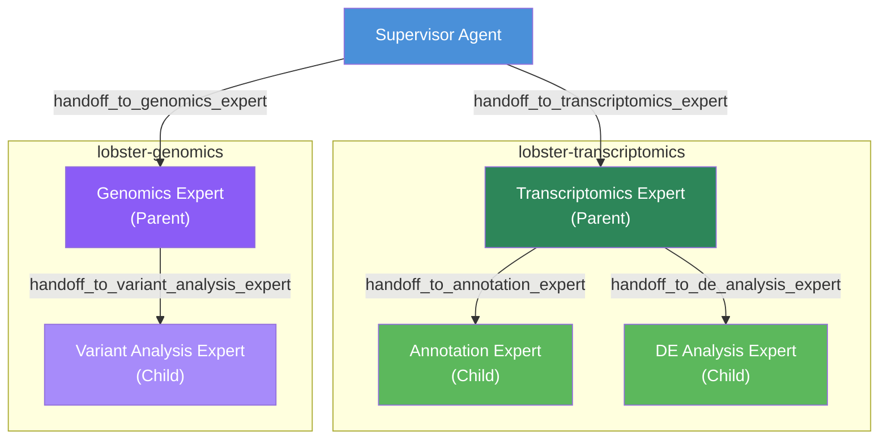

The Transcriptomics and Genomics domain packages implement Lobster's multi-agent analysis capabilities for RNA-seq and genomic variation data. Together, `lobster-transcriptomics` and `lobster-genomics` form a hierarchical agent architecture where parent orchestrators handle workflow routing and core analysis, while specialized sub-agents execute focused tasks like cell type annotation, differential expression, and clinical variant interpretation. Each agent registers itself via `AGENT_CONFIG` entry points, enabling the [Supervisor Agent](5-supervisor-agent-and-routing) to discover and hand off tasks automatically through the [Agent Registry](7-agent-registry-and-discovery).

Sources: [transcriptomics_expert.py](packages/lobster-transcriptomics/lobster/agents/transcriptomics/transcriptomics_expert.py#L1-L45), [genomics_expert.py](packages/lobster-genomics/lobster/agents/genomics/genomics_expert.py#L1-L40), [pyproject.toml](packages/lobster-transcriptomics/pyproject.toml#L58-L63), [pyproject.toml](packages/lobster-genomics/pyproject.toml#L42-L43)

## Architectural Overview

The two packages share an identical structural pattern — a **parent-child agent hierarchy** orchestrated through LangGraph `create_react_agent` factory functions. Parent agents hold direct tool access for high-frequency operations (QC, loading, clustering) and delegate to child agents via `handoff_to_*` delegation tools. Children are **not supervisor-accessible** (`supervisor_accessible=False`), enforcing a strict delegation chain: Supervisor → Parent → Child.

Each agent is built by a factory function that initializes LLM configuration, instantiates stateless services, creates closure-scoped `@tool` functions with access to `DataManagerV2`, and returns a configured `ReAct agent`. The factory pattern ensures tools are bound to the correct `data_manager` instance at creation time, avoiding shared mutable state between agent instances.

Sources: [transcriptomics_expert.py](packages/lobster-transcriptomics/lobster/agents/transcriptomics/transcriptomics_expert.py#L48-L120), [genomics_expert.py](packages/lobster-genomics/lobster/agents/genomics/genomics_expert.py#L28-L39), [annotation_expert.py](packages/lobster-transcriptomics/lobster/agents/transcriptomics/annotation_expert.py#L29-L37), [variant_analysis_expert.py](packages/lobster-genomics/lobster/agents/genomics/variant_analysis_expert.py#L20-L28)

## Agent Registry and Entry Points

Both packages declare agents through Python entry points in `pyproject.toml` under the `lobster.agents` namespace. At runtime, each agent module exposes an `AGENT_CONFIG` instance of `AgentRegistryConfig` at module level, which the registry reads to discover agent metadata, factory functions, handoff tool names, and child agent relationships.

| Package | Entry Point | `supervisor_accessible` | Child Agents |
|---|---|---|---|
| `lobster-transcriptomics` | `transcriptomics_expert` | `true` | `annotation_expert`, `de_analysis_expert` |
| `lobster-transcriptomics` | `annotation_expert` | `false` | — |
| `lobster-transcriptomics` | `de_analysis_expert` | `false` | — |
| `lobster-genomics` | `genomics_expert` | `true` | `variant_analysis_expert` |
| `lobster-genomics` | `variant_analysis_expert` | `false` | — |

The transcriptomics package also registers state classes under the `lobster.states` entry point namespace, enabling the graph topology to reconstruct typed state during agent handoffs.

> [!TIP]
> When `supervisor_accessible=False`, the agent has no `handoff_tool_name` — the supervisor cannot route tasks to it directly. This is intentional: annotation and DE analysis require context (QC results, cluster assignments) that only the parent agent possesses. Bypassing the parent would lead to missing-modality or missing-column errors.

Sources: [pyproject.toml](packages/lobster-transcriptomics/pyproject.toml#L58-L68), [pyproject.toml](packages/lobster-genomics/pyproject.toml#L42-L43), [annotation_expert.py](packages/lobster-transcriptomics/lobster/agents/transcriptomics/annotation_expert.py#L29-L37), [de_analysis_expert.py](packages/lobster-transcriptomics/lobster/agents/transcriptomics/de_analysis_expert.py#L23-L31)

## Transcriptomics Expert — Parent Orchestrator

The **Transcriptomics Expert** is a unified parent agent handling both single-cell and bulk RNA-seq workflows. Its defining capability is **automatic data type detection**: when a modality is accessed, the `detect_data_type()` function applies three heuristics in priority order — observation count (>500 suggests single-cell, <100 suggests bulk), presence of single-cell-specific `obs` columns (`n_counts`, `leiden`, `louvain`), and matrix sparsity (>70% sparse suggests single-cell). This classification drives which QC defaults are applied and which workflow the agent follows.

### Auto-Detection Heuristics and QC Defaults

The `detect_data_type()` function returns `Literal["single_cell", "bulk"]`, and `get_qc_defaults()` maps that result to parameter presets:

| Parameter | Single-Cell Default | Bulk Default | Rationale |
|---|---|---|---|
| `min_genes` | 200 | 1000 | Scanpy standard vs. higher bulk threshold |
| `max_genes` | 5000 | None | Doublet filtering for SC; not applicable for bulk |
| `min_cells_per_gene` | 3 | 2 | Standard rare-gene filter for each modality |
| `max_mt_pct` | 20.0 | 30.0 | Dying cell cutoff; more permissive for bulk |
| `target_sum` | 10000 | 1000000 | CPM for SC; TPM/CPM for bulk |
| `normalization_method` | `log1p` | `log1p` | Standard Scanpy normalization for both |

> [!TIP]
> For cardiac/muscle tissue or metabolically active cells (neurons, hepatocytes), override `max_mt_pct` to 30–50% — these cells naturally have higher mitochondrial content. For proliferative populations, relax `max_genes` to 8000–10000 to avoid filtering legitimate high-complexity cells.

### Shared Tools and Direct Tools

The parent agent assembles its tool set from two sources: **shared tools** (created by `create_shared_tools()`) and **direct tools** (defined inline in the factory function). Shared tools auto-detect data type and work for both SC and bulk, while direct tools are modality-specific.

| Tool | Source | AQUADIF Category | SC | Bulk | Description |
|---|---|---|---|---|---|
| `check_data_status` | Shared | UTILITY | ✓ | ✓ | List modalities, detect type, report dimensions |
| `assess_data_quality` | Shared | QUALITY | ✓ | ✓ | QC metrics with auto-defaults |
| `filter_and_normalize` | Shared | PREPROCESS | ✓ | ✓ | Filter + normalize with auto-defaults |
| `select_variable_features` | Shared | PREPROCESS | ✓ | ✓ | HVG or deviance feature selection |
| `run_pca` | Shared | ANALYZE | ✓ | ✓ | PCA reduction |
| `compute_neighbors_and_embed` | Shared | ANALYZE | ✓ | ✓ | KNN graph + UMAP |
| `cluster_cells` | Direct | ANALYZE | ✓ | ✗ | Full clustering pipeline (Leiden/Louvain) |
| `subcluster_cells` | Direct | ANALYZE | ✓ | ✗ | Re-cluster specific clusters |
| `find_marker_genes` | Direct | ANALYZE | ✓ | ✓ | Rank genes per group |
| `import_bulk_counts` | Direct | IMPORT | ✗ | ✓ | Load from Salmon/kallisto/featureCounts/CSV |
| `merge_sample_metadata` | Direct | IMPORT | ✗ | ✓ | Join sample metadata |
| `assess_bulk_sample_quality` | Direct | QUALITY | ✗ | ✓ | Outlier detection for bulk |
| `filter_bulk_genes` | Direct | PREPROCESS | ✗ | ✓ | Remove low-expression genes |
| `normalize_bulk_counts` | Direct | PREPROCESS | ✗ | ✓ | DESeq2 VST or log1p |
| `detect_batch_effects` | Direct | ANALYZE | ✓ | ✓ | Batch detection |
| `integrate_batches` | Direct | ANALYZE | ✓ | ✓ | Harmony integration |

### Delegation Protocol

The transcriptomics expert enforces **mandatory immediate delegation** — when the agent identifies annotation or DE tasks, it must invoke the delegation tool in its next action rather than describing or suggesting it. This is codified in the system prompt with explicit trigger phrases:

- **Annotation triggers**: "annotate", "cell type", "label clusters" → `handoff_to_annotation_expert`
- **DE triggers**: "differential expression", "DE analysis", "pseudobulk" → `handoff_to_de_analysis_expert`
- **Pathway triggers**: "pathway analysis", "enrichment", "GO terms" → `handoff_to_de_analysis_expert`

### Standard Workflows

The system prompt defines two canonical analysis sequences. The **SC Standard Workflow** (10 steps): `check_data_status` → `detect_doublets` → `filter_and_normalize` → `select_variable_features` → `run_pca` → `integrate_batches` → `compute_neighbors_and_embed` → `cluster_cells` → `find_marker_genes` → `handoff_to_annotation_expert`. The **Bulk Standard Workflow** (7 steps): `import_bulk_counts` → `merge_sample_metadata` → `assess_bulk_sample_quality` → `filter_bulk_genes` → `normalize_bulk_counts` → `prepare_bulk_for_de` → `handoff_to_de_analysis_expert`. The `cluster_cells` tool can execute steps 4–9 of the SC workflow automatically as a full pipeline, or individual composable tools can be used for fine-grained control.

Sources: [config.py](packages/lobster-transcriptomics/lobster/agents/transcriptomics/config.py#L1-L146), [shared_tools.py](packages/lobster-transcriptomics/lobster/agents/transcriptomics/shared_tools.py#L1-L200), [transcriptomics_expert.py](packages/lobster-transcriptomics/lobster/agents/transcriptomics/transcriptomics_expert.py#L200-L400), [prompts.py](packages/lobster-transcriptomics/lobster/agents/transcriptomics/prompts.py#L1-L200)

## Annotation Expert — Sub-Agent

The **Annotation Expert** is a child agent (`supervisor_accessible=False`) that handles all cell type annotation workflows for single-cell data. It exposes 11 tools covering the full annotation lifecycle:

| Tool | Purpose |
|---|---|
| `annotate_cell_types_auto` | Automated marker-based annotation using built-in or custom marker dictionaries |
| `score_gene_set` | Score cells against a user-provided gene list |
| `manually_annotate_clusters` | Direct cluster-to-celltype assignment |
| `collapse_clusters_to_celltype` | Merge multiple clusters into one cell type |
| `mark_clusters_as_debris` | Flag clusters as debris for QC exclusion |
| `suggest_debris_clusters` | Smart suggestions for potential debris/doublet clusters |
| `review_annotation_assignments` | Audit current annotation coverage and gaps |
| `apply_annotation_template` | Apply tissue-specific annotation templates (via `AnnotationTemplateService`) |
| `export_annotation_mapping` | Export annotations as JSON for reuse |
| `import_annotation_mapping` | Import and apply saved annotations |
| `annotate_cell_types_semantic` | Semantic annotation via Cell Ontology (requires vector search) |

The agent initializes `ManualAnnotationService`, `AnnotationTemplateService`, and `EnhancedSingleCellService` as stateless services. It also performs a lazy availability check for `VectorSearchService` — if the `lobster-vector` package is installed and the component registry returns a vector search service, the semantic annotation tool gains additional capabilities via Cell Ontology embeddings. The `annotate_cell_types_auto` tool uses a built-in marker database with 10 common cell types (T cells, B cells, NK cells, Monocytes, Dendritic cells, Neutrophils, Platelets, Endothelial, Fibroblasts, Epithelial) and supports custom `reference_markers` overrides. All annotation operations store results as new modalities with `_annotated` suffix and log provenance via `AnalysisStep` IR for [Notebook Export](13-notebook-export-pipeline).

Sources: [annotation_expert.py](packages/lobster-transcriptomics/lobster/agents/transcriptomics/annotation_expert.py#L1-L200), [enhanced_singlecell_service.py](packages/lobster-transcriptomics/lobster/services/analysis/enhanced_singlecell_service.py#L1-L100)

## DE Analysis Expert — Sub-Agent

The **DE Analysis Expert** handles all differential expression workflows for both single-cell (via pseudobulk) and bulk RNA-seq. It is the most scientifically rigorous agent in the transcriptomics package, with critical fixes documented in its module docstring:

1. **Raw counts requirement**: DESeq2 requires raw integer counts from `adata.raw.X`, not normalized `adata.X`. The `_extract_raw_counts()` helper prefers `adata.raw.X` and emits a warning when falling back to `adata.X`.
2. **Minimum replicate threshold**: Changed from 2 to **3** for stable variance estimation in pyDESeq2.
3. **Low-power warning**: Any condition with fewer than 4 replicates triggers an explicit warning about insufficient statistical power.

The DE workflow follows this pipeline: **pseudobulk aggregation** → **formula-based experimental design** → **pyDESeq2 analysis** → **pathway enrichment**. The `DifferentialFormulaService` parses R-style formulas (e.g., `~condition + batch`) into design matrices, supporting complex experimental designs with covariates and reference levels. The `PseudobulkService` aggregates single-cell counts at the sample-celltype level using configurable methods (`sum`, `mean`, `median`) with a minimum cells threshold (default: 10 cells per sample-celltype combination).

| DE Tool | Description |
|---|---|
| `run_pseudobulk_de` | Aggregate SC → pseudobulk, then run pyDESeq2 |
| `run_formula_de` | Formula-based DE with covariates |
| `run_deseq2_bulk` | Direct bulk RNA-seq DE via pyDESeq2 |
| `iterate_de_analysis` | Iterative DE with comparison across runs |
| `run_pathway_enrichment` | GO/KEGG pathway analysis (premium feature) |

Pathway enrichment is a **premium feature** — it lazy-imports `PathwayEnrichmentService` and gracefully degrades if the package is unavailable, following Lobster's free/commercial tiering model.

Sources: [de_analysis_expert.py](packages/lobster-transcriptomics/lobster/agents/transcriptomics/de_analysis_expert.py#L1-L200), [pseudobulk_service.py](packages/lobster-transcriptomics/lobster/services/analysis/pseudobulk_service.py#L1-L100), [differential_formula_service.py](packages/lobster-transcriptomics/lobster/services/analysis/differential_formula_service.py#L1-L100)

## Genomics Expert — Parent Orchestrator

The **Genomics Expert** handles whole genome sequencing (VCF) and SNP array (PLINK) data. Unlike the transcriptomics expert which auto-detects data type, the genomics expert requires explicit format selection through its loading tools. It supports two data adapters:

- **VCFAdapter** (`cyvcf2`-based): Loads `.vcf`, `.vcf.gz`, `.bcf` files with optional region filtering, sample subsetting, and PASS variant filtering. Supports a `max_variants` cap (default: 100,000) to manage memory for large cohorts.
- **PLINKAdapter** (`bed-reader`-based): Loads `.bed/.bim/.fam` files with optional MAF pre-filtering.

### QC Thresholds

The genomics agent follows UK Biobank–inspired QC standards, defined in `config.py`:

| Parameter | Default | Conservative | Permissive (Rare Variants) |
|---|---|---|---|
| Sample call rate | 0.95 | 0.98 | 0.95 |
| Variant call rate | 0.95 | 0.99 | 0.95 |
| Min MAF | 0.01 | 0.05 | 0.001 |
| HWE p-value | 1e-6 | 1e-6 | 1e-10 |
| LD threshold (r²) | 0.2 | — | — |
| Kinship threshold | 0.125 | — | — |
| Clumping window | 250 kb | — | — |

The critical operational rule is **filter order matters**: always `filter_samples()` first, then `filter_variants()`, because sample quality affects variant metric calculations. After QC, LD pruning must precede PCA and GWAS. If GWAS produces a genomic inflation factor (λGC) > 1.1, the agent must calculate population structure PCs on LD-pruned data and re-run GWAS with PC covariates.

### GWAS Pipeline

The `GWASService` wraps `sgkit` for genome-wide association studies, supporting linear regression (continuous phenotypes) and logistic regression (binary phenotypes). Results include λGC, significant variant counts, and top hits. After clumping, the agent delegates clinical interpretation to `variant_analysis_expert`.

Sources: [genomics_expert.py](packages/lobster-genomics/lobster/agents/genomics/genomics_expert.py#L1-L200), [config.py](packages/lobster-genomics/lobster/agents/genomics/config.py#L1-L37), [gwas_service.py](packages/lobster-genomics/lobster/services/analysis/gwas_service.py#L1-L100)

## Variant Analysis Expert — Sub-Agent

The **Variant Analysis Expert** is a child agent (`supervisor_accessible=False`) handling post-GWAS clinical variant interpretation. Its canonical workflow is a sequential pipeline: `normalize_variants` → `predict_consequences` → `query_population_frequencies` → `query_clinical_databases` → `prioritize_variants`. For single-variant lookups, `lookup_variant()` provides a comprehensive one-shot query by rsID or coordinates.

| Tool | Purpose |
|---|---|
| `normalize_variants` | Left-align indels, split multiallelic variants |
| `predict_consequences` | VEP batch annotation with SIFT/PolyPhen/CADD |
| `query_population_frequencies` | gnomAD allele frequency lookup |
| `query_clinical_databases` | ClinVar pathogenicity and disease associations |
| `prioritize_variants` | Rank by consequence severity + frequency + pathogenicity |
| `lookup_variant` | Single-variant comprehensive lookup |
| `retrieve_sequence` | Ensembl sequence fetch |

Variant prioritization uses a weighted scoring system: **consequence severity (0–0.4)** + **population rarity (0–0.3)** + **pathogenicity (0–0.3)**, producing a composite score from 0 to 1.0. The agent recommends normalization before annotation for consistent variant representation, and for batch sizes >10K variants, recommends `genebe` over `ensembl_vep` for faster processing.

Sources: [variant_analysis_expert.py](packages/lobster-genomics/lobster/agents/genomics/variant_analysis_expert.py#L1-L200)

## State Management

Each agent defines a typed state class extending LangGraph's `AgentState`, enabling structured state propagation during agent handoffs. The transcriptomics package registers three state classes via entry points:

| State Class | Agent | Key Fields |
|---|---|---|
| `TranscriptomicsExpertState` | Parent | `data_type`, `quality_metrics`, `clustering_parameters`, `marker_genes` |
| `AnnotationExpertState` | Annotation child | `cell_type_annotations`, `annotation_confidence`, `debris_clusters`, `pending_annotations` |
| `DEAnalysisExpertState` | DE child | `experimental_design`, `formula`, `de_results`, `iteration_history`, `pathway_results` |

All state classes include a `next: str` field (for LangGraph routing), `task_description`, and `intermediate_outputs: Dict[str, Any]` for cross-cutting data exchange. The genomics package does not register separate state classes — it relies on the base `AgentState` provided by LangGraph.

Sources: [state.py](packages/lobster-transcriptomics/lobster/agents/transcriptomics/state.py#L1-L101), [pyproject.toml](packages/lobster-transcriptomics/pyproject.toml#L65-L68)

## Service Architecture

Both packages follow a **stateless service pattern** — services are initialized without persistent state and return a consistent 3-tuple: `(AnnData, stats_dict, AnalysisStep)`. This pattern enables provenance tracking via the `AnalysisStep` IR and ensures services are safe for concurrent use.

### Transcriptomics Services

| Service | Location | Responsibility |
|---|---|---|
| `QualityService` | `services/quality/quality_service.py` | QC metrics calculation and assessment |
| `PreprocessingService` | `services/quality/preprocessing_service.py` | Filtering and normalization |
| `ClusteringService` | `services/analysis/` (core package) | Leiden/Louvain clustering, UMAP |
| `EnhancedSingleCellService` | `services/analysis/enhanced_singlecell_service.py` | Doublet detection, annotation, pathway enrichment |
| `BulkRNASeqService` | `services/analysis/` (core package) | Bulk RNA-seq import and processing |
| `BulkPreprocessingService` | `services/analysis/bulk_preprocessing_service.py` | Bulk-specific preprocessing |
| `PseudobulkService` | `services/analysis/pseudobulk_service.py` | SC → pseudobulk aggregation |
| `DifferentialFormulaService` | `services/analysis/differential_formula_service.py` | R-formula parsing and design matrices |
| `ManualAnnotationService` | `services/metadata/manual_annotation_service.py` | Manual annotation state management |
| `AnnotationTemplateService` | `services/templates/annotation_templates.py` | Tissue-specific annotation templates |
| `BulkVisualizationService` | `services/visualization/bulk_visualization_service.py` | Bulk RNA-seq visualizations |

### Genomics Services

| Service | Location | Responsibility |
|---|---|---|
| `GenomicsQualityService` | `services/quality/genomics_quality_service.py` | VCF/PLINK QC metrics |
| `GWASService` | `services/analysis/gwas_service.py` | GWAS via sgkit |
| `VariantAnnotationService` | `services/analysis/variant_annotation_service.py` | VEP, gnomAD, ClinVar queries |

Sources: [pseudobulk_service.py](packages/lobster-transcriptomics/lobster/services/analysis/pseudobulk_service.py#L1-L100), [gwas_service.py](packages/lobster-genomics/lobster/services/analysis/gwas_service.py#L1-L100), [enhanced_singlecell_service.py](packages/lobster-transcriptomics/lobster/services/analysis/enhanced_singlecell_service.py#L1-L100)

## Package Dependencies and Optional Features

Both packages depend on `lobster-ai~=1.1.0` as their core framework. The transcriptomics package has a rich dependency set including `scanpy`, `leidenalg`, `pydeseq2`, and `plotly`, with optional extras for platform-specific or specialized capabilities:

| Optional Extra | Package | Purpose |
|---|---|---|
| `seurat-v3` | `scikit-misc>=0.5.1` | Seurat v3 HVG flavor (requires Fortran compiler on aarch64) |
| `doublet-detection` | `scrublet>=0.2.3` | Doublet detection for single-cell QC |
| `batch-integration` | `harmonypy>=0.0.6` | Harmony batch correction |

The genomics package has a single optional extra: `genebe>=0.2.0` for faster batch variant annotation. Both packages require Python `>=3.12,<3.14`.

Sources: [pyproject.toml](packages/lobster-transcriptomics/pyproject.toml#L1-L81), [pyproject.toml](packages/lobster-genomics/pyproject.toml#L1-L56)

## Provenance and Notebook Export

Every tool that performs a computational step creates an `AnalysisStep` IR object containing the operation name, library, code template, imports, parameters, and parameter schema. This IR is logged via `data_manager.log_tool_usage()` and can be assembled into reproducible Jupyter notebooks through the [Notebook Export Pipeline](13-notebook-export-pipeline). The `ParameterSpec` entries mark which parameters are `papermill_injectable`, enabling parameterized notebook re-execution. For example, `load_vcf` creates an IR with `file_path` and `modality_name` as injectable parameters, so the exported notebook can be re-run on different VCF files without code modification.

Sources: [genomics_expert.py](packages/lobster-genomics/lobster/agents/genomics/genomics_expert.py#L200-L280)

## Next Steps

- Explore how the [Supervisor Agent](5-supervisor-agent-and-routing) routes requests to these domain agents
- Understand the [LangGraph State and Graph Topology](6-langgraph-state-and-graph-topology) that enables parent-child delegation
- Learn about [DataManager and Modality Adapters](11-datamanager-and-modality-adapters) that underpin all data flow
- See how [Provenance Tracking](12-provenance-tracking-and-ir) captures every analysis step for reproducibility
- Discover the [Proteomics and Metabolomics Agents](15-proteomics-and-metabolomics-agents) that follow the same architectural pattern