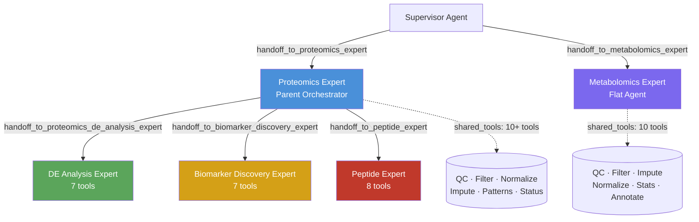

The **Proteomics** and **Metabolomics** domain packages encode omics-specific intelligence as LangGraph ReAct agents, each backed by stateless service classes and platform-aware configuration that auto-detects instrument characteristics from data alone. The proteomics package operates as a **parent-child agent hierarchy** — a parent orchestrator that delegates differential expression, biomarker discovery, and peptide analysis to specialized sub-agents — while the metabolomics package runs as a single flat agent structured for future sub-agent extraction. Both packages share the same architectural DNA: factory functions that wire `DataManagerV2` to service instances, `AgentRegistryConfig` declarations for supervisor discovery, and platform-detection scoring systems that silently select correct defaults so users never need to specify whether their data came from a mass spectrometer or an Olink panel.

Sources: [\_\_init\_\_.py](packages/lobster-proteomics/lobster/agents/proteomics/__init__.py#L1-L13), [\_\_init\_\_.py](packages/lobster-metabolomics/lobster/agents/metabolomics/__init__.py#L1-L5)

## Agent Topology and Hierarchy

The proteomics package deploys a **three-tier delegation model**: the parent `proteomics_expert` handles QC, preprocessing, and pattern analysis directly, then hands off downstream tasks to one of three child agents. The metabolomics package uses a single `metabolomics_expert` with no children in its current version, though its `AGENT_CONFIG` explicitly sets `child_agents=None` with a comment indicating planned extraction. This asymmetry reflects a deliberate design decision — proteomics has more analytically distinct workflows (DE analysis vs. network/survival vs. peptide computation) that benefit from isolated tool sets and prompts, while metabolomics workflows are more sequential and share tighter state dependencies.



The delegation protocol is **mandatory** — the proteomics parent agent's prompt contains explicit instructions to immediately invoke handoff tools for DE, time course, correlation, pathway, network, survival, and biomarker tasks rather than attempting them directly. Each child agent is registered with `supervisor_accessible=False`, meaning the supervisor cannot route to them directly; delegation always flows through the parent.

Sources: [proteomics_expert.py](packages/lobster-proteomics/lobster/agents/proteomics/proteomics_expert.py#L18-L36), [metabolomics_expert.py](packages/lobster-metabolomics/lobster/agents/metabolomics/metabolomics_expert.py#L13-L26), [prompts.py](packages/lobster-proteomics/lobster/agents/proteomics/prompts.py#L65-L100)

## Agent Registry Configuration

Every agent exposes an `AGENT_CONFIG` dataclass at module level — placed before heavy imports so the supervisor's entry-point scanner can discover agents without triggering transitive dependency chains. This configuration drives the [Agent Registry and Discovery](7-agent-registry-and-discovery) system and defines handoff tool names, descriptions, and child relationships.

| Field | Proteomics Expert | DE Analysis Expert | Biomarker Discovery Expert | Peptide Expert | Metabolomics Expert |
|-------|------------------|--------------------|---------------------------|----------------|---------------------|
| **name** | `proteomics_expert` | `proteomics_de_analysis_expert` | `biomarker_discovery_expert` | `peptide_expert` | `metabolomics_expert` |
| **supervisor_accessible** | `True` | `False` | `False` | `False` | `True` |
| **child_agents** | 3 children | None | None | None | None |
| **handoff_tool** | `handoff_to_proteomics_expert` | `handoff_to_proteomics_de_analysis_expert` | None (parent-delegated) | `handoff_to_peptide_expert` | `handoff_to_metabolomics_expert` |
| **tier_requirement** | `free` | `free` | `free` | `free` | `free` |

The `supervisor_accessible=False` flag on child agents enforces the delegation boundary — the supervisor's routing table only contains entries for the two parent-accessible agents. The `tier_requirement="free"` across all agents signals that commercial value lives in the Omics-OS Cloud orchestration layer, not in individual agent access.

Sources: [proteomics_expert.py](packages/lobster-proteomics/lobster/agents/proteomics/proteomics_expert.py#L18-L36), [de_analysis_expert.py](packages/lobster-proteomics/lobster/agents/proteomics/de_analysis_expert.py#L22-L34), [biomarker_discovery_expert.py](packages/lobster-proteomics/lobster/agents/proteomics/biomarker_discovery_expert.py#L19-L30), [peptide_expert.py](packages/lobster-proteomics/lobster/agents/proteomics/peptide_expert.py#L15-L25), [metabolomics_expert.py](packages/lobster-metabolomics/lobster/agents/metabolomics/metabolomics_expert.py#L13-L26)

## Platform Auto-Detection

Both packages implement a **scoring-based platform detection system** that examines AnnData metadata columns and data characteristics to identify the instrument platform, then applies platform-specific defaults for QC thresholds, normalization methods, and imputation strategies. This is the central innovation that allows agents to handle heterogeneous data without user configuration.

### Proteomics Platform Detection

The proteomics `detect_platform_type` function scores data against two platform profiles — **mass spectrometry** (DDA/DIA) and **affinity** (Olink, SomaScan, Luminex) — using five signal categories:

| Signal Category | Mass Spec Indicators (+score) | Affinity Indicators (+score) |
|----------------|-------------------------------|------------------------------|
| **var columns** | `n_peptides`, `n_unique_peptides`, `sequence_coverage`, `protein_group` (+2 each) | `antibody_id`, `antibody_clone`, `panel_type`, `npx_value` (+2 each) |
| **contaminant markers** | `is_contaminant`, `is_reverse` columns (+3) | — |
| **plate markers** | — | `plate_id`, `plate_number` in obs (+2) |
| **missing rate** | >30% missing (+3) | <30% missing (implicit) |
| **protein count** | >3000 proteins (+2) | <200 proteins (+2) |

When scores tie or both are zero, the function returns `"unknown"` and callers default to mass spec with a warning.

### Metabolomics Platform Detection

The metabolomics detector scores against three platforms — **LC-MS**, **GC-MS**, and **NMR** — using var column hints, `uns["platform"]` metadata, and missing rate as a tiebreaker:

| Signal | LC-MS (+score) | GC-MS (+score) | NMR (+score) |
|--------|----------------|----------------|--------------|
| **var columns** | `retention_time`, `mz`, `adduct`, `rt`, `precursor_mz` (+2 each) | `ri`, `retention_index`, `kovats_index`, `derivatization` (+3 each) | `ppm`, `chemical_shift`, `bin_start`, `bin_end` (+3 each) |
| **uns platform** | `"lc-ms"`, `"lcms"`, `"liquid"` (+5) | `"gc-ms"`, `"gcms"`, `"gas"` (+5) | `"nmr"`, `"nuclear"`, `"1h"`, `"13c"` (+5) |
| **missing rate** | 20–60% | 10–40% | 0–10% |

> [!TIP]
> Both detection functions accept a `force_type` override parameter, which bypasses scoring entirely and directly validates against `PLATFORM_CONFIGS` keys. Use this when you know the platform but the data lacks discriminating metadata — for example, a processed expression matrix stripped of original m/z or peptide columns.

Sources: [config.py](packages/lobster-proteomics/lobster/agents/proteomics/config.py#L70-L259), [config.py](packages/lobster-metabolomics/lobster/agents/metabolomics/config.py#L63-L241)

## Platform-Specific Defaults

Platform detection feeds directly into `PlatformConfig` / `MetabPlatformConfig` dataclasses that define **every default parameter** an agent needs. These configs are not advisory — tools read them programmatically via `get_qc_defaults()` and `get_normalization_defaults()` to populate method selections, thresholds, and imputation strategies without user input.

### Proteomics Platform Comparison

| Parameter | Mass Spectrometry | Affinity Proteomics |
|-----------|------------------|---------------------|
| **Missing rate range** | 30–70% (MNAR) | 0–30% (MAR) |
| **Max missing/sample** | 70% | 30% |
| **Max missing/protein** | 80% | 50% |
| **CV threshold** | 50% | 30% |
| **Min proteins/sample** | 100 | 20 |
| **Normalization** | median + log2 | quantile (no log) |
| **Imputation** | `keep` (preserve MNAR) | `impute_knn` (MAR imputation) |
| **Fold change cutoff** | 1.5× | 1.2× |
| **PCA components** | 15 | 10 |
| **Platform-specific** | min 2 peptides/protein, remove contaminants | correct plate effects, check antibody specificity |

The most consequential difference is the **missing value strategy**: mass spectrometry data exhibits Missing Not At Random (MNAR) patterns where absent values reflect true biological absence below detection limits, so the default `keep` strategy preserves this information. Affinity data exhibits Missing At Random (MAR) patterns from technical failures, making KNN imputation appropriate.

### Metabolomics Platform Comparison

| Parameter | LC-MS | GC-MS | NMR |
|-----------|-------|-------|-----|
| **Missing rate range** | 20–60% | 10–40% | 0–10% |
| **Max missing/sample** | 60% | 40% | 10% |
| **Max missing/feature** | 80% | 60% | 20% |
| **QC RSD threshold** | 30% | 25% | 20% |
| **Min features/sample** | 50 | 30 | 100 |
| **Normalization** | PQN + log2 | TIC + log2 | PQN (no log) |
| **Imputation** | KNN | min/2 | median |
| **Fold change cutoff** | 1.5× | 2.0× | 1.5× |

> [!TIP]
> The GC-MS fold change threshold of 2.0× (higher than LC-MS or NMR) reflects GC-MS's superior chromatographic reproducibility — features that pass the tighter RSD filter should show larger effect sizes to be considered biologically meaningful.

Sources: [config.py](packages/lobster-proteomics/lobster/agents/proteomics/config.py#L62-L131), [config.py](packages/lobster-metabolomics/lobster/agents/metabolomics/config.py#L55-L143)

## State Schemas and Agent State Design

Each agent declares a state class that extends LangGraph's `AgentState` with domain-specific fields. These states are **not shared across agents** — delegation passes task descriptions, not state objects, which keeps the hierarchy loosely coupled.

### Proteomics State Hierarchy

```
ProteomicsExpertState          ← Parent: QC, platform, normalization, pattern analysis
├── DEAnalysisExpertState      ← Child: comparison groups, DE/time course/correlation results
├── BiomarkerDiscoveryExpertState ← Child: WGCNA modules, survival, biomarker candidates
└── PeptideExpertState         ← Child: properties, activity, digestion, variants
```

All four states inherit `next: str = ""` and `task_description: str = ""` from the `AgentState` base, plus an `intermediate_outputs: Dict[str, Any]` for cross-tool communication within a single agent's execution. The parent state additionally carries `platform_type`, `platform_defaults`, `missing_value_info`, and `normalization_info` — the platform detection results that downstream tools read.

### Metabolomics State

`MetabolomicsExpertState` is a single flat state with fields for `quality_metrics`, `platform_defaults`, `missing_value_info`, `normalization_info`, `statistical_results`, `multivariate_results`, and `annotation_results` — reflecting the sequential pipeline nature of untargeted metabolomics where each stage's output feeds the next.

Sources: [state.py](packages/lobster-proteomics/lobster/agents/proteomics/state.py#L1-L126), [state.py](packages/lobster-metabolomics/lobster/agents/metabolomics/state.py#L1-L50)

## Tool Inventories by Agent

Each agent's tools are constructed through factory functions that close over the `DataManagerV2` and service instances, producing LangChain `@tool`-decorated functions with AQUADIF category metadata and provenance tracking.

### Proteomics Expert (Parent) — Shared Tools + Inline Tools

The parent agent receives tools from two sources: `create_shared_tools()` produces the core QC/preprocessing/analysis tools, and a small number of platform-specific tools are defined inline in the factory function.

| # | Tool | Category | Source | Provenance |
|---|------|----------|--------|------------|
| 1 | `import_proteomics_data` | IMPORT | shared_tools | Yes |
| 2 | `import_affinity_data` | IMPORT | shared_tools | Yes |
| 3 | `import_ptm_sites` | IMPORT | shared_tools | Yes |
| 4 | `check_proteomics_status` | UTILITY | shared_tools | No |
| 5 | `assess_proteomics_quality` | QUALITY | shared_tools | Yes |
| 6 | `filter_proteomics_data` | PREPROCESS | shared_tools | Yes |
| 7 | `normalize_proteomics_data` | PREPROCESS | shared_tools | Yes |
| 8 | `handle_missing_values` | PREPROCESS | shared_tools | Yes |
| 9 | `correct_batch_effects` | PREPROCESS | shared_tools | Yes |
| 10 | `analyze_proteomics_patterns` | ANALYZE | shared_tools | Yes |
| 11 | `select_variable_proteins` | ANALYZE | shared_tools | Yes |
| 12 | `create_proteomics_summary` | UTILITY | shared_tools | Yes |
| 13 | `add_peptide_mapping` | UTILITY | inline (deprecated) | No |
| 14 | `validate_antibody_specificity` | QUALITY | inline | Yes |

The deprecated `add_peptide_mapping` tool now returns a warning message directing users to `import_proteomics_data`, which automatically extracts peptide counts, unique peptides, and sequence coverage from MaxQuant/DIA-NN/Spectronaut parser output.

### DE Analysis Expert — 7 Tools

| # | Tool | Purpose |
|---|------|---------|
| 1 | `find_differential_proteins` | Statistical testing with platform-aware method selection and FDR |
| 2 | `run_time_course_analysis` | Longitudinal proteomics with repeated measures |
| 3 | `run_correlation_analysis` | Protein-trait continuous variable correlation |
| 4 | `run_pathway_enrichment` | GO/Reactome/KEGG via core PathwayEnrichmentService |
| 5 | `run_differential_ptm_analysis` | Phospho/PTM site-level differential analysis |
| 6 | `run_kinase_enrichment` | KSEA kinase substrate enrichment analysis |
| 7 | `run_string_network_analysis` | STRING protein-protein interaction networks |

The DE expert performs a minimum sample size check — if the smallest group has fewer than 3 samples, it returns an error message with group sizes rather than attempting unreliable statistical testing.

### Biomarker Discovery Expert — 7 Tools

| # | Tool | Purpose |
|---|------|---------|
| 1 | `identify_coexpression_modules` | WGCNA-lite module identification with color labels |
| 2 | `correlate_modules_with_traits` | Module-trait eigengene correlation |
| 3 | `perform_survival_analysis` | Cox proportional hazards regression |
| 4 | `find_survival_biomarkers` | Batch Kaplan-Meier biomarker screening |
| 5 | `select_biomarker_panel` | Multi-method feature selection (LASSO, stability, Boruta) |
| 6 | `evaluate_biomarker_panel` | Nested cross-validation with AUC reporting |
| 7 | `extract_hub_proteins` | Hub protein extraction via kME from WGCNA modules |

### Peptide Expert — 8 Domain Tools

| # | Tool | Purpose |
|---|------|---------|
| 1 | `import_peptide_sequences` | Load from FASTA/CSV/TSV with validation against standard amino acids |
| 2 | `calculate_peptide_properties` | MW, pI, charge, GRAVY, Boman index, etc. |
| 3 | `predict_peptide_activity` | Heuristic scoring for antimicrobial/CPP/toxicity |
| 4 | `simulate_enzymatic_digestion` | In silico tryptic/chymotryptic/pepsin/Lys-C/Asp-N/Glu-C digest |
| 5 | `filter_peptides` | Threshold filtering on length, charge, hydrophobicity, activity |
| 6 | `generate_variants` | — |
| 7 | `annotate_bioactive_peptides` | — |
| 8 | `export_peptide_library` | — |

### Metabolomics Expert — 10 Tools

| # | Tool | Category | Purpose |
|---|------|----------|---------|
| 1 | `assess_metabolomics_quality` | QUALITY | RSD, TIC distribution, QC reproducibility, missing profiling |
| 2 | `filter_metabolomics_features` | PREPROCESS | Prevalence, RSD, and blank ratio filtering |
| 3 | `handle_missing_values` | PREPROCESS | KNN/min/LOD-half/median/MICE imputation |
| 4 | `normalize_metabolomics` | PREPROCESS | PQN/TIC/IS/median/quantile + optional log2 |
| 5 | `correct_batch_effects` | PREPROCESS | ComBat/QC-RLSC/median centering |
| 6 | `run_metabolomics_statistics` | ANALYZE | Univariate tests with FDR + fold change |
| 7 | `run_multivariate_analysis` | ANALYZE | PCA, PLS-DA (VIP scores), OPLS-DA |
| 8 | `annotate_metabolites` | ANNOTATE | m/z matching against ~80-metabolite reference database |
| 9 | `analyze_lipid_classes` | ANNOTATE | Annotation-based or m/z range-based lipid classification |
| 10 | `run_pathway_enrichment` | ANALYZE | KEGG/Reactome/GO via core PathwayEnrichmentService |

Sources: [shared_tools.py](packages/lobster-proteomics/lobster/agents/proteomics/shared_tools.py#L1-L2794), [de_analysis_expert.py](packages/lobster-proteomics/lobster/agents/proteomics/de_analysis_expert.py#L86-L1530), [biomarker_discovery_expert.py](packages/lobster-proteomics/lobster/agents/proteomics/biomarker_discovery_expert.py#L72-L1562), [peptide_tools.py](packages/lobster-proteomics/lobster/agents/proteomics/peptide_tools.py#L1-L746), [shared_tools.py](packages/lobster-metabolomics/lobster/agents/metabolomics/shared_tools.py#L1-L1063)

## Standard Workflows

The agent prompts encode **prescribed analysis pipelines** as numbered step sequences. These workflows represent the recommended analysis order for each platform type, ensuring that filtering precedes imputation, normalization follows imputation, and statistical tests operate on properly preprocessed data.

### Proteomics Workflows

**MS Discovery Proteomics** — the most common workflow — imports data through the dedicated parser, runs QC with mass-spec metrics, filters contaminants and low-peptide proteins, applies median + log2 normalization, then delegates to the DE sub-agent for differential analysis and downstream interpretation:

```
1. import_proteomics_data("path/to/proteinGroups.txt")  → Auto-detect MaxQuant/DIA-NN/Spectronaut
2. check_proteomics_status()                              → Verify import & platform detection
3. assess_proteomics_quality("modality")                  → QC with MS-specific metrics
4. filter_proteomics_data("modality_assessed")            → Remove contaminants, low-peptide proteins
5. normalize_proteomics_data("modality_filtered")         → Median + log2
6. correct_batch_effects("modality_normalized")           → If multi-batch (OPTIONAL)
7. select_variable_proteins("modality_normalized")        → Optional: top variable proteins
8. analyze_proteomics_patterns("modality_normalized")     → PCA/clustering
9. → handoff_to_proteomics_de_analysis_expert             → DE analysis + pathway/network
10. create_proteomics_summary()                           → Final report
```

**Affinity Proteomics** (Olink/SomaScan/Luminex) follows a similar structure but adds platform-specific steps: LOD quality assessment, bridge sample normalization for multi-plate studies, plate effect correction, and antibody specificity validation:

```
1. import_affinity_data("path/to/data.npx")              → Auto-detect Olink/SomaScan/Luminex
2. check_proteomics_status()                              → Verify import & platform detection
3. assess_proteomics_quality("modality")                  → QC with LOD metrics
4. assess_lod_quality("modality")                         → Detailed per-protein below-LOD %
5. filter_proteomics_data("modality_assessed")            → Remove failed antibodies
6. normalize_bridge_samples("modality_filtered")          → If multi-plate Olink
7. correct_plate_effects("modality_normalized")           → Residual plate effects
8. normalize_proteomics_data("modality_corrected")        → Quantile + impute
9. validate_antibody_specificity("modality_normalized")   → Cross-reactivity check
10. analyze_proteomics_patterns("modality_validated")     → PCA/clustering
11. → handoff_to_proteomics_de_analysis_expert            → DE analysis
12. → handoff_to_biomarker_discovery_expert               → Optional: network/survival/panel
```

**PTM/Phosphoproteomics** is a specialized workflow requiring paired import of both protein-level and PTM-level data, with separate PTM-to-protein normalization that isolates phosphorylation changes from protein abundance changes before differential analysis.

### Metabolomics Workflows

**Untargeted LC-MS** — the default metabolomics pipeline — chains QC through annotation with 10 sequential steps:

```
1. assess_metabolomics_quality(modality)                  → TIC, RSD, QC samples, missing values
2. filter_metabolomics_features(modality_assessed)        → Prevalence > 0.5, optionally by blank ratio
3. handle_missing_values(modality_filtered, "knn")        → KNN imputation (LC-MS default)
4. normalize_metabolomics(modality_imputed, "pqn", log_transform=True)  → PQN + log2
5. correct_batch_effects(modality_normalized, batch_key)  → If multi-batch
6. run_metabolomics_statistics(modality_normalized, group_column)  → Univariate + fold changes
7. run_multivariate_analysis(modality_normalized, "pca")  → Unsupervised overview
8. run_multivariate_analysis(modality_normalized, "plsda", group_column=...)  → Supervised
9. annotate_metabolites(modality_normalized, ppm_tolerance=10, ion_mode="positive")  → Putative IDs
10. run_pathway_enrichment(modality_statistics, database="KEGG_2021_Human")  → Biological interpretation
```

GC-MS and NMR workflows follow the same sequence with parameter substitutions: GC-MS uses TIC normalization + min/2 imputation, while NMR uses PQN without log transform + median imputation.

Sources: [prompts.py](packages/lobster-proteomics/lobster/agents/proteomics/prompts.py#L102-L200), [prompts.py](packages/lobster-metabolomics/lobster/agents/metabolomics/prompts.py#L86-L200)

## Service Architecture

All computational work is delegated to **stateless service classes** instantiated inside the agent factory functions. This separation means agents contain zero business logic — they are thin orchestration layers that validate inputs, call service methods, store results via `DataManagerV2`, and format responses. Every service method returns a three-tuple of `(adata_result, stats_dict, analysis_ir)` enabling both data lineage tracking and human-readable reporting.

### Proteomics Service Map

| Service | Location | Used By |
|---------|----------|---------|
| `ProteomicsQualityService` | `services/quality/` | Parent (shared_tools) |
| `ProteomicsPreprocessingService` | `services/quality/` | Parent (shared_tools) |
| `ProteomicsAnalysisService` | `services/analysis/` | Parent (shared_tools) |
| `ProteomicsDifferentialService` | `services/analysis/` | DE Analysis Expert |
| `ProteomicsPathwayService` | `services/analysis/` | DE Analysis Expert (lazy import) |
| `ProteomicsKinaseService` | `services/analysis/` | DE Analysis Expert (lazy import) |
| `ProteomicsStringService` | `services/analysis/` | DE Analysis Expert (lazy import) |
| `WGCNALiteService` | `services/analysis/` | Biomarker Discovery Expert |
| `ProteomicsSurvivalService` | `services/analysis/` | Biomarker Discovery Expert |
| `ProteomicsVisualizationService` | `services/visualization/` | (available) |
| `PeptidePropertyService` | `services/peptidomics/` | Peptide Expert |
| `PeptideActivityService` | `services/peptidomics/` | Peptide Expert |
| `PeptideDigestionService` | `services/peptidomics/` | Peptide Expert |

### Metabolomics Service Map

| Service | Location | Used By |
|---------|----------|---------|
| `MetabolomicsQualityService` | `services/quality/` | Metabolomics Expert (shared_tools) |
| `MetabolomicsPreprocessingService` | `services/quality/` | Metabolomics Expert (shared_tools) |
| `MetabolomicsAnalysisService` | `services/analysis/` | Metabolomics Expert (shared_tools) |
| `MetabolomicsAnnotationService` | `services/annotation/` | Metabolomics Expert (shared_tools) |

The DE Analysis Expert uses **lazy imports** for downstream services (`ProteomicsPathwayService`, `ProteomicsKinaseService`, `ProteomicsStringService`) — imported inside the factory function rather than at module level — to avoid circular dependencies and reduce cold-start cost for cases where only core DE testing is needed.

Sources: [proteomics_expert.py](packages/lobster-proteomics/lobster/agents/proteomics/proteomics_expert.py#L95-L110), [de_analysis_expert.py](packages/lobster-proteomics/lobster/agents/proteomics/de_analysis_expert.py#L95-L109), [metabolomics_expert.py](packages/lobster-metabolomics/lobster/agents/metabolomics/metabolomics_expert.py#L82-L96)

## Provenance and the Analysis IR

Every tool call that modifies data generates an `AnalysisStep` record — a structured intermediate representation that captures the operation name, parameters, code template, and library dependencies. The `DataManagerV2.log_tool_usage()` method stores these IR records, enabling the [Notebook Export Pipeline](13-notebook-export-pipeline) to reconstruct a reproducible analysis script from the provenance chain.

The `ParameterSpec` schema within each `AnalysisStep` distinguishes between `papermill_injectable` parameters (safe for automated notebook parameterization) and non-injectable ones (like orientation flags that affect code structure). For example, the `file_path` parameter in `import_proteomics_data` is injectable (`papermill_injectable=True`), while `orientation` is not because it determines whether the code template includes a transpose operation.

Sources: [shared_tools.py](packages/lobster-proteomics/lobster/agents/proteomics/shared_tools.py#L117-L176), [biomarker_discovery_expert.py](packages/lobster-proteomics/lobster/agents/proteomics/biomarker_discovery_expert.py#L133-L152)

## Package Structure

```
packages/lobster-proteomics/
├── lobster/
│   ├── agents/
│   │   └── proteomics/
│   │       ├── __init__.py              ← State exports
│   │       ├── config.py                ← PlatformConfig, detect_platform_type, get_platform_config
│   │       ├── proteomics_expert.py     ← Parent agent factory + inline tools
│   │       ├── de_analysis_expert.py    ← DE sub-agent factory + 7 tools
│   │       ├── biomarker_discovery_expert.py ← Biomarker sub-agent factory + 7 tools
│   │       ├── peptide_expert.py        ← Peptide sub-agent factory
│   │       ├── peptide_config.py        ← Peptide-specific config (standard AA set, etc.)
│   │       ├── peptide_prompts.py       ← Peptide system prompt
│   │       ├── peptide_tools.py         ← 8 peptide domain tools
│   │       ├── prompts.py               ← All proteomics agent prompts
│   │       ├── shared_tools.py          ← Parent agent tools (factory pattern)
│   │       └── state.py                 ← 4 state schemas
│   └── services/
│       ├── analysis/                    ← 6 analysis services (differential, kinase, network, pathway, string, survival)
│       ├── quality/                     ← 2 quality services (preprocessing, quality)
│       └── visualization/              ← 1 visualization service
└── tests/                              ← Unit + integration + fixture tests

packages/lobster-metabolomics/
├── lobster/
│   ├── agents/
│   │   └── metabolomics/
│   │       ├── __init__.py              ← State export
│   │       ├── config.py                ← MetabPlatformConfig, detect_platform_type
│   │       ├── metabolomics_expert.py   ← Single agent factory
│   │       ├── prompts.py               ← Metabolomics system prompt
│   │       ├── shared_tools.py          ← 10 metabolomics tools (factory pattern)
│   │       └── state.py                 ← MetabolomicsExpertState
│   └── services/
│       ├── analysis/                    ← MetabolomicsAnalysisService
│       ├── annotation/                  ← MetabolomicsAnnotationService
│       └── quality/                     ← Preprocessing + quality services
└── tests/
```

Sources: [repo structure](packages/lobster-proteomics), [repo structure](packages/lobster-metabolomics)

---

**Next steps**: For the broader agent orchestration model that routes tasks to these domain agents, see [Supervisor Agent and Routing](5-supervisor-agent-and-routing). For how the supervisor discovers these agents via `AGENT_CONFIG` entry points, see [Agent Registry and Discovery](7-agent-registry-and-discovery). For the complementary transcriptomics/genomics domain agents, see [Transcriptomics and Genomics Agents](14-transcriptomics-and-genomics-agents). For how provenance records flow into reproducible notebooks, see [Notebook Export Pipeline](13-notebook-export-pipeline).