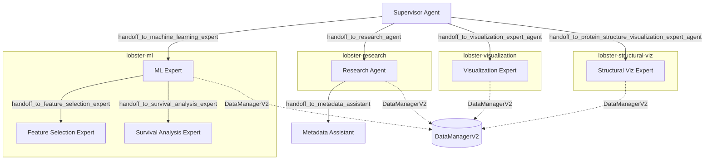
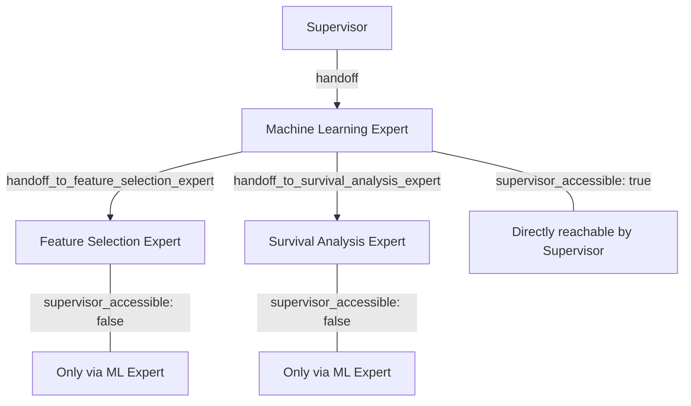
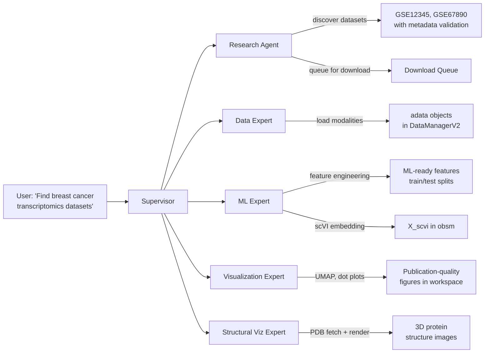

The **Research**, **Machine Learning**, and **Visualization** agent packages form the analytical backbone of Lobster's multi-agent pipeline — spanning literature discovery through ML-ready data preparation to publication-quality rendering. Each package is independently installable, registry-discoverable, and connected through the supervisor-mediated orchestration graph. Together they close the loop from "what's known in the literature" to "what the data looks like in a figure," a trajectory that mirrors the actual workflow of a working computational biologist.

Sources: [research_agent.py](/packages/lobster-research/lobster/agents/research/research_agent.py#L1-L55), [machine_learning_expert.py](/packages/lobster-ml/lobster/agents/machine_learning/machine_learning_expert.py#L1-L50), [visualization_expert.py](/packages/lobster-visualization/lobster/agents/visualization_expert.py#L1-L50), [protein_structure_visualization_expert.py](/packages/lobster-structural-viz/lobster/agents/protein_structure_visualization_expert.py#L1-L50)

## Architectural Overview

All four agent packages share a uniform architectural skeleton: an `AgentRegistryConfig` declaration at module top, lazy-loaded services inside the factory function, LangChain `@tool`-decorated functions closing over a shared `DataManagerV2` instance, and a final `create_react_agent` call that wires everything into a LangGraph node. This consistency is not accidental — it is enforced by the scaffold system described in [Scaffold and Package Validation](10-scaffold-and-package-validation).



The supervisor never calls sub-agents of the ML Expert directly — `feature_selection_expert` and `survival_analysis_expert` are declared with `supervisor_accessible=False`, so they can only be reached through their parent. Conversely, the Research Agent can hand off to `metadata_assistant` (a premium-tier feature gated by subscription level). The Visualization and Structural Viz experts have no child agents; they operate as leaf nodes.

Sources: [config.py](/packages/lobster-ml/lobster/agents/machine_learning/config.py#L1-L51), [research_agent.py](/packages/lobster-research/lobster/agents/research/research_agent.py#L14-L28), [visualization_expert.py](/packages/lobster-visualization/lobster/agents/visualization_expert.py#L14-L20), [protein_structure_visualization_expert.py](/packages/lobster-structural-viz/lobster/agents/protein_structure_visualization_expert.py#L14-L20)

## Agent Comparison at a Glance

| Dimension | Research Agent | ML Expert | Visualization Expert | Structural Viz Expert |
|---|---|---|---|---|
| **Package** | `lobster-research` | `lobster-ml` | `lobster-visualization` | `lobster-structural-viz` |
| **Registry Name** | `research_agent` | `machine_learning_expert` | `visualization_expert_agent` | `protein_structure_visualization_expert_agent` |
| **Tier** | Free (child: premium) | Free | Free | Free |
| **Child Agents** | `metadata_assistant` | `feature_selection_expert`, `survival_analysis_expert` | None | None |
| **Supervisor Accessible** | Yes | Yes | Yes | Yes |
| **Primary Data Flow** | Literature → Dataset metadata → Queue | Modality → Features → Splits → Export | Modality → Plot figures → Workspace | PDB ID → Structure file → 3D render |
| **State Schema** | `ResearchAgentState` | `MachineLearningExpertState` | `VisualizationExpertState` | `ProteinStructureVisualizationExpertState` |
| **Key Services** | ContentAccess, QueuePreparation, MetadataValidation | MLPreparation, FeatureSelection, SurvivalAnalysis | SingleCellVisualization | PyMOLVisualization, StructureAnalysis, ProteinStructureFetch |

Sources: [config.py](/packages/lobster-ml/lobster/agents/machine_learning/config.py#L25-L51), [state.py](/packages/lobster-research/lobster/agents/research/state.py#L1-L61), [visualization_state.py](/packages/lobster-visualization/lobster/agents/visualization_state.py#L1-L40), [structural_viz_state.py](/packages/lobster-structural-viz/lobster/agents/structural_viz_state.py#L1-L44)

## Research Agent

The Research Agent is a **literature-to-metadata orchestrator** that never communicates with end users — it responds only to the supervisor. Its mandate is precise: discover and triage publications and datasets, manage the publication queue, validate metadata, and cache reusable artifacts to the workspace. It explicitly does **not** download data (that is the data expert's job) or run omics analysis.

### Registration and Factory

The agent declares itself at module top via `AgentRegistryConfig`, which the [Agent Registry and Discovery](7-agent-registry-and-discovery) system reads at startup:

```python
AGENT_CONFIG = AgentRegistryConfig(
    name="research_agent",
    display_name="Research Agent",
    description="Handles literature discovery, dataset identification, PDF extraction with AUTOMATIC PMID/DOI resolution...",
    factory_function="lobster.agents.research.research_agent.research_agent",
    handoff_tool_name="handoff_to_research_agent",
    child_agents=["metadata_assistant"],
)
```

The `factory_function` string is the entry point the supervisor calls to instantiate the agent at runtime, passing the shared `DataManagerV2`, callback handlers, delegation tools, and subscription tier.

Sources: [research_agent.py](/packages/lobster-research/lobster/agents/research/research_agent.py#L14-L28)

### Lazy Service Loading

The Research Agent employs **lazy initialization** for its five heaviest services, shaving ~1.2 seconds off import time. Services are loaded only when first invoked by a tool:

| Service | Import Cost | Purpose |
|---|---|---|
| `ContentAccessService` | 500–800 ms | Full-text publication content retrieval |
| `DataExpertAssistant` | 200–400 ms | Dataset expertise queries |
| `MetadataValidationService` | 200–400 ms | Structured metadata validation with severity levels |
| `QueuePreparationService` | — | Download queue entry creation |
| `UniProtService` / `EnsemblService` | — | Knowledgebase identifier lookups |

Each loader follows the same memoization pattern — a `nonlocal` variable, a `None` check, and a debug log on first load. This is a deliberate architectural choice to keep cold-start latency low when the supervisor routes a request to this agent.

Sources: [research_agent.py](/packages/lobster-research/lobster/agents/research/research_agent.py#L100-L175)

### Operating Principles and Prompt Design

The Research Agent's system prompt encodes five operating principles that govern every tool call it makes: **(1) Data type routing** — match assay to repository using the dynamic `OmicsTypeRegistry` so that transcriptomics queries go to GEO/SRA, proteomics to PRIDE/MassIVE, and so on; **(2) Query discipline** — define technology, organism, disease, and required metadata before searching, using controlled vocabulary; **(3) Metadata-first** — immediately check whether candidate datasets expose required annotations, discarding low-value datasets early; **(4) Cache first** — prefer workspace-cached metadata over re-querying providers; **(5) Stopping rules** — cap discovery at ~10 tool calls per workflow, stopping once 1–3 strong datasets match all criteria.

The routing table is built dynamically from `OMICS_TYPE_REGISTRY`, meaning new omics types added to the registry automatically appear in the agent's prompt without manual updates.

Sources: [prompts.py](/packages/lobster-research/lobster/agents/research/prompts.py#L1-L148)

### State Schema

`ResearchAgentState` extends LangGraph's `AgentState` with research-specific fields organized into five semantic groups:

| Group | Key Fields | Purpose |
|---|---|---|
| **Literature Discovery** | `search_history`, `publications_found`, `literature_cache` | Track searches and cached abstracts/methods |
| **Dataset Discovery** | `datasets_discovered`, `dataset_validation_results`, `related_entries` | Map accessions to metadata and validation outcomes |
| **Queue Management** | `download_queue_entries`, `publication_queue_entries`, `queue_status_tracking` | Track entries through the download pipeline |
| **Content Extraction** | `methods_extracted`, `metadata_extracted`, `identifiers_found` | Store extracted methods, metadata, and cross-references |
| **Workspace** | `cached_content`, `workspace_locations` | Map content identifiers to workspace file paths |

Sources: [state.py](/packages/lobster-research/lobster/agents/research/state.py#L1-L61)

### Metadata Verbosity Control

The config module defines three field sets — `ESSENTIAL_FIELDS`, `STANDARD_FIELDS`, and `VERBOSE_FIELDS` — that the `get_dataset_metadata` tool uses to prevent context overflow when returning GEO metadata. Essential fields (database, accession, title, status, pubmed_id, summary) are always included; standard and verbose fields are added only when the user explicitly requests them. This tiered approach prevents a single metadata query from consuming the LLM's context window.

Sources: [config.py](/packages/lobster-research/lobster/agents/research/config.py#L1-L59)

### Tier-Restricted Delegation

The Research Agent's handoff to `metadata_assistant` is gated by subscription tier. At the free tier, the `get_restricted_handoffs` function identifies `metadata_assistant` as restricted, and the factory function filters the delegation tools list before passing it to `create_react_agent`. If the tool is missing due to tier restrictions, the agent informs the supervisor that a premium upgrade is required — it never silently fails.

Sources: [research_agent.py](/packages/lobster-research/lobster/agents/research/research_agent.py#L56-L97)

## Machine Learning Expert Agent

The ML Expert is a **parent orchestrator** that prepares biological data for model training. It handles ML readiness assessment, feature engineering, data splitting, framework export, and scVI embedding training directly, while **immediately delegating** biomarker discovery to the Feature Selection Expert and time-to-event analysis to the Survival Analysis Expert. The delegation protocol is strict: the agent must *invoke* the handoff tool immediately upon detecting trigger phrases, never merely suggest or recommend delegation.

### Agent Hierarchy



All three agents are tier-free — the commercial value lives in Omics-OS Cloud, not in agent access restrictions.

Sources: [config.py](/packages/lobster-ml/lobster/agents/machine_learning/config.py#L1-L51)

### Direct Tools

The ML Expert's seven direct tools form a linear preparation pipeline:

| Tool | AQUADIF Category | Purpose |
|---|---|---|
| `check_ml_ready_modalities` | UTILITY | Assess which modalities have labels, normalization, sufficient sample count |
| `prepare_ml_features` | PREPROCESS | Feature selection (highly_variable, pca, all, marker_genes), scaling, zero handling |
| `create_ml_splits` | PREPROCESS | Stratified train/test/validation splits with class balance |
| `export_for_ml_framework` | PREPROCESS | Export to PyTorch, TensorFlow, scikit-learn, or NumPy formats |
| `create_ml_analysis_summary` | UTILITY | Comprehensive report of all ML preprocessing steps |
| `check_scvi_availability` | UTILITY | Verify scVI-tools installation |
| `train_scvi_embedding` | ANALYZE | Train scVI deep learning embedding for single-cell data |

> [!TIP]
> The `prepare_ml_features` tool creates a new modality named `{modality_name}_ml_features` in the DataManager rather than mutating the original, preserving the provenance chain for [Provenance Tracking and IR](12-provenance-tracking-and-ir).

The readiness check is particularly informative — it inspects each modality for label columns (`condition`, `cell_type`, `treatment`, `group`, `label`, `class`), normalization status, batch information, and sparsity. For small samples (<50), it warns about regularization needs; for large datasets (>10,000), it notes suitability for deep learning.

Sources: [machine_learning_expert.py](/packages/lobster-ml/lobster/agents/machine_learning/machine_learning_expert.py#L60-L200), [prompts.py](/packages/lobster-ml/lobster/agents/machine_learning/prompts.py#L1-L200)

### Mandatory Delegation Protocol

The ML Expert's prompt enforces an **immediate-action delegation protocol**: when trigger phrases like "feature selection", "biomarker", "survival analysis", or "Cox model" are detected, the agent must invoke the corresponding handoff tool *without asking permission, suggesting, or reporting "delegation needed."* This eliminates the common failure mode where an LLM acknowledges a need but fails to act on it. The decision tree is unambiguous:

```
Feature selection?     → INVOKE handoff_to_feature_selection_expert (IMMEDIATELY)
Survival analysis?     → INVOKE handoff_to_survival_analysis_expert (IMMEDIATELY)
ML readiness check?    → Handle directly
Feature engineering?   → Handle directly
Train/test splits?     → Handle directly
Framework export?      → Handle directly
scVI embedding?        → Handle directly
```

Sources: [prompts.py](/packages/lobster-ml/lobster/agents/machine_learning/prompts.py#L100-L200)

### Feature Selection Expert (Sub-Agent)

The Feature Selection Expert handles **biomarker discovery** through three selection strategies exposed via `shared_tools.py`:

| Tool | Method | Best For |
|---|---|---|
| `run_stability_selection` | Bootstrap resampling with XGBoost/Random Forest/LASSO | Robust feature ranking across data perturbations |
| `run_lasso_selection` | L1 regularization (coefficient sparsity) | Parsimonious models with automatic feature elimination |
| `run_variance_filter` | Percentile-based low-variance removal | Quick dimensionality reduction as preprocessing step |

The stability selection tool is the most sophisticated — it trains models on multiple bootstrap subsamples and ranks features by **selection probability** (how often each feature is chosen across rounds), producing both importance scores and stability metrics. Results are stored as new modalities (e.g., `{name}_feature_selected`) with `feature_mean_importance` and `feature_selection_probability` columns in `adata.var`.

> [!TIP]
> Feature selection results include a pathway enrichment bridge — the `PathwayEnrichmentBridgeService` is available in the shared tools module to connect selected features to biological pathways, adding interpretability to biomarker panels.

Sources: [feature_selection_expert.py](/packages/lobster-ml/lobster/agents/machine_learning/feature_selection_expert.py#L1-L135), [shared_tools.py](/packages/lobster-ml/lobster/agents/machine_learning/shared_tools.py#L1-L200)

### Survival Analysis Expert (Sub-Agent)

The Survival Analysis Expert handles **time-to-event modeling** with a dedicated data-check tool (`check_survival_data`) that scans `adata.obs` for time columns (keywords: time, days, months, survival, duration), event columns (event, status, censor, death), and grouping columns (group, arm, treatment, stage). It also detects existing Cox model results (`cox_risk_score`, `risk_category` in `obs`; `kaplan_meier` in `uns`).

The `get_hazard_ratios` tool retrieves trained Cox model coefficients and formats them as hazard ratios with confidence intervals. Like all ML sub-agents, results flow through `DataManagerV2.log_tool_usage` with an `ir` (information record) for provenance tracking.

Sources: [survival_analysis_expert.py](/packages/lobster-ml/lobster/agents/machine_learning/survival_analysis_expert.py#L1-L200), [state.py](/packages/lobster-ml/lobster/agents/machine_learning/state.py#L59-L84)

### ML State Schemas

The three ML state classes follow a consistent pattern — each extends `AgentState` with a `next` routing field and domain-specific tracking:

- **`MachineLearningExpertState`**: Tracks `ml_ready_modalities`, `feature_engineering_results`, `data_splits`, `exported_datasets`, `framework_exports`
- **`FeatureSelectionExpertState`**: Tracks `selection_method`, `selected_features`, `feature_rankings`, `stability_scores`
- **`SurvivalAnalysisExpertState`**: Tracks `time_column`, `event_column`, `model_type`, `hazard_ratios`, `survival_curves`, `risk_scores`, `model_metrics` (C-index, time-dependent AUC), `threshold_info`

Sources: [state.py](/packages/lobster-ml/lobster/agents/machine_learning/state.py#L1-L84)

## Visualization Expert Agent

The Visualization Expert is a **leaf agent** — no child agents, no delegation. It creates publication-quality interactive plots through supervisor-mediated workflows, operating on modalities already loaded into `DataManagerV2`. Its `SingleCellVisualizationService` handles the rendering, while the `DataManagerV2.plot_manager` handles storage, tracking, and workspace persistence.

### Tool Catalog

| Tool | Plot Type | Key Parameters | AQUADIF Category |
|---|---|---|---|
| `check_visualization_readiness` | — | `modality_name` | UTILITY |
| `create_umap_plot` | UMAP scatter | `color_by`, `point_size` (auto-scaled) | ANALYZE |
| `create_qc_plots` | Quality control | `metrics` (n_genes, total_counts, pct_mt) | ANALYZE |
| `create_violin_plot` | Gene expression violin | `genes`, `groupby` | ANALYZE |
| `create_feature_plot` | Gene expression on UMAP | `genes`, `use_raw`, `ncols` | ANALYZE |
| `create_dot_plot` | Marker gene dot plot | `genes`, `groupby`, `standard_scale` | ANALYZE |

### Scientific Correctness Guard

The `create_qc_plots` tool includes a **scientific validation gate** that refuses to generate QC plots for differential expression result subsets. The rationale is encoded in the tool itself: QC metrics like `n_genes_by_counts`, `total_counts`, and `pct_counts_mt` are meaningless for filtered gene subsets (e.g., 174 DE genes) — they only make sense for full datasets. The tool detects DE modalities (via `_de_` in the name or small gene counts <1000) and returns a detailed explanation recommending volcano plots or heatmaps instead. This prevents a common analytical error where users request biologically inappropriate visualizations.

Sources: [visualization_expert.py](/packages/lobster-visualization/lobster/agents/visualization_expert.py#L200-L399)

### Auto-Scaling and Plot Management

Point sizes in UMAP plots are auto-scaled based on cell count: <1,000 cells → size 8; 1,000–10,000 → size 5; 10,000–50,000 → size 3; >50,000 → size 2. Every plot receives a UUID-based `plot_id`, is registered with `plot_manager.add_plot()` (with full dataset_info metadata), tracked via `add_visualization_record()`, and optionally saved to the workspace via `save_plots_to_workspace()`. The `DataManagerV2.log_tool_usage()` call records the operation with parameters for the provenance chain.

Sources: [visualization_expert.py](/packages/lobster-visualization/lobster/agents/visualization_expert.py#L120-L200)

### Visualization State

`VisualizationExpertState` maintains a `visualization_history` list, `plot_queue` for pending tasks, `active_modalities` for current session tracking, and `plot_metadata` for the current plot session. This enables the supervisor to query visualization state across multiple handoffs.

Sources: [visualization_state.py](/packages/lobster-visualization/lobster/agents/visualization_state.py#L1-L40)

## Protein Structure Visualization Expert Agent

The Structural Viz Expert bridges **omics data to 3D molecular structure**. It fetches structures from RCSB PDB, renders them via PyMOL, performs structural analysis (RMSD, secondary structure, geometry), and links structures to gene expression and proteomics data. It is the only agent in this group that interacts with external data providers (RCSB) rather than operating solely on in-memory modalities.

### Service Architecture

Three services power this agent:

| Service | Responsibility |
|---|---|
| `ProteinStructureFetchService` | Downloads PDB/CIF files from RCSB, extracts metadata (organism, resolution, experiment method, chains, atoms) |
| `PyMOLVisualizationService` | Generates high-quality 3D renders via PyMOL scripting |
| `StructureAnalysisService` | Computes RMSD between structures, secondary structure assignment, geometric analysis |

The fetch tool stores retrieved structures as modalities named `structure_{pdb_id}` in `DataManagerV2`, making them available to downstream agents. It also returns provenance records (`ir`) that track the external data access.

Sources: [protein_structure_visualization_expert.py](/packages/lobster-structural-viz/lobster/agents/protein_structure_visualization_expert.py#L60-L200)

### Structural Viz State

`ProteinStructureVisualizationExpertState` tracks `pdb_ids` (list of structures being worked with), `visualization_settings` (PyMOL rendering parameters), `analysis_results` (RMSD, secondary structure, geometry), and `comparison_results` for multi-structure alignment workflows.

Sources: [structural_viz_state.py](/packages/lobster-structural-viz/lobster/agents/structural_viz_state.py#L1-L44)

## End-to-End Workflow: Literature to Figure

The four agent packages form a natural pipeline that mirrors the scientific process. A typical workflow moves through discovery, preparation, and visualization stages:



Each handoff is initiated by the supervisor, never by the user directly. The `DataManagerV2` serves as the shared state medium — modalities stored by one agent are immediately available to the next, with full provenance tracking through `log_tool_usage` and information records.

Sources: [research_agent.py](/packages/lobster-research/lobster/agents/research/research_agent.py#L14-L28), [machine_learning_expert.py](/packages/lobster-ml/lobster/agents/machine_learning/machine_learning_expert.py#L1-L50), [visualization_expert.py](/packages/lobster-visualization/lobster/agents/visualization_expert.py#L1-L50), [protein_structure_visualization_expert.py](/packages/lobster-structural-viz/lobster/agents/protein_structure_visualization_expert.py#L1-L50)

## Navigation

- **Upstream**: These agents receive tasks from the [Supervisor Agent and Routing](5-supervisor-agent-and-routing) via the [LangGraph State and Graph Topology](6-langgraph-state-and-graph-topology)
- **Data access**: All agents depend on [DataManager and Modality Adapters](11-datamanager-and-modality-adapters) and the [Provider Registry and Data Access](19-provider-registry-and-data-access)
- **Sibling domain agents**: See [Transcriptomics and Genomics Agents](14-transcriptomics-and-genomics-agents) and [Proteomics and Metabolomics Agents](15-proteomics-and-metabolomics-agents) for the omics-specific agents
- **Extensibility**: To build your own agent package, see [Plugin System and Entry Points](8-plugin-system-and-entry-points) and [Scaffold and Package Validation](10-scaffold-and-package-validation)