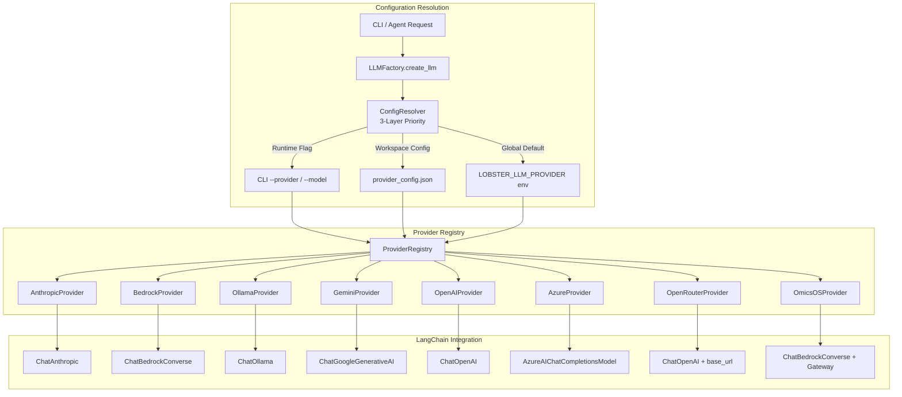
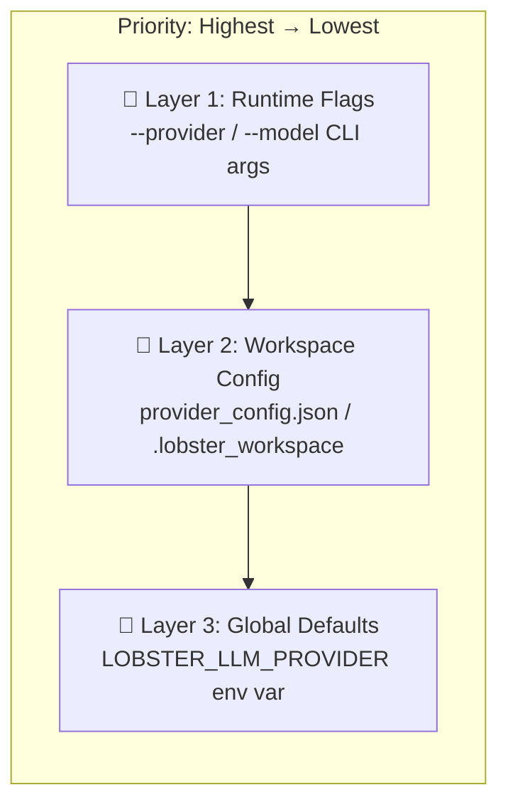
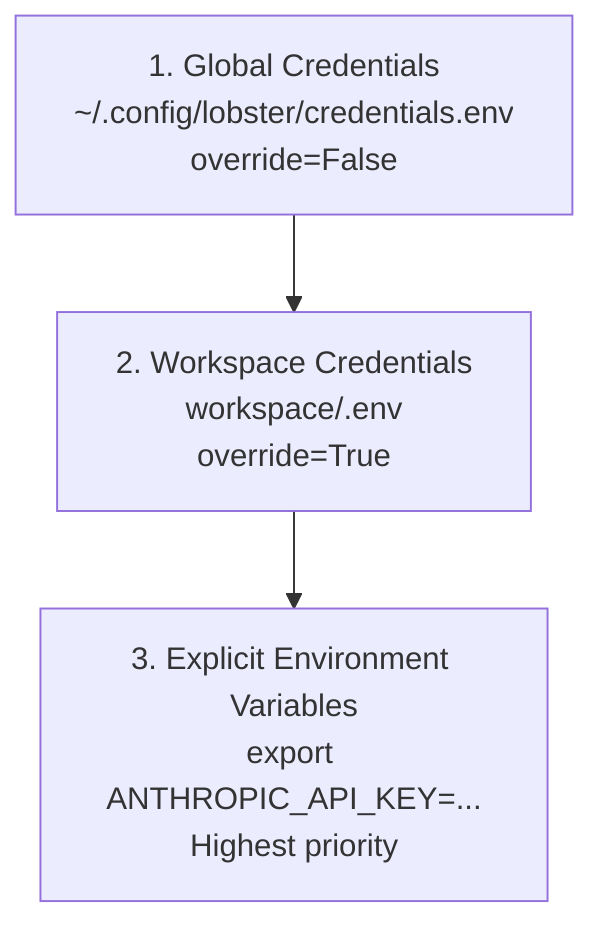
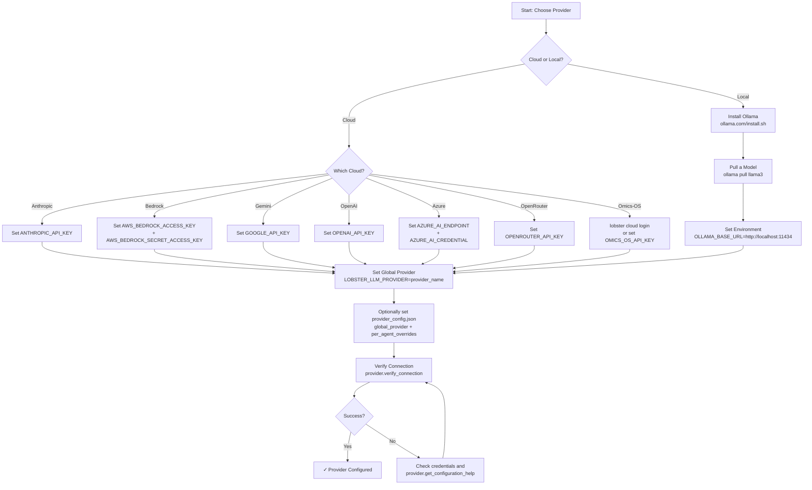

Lobster's LLM provider system is a **multi-provider abstraction layer** that decouples agent logic from any single LLM vendor. It implements a registry pattern with an abstract provider interface, a singleton discovery registry, a factory that resolves configuration through a 3-layer priority system, and eight concrete provider implementations spanning cloud APIs, local inference, and a managed gateway. This page covers the full configuration architecture: how providers are registered, how credentials are resolved, how the factory dispatches model instantiation, and how to configure each supported provider.

## Provider Architecture Overview

The provider system follows a layered architecture where each component has a single, well-defined responsibility. The **ILLMProvider** interface defines the contract all providers must fulfill. The **ProviderRegistry** singleton manages discovery and access. The **LLMFactory** orchestrates configuration resolution through a priority chain and delegates model creation to the resolved provider. This separation means adding a new provider requires only implementing the interface and registering it — no changes to the factory, the CLI, or any agent code.



The **ILLMProvider** abstract interface mandates seven core methods and provides four default implementations with sensible fallbacks. Every provider must implement `name`, `is_configured()`, `is_available()`, `list_models()`, `get_default_model()`, and `create_chat_model()`. The base class supplies default implementations for `validate_model()` (accepts any non-empty string), `get_model_info()` (returns a synthesized `ModelInfo` for unknown model IDs using the provider's `_default_context_window`), `verify_connection()` (makes a single-token inference call), and `get_configuration_help()`.

Sources: [base_provider.py](lobster/config/providers/base_provider.py#L1-L303), [llm_factory.py](lobster/config/llm_factory.py#L1-L235)

## The ModelInfo Data Contract

All providers return model metadata through the **ModelInfo** dataclass, which provides a uniform schema across heterogeneous LLM vendors. This dataclass is the single source of truth for model catalogs, pricing, and capability metadata — every provider's `list_models()` method returns `List[ModelInfo]`.

| Field | Type | Purpose |
|-------|------|---------|
| `name` | `str` | Model identifier (e.g., `"claude-sonnet-4-20250514"`) |
| `display_name` | `str` | Human-friendly name (e.g., `"Claude Sonnet 4"`) |
| `description` | `str` | Capability summary for UI display |
| `provider` | `str` | Provider key (e.g., `"anthropic"`, `"bedrock"`) |
| `context_window` | `Optional[int]` | Maximum context tokens |
| `is_default` | `bool` | Whether this is the provider's recommended model |
| `input_cost_per_million` | `Optional[float]` | USD cost per million input tokens |
| `output_cost_per_million` | `Optional[float]` | USD cost per million output tokens |

> [!TIP]
> The `get_model_info()` method never returns `None` — if a model ID isn't in the provider's static catalog, it synthesizes a `ModelInfo` with `_default_context_window`. This ensures that `resolve_context_window()` always receives a real value, even for newly released models not yet in the catalog.

Sources: [base_provider.py](lobster/config/providers/base_provider.py#L30-L52)

## Provider Registry and Discovery

The **ProviderRegistry** is a class-level singleton that manages all registered providers. It uses lazy initialization — providers are only imported and registered on first access via `_ensure_initialized()`. This avoids import-time failures when optional dependencies (like `langchain-aws` or `langchain-anthropic`) are not installed.

The registry maintains an internal `_providers` dictionary keyed by provider name. During initialization, it attempts to import each of the eight provider modules. If a module's dependencies are missing, the `ImportError` is caught silently and the provider is simply not registered. This means the system degrades gracefully — a user without `langchain-aws` installed will see Bedrock absent from the provider list rather than crashing.

Key registry access patterns:

| Method | Purpose | Cost |
|--------|---------|------|
| `get(name)` | Retrieve a specific provider | O(1) dict lookup |
| `get_configured_providers()` | Providers with `is_configured() == True` | Checks env vars |
| `get_available_providers()` | Providers with `is_available() == True` | May perform network I/O |
| `get_provider_names()` | All registered names (for tab completion) | O(1) |

Sources: [registry.py](lobster/config/providers/registry.py#L1-L200)

## The 3-Layer Configuration Priority

The **LLMFactory** delegates provider and model resolution to the **ConfigResolver**, which implements a 3-layer priority system. Higher-priority sources override lower ones, giving users precise control at every level from global defaults down to per-invocation overrides.



**Layer 1 — Runtime Flags**: The `--provider` and `--model` CLI arguments are passed as `provider_override` and `model_override` to `LLMFactory.create_llm()`. These always win, making them ideal for testing or one-off invocations against a different provider.

**Layer 2 — Workspace Config**: The `provider_config.json` file (located at the project root) stores `global_provider`, `per_agent_providers`, `per_agent_models`, and `profile` settings. This allows different projects to use different providers without changing environment variables. The file also supports `model_context_windows` for overriding context limits.

**Layer 3 — Global Defaults**: The `LOBSTER_LLM_PROVIDER` environment variable provides the system-wide default. If no higher-priority source specifies a provider, this value is used. Credential environment variables (`ANTHROPIC_API_KEY`, `AWS_BEDROCK_ACCESS_KEY`, etc.) are resolved through the same layered approach.

> [!TIP]
> When `model_override` is not set, the factory checks `model_config.get("model_id")` (from the profile system), then falls back to `resolver.resolve_model()` (which checks per-agent and workspace config), and finally uses `provider.get_default_model()`. This cascade ensures every agent always gets a working model — you never need to specify a model explicitly unless you want to override the default.

Sources: [llm_factory.py](lobster/config/llm_factory.py#L64-L155), [provider_config.json](provider_config.json#L1-L15)

## Credential Loading Order

Credentials follow a separate but parallel priority chain, managed by the **Settings** class. The loading order ensures that workspace-specific credentials always override global ones, and explicit environment variables always take highest priority.



The `override` parameter on `load_dotenv()` is critical: global credentials are loaded with `override=False` (they don't overwrite existing env vars), while workspace credentials use `override=True` (they replace global values). Explicit shell exports always win because `os.environ.get()` returns the current process environment.

Sources: [settings.py](lobster/config/settings.py#L55-L102), [settings.py](lobster/config/settings.py#L200-L260)

## Supported Providers Reference

Lobster ships with eight provider implementations. Each auto-registers with the `ProviderRegistry` at import time. The table below summarizes their key characteristics.

| Provider | Key | Required Environment Variables | Default Model | Context Window | Cost (Input/M tokens) |
|----------|-----|-------------------------------|---------------|----------------|----------------------|
| **Anthropic Direct API** | `anthropic` | `ANTHROPIC_API_KEY` | `claude-sonnet-4-20250514` | 200K | $3.00 |
| **AWS Bedrock** | `bedrock` | `AWS_BEDROCK_ACCESS_KEY` + `AWS_BEDROCK_SECRET_ACCESS_KEY` | `us.anthropic.claude-sonnet-4-5-20250929-v1:0` | 200K | $3.00 |
| **Ollama (Local)** | `ollama` | None (defaults to `localhost:11434`) | Auto-selected from installed models | Varies | Free |
| **Google Gemini** | `gemini` | `GOOGLE_API_KEY` or `GEMINI_API_KEY` | `gemini-3-pro-preview` | 200K | $2.00 |
| **OpenAI** | `openai` | `OPENAI_API_KEY` | `gpt-4o` | 128K | $2.50 |
| **Azure AI** | `azure` | `AZURE_AI_ENDPOINT` + `AZURE_AI_CREDENTIAL` | `gpt-4o` | 128K | $5.00 |
| **OpenRouter** | `openrouter` | `OPENROUTER_API_KEY` | `anthropic/claude-sonnet-4-5` | 200K | Varies by model |
| **Omics-OS Cloud** | `omics-os` | `OMICS_OS_API_KEY` or `lobster cloud login` | `us.anthropic.claude-sonnet-4-5-20250929-v1:0` | 200K | $3.00 |

Sources: [constants.py](lobster/config/constants.py#L1-L48), [anthropic_provider.py](lobster/config/providers/anthropic_provider.py#L1-L80), [bedrock_provider.py](lobster/config/providers/bedrock_provider.py#L50-L100), [ollama_provider.py](lobster/config/providers/ollama_provider.py#L1-L90), [gemini_provider.py](lobster/config/providers/gemini_provider.py#L50-L85), [openai_provider.py](lobster/config/providers/openai_provider.py#L50-L85), [azure_provider.py](lobster/config/providers/azure_provider.py#L50-L100), [openrouter_provider.py](lobster/config/providers/openrouter_provider.py#L1-L80), [omics_os_provider.py](lobster/config/providers/omics_os_provider.py#L1-L80)

### Anthropic Direct API

The Anthropic provider offers direct API access to the Claude model family. It supports both API key authentication and OAuth-based authentication (via `oauth_store`). The static model catalog includes Claude Sonnet 4 (default), Claude Opus 4, Claude 3.5 Sonnet, and Claude 3.5 Haiku. The `create_chat_model()` method instantiates `ChatAnthropic` from `langchain-anthropic`, with special handling for extended thinking via `additional_model_request_fields`.

Sources: [anthropic_provider.py](lobster/config/providers/anthropic_provider.py#L1-L200)

### AWS Bedrock

The Bedrock provider routes Claude models through Amazon's Bedrock service with IAM credentials and cross-region support. All model IDs use the cross-region prefix format (`us.anthropic.*` or `global.anthropic.*`) for maximum availability. The catalog includes models up to Claude Sonnet 4.6 and Opus 4.6 with 1M native context windows. A notable implementation detail: the provider patches `ChatBedrockConverse` with generous boto3 timeouts (`read_timeout=600s`, `connect_timeout=10s`) because agent turns that invoke multiple external tools can far exceed boto3's default 60-second read timeout. The `thinking` parameter is automatically wrapped into `additional_model_request_fields` for Bedrock's extended thinking configuration.

Sources: [bedrock_provider.py](lobster/config/providers/bedrock_provider.py#L1-L322)

### Ollama (Local)

The Ollama provider is architecturally distinct from the cloud providers. Where cloud providers use a static model catalog, Ollama dynamically discovers installed models via an HTTP GET to `/api/tags` on the Ollama server. The `is_available()` method performs a real health check (2-second timeout), unlike cloud providers where `is_available()` simply returns `is_configured()`. Model auto-selection uses a size-based heuristic: it prefers larger instruct models (70B > 8x7B > 13B > 8B), and falls back to `gpt-oss:20b` if no models are found. The context window is estimated from model names using regex pattern matching rather than static metadata.

Sources: [ollama_provider.py](lobster/config/providers/ollama_provider.py#L1-L200)

### Google Gemini

The Gemini provider accesses Google's Gemini 3.0 models via the Developer API. An important constraint: **Gemini 3.0+ requires `temperature=1.0`** — lower values can cause infinite loops per Google's documentation. The provider enforces this by overriding any non-1.0 temperature when creating the model. The API key can be set via either `GOOGLE_API_KEY` (primary) or `GEMINI_API_KEY` (fallback for LangChain compatibility). The default context window is 1M tokens, though individual models may specify smaller windows.

Sources: [gemini_provider.py](lobster/config/providers/gemini_provider.py#L1-L200)

### OpenAI

The OpenAI provider supports GPT-4o and the o-series reasoning models. A key implementation detail: **o1 and o3 reasoning models do not accept `temperature` or `max_tokens` parameters**. The provider's `create_chat_model()` method detects reasoning model names (prefixed with `o`) and omits these parameters, passing only `max_completion_tokens` instead. This prevents runtime errors from OpenAI's API rejecting unsupported parameters.

Sources: [openai_provider.py](lobster/config/providers/openai_provider.py#L1-L200)

### Azure AI

The Azure provider targets enterprise deployments through Azure AI Foundry. Unlike pure Azure OpenAI, it supports multiple model providers (GPT-4o, DeepSeek R1, Cohere, Phi, Mistral) through a single endpoint. Environment variables support both new (`AZURE_AI_ENDPOINT`, `AZURE_AI_CREDENTIAL`) and legacy (`AZURE_OPENAI_ENDPOINT`, `AZURE_OPENAI_API_KEY`) naming conventions for backward compatibility. The default model is `gpt-4o`.

Sources: [azure_provider.py](lobster/config/providers/azure_provider.py#L1-L200)

### OpenRouter (600+ Models)

OpenRouter is a unified API gateway providing access to 600+ LLM models across all major vendors. It uses the OpenAI-compatible protocol (no special LangChain package needed — just `ChatOpenAI` with a `base_url` override). The provider fetches a live model catalog from `openrouter.ai/api/v1/models` on the first `list_models()` call, with a class-level in-process cache that persists for the lifetime of the process. When the network is unavailable, it falls back to a curated static catalog of representative models. Model naming follows the `"provider/model-name"` convention (e.g., `"anthropic/claude-sonnet-4-5"`, `"meta-llama/llama-3.3-70b-instruct"`). Lobster sends branded headers (`HTTP-Referer: lobsterbio.com`, `X-Title: Lobster AI`) for OpenRouter leaderboard attribution.

Sources: [openrouter_provider.py](lobster/config/providers/openrouter_provider.py#L1-L200)

### Omics-OS Cloud (Managed Gateway)

The Omics-OS provider routes all LLM calls through a managed gateway at `app.omics-os.com`, providing usage tracking, billing, and model access control. Despite routing through a gateway, it returns a real `ChatBedrockConverse` instance — the gateway acts as a transport client (`GatewayBedrockClient`), preserving full tool calling and structured output support. Authentication supports both API keys (`OMICS_OS_API_KEY`) and OAuth via `lobster cloud login`. The provider defines custom exception classes (`BudgetExhaustedError`, `RateLimitError`) for gateway-specific failure modes. A `_MODEL_ALIASES` map resolves friendly names to canonical Bedrock model IDs.

Sources: [omics_os_provider.py](lobster/config/providers/omics_os_provider.py#L1-L172), [credentials.py](lobster/config/credentials.py#L1-L200)

## Configuration Profiles

Profiles control agent-level LLM parameters (temperature, thinking mode, max tokens) independently of provider selection. They are defined in `constants.py` and resolved through the same layered priority system.

| Profile | Use Case | Key Characteristics |
|---------|----------|-------------------|
| `development` | Local testing and debugging | Lower cost, faster responses |
| `production` | Production deployments | Balanced quality and reliability |
| `performance` | High-quality outputs | Optimized for best results |
| `max` | Maximum capability | Unrestricted thinking, highest token limits |
| `hybrid` | Mixed workload | Selective quality per agent type |

Deprecated aliases (`"ultra"` → `"performance"`, `"godmode"` → `"max"`) are mapped automatically via `DEPRECATED_PROFILE_ALIASES`.

The default profile in `provider_config.json` is `"performance"`, which can be overridden at the workspace or runtime level.

Sources: [constants.py](lobster/config/constants.py#L29-L48), [provider_config.json](provider_config.json#L1-L15)

## Provider Setup and Validation

The **provider_setup** module provides pure-logic utilities for detecting, validating, and configuring providers. These functions are used by the CLI setup flow and are intentionally separated from presentation logic for testability.

For each provider, there is a `create_*_config()` function that returns a `ProviderConfig` dataclass containing the provider type, required environment variables, success status, and an optional error message. For Ollama specifically, the module provides `check_ollama_installation()`, `check_ollama_server()`, and `get_ollama_models()` — subprocess-based checks that verify the Ollama binary is installed, the server is running, and models are available.

The `verify_connection()` method on every provider makes a real single-token inference call (`llm.invoke("Hi")`) to validate credentials and model accessibility. This costs approximately $0.000003 for most models and should only be used during setup flows, not in hot paths.

Sources: [provider_setup.py](lobster/config/provider_setup.py#L1-L399)

## Configuring a Provider Step by Step

The following flowchart illustrates the end-to-end process of selecting and configuring an LLM provider, from credential setup through first inference.



Sources: [provider_setup.py](lobster/config/provider_setup.py#L1-L399), [base_provider.py](lobster/config/providers/base_provider.py#L268-L303)

## The provider_config.json Schema

The root-level `provider_config.json` file provides workspace-level configuration. It is the primary mechanism for setting the default provider, per-agent overrides, and the active profile without modifying environment variables.

```json
{
  "global_provider": "bedrock",
  "anthropic_model": null,
  "bedrock_model": null,
  "ollama_model": null,
  "gemini_model": null,
  "azure_model": null,
  "openai_model": null,
  "openrouter_model": null,
  "ollama_host": "http://localhost:11434",
  "model_context_windows": {},
  "per_agent_providers": {},
  "per_agent_models": {},
  "profile": "performance"
}
```

| Field | Type | Purpose |
|-------|------|---------|
| `global_provider` | `str` | Default provider for all agents |
| `*_model` | `str \| null` | Provider-specific default model override |
| `ollama_host` | `str` | Ollama server URL |
| `model_context_windows` | `dict` | Override context windows by model name |
| `per_agent_providers` | `dict` | Map agent name → provider name |
| `per_agent_models` | `dict` | Map agent name → model identifier |
| `profile` | `str` | Agent parameter profile |

The `per_agent_providers` and `per_agent_models` fields enable fine-grained routing — for example, using a local Ollama model for lightweight agents while routing the supervisor to a cloud provider for maximum reasoning capability.

Sources: [provider_config.json](provider_config.json#L1-L15)

## Dependency Management

Each provider declares its LangChain dependency in `check_dependencies()`, which is called during startup validation before the UI renders. If the required package is missing, it raises an `ImportError` with an install command sourced from the `component_registry`.

| Provider | Required Package | Install Extra |
|----------|-----------------|---------------|
| Anthropic | `langchain-anthropic` | `[anthropic]` |
| Bedrock | `langchain-aws` | `[bedrock]` |
| Ollama | `langchain-ollama` | `[ollama]` |
| Gemini | `langchain-google-genai` | `[gemini]` |
| OpenAI | `langchain-openai` | `[openai]` |
| Azure | `langchain-azure-ai` | `[azure]` |
| OpenRouter | `langchain-openai` (reuses OpenAI) | `[openai]` |
| Omics-OS | `langchain-aws` (reuses Bedrock) | `[bedrock]` |

Sources: [anthropic_provider.py](lobster/config/providers/anthropic_provider.py#L88-L94), [bedrock_provider.py](lobster/config/providers/bedrock_provider.py#L107-L113), [ollama_provider.py](lobster/config/providers/ollama_provider.py#L80-L86), [gemini_provider.py](lobster/config/providers/gemini_provider.py#L88-L94), [openai_provider.py](lobster/config/providers/openai_provider.py#L86-L92), [azure_provider.py](lobster/config/providers/azure_provider.py#L103-L109)

## Extending with a Custom Provider

To add a new provider, implement the `ILLMProvider` interface, auto-register it with `ProviderRegistry`, and add the provider name to `VALID_PROVIDERS` in `constants.py`. The registry's `_ensure_initialized()` method must also be updated to include the new provider module in its `_provider_specs` list. The interface contract guarantees that every existing consumer (LLMFactory, CLI setup, agent system) will work with the new provider without modification.

The minimum viable provider must implement: `name` (property), `is_configured()`, `is_available()`, `list_models()`, `get_default_model()`, and `create_chat_model()`. All other methods (`validate_model()`, `get_model_info()`, `verify_connection()`, `get_configuration_help()`) have working defaults in the base class.

Sources: [base_provider.py](lobster/config/providers/base_provider.py#L56-L303), [registry.py](lobster/config/providers/registry.py#L160-L200), [constants.py](lobster/config/constants.py#L1-L48)

## Next Steps

- **Per-agent provider routing** is managed through workspace configuration — see [Workspace and Session Management](18-workspace-and-session-management) for details on how `per_agent_providers` and `per_agent_models` interact with workspace sessions.
- **The Omics-OS gateway** integrates with the data provider ecosystem — see [Provider Registry and Data Access](19-provider-registry-and-data-access) and [Rate Limiting and Download Queue](20-rate-limiting-and-download-queue) for how LLM and data providers share rate limiting infrastructure.
- **Agent-level parameter tuning** (temperature, thinking mode, max tokens) is driven by profiles and resolved via `agent_defaults` — see [Agent Registry and Discovery](7-agent-registry-and-discovery) for how agents declare their LLM parameter requirements.