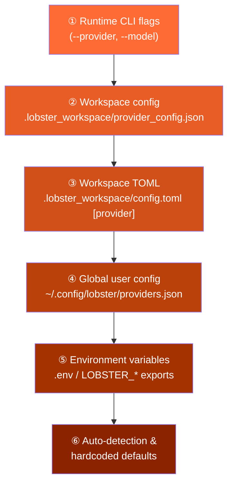

Lobster's workspace and session management system provides a layered, priority-driven configuration architecture that isolates project-specific settings from global user preferences while ensuring every interaction — from ad-hoc queries to multi-step pipelines — carries a persistent, reproducible context. Understanding this layering is essential for developers who need to customize agent behavior, manage credentials across environments, or build tooling that integrates with Lobster's session lifecycle.

## Workspace Resolution and Directory Layout

The workspace is the fundamental isolation boundary in Lobster. Every project gets its own `.lobster_workspace/` directory, resolved through a strict priority chain: **explicit path parameter → `LOBSTER_WORKSPACE` environment variable → current working directory fallback**. The `resolve_workspace()` function in `lobster.core.runtime.workspace` implements this chain, converting relative paths to absolute ones while preserving symlinks (a deliberate choice to avoid macOS `/var → /private/var` resolution issues). When `create=True` — the default — the directory is materialized on first access, guaranteeing downstream code never encounters a missing workspace root.

Sources: [workspace.py](/lobster/core/runtime/workspace.py#L1-L102)

Within a resolved workspace, Lobster maintains a structured directory tree that separates concerns:

| Path | Purpose |
|---|---|
| `.lobster_workspace/provider_config.json` | Workspace-scoped LLM provider and model preferences |
| `.lobster_workspace/config.toml` | Agent composition, per-agent settings, and provider overrides |
| `.lobster_workspace/.env` | Workspace-scoped credentials (overrides global) |
| `.lobster/sessions/<session_id>/` | Session-specific data, provenance, and artifacts |
| `.lobster/workspace/` | Data, exports, cache, metadata, notebooks, queues subdirectories |

> [!TIP]
> The `.lobster_workspace/` prefix (workspace root) and `.lobster/` prefix (runtime data) are distinct directories. Configuration lives under the former; session artifacts and runtime state live under the latter. Confusing them is the most common cause of "config not found" errors.

Sources: [workspace_config.py](/lobster/config/workspace_config.py#L1-L254), [workspace_agent_config.py](/lobster/config/workspace_agent_config.py#L1-L397)

## Configuration Priority Hierarchy

Lobster implements a six-tier configuration cascade where higher-priority sources override lower ones. This design ensures that local development overrides never leak into production, while global defaults reduce boilerplate across projects.



The **credential loading** follows a parallel but distinct cascade: global credentials (`~/.config/lobster/credentials.env`) load first with `override=False` to preserve any existing environment variables, then workspace credentials (`workspace/.env`) load with `override=True` so project-specific keys take precedence. This means a workspace `.env` containing `ANTHROPIC_API_KEY=sk-workspace-xxx` will always win over a global `credentials.env` with a different key, but explicit shell exports (e.g., `export ANTHROPIC_API_KEY=sk-explicit-xxx`) still take highest priority because `python-dotenv` never overwrites already-set environment variables when `override=True` is used with pre-existing shell exports.

Sources: [settings.py](/lobster/config/settings.py#L203-L280), [global_config.py](/lobster/config/global_config.py#L1-L200)

## WorkspaceProviderConfig: Per-Project LLM Settings

`WorkspaceProviderConfig` is a Pydantic model persisted as `.lobster_workspace/provider_config.json` that controls which LLM provider and model each workspace uses. It inherits from `ProviderConfigBase`, which provides shared validation — rejecting invalid provider names and auto-resolving deprecated profile aliases before Pydantic model construction. The model supports both **global provider selection** (`global_provider`) and **per-agent overrides** via `per_agent_providers` and `per_agent_models` dictionaries, enabling configurations like "use Anthropic for the supervisor but Ollama for data processing agents."

| Field | Type | Description |
|---|---|---|
| `global_provider` | `Optional[str]` | Default provider for all agents |
| `anthropic_model` | `Optional[str]` | Model override when provider is `anthropic` |
| `bedrock_model` | `Optional[str]` | Model override when provider is `bedrock` |
| `ollama_model` | `Optional[str]` | Model override when provider is `ollama` |
| `gemini_model` | `Optional[str]` | Model override when provider is `gemini` |
| `per_agent_providers` | `Dict[str, str]` | Agent-specific provider overrides |
| `per_agent_models` | `Dict[str, str]` | Agent-specific model overrides |
| `profile` | `str` | Agent configuration profile (default: `production`) |
| `model_context_windows` | `Dict[str, int]` | Context window overrides for custom models |

The `load()` classmethod implements graceful degradation: missing files yield defaults, corrupted JSON logs a warning and returns defaults, and Pydantic validation errors fall back to defaults rather than crashing the application. The `save()` method uses atomic writes with human-readable indentation. Both `reset()` and `exists()` round out the lifecycle API.

Sources: [workspace_config.py](/lobster/config/workspace_config.py#L1-L254), [base_config.py](/lobster/config/base_config.py#L1-L100)

## WorkspaceAgentConfig: TOML-Driven Agent Composition

While `WorkspaceProviderConfig` handles LLM routing, `WorkspaceAgentConfig` governs **which agents are active and how they behave**. Stored as `.lobster_workspace/config.toml`, it uses human-readable TOML instead of JSON — a deliberate choice because agent composition is something users edit manually. The configuration supports three composition modes:

- **Preset mode**: Set `preset = "production"` to use a curated agent set defined by the profile system.
- **Explicit list mode**: Set `enabled = ["research_agent", "data_expert"]` to opt in to specific agents.
- **Hybrid mode**: A preset with per-agent settings overrides in the `[agent_settings]` section.

```toml
config_version = "1.0"
enabled = ["research_agent", "data_expert", "transcriptomics_expert"]
preset = "production"

[agent_settings.transcriptomics_expert]
model = "claude-sonnet-4-20250514"
thinking_preset = "high"
temperature = 0.7

[provider]
default = "anthropic"
ollama_host = "http://localhost:11434"
models = { anthropic = "claude-sonnet-4-20250514", ollama = "llama3:70b-instruct" }
```

The `validate_enabled_agents()` method cross-references the enabled list against `ComponentRegistry` — the single source of truth for installed agents — and returns a tuple of `(valid_agents, missing_agents)` with installation hints for missing ones. The `[provider]` section (designated CONF-04 in the codebase) allows workspace-level provider configuration as an alternative to environment variables, parsed into a `ProviderSettings` model with `default`, `ollama_host`, and `models` fields.

Sources: [workspace_agent_config.py](/lobster/config/workspace_agent_config.py#L1-L397)

## Agent Parameter Resolution

Per-agent LLM parameters — temperature, thinking budget, and model-specific fields — follow their own three-layer resolution chain within `get_agent_params()`:

1. **Workspace config.toml** `[agent_settings]` section provides base values.
2. **Environment variable overrides** (`LOBSTER_{AGENT}_TEMPERATURE`, `LOBSTER_{AGENT}_THINKING`) take precedence over TOML.
3. **Hardcoded defaults** (`temperature=1.0`, `thinking=disabled`) serve as the safety net.

The thinking system uses named presets rather than raw token counts, making configuration declarative:

| Preset | Budget Tokens | Use Case |
|---|---|---|
| `disabled` | 0 | Fast responses, no reasoning chain |
| `light` | 1,000 | Brief reasoning, minimal overhead |
| `standard` | 2,000 | Default reasoning depth |
| `extended` | 5,000 | Complex multi-step analysis |
| `deep` | 10,000 | Maximum reasoning for difficult problems |

A global override (`LOBSTER_GLOBAL_THINKING`) applies to all agents unless a per-agent override (`LOBSTER_{AGENT}_THINKING`) supersedes it. The function **never raises for unknown agents** — they receive sensible defaults, ensuring that adding new agents to the registry never breaks existing configuration.

Sources: [agent_defaults.py](/lobster/config/agent_defaults.py#L1-L150)

## Session Lifecycle and Persistence

Sessions represent discrete conversational interactions with the agent system. Each session is identified by a `session_id` and persists its data under `<workspace>/.lobster/sessions/<session_id>/`. The `CommandClient` class — a lightweight alternative to `AgentClient` that skips expensive graph/LLM initialization — accepts an optional `session_id` and resolves its directory accordingly, loading provenance from that session for cross-session pipeline export.

Session continuation is handled by `resolve_session_continuation()`, which implements the following resolution logic:

1. If `session_id` is `"latest"`, find the most recent session directory by modification time.
2. Check for a transcript file (`session_<id>.json` or `<id>.json`) in the workspace root.
3. Check for a session directory under `.lobster/sessions/<id>/`.
4. Return `(session_file_to_load, resolved_session_id, found_existing_session)` — where `session_file_to_load` may be `None` for sessions that haven't yet exported a JSON transcript.

> [!TIP]
> When resuming a session with `--session-id latest`, Lobster prefers session directories over transcript JSON files because directories exist even before a chat session exports its transcript. This prevents "session not found" errors for sessions that are in-progress but haven't completed an export cycle.

Sources: [session_infra.py](/lobster/cli_internal/commands/heavy/session_infra.py#L53-L130), [cli.py](/lobster/cli.py#L202-L260)

## Global Configuration and Credential Security

`GlobalProviderConfig` provides cross-project defaults stored in a platform-aware location: `~/.config/lobster/providers.json` on Linux/macOS (respecting `XDG_CONFIG_HOME`) and `%APPDATA%\lobster\providers.json` on Windows. Its schema mirrors `WorkspaceProviderConfig` but uses `default_provider` and `_default_model` suffixes instead of `global_provider` and `_model`, reflecting its role as a fallback rather than an authoritative source.

Credentials receive special treatment. The `save_global_credentials()` function writes to `~/.config/lobster/credentials.env` with `0o600` permissions (owner read/write only), and `check_credentials_permissions()` validates that these permissions haven't been relaxed — returning a tuple of `(is_secure, message)` with actionable remediation advice. The `append` mode supports incremental credential addition without overwriting existing keys, filtering out only the keys being updated from the existing file.

Sources: [global_config.py](/lobster/config/global_config.py#L1-L401)

## Configuration Management CLI

The `lobster config` command group provides interactive access to the workspace configuration system. Running `lobster config` without arguments displays the current configuration summary, including active profile, configured providers, and agent composition. The `lobster config list-models` subcommand queries `ProviderRegistry` for all available model presets across providers, while `lobster config list-profiles` shows the four built-in profiles:

| Profile | Description | Typical Use |
|---|---|---|
| `development` | Sonnet 4 — fastest, most affordable | Local development, testing |
| `production` | Sonnet 4 + Sonnet 4.5 supervisor | Default, balanced cost/quality |
| `performance` | Sonnet 4.5 — highest quality | Critical analyses |
| `max` | Opus 4.5 supervisor — most capable | Maximum capability, highest cost |

Per-agent overrides can be managed through three channels: the interactive `lobster config models` command, manual edits to `.lobster_workspace/config.toml` under `[agent_settings]`, or environment variables following the `LOBSTER_{AGENT}_*` naming convention. The system's graceful degradation ensures that any misconfiguration falls back to defaults rather than blocking execution.

Sources: [config_manager.py](/lobster/config/config_manager.py#L1-L200)

## Putting It All Together

The workspace and session management system follows a clear architectural principle: **configuration cascades downward, specificity wins, and failure degrades gracefully**. Every layer — from global user defaults down to per-session provenance — has a well-defined storage location, a deterministic resolution order, and a fallback path that never crashes the application. For developers extending Lobster, the key integration points are:

- Use `resolve_workspace()` to obtain the workspace root in any entry point.
- Read provider/model configuration through `WorkspaceProviderConfig.load()` or `GlobalProviderConfig.load()`, never by parsing files directly.
- Resolve agent parameters via `get_agent_params()`, which already handles the TOML → env var → defaults chain.
- Store session artifacts under `.lobster/sessions/<id>/` and use `resolve_session_continuation()` when resuming.
- Always write credentials through `save_global_credentials()` to ensure secure file permissions.

To understand how workspace configuration feeds into the LLM provider initialization pipeline, see [LLM Provider Configuration](17-llm-provider-configuration). For details on how sessions integrate with the provenance tracking system that records every data transformation, see [Provenance Tracking and IR](12-provenance-tracking-and-ir).
