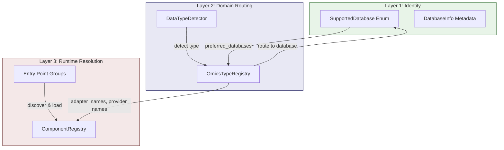
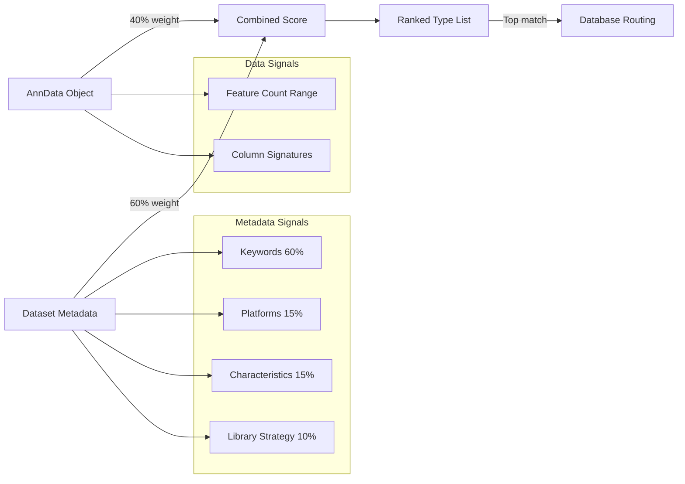
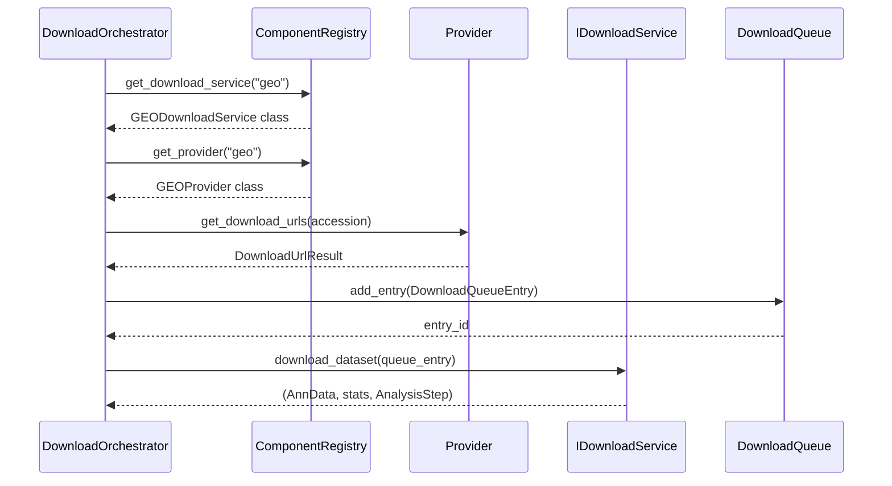
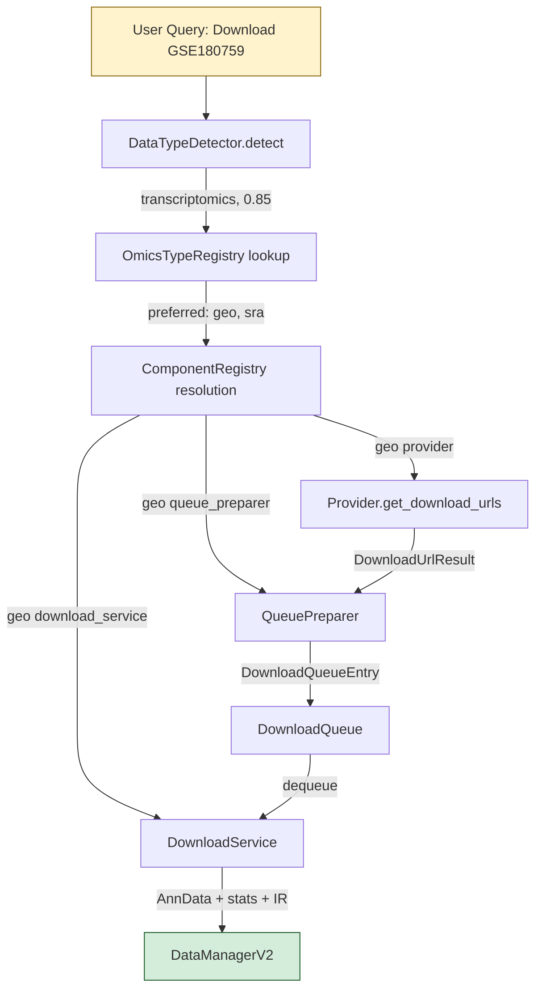

Lobster's provider registry is the architectural backbone that maps every external bioinformatics database to the concrete services, adapters, and download strategies needed to access its data. Rather than scattering database-specific logic across agents and tools, Lobster centralizes discovery, validation, and routing through three interlocking registries: the **SupportedDatabase** enum (canonical identity), the **OmicsTypeRegistry** (domain-level routing), and the **ComponentRegistry** (runtime service resolution). Together, they form a closed loop — from "what database is this?" to "what code handles it?" — that keeps every data-access path deterministic, extensible, and auditable.

## The Three-Layer Registry Architecture

Lobster's external data access follows a layered resolution pattern. At the top, **SupportedDatabase** provides the authoritative list of known databases and their metadata. In the middle, **OmicsTypeRegistry** maps omics domains (transcriptomics, proteomics, etc.) to their preferred databases, detection heuristics, and adapter names. At the bottom, **ComponentRegistry** resolves those logical names into live Python objects — provider classes, download services, queue preparers — discovered through Python entry points. Each layer depends only on the one above it, never the reverse, which means you can add a new database by extending a single layer without touching the others.



Sources: [database_registry.py](/lobster/core/schemas/database_registry.py#L1-L238), [omics_registry.py](/lobster/core/omics_registry.py#L1-L120), [component_registry.py](/lobster/core/component_registry.py#L1-L72)

## SupportedDatabase: Canonical Database Identity

The `SupportedDatabase` enum is the **single source of truth** for every database name in Lobster. All code that validates, enumerates, or displays database identifiers imports from this module rather than hardcoding strings. Each enum value maps to a `DatabaseInfo` record carrying the human-readable display name, domain category, base URL, and description.

| Enum Value | Display Name | Category | Base URL |
|---|---|---|---|
| `GEO` | NCBI GEO | Transcriptomics | `https://www.ncbi.nlm.nih.gov/geo/` |
| `SRA` | NCBI SRA | Transcriptomics | `https://www.ncbi.nlm.nih.gov/sra/` |
| `ARRAYEXPRESS` | ArrayExpress | Transcriptomics | `https://www.ebi.ac.uk/arrayexpress/` |
| `ENA` | ENA | Transcriptomics | `https://www.ebi.ac.uk/ena/` |
| `PRIDE` | PRIDE | Proteomics | `https://www.ebi.ac.uk/pride/` |
| `MASSIVE` | MassIVE | Proteomics | `https://massive.ucsd.edu/` |
| `PROTEOMEXCHANGE` | ProteomeXchange | Proteomics | `http://www.proteomexchange.org/` |
| `METABOLIGHTS` | MetaboLights | Metabolomics | `https://www.ebi.ac.uk/metabolights/` |
| `MGNIFY` | MGnify | Metagenomics | `https://www.ebi.ac.uk/metagenomics/` |
| `QIITA` | Qiita | Metagenomics | `https://qiita.ucsd.edu/` |
| `BIOPROJECT` | BioProject | General | `https://www.ncbi.nlm.nih.gov/bioproject/` |
| `BIOSAMPLE` | BioSample | General | `https://www.ncbi.nlm.nih.gov/biosample/` |
| `DBGAP` | dbGaP | General | `https://www.ncbi.nlm.nih.gov/gap/` |
| `EGA` | EGA | General | `https://ega-archive.org/` |
| `EBI` | EBI | General | `https://www.ebi.ac.uk/` |

The enum provides three class-method utilities for runtime validation: `values()` returns the full set of lowercase strings, `is_valid()` checks membership, and `from_string()` performs case-insensitive lookup. The `get_by_category()` method filters databases by `DatabaseCategory` (transcriptomics, proteomics, metabolomics, metagenomics, general), enabling agents to enumerate candidate databases for a given omics domain without knowing the full list.

```python
from lobster.core.schemas.database_registry import SupportedDatabase, get_display_name

# Validation
SupportedDatabase.is_valid("geo")        # True
SupportedDatabase.is_valid("unknown_db") # False

# Case-insensitive lookup
db = SupportedDatabase.from_string("PRIDE")  # SupportedDatabase.PRIDE

# Display name resolution
get_display_name("geo")  # "NCBI GEO"
```

Sources: [database_registry.py](/lobster/core/schemas/database_registry.py#L31-L238)

## OmicsTypeRegistry: Domain-to-Database Routing

While `SupportedDatabase` answers "what databases exist?", the **OmicsTypeRegistry** answers "for a given omics domain, which databases should I search and how do I detect the domain from metadata?" It registers `OmicsTypeConfig` dataclasses that bind together a domain's identity, schema routing, adapter names, preferred databases, detection heuristics, and QC thresholds into a single object.

Five built-in types are registered at module initialization — transcriptomics, proteomics, genomics, metabolomics, and metagenomics — each with carefully weighted detection patterns. External packages can register additional types via the `lobster.omics_types` entry point group, discovered automatically at import time.

| Omics Type | Preferred Databases | Detection Weight | Feature Count Range | Key Adapters |
|---|---|---|---|---|
| Transcriptomics | geo, sra | 8 | 5,000–60,000 | transcriptomics_single_cell, transcriptomics_bulk |
| Proteomics | pride, massive, geo | 12 | 100–12,000 | proteomics_ms, proteomics_affinity |
| Genomics | geo, sra, dbgap | 9 | 10,000–10,000,000 | genomics_vcf, genomics_plink |
| Metabolomics | metabolights, metabolomics_workbench, geo | 11 | 50–5,000 | metabolomics_lc_ms, metabolomics_gc_ms, metabolomics_nmr |
| Metagenomics | sra, geo, mg-rast | 10 | 100–50,000 | metagenomics_amplicon, metagenomics_shotgun |

> [!TIP]
> The detection **weight** acts as a tiebreaker when multiple omics types score similarly against dataset metadata. Proteomics gets the highest weight (12) because its keywords (e.g., "tmt", "orbitrap") are highly specific, while transcriptomics gets the lowest (8) because GEO's default content is transcriptomic — a high weight would cause false positives on ambiguous datasets.

The `register_omics_type()` function enforces **first-registration-wins** semantics: duplicate names log a warning and are skipped. This ensures that built-in types cannot be silently overridden by plugins, while still allowing plugins to add entirely new domains.

Sources: [omics_registry.py](/lobster/core/omics_registry.py#L102-L444)

## DataTypeDetector: Automatic Domain Classification

The `DataTypeDetector` is the operational side of `OmicsTypeRegistry` — it takes raw metadata or loaded AnnData objects and returns a ranked list of `(omics_type_name, confidence)` tuples. It replaces four previously scattered detection functions with a single unified scorer.

**Metadata-based detection** (`detect_from_metadata`) combines four weighted signals: keyword matching (60%), platform patterns (15%), characteristic patterns (15%), and library strategy (10%). The detector concatenates standard text fields (title, summary, overall_design, type, description), platform strings, and sample characteristics into a single corpus, then scores each registered type's keywords against it.

**Data-based detection** (`detect_from_data`) uses feature count range matching and column signature matching against AnnData's `obs` and `var` columns. Features within range score based on how centered they are in the expected interval; out-of-range features incur a 0.2 penalty.

**Combined detection** (`detect`) merges both signals when both metadata and data are available, weighting metadata at 60% and data at 40%. This two-signal approach handles cases where metadata is ambiguous but the data shape is distinctive (or vice versa).



Three backward-compatible helper methods — `is_single_cell()`, `is_proteomics()`, and `determine_data_type()` — wrap the detector for legacy call sites that expect boolean or string results rather than confidence-ranked lists.

Sources: [omics_registry.py](/lobster/core/omics_registry.py#L452-L718)

## ComponentRegistry: Entry Point–Driven Service Resolution

The `ComponentRegistry` is a singleton that discovers and loads all provider-related components from Python entry points. It manages six distinct component groups, four of which are directly relevant to data access:

| Entry Point Group | Storage Dict | Purpose |
|---|---|---|
| `lobster.providers` | `_providers` | Database-specific API client classes |
| `lobster.download_services` | `_download_services` | Database-specific download implementations |
| `lobster.queue_preparers` | `_queue_preparers` | Pre-download validation and queue entry creation |
| `lobster.adapters` | `_adapters` | Modality-specific data transformation factories |
| `lobster.services` | `_services` | General-purpose service classes |
| `lobster.agents` | `_agents` | Agent configuration objects |

The registry uses **lazy group loading** — each entry point group is loaded on first access via `_ensure_group_loaded()`, not at import time. This keeps startup fast and avoids triggering dependency chains for unused providers. The `load_components()` method is idempotent; calling it multiple times is safe.

Each accessor method (`get_provider()`, `get_download_service()`, `get_queue_preparer()`, `get_adapter()`) follows the same contract: accept a `required` flag that, when `True`, raises `ValueError` with a diagnostic message listing available components if the requested name is missing. The `has_*()` methods provide boolean checks, and `list_*()` methods return the full dictionary of registered components.

> [!TIP]
> Providers, download services, and queue preparers are registered as **classes** (instantiable with no args or factory callables), while adapters are registered as **factory callables** that return configured instances. This distinction exists because adapters often need constructor arguments (e.g., `data_type="lc_ms"`) that raw classes can't express. When defining entry points in `pyproject.toml`, use a factory function for adapters: `metabolomics_lc_ms = "package.module:create_lc_ms_adapter"`.

### Version Compatibility Guard

Before loading any external plugin entry point, the registry checks version compatibility using `check_plugin_compatibility()`. This parses the plugin's declared `lobster-ai` dependency constraint (supporting `>=`, `==`, `~=` operators) and compares it against the currently installed version. Incompatible plugins are skipped with a warning, preventing runtime crashes from API mismatches. Core `lobster-ai` entry points bypass this check entirely.

Sources: [component_registry.py](/lobster/core/component_registry.py#L275-L777)

## DownloadUrlResult: Standardized Download Schema

The `DownloadUrlResult` Pydantic model is the canonical return type for all `provider.get_download_urls()` methods. It ensures that regardless of whether data comes from GEO, SRA, PRIDE, or MetaboLights, the downstream download orchestrator receives a uniform structure it can process without database-specific branching.

The model categorizes downloadable files into six typed lists: `primary_files` (expression matrices, protein intensities), `raw_files` (FASTQ, .raw, .mzML), `processed_files` (counts, search results), `supplementary_files`, `metadata_files`, and `search_files` (PRIDE-specific). Each file is represented as a `DownloadFile` with URL, filename, size, checksum, and file type.

| Method | Purpose | Return Type |
|---|---|---|
| `get_all_urls()` | Flat list of all URLs | `List[str]` |
| `get_all_files()` | Flat list of all DownloadFile objects | `List[DownloadFile]` |
| `to_queue_entry_fields()` | Dict compatible with DownloadQueueEntry | `Dict[str, Any]` |
| `to_legacy_dict()` | Old-style dict for backward compatibility | `Dict[str, Any]` |
| `from_geo_response()` | Construct from GEO provider response | `DownloadUrlResult` |
| `from_sra_response()` | Construct from SRA provider response | `DownloadUrlResult` |
| `from_pride_response()` | Construct from PRIDE provider response | `DownloadUrlResult` |

The `to_queue_entry_fields()` method is the critical bridge between the provider layer and the download queue. It extracts the matrix URL (first primary or first processed file), the H5AD URL (scanning for `.h5ad`/`.h5` extensions), and flat URL lists for raw and supplementary files — producing a dictionary that can be unpacked directly into a `DownloadQueueEntry` constructor. This is where the schema translates from the provider's file-centric view to the queue's download-centric view.

Database-specific factory methods (`from_geo_response`, `from_sra_response`, `from_pride_response`) handle the messy reality that each provider API returns data in its own format. They normalize heterogeneous responses — string URLs, dict URLs, mixed types — into the canonical `DownloadFile` list structure, insulating all downstream code from provider idiosyncrasies.

Sources: [download_urls.py](/lobster/core/schemas/download_urls.py#L1-L494)

## IDownloadService: The Provider Contract

The `IDownloadService` abstract base class defines the contract that every database-specific download implementation must follow. It establishes a clean separation between download **orchestration** (which service to use) and download **execution** (how to fetch and parse data from a specific database).

Every implementation must provide `supported_databases()` (returning a list of database identifiers it handles, e.g., `["geo"]` or `["sra", "ena", "ddbj"]`) and `download_dataset()` (the main execution method). The download method accepts a `DownloadQueueEntry` and an optional `strategy_override` dict, returning a **3-tuple** of `(AnnData, stats_dict, AnalysisStep_ir)` that captures the loaded data, human-readable summary, and provenance intermediate representation in one call.

The interface design follows two principles: **statelessness beyond the data_manager reference** (no accumulated state between calls), and **validation-before-execution** (strategy parameters are validated separately so failures are caught early). The class method `supports_database()` enables the orchestrator to route requests without instantiating every service.



Sources: [download_service.py](/lobster/core/interfaces/download_service.py#L1-L200)

## End-to-End Data Access Flow

When a user requests data from an external database, the system progresses through all three registry layers in sequence. First, the `DataTypeDetector` examines any available metadata to classify the omics domain. Second, the `OmicsTypeRegistry` maps that domain to its `preferred_databases` list, providing an ordered search route. Third, the `ComponentRegistry` resolves those database names into concrete provider classes, download services, and queue preparers. The provider fetches URLs and metadata, the queue preparer validates and structures the download request, and the download service executes the actual data transfer and parsing.



This layered architecture means that adding support for a new database requires precisely three steps: (1) add an enum value to `SupportedDatabase` with its `DatabaseInfo` metadata, (2) optionally add it to an `OmicsTypeConfig`'s `preferred_databases` list, and (3) publish entry points for the provider, download service, and queue preparer in the plugin package's `pyproject.toml`. The `ComponentRegistry` discovers them automatically at runtime with no additional wiring.

Sources: [database_registry.py](/lobster/core/schemas/database_registry.py#L31-L105), [omics_registry.py](/lobster/core/omics_registry.py#L70-L100), [component_registry.py](/lobster/core/component_registry.py#L65-L72)

## Extending the Registry: Adding a New Provider

To register a new external data provider, a plugin package declares entry points in its `pyproject.toml` that the `ComponentRegistry` discovers at runtime. The pattern requires three complementary components that work together:

**Entry point declaration** (in the plugin's `pyproject.toml`):

```toml
[project.entry-points."lobster.providers"]
metabolights = "lobster_metabolomics.provider:MetaboLightsProvider"

[project.entry-points."lobster.download_services"]
metabolights = "lobster_metabolomics.download:MetaboLightsDownloadService"

[project.entry-points."lobster.queue_preparers"]
metabolights = "lobster_metabolomics.preparer:MetaboLightsQueuePreparer"
```

**Provider class** implements the API client that fetches metadata and resolves download URLs, returning a `DownloadUrlResult`. **Download service** implements `IDownloadService` to handle the actual data transfer and parsing into AnnData. **Queue preparer** validates metadata and constructs a `DownloadQueueEntry` with the correct strategy parameters. All three share the same entry point name (e.g., `"metabolights"`) so the orchestrator can look them up as a coherent set.

If the provider introduces an entirely new omics domain, it should also register an `OmicsTypeConfig` via the `lobster.omics_types` entry point group, ensuring the `DataTypeDetector` can route datasets to the new provider automatically.

Sources: [component_registry.py](/lobster/core/component_registry.py#L14-L29), [download_service.py](/lobster/core/interfaces/download_service.py#L52-L112), [omics_registry.py](/lobster/core/omics_registry.py#L720-L749)

---

**Next steps**: For details on how the download queue manages concurrency, retries, and rate limiting, see [Rate Limiting and Download Queue](20-rate-limiting-and-download-queue). For how modality adapters transform raw downloads into structured AnnData objects, see [DataManager and Modality Adapters](11-datamanager-and-modality-adapters). For the plugin entry point mechanism that powers component discovery, see [Plugin System and Entry Points](8-plugin-system-and-entry-points).