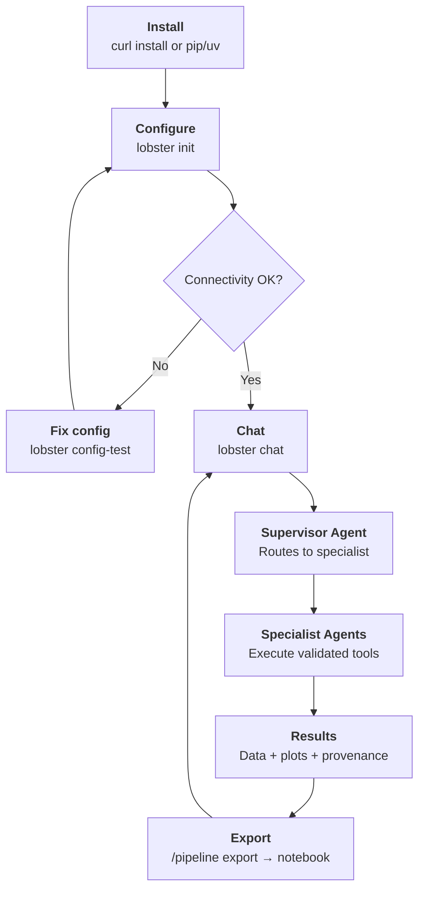

Get Lobster AI running on your machine in under five minutes. This guide walks you through installation, LLM provider configuration, and your first interactive analysis session — everything you need to go from zero to a working multi-agent bioinformatics system.


Sources: [README.md](README.md#L1-L7), [lobster/version.py](lobster/version.py#L1-L2)

## Prerequisites

Lobster AI requires **Python 3.12 or 3.13** (3.14+ is not yet supported). The package enforces this at startup with a clear version guard — if you attempt to run on an older Python, you'll see an immediate error with remediation instructions. You also need an LLM provider API key (Anthropic, Gemini, OpenAI, or a local Ollama installation) to power the agent orchestration layer.

| Requirement | Minimum | Notes |
|---|---|---|
| **Python** | 3.12 (≤ 3.13) | Enforced at CLI startup |
| **LLM Provider** | 1 active | Anthropic, OpenAI, Gemini, Bedrock, Azure, Ollama, OpenRouter, or Omics-OS Cloud |
| **OS** | macOS / Linux / Windows | Windows uses PowerShell installer |
| **Disk** | ~500 MB base | Domain packages add 200–800 MB each |

Sources: [pyproject.toml](pyproject.toml#L9-L14), [lobster/cli.py](lobster/cli.py#L25-L34), [lobster/config/constants.py](lobster/config/constants.py#L15-L24)

## Step 1 — Install Lobster AI

The fastest path is the one-liner installer, which handles Python version detection, virtual environment creation, and the `lobster` CLI registration automatically.

**macOS / Linux:**
```bash
curl -fsSL https://install.lobsterbio.com | bash
```

**Windows (PowerShell):**
```powershell
irm https://install.lobsterbio.com/windows | iex
```

**Alternative — pip or uv:**
```bash
# With uv (recommended, faster)
uv tool install --python 3.13 lobster-ai

# With pip
pip install lobster-ai
```

For developers contributing to the codebase, the Makefile provides a full development installation with all domain packages and test dependencies:
```bash
make dev-install
```

> [!TIP]
> The `uv tool install` method is preferred over `pip` because it creates an isolated environment that won't conflict with your system Python or other projects. The `--python 3.13` flag ensures the correct Python version is used even if your system default is older.

Sources: [README.md](README.md#L23-L29), [pyproject.toml](pyproject.toml#L9-L14), [Makefile](Makefile#L10-L24)

## Step 2 — Configure Your LLM Provider

Run the interactive initialization wizard to select and configure your LLM provider. This command writes credentials to your workspace `.env` file and installs the correct LangChain provider package.

```bash
lobster init
```

The wizard walks you through provider selection, API key entry, and agent package installation. Behind the scenes, `lobster init` uses a structured protocol to detect your environment (existing credentials, Ollama status, installed agents) and writes a deterministic configuration.

For **CI/CD or scripting**, use non-interactive mode with explicit flags:

```bash
# Anthropic Direct API
lobster init --non-interactive --anthropic-key sk-ant-...

# Local Ollama (no API key needed)
lobster init --non-interactive --use-ollama --ollama-model llama3:8b-instruct

# Google Gemini
lobster init --non-interactive --gemini-key AIza...

# OpenAI
lobster init --non-interactive --openai-key sk-...
```

The system supports **eight LLM providers**, each with a dedicated LangChain integration:

| Provider | Key Config | Display Name |
|---|---|---|
| `anthropic` | `ANTHROPIC_API_KEY` | Anthropic Direct API |
| `openai` | `OPENAI_API_KEY` | OpenAI |
| `gemini` | `GOOGLE_API_KEY` | Google Gemini |
| `bedrock` | `AWS_BEDROCK_ACCESS_KEY` + `AWS_BEDROCK_SECRET_ACCESS_KEY` | AWS Bedrock |
| `azure` | `AZURE_AI_ENDPOINT` + `AZURE_AI_CREDENTIAL` | Azure AI |
| `ollama` | No key required (local) | Ollama (Local) |
| `openrouter` | `OPENROUTER_API_KEY` | OpenRouter (600+ models) |
| `omics-os` | Cloud credentials via `lobster auth login` | Omics-OS Cloud |

You can also specify an **agent profile** that controls model selection and behavior:

```bash
lobster init --profile production   # Balanced cost/quality
lobster init --profile performance  # Higher capability models
lobster init --profile max          # Maximum capability
```

Valid profiles are: `development`, `production`, `performance`, `max`, and `hybrid`.

> [!TIP]
> If you have Ollama installed locally, the init wizard auto-detects it and lists available models. This is the only provider that requires zero API keys — ideal for air-gapped environments or sensitive patient data that must never leave your machine.

Sources: [lobster/cli.py](lobster/cli.py#L728-L830), [lobster/config/provider_setup.py](lobster/config/provider_setup.py#L62-L157), [lobster/config/constants.py](lobster/config/constants.py#L15-L48), [lobster/cli_internal/commands/light/init_protocol.py](lobster/cli_internal/commands/light/init_protocol.py#L87-L152)

## Step 3 — Verify Connectivity

Before starting an analysis session, confirm your provider configuration is valid and the API is reachable:

```bash
lobster config-test
```

This command tests API connectivity, validates credentials, and reports any issues. You can also inspect your full configuration at any time with:

```bash
lobster config          # Show current configuration and agent composition
lobster status          # Show subscription tier, installed packages, available agents
```

Sources: [lobster/cli.py](lobster/cli.py#L547-L554), [lobster/cli.py](lobster/cli.py#L556-L558)

## Step 4 — Start Your First Session

Launch an interactive chat session where you describe your analysis in plain language:

```bash
lobster chat
```

Then describe what you need — the supervisor agent routes your request to the appropriate specialist agents automatically:

```text
> Search PubMed for single-cell CRISPR screens in T cells from 2023–2024,
  download the most cited dataset, run QC, integrate batches with Harmony,
  cluster the cells, annotate cell types, and export a reproducible notebook.
```

For **single-turn, non-interactive** usage (scripts, pipelines):

```bash
lobster query "Search PubMed for CRISPR screen datasets in T cells"
```

Sources: [README.md](README.md#L37-L54), [lobster/cli.py](lobster/cli.py#L497-L531)

## Session Workflow at a Glance

The following diagram shows the end-to-end flow from installation through your first analysis:



Sources: [README.md](README.md#L23-L70), [lobster/cli.py](lobster/cli.py#L547-L558)

## In-Session Slash Commands

Once inside `lobster chat`, use slash commands to manage your session:

| Command | Purpose |
|---|---|
| `/pipeline export` | Export analysis as a reproducible Jupyter notebook |
| `/pipeline run analysis.ipynb` | Re-run an exported notebook |
| `/data` | List loaded datasets and modalities |
| `/files` | Browse workspace files |
| `/status` | Session info, token usage, active agents |
| `/help` | Show all slash commands |

Sources: [README.md](README.md#L56-L70)

## Session Continuity

Lobster supports **session persistence** — you can resume conversations across multiple CLI invocations using `--session-id`:

```bash
# Start a named session
lobster query --session-id my_project "Search PubMed for CRISPR screens"

# Resume it later
lobster query --session-id latest "Download the first result"

# Or continue in interactive mode
lobster chat --session-id my_project
```

Sources: [README.md](README.md#L72-L76)

## Install Domain Packages

The base `lobster-ai` package includes the core agent framework and CLI. Domain-specific capabilities are installed as optional extras, each bundling the relevant agent, its scientific dependencies, and visualization tools:

```bash
# Single-cell and bulk RNA-seq
pip install lobster-ai[transcriptomics]

# VCF, GWAS, variant annotation
pip install lobster-ai[genomics]

# DDA/DIA mass spectrometry
pip install lobster-ai[proteomics]

# Literature search and dataset discovery
pip install lobster-ai[research]

# Everything at once
pip install lobster-ai[full]
```

| Extra | Agents Included | Key Capabilities |
|---|---|---|
| `[transcriptomics]` | scRNA-seq, bulk RNA-seq | QC, batch integration (Harmony/scVI), clustering, cell annotation, trajectory inference |
| `[genomics]` | Genomics expert | GWAS, LD pruning, variant annotation, association testing |
| `[proteomics]` | Proteomics expert | DDA/DIA processing, biomarker panel selection, network analysis |
| `[research]` | Research agent | PubMed search, dataset discovery, automated literature mining |
| `[full]` | All of the above | Complete multi-omics suite |

Sources: [pyproject.toml](pyproject.toml#L137-L193), [README.md](README.md#L147-L175)

## Build Your Own Agent (Optional)

If you want to extend Lobster with a custom domain agent, the `scaffold` command generates a complete, contract-compliant plugin package:

```bash
lobster scaffold agent \
  --name epigenomics_expert \
  --display-name "Epigenomics Expert" \
  --description "ATAC-seq, ChIP-seq, and DNA methylation analysis"
```

This creates a directory structure with `pyproject.toml`, entry point wiring, tool stubs with AQUADIF metadata, and contract tests. Validate your package before distribution:

```bash
lobster validate-plugin ./lobster-epigenomics/
```

Sources: [lobster/cli_internal/commands/light/scaffold_commands.py](lobster/cli_internal/commands/light/scaffold_commands.py#L26-L76), [README.md](README.md#L97-L116)

## Troubleshooting

| Problem | Likely Cause | Fix |
|---|---|---|
| `Error: Python 3.12+ required` | Old Python version | `uv tool install --python 3.13 lobster-ai` |
| `lobster: command not found` | CLI not on PATH | Re-run installer, or use `uv tool install` |
| Init wizard doesn't detect Ollama | Ollama not running | `ollama serve` in a separate terminal |
| API key rejected | Invalid or expired key | Run `lobster init` again, or check `lobster config-test` |
| Agent not found at runtime | Domain package missing | `pip install lobster-ai[transcriptomics]` (or relevant extra) |
| SSL certificate errors | Corporate proxy/firewall | `lobster init --no-ssl-verify` or `--ssl-cert-path /path/to/ca.pem` |

Sources: [lobster/cli.py](lobster/cli.py#L25-L34), [lobster/cli.py](lobster/cli.py#L830-L855), [lobster/config/provider_setup.py](lobster/config/provider_setup.py#L34-L60)

## Next Steps

Now that you're up and running, explore the system in depth:

1. **[CLI Reference](3-cli-reference)** — Complete command reference for all `lobster` subcommands, flags, and options.
2. **[Architecture Overview](4-architecture-overview)** — Understand how the supervisor agent routes requests across 22 specialist agents via LangGraph.
3. **[LLM Provider Configuration](17-llm-provider-configuration)** — Advanced provider setup, model selection, and multi-provider strategies.
4. **[Plugin System and Entry Points](8-plugin-system-and-entry-points)** — Deep dive into building and distributing custom agent packages.
