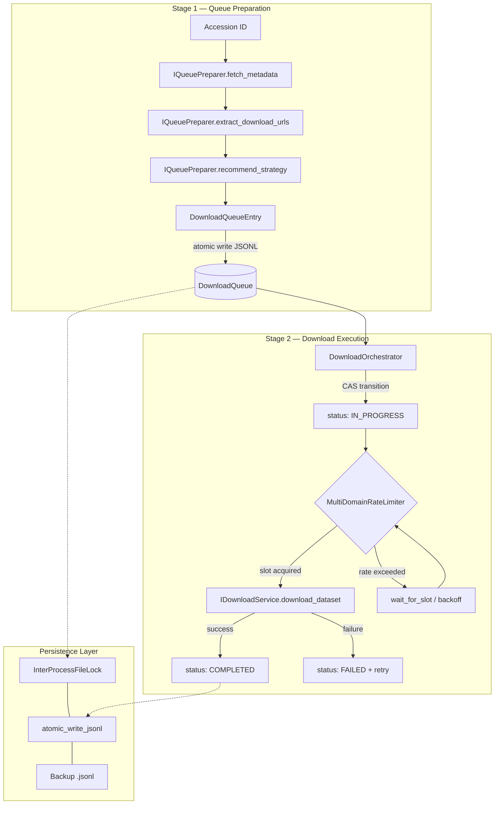

Lobster's external data pipeline rests on two interlocking subsystems: a **distributed rate limiter** that prevents API abuse across dozens of biological data publishers, and a **persistent download queue** that orchestrates dataset requests from enrollment through completion. Together they form the back-pressure mechanism that lets agents safely pull data from NCBI, GEO, PRIDE, SRA, MetaboLights, and publisher websites without triggering IP bans or data loss. This page examines their internal architecture, the schemas that bind them, and the service interfaces that connect preparation to execution.

## Architectural Overview

The rate limiting and download queue subsystems form a two-stage pipeline. **Stage 1 — Preparation** — a queue preparer fetches metadata, extracts URLs, and recommends a download strategy, assembling a `DownloadQueueEntry` that is persisted to disk. **Stage 2 — Execution** — the `DownloadOrchestrator` routes that entry to a database-specific `IDownloadService`, while the `MultiDomainRateLimiter` gates every outbound HTTP request against per-domain quotas. The diagram below traces this flow from accession ID to persisted `AnnData` modality.

Sources: [download_queue.py](lobster/core/queues/download_queue.py#L1-L428), [rate_limiter.py](lobster/tools/rate_limiter.py#L1-L250), [download_orchestrator.py](lobster/tools/download_orchestrator.py#L1-L100), [queue_preparer.py](lobster/core/interfaces/queue_preparer.py#L1-L229)

## Multi-Domain Rate Limiting

### Redis Sliding Window Architecture

All rate limiting is powered by a **Redis sliding window counter** with per-second granularity. Each domain + user combination maps to a Redis key of the form `ratelimit:multi:{domain}:{user_id}` with a 1-second TTL. On every request the counter is incremented; if it already meets or exceeds the domain's configured limit, the request is blocked until the window expires and the key auto-evicts. This design is inherently **multi-process safe** — cross-process coordination happens through Redis itself, not through in-process locks.

The connection pool is initialized lazily with **double-checked locking** to guarantee exactly one pool per process. The pool is configured with a 30-second health check interval, 5-second socket timeouts, and a maximum of 10 connections. Stale connections are automatically revalidated before reuse.

> [!TIP]
> When Redis is unavailable (not installed, connection refused, or operation error), all rate limiters follow a **fail-open** policy: they log a warning and return `True`, allowing the request through. This prevents a Redis outage from blocking the entire data pipeline, but it means rate compliance degrades to the honor system. For production deployments, ensure Redis is running (`docker-compose up -d redis`) and the `redis` package is installed via `lobster-ai[observability]`.

Sources: [rate_limiter.py](lobster/tools/rate_limiter.py#L49-L109), [rate_limiter.py](lobster/tools/rate_limiter.py#L165-L250)

### Domain Configuration Registry

The `DOMAIN_CONFIG` dictionary is the **single source of truth** for per-domain rate limits and header strategies. It classifies publishers into four tiers based on their bot-detection aggressiveness and access policies:

| Tier | Rate Limit | Header Strategy | Typical Domains | Rationale |
|------|-----------|-----------------|-----------------|-----------|
| **NCBI / API** | 10 req/s | `DEFAULT` | `eutils.ncbi.nlm.nih.gov`, `pmc.ncbi.nlm.nih.gov` | Official API endpoints, minimal headers sufficient |
| **Session-required** | 10 req/s | `SESSION` | `asm.org`, `journals.asm.org` | Require homepage visit + cookie establishment before article access |
| **High-protection** | 3 req/s | `STEALTH` | `cell.com`, `academic.oup.com`, `sciencedirect.com`, `wiley.com`, `nature.com` | Cloudflare / aggressive anti-scraping; requires `Sec-Fetch-*` headers + `cloudscraper` |
| **Open-access** | 20–30 req/s | `POLITE` | `biorxiv.org`, `mdpi.com`, `arxiv.org`, `plos.org`, `frontiersin.org` | Bot-friendly publishers with liberal access policies |
| **Default fallback** | 3 req/s | `BROWSER` | Any unmatched domain | Conservative default for unknown domains |

Each `DomainConfig` pairs a `rate_limit` (float, requests per second) with a `HeaderStrategy` enum value. The legacy `DOMAIN_RATE_LIMITS` and `DOMAIN_HEADER_STRATEGIES` dictionaries are **auto-derived** from this unified config for backward compatibility — modify `DOMAIN_CONFIG` only, never the derived dictionaries.

Sources: [rate_limiter.py](lobster/tools/rate_limiter.py#L420-L535)

### Header Strategy Matrix

The `HeaderStrategy` enum controls what HTTP headers are injected into outbound requests. The escalation from `DEFAULT` → `POLITE` → `BROWSER` → `SESSION` → `STEALTH` corresponds to increasing anti-bot countermeasures:

| Strategy | Headers Applied | Use Case |
|----------|----------------|----------|
| `DEFAULT` | `requests` library defaults | API endpoints (NCBI E-utilities) |
| `POLITE` | Standard headers + bot-identifying `User-Agent` | Open-access publishers that tolerate crawlers |
| `BROWSER` | Full Chrome `User-Agent` + `Accept`/`Accept-Language`/`Accept-Encoding` | Moderate bot-detection sites (Nature, Springer) |
| `SESSION` | BROWSER headers + session cookie establishment pass | Sites requiring a homepage visit before deep-linking |
| `STEALTH` | BROWSER headers + `Sec-Fetch-Dest`/`Mode`/`Site`/`User` + `cloudscraper` | Aggressive Cloudflare-protected sites (Cell, Elsevier) |

The `DomainHeaderProvider` class integrates with `MultiDomainRateLimiter` to provide a unified `DomainRequestConfig` that bundles rate limits and headers together. When making a request, you call `provider.get_request_config(url)` and receive both the rate limit and the appropriate header dict.

Sources: [rate_limiter.py](lobster/tools/rate_limiter.py#L420-L428), [rate_limiter.py](lobster/tools/rate_limiter.py#L917-L996)

### Exponential Backoff and Retry

The `MultiDomainRateLimiter.calculate_backoff()` implements exponential backoff with the formula `base × factor^attempt`, capped at `backoff_max`. The default `DomainStrategy` configuration uses a base of 1.0s, factor of 3.0, and max of 30.0s, yielding the progression **1s → 3s → 9s → 27s → 30s (capped)**. Retries are triggered by HTTP status codes 429, 503, and 502. High-rate domains (≥1 req/s) get 3 max retries; lower-rate domains get 2.

The convenience function `rate_limited_request(url, request_func, ...)` wraps the entire cycle: **wait for slot → execute request → check status code → backoff if retryable → retry**. It accepts an optional `max_retries` override and raises the last exception if all retries are exhausted.

Sources: [rate_limiter.py](lobster/tools/rate_limiter.py#L546-L558), [rate_limiter.py](lobster/tools/rate_limiter.py#L806-L914)

### Three Rate Limiter Classes

The module exposes three complementary rate limiter classes, each targeting a different scope:

| Class | Scope | Redis Key Pattern | Use Case |
|-------|-------|-------------------|----------|
| `NCBIRateLimiter` | NCBI E-utilities only | `ratelimit:{api_name}:{user_id}` | Backward-compatible NCBI-specific limiting; respects `NCBI_API_KEY` (9 req/s with key, 2 req/s without) |
| `RateLimiter` | Single arbitrary API | `ratelimit:{api_name}:{user_id}` | Simple per-API limiting (e.g., Enrichr at 3 req/s); supports context manager usage |
| `MultiDomainRateLimiter` | All publisher domains | `ratelimit:multi:{domain}:{user_id}` | Production general-purpose limiter with auto domain detection, backoff, and header strategies |

All three share the same Redis infrastructure (`get_redis_client()`), sliding window algorithm, and fail-open behavior. The `@rate_limited("api_name")` decorator wraps any function with `NCBIRateLimiter.wait_for_slot()` semantics.

Sources: [rate_limiter.py](lobster/tools/rate_limiter.py#L165-L408), [rate_limiter.py](lobster/tools/rate_limiter.py#L560-L663), [rate_limiter.py](lobster/tools/rate_limiter.py#L665-L838)

## Download Queue

### JSON Lines Persistence and Atomic Writes

The `DownloadQueue` class persists entries as **JSON Lines** (`.jsonl`) — one JSON object per line — enabling append-only durability and human-readable inspection. Every mutation (add, update, remove, clear) goes through the `_write_entries_atomic()` method, which delegates to `atomic_write_jsonl()`. The atomic write protocol is:

1. Write all entries to a temporary file (`mkstemp` in the same directory)
2. `flush()` + `os.fsync()` to force data to disk
3. `os.replace()` to atomically rename the temp file over the target

This ensures that no reader ever observes a partially-written queue file — the rename is atomic on both POSIX and Windows. If the write fails, the temp file is cleaned up and the original remains untouched.

Sources: [download_queue.py](lobster/core/queues/download_queue.py#L348-L362), [queue_storage.py](lobster/core/queues/queue_storage.py#L79-L107)

### Dual-Layer Locking: Thread + Process

Queue operations are protected by a **dual-layer lock** composed of an in-process `threading.Lock` and an `InterProcessFileLock` backed by a `.lock` sidecar file. The `queue_file_lock()` context manager acquires the thread lock first, then the file lock, and releases in reverse order. The `InterProcessFileLock` uses `fcntl.flock(LOCK_EX)` on POSIX and `msvcrt.locking(LK_LOCK)` on Windows, ensuring mutual exclusion across both threads and processes. Read-only operations like `get_entry` and `list_entries` acquire only the thread lock (no inter-process contention on reads), while all mutations go through `_locked()` which acquires both.

> [!TIP]
> The `update_status()` method supports **compare-and-swap (CAS)** via the `expected_current_status` parameter. When provided, the update only proceeds if the entry's current status matches the expected value; otherwise it returns `None` without modification. This prevents race conditions where two workers simultaneously try to transition the same entry from `PENDING` to `IN_PROGRESS`. Always use CAS in concurrent environments: `queue.update_status(entry_id, DownloadStatus.IN_PROGRESS, expected_current_status=DownloadStatus.PENDING)`.

Sources: [download_queue.py](lobster/core/queues/download_queue.py#L83-L86), [download_queue.py](lobster/core/queues/download_queue.py#L144-L231), [queue_storage.py](lobster/core/queues/queue_storage.py#L22-L76)

### Backup Mechanism

Before every mutation, the queue creates a **timestamped backup** (e.g., `queue_backup_20240115_103000_123456.jsonl`) in a `backups/` subdirectory adjacent to the queue file. Backups are gated by the `LOBSTER_ENABLE_QUEUE_BACKUPS` environment variable (must be set to `1`, `true`, or `yes`). Empty queue files are skipped. Backup failure is non-fatal — a warning is logged but the mutation proceeds, ensuring that backup I/O issues never block the data pipeline.

Sources: [download_queue.py](lobster/core/queues/download_queue.py#L364-L392), [queue_storage.py](lobster/core/queues/queue_storage.py#L143-L151)

### Queue Statistics

The `get_statistics()` method provides a real-time snapshot of queue health, returning a dictionary with counts broken down by status, database, and priority. It initializes the `by_status` map with **all** `DownloadStatus` enum values (including zero-counts) to guarantee consistent shape regardless of queue contents.

Sources: [download_queue.py](lobster/core/queues/download_queue.py#L394-L428)

## Download Queue Schemas

### DownloadStatus Lifecycle

The `DownloadStatus` enum defines four states with a strict lifecycle: `PENDING` → `IN_PROGRESS` → `COMPLETED` or `FAILED`. Each status carries a display configuration (`icon`, `style`) for consistent Rich-based terminal rendering:

| Status | Icon | Style | Semantic |
|--------|------|-------|----------|
| `PENDING` | ○ | `dim` | Entry enqueued, awaiting worker pickup |
| `IN_PROGRESS` | ● | `bold #CC2C18` | Worker has claimed the entry (CAS transition) |
| `COMPLETED` | ✓ | `green` | Dataset downloaded and stored in DataManagerV2 |
| `FAILED` | ✗ | `red` | Download failed; error appended to `error_log` |

Sources: [download_queue.py (schema)](lobster/core/schemas/download_queue.py#L16-L53)

### DownloadQueueEntry Structure

The `DownloadQueueEntry` Pydantic model is the central data contract between preparation and execution. It carries:

- **Core identification**: `entry_id`, `dataset_id` (e.g., `GSE180759`), `database` (validated against `SupportedDatabase`)
- **Priority**: integer 1–10 (1 = highest)
- **Status**: `DownloadStatus` enum with CAS-protected transitions
- **Prepared metadata**: `metadata` dict, `validation_result`, `validation_status`, `recommended_strategy`
- **Execution tracking**: `created_at`, `updated_at`, `downloaded_by`, `modality_name`, `error_log`
- **URLs**: `matrix_url`, `raw_urls`, `supplementary_urls`, `h5_url`

The `update_status()` method transitions the status, timestamps the change, and appends error messages to `error_log` with ISO-8601 timestamps. The `database` field is validated against `SupportedDatabase.values()` at construction time, ensuring only known databases enter the queue.

Sources: [download_queue.py (schema)](lobster/core/schemas/download_queue.py#L205-L398)

### StrategyConfig and Download Strategy

The `StrategyConfig` model captures the download strategy prepared by the research agent:

| Field | Type | Purpose |
|-------|------|---------|
| `strategy_name` | `str` | Strategy identifier (e.g., `MATRIX_FIRST`, `RAW_FIRST`, `H5_FIRST`) |
| `concatenation_strategy` | `str` | Sample merge mode: `auto`, `union`, `intersection` |
| `confidence` | `float` | 0.0–1.0 confidence score for the recommendation |
| `rationale` | `Optional[str]` | Human-readable explanation |
| `strategy_params` | `Optional[Dict]` | Database-specific parameters (e.g., GEO's `use_intersecting_genes_only`) |
| `execution_params` | `Optional[Dict]` | Execution tuning: `timeout`, `max_retries`, `retry_backoff`, `max_concurrent_downloads`, `verify_checksum`, `resume_enabled` |

The `get_execution_params_with_defaults()` method merges user-provided `execution_params` over sensible defaults (timeout: 3600s, max_retries: 3, backoff: 2.0s, verify_checksum: True), ensuring that partial overrides fill in missing values rather than breaking execution.

Sources: [download_queue.py (schema)](lobster/core/schemas/download_queue.py#L64-L202)

### DownloadUrlResult and File Categorization

The `DownloadUrlResult` schema is the canonical return type for all `provider.get_download_urls()` methods. It categorizes files into five buckets — `primary_files`, `raw_files`, `processed_files`, `supplementary_files`, `metadata_files` — plus PRIDE-specific `search_files`. Each file is a `DownloadFile` with URL, filename, size, checksum, and type metadata. The `to_queue_entry_fields()` method bridges URL data into the flat `matrix_url`/`raw_urls`/`supplementary_urls`/`h5_url` fields expected by `DownloadQueueEntry`, maintaining backward compatibility with the queue schema while allowing richer per-file metadata upstream.

Sources: [download_urls.py](lobster/core/schemas/download_urls.py#L1-L200)

## Service Interfaces

### IQueuePreparer — Template Method Pattern

The `IQueuePreparer` abstract base class defines a three-step template method for queue entry preparation. Concrete implementations (one per database) override only the three abstract methods:

1. **`fetch_metadata(accession)`** → `(metadata_dict, validation_info)`
2. **`extract_download_urls(accession)`** → `DownloadUrlResult`
3. **`recommend_strategy(metadata, url_data, accession)`** → `StrategyConfig`

The `prepare_queue_entry()` template method orchestrates these in sequence, generates a unique `entry_id` (`queue_{accession}_{uuid8}`), bridges URL data to queue fields, and returns a `QueuePreparationResult` bundling the entry with raw data for inspection. This separation ensures that strategy recommendation is always informed by both metadata and available URLs — never decided in isolation.

Sources: [queue_preparer.py](lobster/core/interfaces/queue_preparer.py#L67-L229)

### IDownloadService — Strategy Execution Contract

The `IDownloadService` abstract base class defines the contract for database-specific download execution. Each implementation must provide:

| Method | Return Type | Purpose |
|--------|------------|---------|
| `supported_databases()` | `List[str]` | Database identifiers this service handles (e.g., `["geo"]`, `["sra", "ena", "ddbj"]`) |
| `download_dataset(queue_entry, strategy_override?)` | `(AnnData, stats_dict, AnalysisStep)` | Execute the download; return data + provenance IR |
| `validate_strategy_params(params)` | `(bool, Optional[str])` | Early validation without network access |
| `get_supported_strategies()` | `List[str]` | Strategy names (e.g., `["H5_FIRST", "MATRIX_FIRST"]`) |

The 3-tuple return pattern `(adata, stats, ir)` is the **service convention** across Lobster: the `AnnData` object carries the data, the stats dict provides a human-readable summary, and the `AnalysisStep` IR captures full provenance for notebook export and reproducibility.

Sources: [download_service.py](lobster/core/interfaces/download_service.py#L52-L399)

### DownloadOrchestrator — Facade and Router

The `DownloadOrchestrator` is the facade that ties everything together. It maintains a registry of `IDownloadService` instances keyed by database name and routes `execute_download(entry_id)` calls to the appropriate service. Service registration happens in two phases:

1. **Entry-point discovery** (always active): scans `lobster.download_services` entry points via `component_registry.list_download_services()`
2. **Hardcoded fallback** (gated by `_ALLOW_HARDCODED_FALLBACK = False`): disabled by default to force explicit opt-in; when enabled, attempts to import `GEODownloadService`, `SRADownloadService`, `PRIDEDownloadService`, `MassIVEDownloadService`, and `MetaboLightsDownloadService`

The orchestrator performs CAS-protected status transitions: `PENDING → IN_PROGRESS` before execution, then `IN_PROGRESS → COMPLETED` or `IN_PROGRESS → FAILED` after. If a `ServiceNotFoundError` is raised (no registered service for the entry's database), the entry remains in its current status.

Sources: [download_orchestrator.py](lobster/tools/download_orchestrator.py#L43-L200)

## Environment Variables and Configuration

| Variable | Default | Purpose |
|----------|---------|---------|
| `REDIS_HOST` | `localhost` | Redis server hostname for distributed rate limiting |
| `REDIS_PORT` | `6379` | Redis server port |
| `NCBI_API_KEY` | *(none)* | NCBI API key; raises rate limit from 2 → 9 req/s in `NCBIRateLimiter` |
| `LOBSTER_ENABLE_QUEUE_BACKUPS` | *(none)* | Set to `1`/`true`/`yes` to enable timestamped queue file backups before mutations |

Sources: [rate_limiter.py](lobster/tools/rate_limiter.py#L78-L88), [rate_limiter.py](lobster/tools/rate_limiter.py#L193-L194), [queue_storage.py](lobster/core/queues/queue_storage.py#L143-L150)

## Next Steps

- For the provider implementations that produce `DownloadUrlResult` objects, see [Provider Registry and Data Access](19-provider-registry-and-data-access).
- For how downloaded data is stored and tracked after completion, see [DataManager and Modality Adapters](11-datamanager-and-modality-adapters).
- For the provenance IR generated during download execution, see [Provenance Tracking and IR](12-provenance-tracking-and-ir).
- For how the orchestrator's entry-point discovery plugs into the plugin system, see [Plugin System and Entry Points](8-plugin-system-and-entry-points).