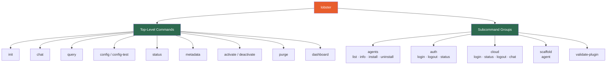

The Lobster CLI is your primary interface to the multi-agent bioinformatics system. Built on **Typer** with **Rich** terminal rendering, it provides commands for configuration, interactive analysis, agent management, cloud connectivity, and plugin development — all accessible from a single `lobster` entry point. The CLI requires **Python 3.12+** and validates this at startup before any heavy imports occur.

Sources: [cli.py](/lobster/cli.py#L1-L27), [__main__.py](/lobster/__main__.py#L1-L13)

## Command Architecture

The CLI is organized into a **two-tier command hierarchy**: top-level commands for everyday workflows (`init`, `chat`, `query`) and subcommand groups for domain-specific management (`agents`, `auth`, `cloud`, `scaffold`, `validate-plugin`). Behind the scenes, the implementation is split into **light commands** (fast, minimal imports from `cli_internal/commands/light/`) and **heavy commands** (lazily loaded from `cli_internal/commands/heavy/` to preserve startup speed). This lazy-loading strategy saves approximately 5 seconds of import time at launch.

Sources: [cli.py](/lobster/cli.py#L70-L74), [cli.py](/lobster/cli.py#L79-L88)



## Global Flags

These flags are available on the root `lobster` command before any subcommand:

| Flag | Short | Description |
|------|-------|-------------|
| `--version` | `-v` | Print the current Lobster version and exit |
| `--help` | | Show the help guide with all available commands |

Running `lobster` with no arguments displays a friendly help guide and checks for updates (non-blocking, cached, fails silently if offline).

Sources: [cli.py](/lobster/cli.py#L369-L397), [cli.py](/lobster/cli.py#L139)

## `lobster init`

Initialize Lobster AI configuration. This is the **first command you run** after installation — it sets up provider credentials, model selection, and agent composition for your workspace.

**Usage:**
```bash
lobster init [OPTIONS]
```

**Key Options:**

| Option | Description |
|--------|-------------|
| `--global`, `-g` | Save configuration to `~/.config/lobster/` (applies to all workspaces) |
| `--force`, `-f` | Overwrite existing configuration |
| `--non-interactive` | CI/CD mode — requires API key flags, no prompts |
| `--anthropic-key` | Claude API key (non-interactive) |
| `--bedrock-access-key` | AWS Bedrock access key (non-interactive) |
| `--bedrock-secret-key` | AWS Bedrock secret key (non-interactive) |
| `--use-ollama` | Use Ollama local LLM provider |
| `--ollama-model` | Ollama model name (default: `llama3:8b-instruct`) |
| `--model`, `-m` | Default model ID for the selected provider |
| `--gemini-key` | Google API key (non-interactive) |
| `--openai-key` | OpenAI API key (non-interactive) |
| `--openrouter-key` | OpenRouter API key (non-interactive) |
| `--azure-endpoint` | Azure AI endpoint URL (non-interactive) |
| `--azure-credential` | Azure AI API credential (non-interactive) |
| `--profile` | Agent profile: `development`, `production`, `performance`, `max` |
| `--agents` | Comma-separated list of agents to enable |
| `--preset` | Agent preset: `scrna-basic`, `scrna-full`, `multiomics-full` |
| `--auto-agents` | Use LLM to suggest agents based on a description |
| `--agents-description` | Workflow description for LLM agent suggestion |
| `--cloud-key` | Lobster Cloud API key (enables premium tier) |
| `--ui` | UI mode for interactive init: `auto`, `go`, `classic` |
| `--skip-extras` | Skip optional package installation |

> [!TIP]
> Credential resolution follows a strict priority chain: **workspace `.env`** (highest) → **global `credentials.env`** (`~/.config/lobster/`) → **environment variables** (lowest). This means a workspace `.env` always overrides global settings, enabling project-specific provider configurations.

**Common Examples:**
```bash
# Interactive setup (workspace-local)
lobster init

# Interactive setup (global defaults for all workspaces)
lobster init --global

# CI/CD: Claude API with production profile
lobster init --non-interactive --anthropic-key=sk-ant-xxx --profile=production

# CI/CD: Ollama with a custom model
lobster init --non-interactive --use-ollama --ollama-model=mixtral:8x7b-instruct

# CI/CD: OpenRouter (600+ models available)
lobster init --non-interactive --openrouter-key=sk-or-xxx

# CI/CD: Azure AI
lobster init --non-interactive --azure-endpoint=https://xxx.inference.ai.azure.com/ --azure-credential=xxx

# Force reconfiguration
lobster init --force
```

Sources: [cli.py](/lobster/cli.py#L797-L1022)

## `lobster chat`

Start an **interactive chat session** with the multi-agent system. This is the primary command for exploratory bioinformatics analysis — you converse with specialized agents that route your questions to the right domain expert.

**Usage:**
```bash
lobster chat [OPTIONS]
```

**Key Options:**

| Option | Short | Description |
|--------|-------|-------------|
| `--workspace` | `-w` | Workspace directory (default: `./.lobster_workspace` or `LOBSTER_WORKSPACE` env var) |
| `--session-id` | `-s` | Continue a saved session; use `latest` for most recent |
| `--reasoning` | | Show agent reasoning and thinking process |
| `--verbose` | `-v` | Show detailed tool usage and agent activity |
| `--debug` | `-d` | Enable debug mode with enhanced error reporting |
| `--profile-timings` | | Enable timing diagnostics for data manager operations |
| `--provider` | `-p` | Override LLM provider (`bedrock`, `anthropic`, `ollama`) |
| `--model` | `-m` | Override model (e.g., `claude-4-sonnet`, `llama3:70b-instruct`) |
| `--stream` / `--no-stream` | | Enable/disable real-time text streaming (default: on) |
| `--no-intro` | | Disable Go TUI intro animation (useful for automation) |
| `--ui` | | UI mode: `auto` (Go TUI → classic fallback), `go` (require Go TUI), `classic` (Rich terminal) |
| `--classic` | | Shorthand for `--ui classic` |

The chat command first attempts to launch the **Go TUI** (a high-performance terminal UI written in Go). If the Go binary isn't installed or the terminal isn't interactive, it falls back to the **classic Rich terminal** interface. The `--classic` flag short-circuits this detection and forces the Python-based UI.

> [!TIP]
> Use `--session-id latest` to resume your most recent conversation. Session data is stored under `.lobster/sessions/` in your workspace, preserving full conversation context and agent routing history across restarts.

**Common Examples:**
```bash
# Start a new interactive session
lobster chat

# Continue most recent session
lobster chat --session-id latest

# Use a specific session
lobster chat --session-id session_20241208_150000

# Show agent reasoning (great for learning how agents work)
lobster chat --reasoning

# Force classic terminal UI
lobster chat --classic

# Override provider and model
lobster chat --provider anthropic --model claude-4-sonnet
```

Sources: [cli.py](/lobster/cli.py#L1225-L1337)

## `lobster query`

Run a **single query** against the multi-agent system without entering an interactive session. Ideal for scripted workflows, quick lookups, or pipeline integration.

**Usage:**
```bash
lobster query "Your question here" [OPTIONS]
```

**Key Options:**

| Option | Short | Description |
|--------|-------|-------------|
| `--workspace` | `-w` | Workspace directory |
| `--session-id` | `-s` | Continue a saved session |
| `--reasoning` | | Show agent reasoning |
| `--verbose` | `-v` | Show agent and tool trace details |
| `--debug` | `-d` | Enable debug logging |
| `--output` | `-o` | Write the final answer to a file |
| `--profile-timings` | | Enable timing diagnostics |
| `--provider` | `-p` | Override LLM provider |
| `--model` | `-m` | Override model |

**Common Examples:**
```bash
# Single query
lobster query "What pathways are enriched in my DEG list?"

# Save output to file
lobster query "Summarize the sample metadata" --output results.txt

# Query with a specific provider
lobster query "Cluster these cells" --provider anthropic --model claude-4-sonnet
```

Sources: [cli.py](/lobster/cli.py#L1367-L1394)

## `lobster dashboard`

Launch the **Textual TUI dashboard** — a rich, interactive terminal application for visualizing workspace data, session history, and agent activity.

**Usage:**
```bash
lobster dashboard [OPTIONS]
```

| Option | Short | Description |
|--------|-------|-------------|
| `--workspace` | `-w` | Workspace directory |

This command requires the `textual` package. If not installed, the CLI will print the install command.

Sources: [cli.py](/lobster/cli.py#L1340-L1364)

## `lobster config`

Display and manage your current configuration including agent composition, provider settings, and workspace details.

**Usage:**
```bash
lobster config [OPTIONS]
```

| Option | Short | Description |
|--------|-------|-------------|
| `--workspace` | `-w` | Workspace directory to inspect |

Running `lobster config` without a subcommand shows a configuration summary. Subcommands (like `lobster config show`, `lobster config list-models`) provide more detailed views.

Sources: [cli.py](/lobster/cli.py#L303-L346)

## `lobster config-test`

Test **API connectivity** and validate that your configuration is working correctly. Reports which providers are reachable and whether credentials are valid.

**Usage:**
```bash
lobster config-test [OPTIONS]
```

| Option | Short | Description |
|--------|-------|-------------|
| `--json` | `-j` | Output results as JSON (machine-readable) |

Sources: [cli.py](/lobster/cli.py#L599-L611)

## `lobster status`

Display your **subscription tier**, installed packages, and available agents in a summary view.

**Usage:**
```bash
lobster status
```

Sources: [cli.py](/lobster/cli.py#L614-L619)

## `lobster metadata`

Display metadata overview and statistics about your workspace data, publications, samples, and exports.

**Usage:**
```bash
lobster metadata [SUBCOMMAND] [OPTIONS]
```

**Subcommands:**

| Subcommand | Description |
|------------|-------------|
| *(none)* | Smart overview with key stats and next steps |
| `publications` | Publication queue status breakdown |
| `samples` | Sample statistics and disease coverage |
| `workspace` | File inventory across all locations |
| `exports` | Export files with usage hints |
| `list` | Legacy detailed list |
| `clear` | Clear metadata (with `exports`/`all` options) |

**Key Options:**

| Option | Short | Description |
|--------|-------|-------------|
| `--workspace` | `-w` | Workspace directory |
| `--status` | | Status filter for `publications` subcommand |

**Common Examples:**
```bash
lobster metadata                           # Smart overview
lobster metadata publications              # Publication queue status
lobster metadata publications --status=handoff_ready
lobster metadata samples                   # Sample statistics
lobster metadata exports                   # Export files
```

Sources: [cli.py](/lobster/cli.py#L622-L663)

## `lobster activate` / `lobster deactivate`

Activate or deactivate a **premium license** using an access code from Omics-OS.

**Usage:**
```bash
lobster activate <ACCESS_CODE> [--server <URL>]
lobster deactivate
```

| Option | Description |
|--------|-------------|
| `--server` | Custom license server URL (default: `https://licenses.omics-os.com`) |

Deactivation removes the local license file and reverts to the free tier. Your license can be re-activated on another machine or reused later.

Sources: [cli.py](/lobster/cli.py#L666-L702)

## `lobster purge`

Remove all Lobster AI files from your system. This is a destructive operation with built-in safety guards — only directories verified to contain Lobster AI files will be removed.

**Usage:**
```bash
lobster purge [OPTIONS]
```

**Key Options:**

| Option | Short | Description |
|--------|-------|-------------|
| `--scope` | `-s` | What to purge: `global`, `workspace`, or `all` (default: `all`) |
| `--workspace` | `-w` | Workspace directory to purge |
| `--keep-license` | | Preserve license file (`~/.lobster/license.json`) |
| `--dry-run` | `-n` | Preview what would be deleted without deleting |
| `--force` | `-f` | Skip confirmation prompt |

**What gets removed:**

| Scope | Files |
|-------|-------|
| **Global** (`~/.lobster/`, `~/.config/lobster/`) | `license.json`, `providers.json`, `credentials.env`, `lobster_history`, `version_check_cache` |
| **Workspace** (`.lobster_workspace/`) | `data/`, `cache/`, `plots/`, sessions |

**Common Examples:**
```bash
lobster purge --dry-run          # Preview what would be deleted
lobster purge --scope global     # Remove only global config files
lobster purge --scope workspace  # Remove only current workspace
lobster purge --keep-license     # Preserve your license file
lobster purge --force            # Skip confirmation prompt
```

Sources: [cli.py](/lobster/cli.py#L705-L793)

## `lobster agents`

Manage agent packages — discover what's installed, inspect individual agents, and install or remove domain-specific packages.

**Usage:**
```bash
lobster agents <SUBCOMMAND>
```

**Subcommands:**

| Subcommand | Description |
|------------|-------------|
| `list` | Display all installed agents in a sorted table |
| `info <AGENT>` | Show concise card with agent details |
| `install <PACKAGE>` | Install a package via `uv pip`, auto-enable its agents |
| `uninstall <PACKAGE>` | Remove a package via `uv pip`, remove from config |

**Common Examples:**
```bash
lobster agents list                          # See all installed agents
lobster agents info research_agent           # Inspect a specific agent
lobster agents install lobster-transcriptomics  # Add transcriptomics agents
```

> [!TIP]
> In a `uv tool` environment, `agents install` is blocked because `uv pip install` writes to a venv that gets wiped on the next `uv tool upgrade`. Instead, use: `uv tool install lobster-ai --with <package>`.

Sources: [agent_commands.py](/lobster/cli_internal/commands/light/agent_commands.py#L1-L44)

## `lobster auth`

Authenticate with LLM providers that support **OAuth login**. This is separate from API key configuration (handled by `lobster init`).

**Usage:**
```bash
lobster auth <SUBCOMMAND>
```

**Subcommands:**

| Subcommand | Description |
|------------|-------------|
| `login <provider>` | Login via OAuth browser flow (currently supports `anthropic`) |
| `logout <provider>` | Remove stored OAuth credentials |
| `status` | Show authentication status for all providers |

**Login Options:**

| Option | Description |
|--------|-------------|
| `--no-browser` | Print the auth URL instead of opening browser |
| `--timeout` | Seconds to wait for browser callback (default: 120) |

**Common Examples:**
```bash
lobster auth login anthropic       # OAuth login with Claude account
lobster auth login anthropic --no-browser  # Headless/remote auth
lobster auth logout anthropic      # Remove stored credentials
lobster auth status                # Check all provider statuses
```

The `status` subcommand checks authentication across all providers including Anthropic (API key + OAuth), Omics-OS Cloud, AWS Bedrock, OpenAI, Google Gemini, OpenRouter, and Azure AI — reporting the method and state for each.

Sources: [auth_commands.py](/lobster/cli_internal/commands/light/auth_commands.py#L1-L31), [auth_commands.py](/lobster/cli_internal/commands/light/auth_commands.py#L90-L162)

## `lobster cloud`

Manage your **Omics-OS Cloud** connection — authenticate, check usage and budget, and launch cloud-based chat sessions.

**Usage:**
```bash
lobster cloud <SUBCOMMAND>
```

**Subcommands:**

| Subcommand | Description |
|------------|-------------|
| `login` | Authenticate with Omics-OS Cloud (API key or browser OAuth) |
| `status` | Show current usage and remaining budget |
| `logout` | Remove stored cloud credentials |
| `chat` | Open interactive cloud chat (launches npm TUI) |

Security is enforced at the protocol level — the CLI refuses to send credentials over non-HTTPS connections (localhost exempted for development), and the browser OAuth flow uses CSRF-protected state tokens.

Sources: [cloud_commands.py](/lobster/cli_internal/commands/light/cloud_commands.py#L1-L42)

## `lobster scaffold`

Generate **plugin packages** for extending Lobster with custom agents. The scaffold creates a complete, standards-compliant package structure ready for development.

**Usage:**
```bash
lobster scaffold agent [OPTIONS]
```

**Key Options:**

| Option | Description |
|--------|-------------|
| `--name` | Agent name in snake_case (e.g., `epigenomics_expert`) |
| `--display-name` | Human-readable name (e.g., "Epigenomics Expert") |
| `--description` | Agent capabilities description |
| `--children` | Comma-separated child agent names |
| `--output-dir`, `-o` | Output directory (default: `.`) |
| `--author-name` | Package author name |
| `--author-email` | Package author email |

**Common Example:**
```bash
lobster scaffold agent \
  --name epigenomics_expert \
  --display-name "Epigenomics Expert" \
  --description "Analyzes methylation and chromatin accessibility data"
```

After scaffolding, the CLI prints next steps: fill in domain-specific tools, add services and platform configs, then validate with `lobster validate-plugin`.

Sources: [scaffold_commands.py](/lobster/cli_internal/commands/light/scaffold_commands.py#L1-L76)

## `lobster validate-plugin`

Validate a plugin package for **Lobster AI contract compliance**. This runs 7 structural checks to ensure your plugin will integrate correctly with the agent system.

**Usage:**
```bash
lobster validate-plugin <PLUGIN_DIR>
```

**Checks Performed:**

| # | Check | What It Verifies |
|---|-------|-----------------|
| 1 | PEP 420 compliance | No `__init__.py` at namespace boundaries |
| 2 | Entry points | `lobster.agents` group defined in `pyproject.toml` |
| 3 | AGENT_CONFIG position | Placed before heavy imports |
| 4 | Factory signature | Standard parameters accepted |
| 5 | AQUADIF metadata | Tools have categories and provenance |
| 6 | Provenance calls | `log_tool_usage` with `ir=` parameter |
| 7 | Import boundaries | No cross-agent imports |

**Common Example:**
```bash
lobster validate-plugin ./lobster-epigenomics/
```

Sources: [validate_commands.py](/lobster/cli_internal/commands/light/validate_commands.py#L1-L59)

## Environment Variables

The CLI responds to several environment variables for workspace resolution, provider configuration, and feature flags:

| Variable | Description |
|----------|-------------|
| `LOBSTER_WORKSPACE` | Default workspace directory (overrides `./.lobster_workspace`) |
| `ANTHROPIC_API_KEY` | Anthropic/Claude API key |
| `AWS_BEDROCK_ACCESS_KEY` | AWS Bedrock access key |
| `OPENAI_API_KEY` | OpenAI API key |
| `GOOGLE_API_KEY` | Google Gemini API key |
| `OPENROUTER_API_KEY` | OpenRouter API key |
| `AZURE_AI_CREDENTIAL` | Azure AI API credential |
| `LOBSTER_PROFILE_TIMINGS` | Enable timing diagnostics (`true`/`false`) |
| `PYDEVD_WARN_EVALUATION_TIMEOUT` | Debugger eval timeout (set to 900000 internally) |

Sources: [cli.py](/lobster/cli.py#L49), [cli.py](/lobster/cli.py#L406)

## Quick Reference Table

| Command | Purpose | Interactive? |
|---------|---------|-------------|
| `lobster init` | Configure providers and agents | Yes (unless `--non-interactive`) |
| `lobster chat` | Multi-agent conversational analysis | Yes |
| `lobster query` | Single-shot query | No |
| `lobster dashboard` | Visual TUI dashboard | Yes |
| `lobster config` | View current configuration | No |
| `lobster config-test` | Test API connectivity | No |
| `lobster status` | Show tier, packages, agents | No |
| `lobster metadata` | Workspace data statistics | No |
| `lobster activate` | Activate premium license | No |
| `lobster deactivate` | Deactivate premium license | No |
| `lobster purge` | Remove all Lobster files | No (confirms unless `--force`) |
| `lobster agents list` | List installed agents | No |
| `lobster agents install` | Add agent package | No |
| `lobster auth login` | OAuth provider login | Yes |
| `lobster auth status` | Check auth state | No |
| `lobster cloud login` | Omics-OS Cloud auth | Yes |
| `lobster scaffold agent` | Generate plugin package | No |
| `lobster validate-plugin` | Check plugin compliance | No |

## Next Steps

Now that you're familiar with every CLI command, here's where to go deeper:

- **Understand how agents route your queries** → [Supervisor Agent and Routing](5-supervisor-agent-and-routing)
- **Learn about the plugin system** → [Plugin System and Entry Points](8-plugin-system-and-entry-points)
- **Configure LLM providers in depth** → [LLM Provider Configuration](17-llm-provider-configuration)
- **Manage workspaces and sessions** → [Workspace and Session Management](18-workspace-and-session-management)
- **Explore the full architecture** → [Architecture Overview](4-architecture-overview)