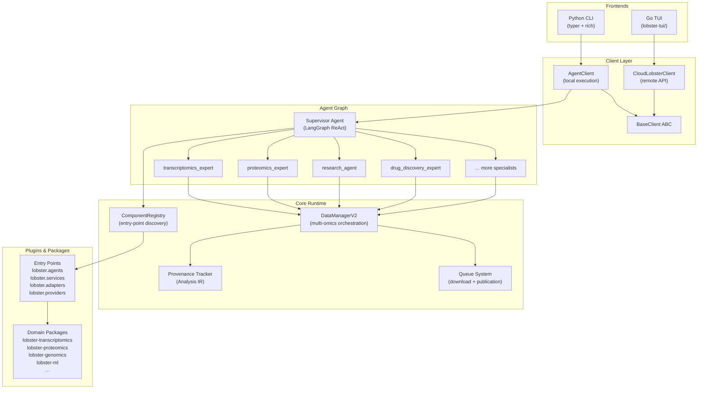
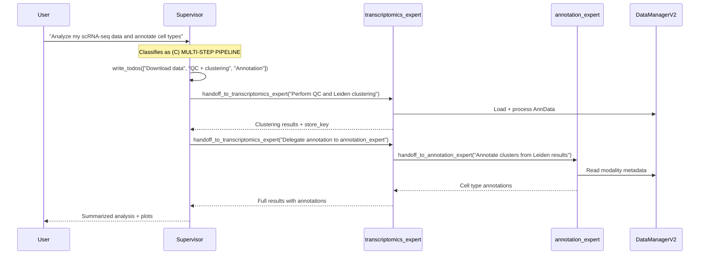

Lobster is a **multi-agent AI orchestration platform** purpose-built for bioinformatics and multi-omics research. At its core, a LangGraph-powered supervisor agent classifies incoming requests and delegates them to domain-specialist agents — transcriptomics, proteomics, metabolomics, genomics, drug discovery, and more. The system is designed around three architectural pillars: **hierarchical agent coordination**, **entry-point-driven extensibility**, and **provenance-tracked data management**. This page maps the full topology — from the user-facing frontends down through the agent graph, plugin registry, and data layer — so you can reason about where your contributions or customizations fit.


## High-Level Topology

The system is organized as a layered architecture with strict dependency direction: frontends depend on the client layer, the client layer depends on the agent graph, and the agent graph depends on the core runtime and plugin registry. Cross-cutting concerns — configuration, security policy, provenance — span all layers but are governed from the core.



Sources: [__main__.py](lobster/__main__.py#L1-L13), [cli.py](lobster/cli.py#L1-L90), [base_client.py](lobster/core/interfaces/base_client.py#L1-L182), [graph.py](lobster/agents/graph.py#L1-L50)

## Project Structure Map

The repository is a monorepo containing the core framework, a Go-based TUI, and a family of domain-specific packages. Understanding this layout is essential for navigating the codebase effectively.

```
lobster/                          # Core Python package
├── agents/                       # LangGraph graph, supervisor, state definitions
│   ├── graph.py                  # Graph assembly + agent tool creation
│   ├── supervisor.py             # Dynamic supervisor prompt builder
│   └── state.py                  # OverallState + domain-specific states
├── cli.py                        # Typer CLI entry point (1700+ lines)
├── cli_internal/                 # CLI subcommands (init, agents, scaffold, auth, cloud)
├── config/                       # LLM providers, agent registry, workspace config
│   ├── providers/                # Anthropic, Bedrock, Gemini, Ollama, OpenAI, OpenRouter
│   ├── agent_registry.py         # Agent discovery + AGENT_CONFIG resolution
│   └── supervisor_config.py      # Supervisor behavior tuning
├── core/                         # Runtime engine + data layer
│   ├── adapters/                 # Modality adapters (transcriptomics, proteomics, …)
│   ├── backends/                 # Storage backends (H5AD, MuData)
│   ├── client.py                 # AgentClient — local execution path
│   ├── component_registry.py     # Unified entry-point discovery (agents, services, adapters, providers)
│   ├── provenance/               # Analysis IR, lineage tracking
│   ├── queues/                   # Download + publication queues
│   ├── runtime/                  # DataManagerV2 + workspace resolver
│   └── interfaces/               # ABC contracts (BaseClient, IModalityAdapter, IDataBackend)
├── services/                     # Business logic services (analysis, execution, metadata, orchestration)
├── tools/                        # LangChain tool implementations (workspace, providers, rate limiting)
├── integrations/                 # External integrations
├── lobster_cloud/                # Cloud client implementation
├── prompts/                      # Prompt templates
├── scaffold/                     # Package scaffolding utilities
├── testing/                      # Test infrastructure
├── ui/                           # Terminal UI theming + console management
└── utils/                        # Shared utilities (logging, callbacks)

lobster-tui/                      # Go-based Terminal UI (cmd/, internal/, themes/)
packages/                         # Domain packages (each an installable PyPI package)
├── lobster-transcriptomics/      # scRNA-seq, bulk RNA-seq, annotation, DE analysis
├── lobster-proteomics/           # Proteomics, DE, biomarker discovery
├── lobster-genomics/             # Genomics, variant analysis
├── lobster-metabolomics/         # Metabolomics LC-MS
├── lobster-drug-discovery/       # Drug discovery, cheminformatics, clinical dev
├── lobster-ml/                   # ML, feature selection, survival analysis
├── lobster-visualization/        # Plotly-based visualization
├── lobster-structural-viz/       # Protein structure visualization
├── lobster-metadata/             # Metadata assistant
├── lobster-research/             # Research + data expert agents
├── lobster-vector/               # Vector/embedding utilities
└── lobster-visualization/        # General visualization
```

Sources: [component_registry.py](lobster/core/component_registry.py#L86-L118), [data_manager_v2.py](lobster/core/data_manager_v2.py#L1-L12), [graph.py](lobster/agents/graph.py#L1-L50)

## Agent Graph: Supervisor-Worker Topology

The heart of Lobster is its **LangGraph multi-agent graph**, assembled by `create_bioinformatics_graph()`. The architecture uses the **Tool Calling pattern** — the supervisor doesn't route via conditional edges on a `StateGraph`, but instead invokes sub-agents as LangChain tools. This means `handoff_to_<agent_name>` tools appear naturally in the supervisor's tool list, and the LLM selects which specialist to call based on the request and each tool's description.

The graph construction follows a **three-phase pipeline**:

| Phase | Function | Purpose |
|-------|----------|---------|
| **1. Resolve** | `_resolve_worker_agents()` | Discover agents from `ComponentRegistry`, apply enable-list + tier filters, auto-include child agents |
| **2. Create** | `_create_agents_single_pass()` | Import each agent's factory function, inject `DataManagerV2` + delegation tools, compile into Pregel graphs |
| **3. Assemble** | `_build_supervisor_tools()` + LangGraph assembly | Build handoff tools + workspace/code/todo tools, bind to supervisor's ReAct agent |

A critical design detail is the **lazy delegation tool** pattern. Parent agents (e.g., `transcriptomics_expert`) hold references to child agents (e.g., `annotation_expert`) via `_create_lazy_delegation_tool()`, which captures the shared `created_agents` dictionary by reference and resolves the actual agent instance at invocation time. This allows the graph to be assembled in a single pass without requiring topological ordering.



Sources: [graph.py](lobster/agents/graph.py#L227-L301), [graph.py](lobster/agents/graph.py#L304-L391), [graph.py](lobster/agents/graph.py#L678-L794), [supervisor.py](lobster/agents/supervisor.py#L131-L157)

## State Management and Graph Topology

All agents share a common state schema rooted in `OverallState`, which extends LangGraph's `AgentState`. The supervisor operates directly on `OverallState`, while specialist agents extend it with domain-specific fields (e.g., `clustering_results` for transcriptomics). State flows through the graph via LangGraph's standard message-passing — the `messages` field accumulates the conversation, while custom fields like `todos`, `store_keys`, and `context_compaction` support planning, context management, and trimming visibility.

The `todos` field uses a **replace reducer** (`_todo_reducer`) rather than append, because the supervisor sends the complete current plan on each `write_todos` call — matching the DeepAgents/LangChain TodoListMiddleware pattern. The `store_keys` registry maps store keys to agent names, populated by a `pre_model_hook` so that key references survive message trimming.

> [!TIP]
> Domain packages extend `OverallState` via the `lobster.states` entry point group. The `get_all_state_classes()` function discovers these at runtime, so new state schemas from installed packages are automatically available without modifying core code.

Sources: [state.py](lobster/agents/state.py#L1-L186), [state.py](lobster/agents/state.py#L27-L83)

## Plugin System and Entry Points

Lobster's extensibility model is built entirely on **Python entry points** — the standard mechanism for packages to advertise components to a host application. The `ComponentRegistry` is the single source of truth, scanning six entry-point groups at load time:

| Entry Point Group | Purpose | Contract |
|-------------------|---------|----------|
| `lobster.agents` | Agent configurations | `AGENT_CONFIG` dataclass with factory_function, description, routing_keywords |
| `lobster.services` | Service classes | Instantiable class or factory callable |
| `lobster.adapters` | Modality adapters | Factory callable returning configured adapter instance |
| `lobster.providers` | External data providers | Class (no-arg instantiation) |
| `lobster.download_services` | Download service classes | Class (no-arg instantiation) |
| `lobster.queue_preparers` | Queue preparation logic | Class (no-arg instantiation) |

Each domain package declares its agents in its `pyproject.toml`. For example, `lobster-transcriptomics` registers `transcriptomics_expert`, `annotation_expert`, and `de_analysis_expert`. The `AGENT_TO_PACKAGE` mapping in `component_registry.py` serves as a fallback — when an agent is referenced but its entry point isn't found (package not installed), the system can produce actionable install instructions.

The registry applies a **three-layer filter** before agents reach the graph: (1) explicit enable-list or workspace config, (2) auto-inclusion of child agents for enabled parents, and (3) subscription-tier gating. Agents that fail to load (missing dependencies, import errors) are pruned gracefully — the graph continues with whatever agents succeeded, logging install hints for the failures.

Sources: [component_registry.py](lobster/core/component_registry.py#L1-L72), [component_registry.py](lobster/core/component_registry.py#L86-L118), [plugin_loader.py](lobster/core/plugin_loader.py#L1-L79)

## Data Layer: DataManagerV2 and Modality Adapters

The `DataManagerV2` is the central orchestrator for all multi-omics data operations. It coordinates a stack of interchangeable components:

- **Modality Adapters** (`IModalityAdapter`) — domain-specific data handlers (TranscriptomicsAdapter, ProteomicsAdapter, MetabolomicsAdapter) that know how to load, validate, and transform data for their modality
- **Storage Backends** (`IDataBackend`) — persistence strategies (H5ADBackend for single-modal, MuDataBackend for multi-modal) that abstract file I/O
- **Provenance Tracker** — records every analysis step as Analysis IR (Intermediate Representation), enabling full lineage tracking and notebook export
- **Queue System** — download queue (with rate limiting) and publication queue for managing external data acquisition and result dissemination

DataManagerV2 supports **backed-mode loading** for large files (≥1 GB), loading AnnData in `backed='r'` mode to avoid OOM, with an explicit `materialize_modality()` call when mutation is needed. Plot management is integrated via `PlotManager`, and session persistence uses a `.lobster/sessions/<session_id>/` directory structure.

```
DataManagerV2
├── Adapters (IModalityAdapter)
│   ├── TranscriptomicsAdapter (scanpy-dependent)
│   ├── ProteomicsAdapter
│   ├── MetabolomicsAdapter
│   ├── ProteinStructureAdapter
│   └── PseudobulkAdapter
├── Backends (IDataBackend)
│   ├── H5ADBackend (.h5ad single-modality)
│   ├── H5ADModalityBackend (h5ad within mudata)
│   └── MuDataBackend (.h5mu multi-modality)
├── Provenance (Analysis IR)
│   ├── create_data_loading_ir() / create_data_saving_ir()
│   └── ProvenanceTracker
├── Queues
│   ├── DownloadQueue (rate-limited external data)
│   └── PublicationQueue (result dissemination)
└── PlotManager (Plotly figure lifecycle)
```

Sources: [data_manager.py](lobster/core/runtime/data_manager.py#L1-L65), [base_client.py](lobster/core/interfaces/base_client.py#L1-L182)

## Client Layer and Frontend Integration

Lobster exposes two client implementations, both conforming to the `BaseClient` abstract interface:

| Client | Location | Execution | Use Case |
|--------|----------|-----------|----------|
| `AgentClient` | `lobster.core.client` | Local — assembles graph in-process | CLI, local development |
| `CloudLobsterClient` | `lobster.lobster_cloud` | Remote — API calls to Lobster Cloud | SaaS, Go TUI |

The `BaseClient` ABC defines a uniform contract: `query()`, `get_status()`, `list_workspace_files()`, `read_file()`, `write_file()`, `get_conversation_history()`, `reset()`, `export_session()`, and optional `get_token_usage()`. This means the Python CLI and Go TUI can swap between local and cloud execution without changing their interaction logic.

The Python CLI (`lobster/cli.py`) is a Typer application with Rich terminal rendering. It handles Python version guarding (3.12+), lazy imports for fast startup (~5s saved), and prompt_toolkit autocomplete. Subcommands are organized in `cli_internal/commands/` with a "heavy/light" split — heavy modules (session infrastructure, extraction cache) are loaded lazily to keep initial startup fast.

Sources: [base_client.py](lobster/core/interfaces/base_client.py#L1-L182), [client.py](lobster/core/client.py#L1-L200), [cli.py](lobster/cli.py#L1-L90)

## Domain Packages Ecosystem

Domain packages are independently installable PyPI packages that plug into Lobster's core via entry points. Each package contributes one or more specialist agents, their associated state schemas, modality adapters, and provider integrations. The monorepo structure under `packages/` ensures cohesive development while allowing users to install only what they need.

| Package | Agents | Key Capabilities |
|---------|--------|-----------------|
| `lobster-transcriptomics` | transcriptomics_expert, annotation_expert, de_analysis_expert | scRNA-seq QC, clustering, cell annotation, differential expression |
| `lobster-proteomics` | proteomics_expert, proteomics_de_analysis_expert, biomarker_discovery_expert | Proteomics quantification, DE, biomarker identification |
| `lobster-genomics` | genomics_expert, variant_analysis_expert | Genomic data analysis, variant calling |
| `lobster-metabolomics` | metabolomics_expert | LC-MS metabolomics processing |
| `lobster-drug-discovery` | drug_discovery_expert, cheminformatics_expert, clinical_dev_expert, pharmacogenomics_expert | Drug design, ADMET, clinical development |
| `lobster-ml` | machine_learning_expert, feature_selection_expert, survival_analysis_expert | ML pipelines, feature engineering, survival modeling |
| `lobster-visualization` | visualization_expert_agent | Plotly-based scientific visualization |
| `lobster-structural-viz` | protein_structure_visualization_expert | 3D protein structure rendering |
| `lobster-metadata` | metadata_assistant | Dataset metadata extraction and validation |
| `lobster-research` | research_agent, data_expert_agent | Literature search, data discovery |

> [!TIP]
> When an agent is requested but its package isn't installed, the `AGENT_TO_PACKAGE` mapping enables the system to produce exact install commands (e.g., `uv pip install 'lobster-transcriptomics'`) rather than silent failures. This mapping is the single source of truth for the install-suggestion feature.

Sources: [component_registry.py](lobster/core/component_registry.py#L86-L118), [graph.py](lobster/agents/graph.py#L425-L535)

## Cross-Cutting Concerns

**Security Policy** is embedded directly in the supervisor prompt as the highest-priority section of an instruction hierarchy: security policy > system instructions > user messages > tool results > file content. This prevents prompt injection from external data sources (GEO, PubMed, PRIDE). Tool outputs are wrapped in `<tool_data>` markers for spotlighting.

**LLM Provider Configuration** is managed through a provider registry in `lobster/config/providers/`, with a factory function `create_llm()` that resolves provider + model from settings, workspace config, or explicit overrides. Supported providers include Anthropic, AWS Bedrock, Google Gemini, Ollama, OpenAI, OpenRouter, Azure, and Omics-OS Gateway.

**Subscription Tiers** gate agent availability. The `is_agent_available()` function checks the current tier (free/premium/enterprise) against agent-level tier requirements, and the graph construction pipeline filters out agents that exceed the user's tier.

Sources: [supervisor.py](lobster/agents/supervisor.py#L66-L106), [component_registry.py](lobster/core/component_registry.py#L120-L183)

## Where to Go Next

Now that you understand the full architecture, the logical next step depends on what you're building:

- **Working with the agent graph?** → [Supervisor Agent and Routing](5-supervisor-agent-and-routing) for how the supervisor classifies requests and delegates, then [LangGraph State and Graph Topology](6-langgraph-state-and-graph-topology) for state flow details
- **Building a new agent or package?** → [Plugin System and Entry Points](8-plugin-system-and-entry-points) for the entry-point contract, then [Scaffold and Package Validation](10-scaffold-and-package-validation) for scaffolding tools
- **Integrating a new data modality?** → [DataManager and Modality Adapters](11-datamanager-and-modality-adapters) for the adapter interface, then [Provenance Tracking and IR](12-provenance-tracking-and-ir) for lineage requirements
- **Configuring providers or workspaces?** → [LLM Provider Configuration](17-llm-provider-configuration) or [Workspace and Session Management](18-workspace-and-session-management)
- **Understanding security?** → [Security Policy and Instruction Hierarchy](21-security-policy-and-instruction-hierarchy) for the full threat model and mitigation strategy