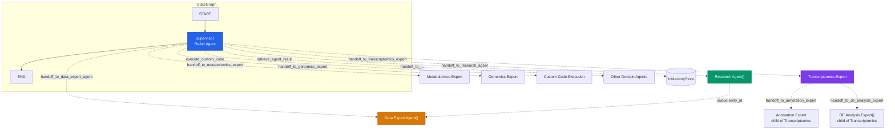
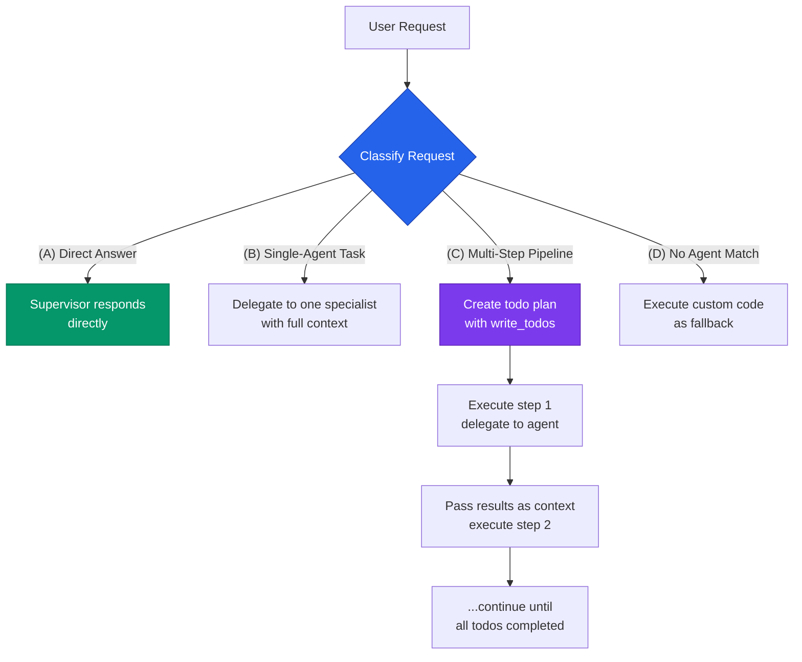

The supervisor agent is the central orchestrator in Lobster's multi-agent architecture — the single point of contact between the user and every specialist agent. Rather than routing through a complex graph topology, Lobster uses the **Tool Calling pattern**: the supervisor is a LangGraph `ReAct` agent whose "tools" are delegation functions that invoke sub-agents. This design makes routing a consequence of the LLM's own tool selection, driven by a dynamically assembled system prompt that encodes the agent directory, cognitive protocol, and orchestration principles. The result is a system where routing logic is declarative (expressed in prompt sections and tool descriptions) rather than imperative (hard-coded branching rules), letting the supervisor adapt its delegation strategy to context that changes at runtime.

## Architecture: The Tool Calling Supervisor

At the highest level, the supervisor sits at the center of a star topology. Every user message enters through the supervisor node; every specialist response flows back through it. The graph itself is deliberately simple — a single `StateGraph` with one node named `"supervisor"` connected from `START` to `END` — because all routing intelligence lives inside the supervisor's ReAct loop, not in graph edges.



The graph construction happens in [`create_bioinformatics_graph()`](lobster/agents/graph.py#L678-L920), which returns a tuple of `(compiled_graph, GraphMetadata)`. The `GraphMetadata` dataclass exposes agent hierarchy, subscription tier, and supervisor-accessible agent names to frontends via a `to_dict()` serialization method — making the graph's configuration inspectable without re-compilation.

Sources: [graph.py](lobster/agents/graph.py#L860-L878), [graph.py](lobster/agents/graph.py#L678-L726)

## Prompt Assembly: Seven Sections, One Dynamic Prompt

The supervisor's behavior is controlled entirely by its system prompt, which is assembled at graph creation time by [`create_supervisor_prompt()`](lobster/agents/supervisor.py#L22-L63). This function stitches together seven section builders, each responsible for a distinct behavioral domain. The prompt is **dynamic** — it reflects the current data context, active agent list, and `SupervisorConfig` settings — meaning the same codebase produces different prompts for different configurations.

| Section Builder | Purpose | Dynamic? |
|---|---|---|
| `_build_security_policy()` | Immutable instruction hierarchy, content boundary rules, prohibited actions | No (static) |
| `_build_identity_section(config)` | Role definition, admin mode toggle | Yes (admin_mode) |
| `_build_cognitive_protocol()` | Request classification taxonomy (A/B/C/D), data inspection rule, parallel execution guidance | No (static) |
| `_build_agent_directory(active_agents, config)` | Tree-structured agent listing with routing keywords and download queue protocol | Yes (active agents, admin_mode) |
| `_build_orchestration_principles()` | Multi-step coordination, error handling, routing recovery, continuation rules | No (static) |
| `_build_response_behavior(config, interactive)` | Clarification limits, download confirmations, summarization style | Yes (all config fields, interactive flag) |
| `_build_agent_result_memory()` | Store key retrieval rules for accessing full sub-agent results | No (static) |
| `_build_live_context(data_manager, config)` | Loaded modality snapshot, system info, memory stats | Yes (runtime data) |

The security policy section enforces a strict **instruction hierarchy**: security rules > system instructions > user messages > tool results > file content. This is the foundation of Lobster's defense against prompt injection via untrusted data sources like GEO metadata or PubMed abstracts.

> [!TIP]
> The `_build_agent_directory` section is the routing backbone. It renders a tree showing parent→child relationships and injects **routing keywords** from `AgentRegistryConfig.routing_keywords` into each agent entry. These keywords, combined with the `handoff_tool_description` on each delegation tool, are what the LLM uses to select the correct agent — making routing accuracy depend on prompt engineering quality, not code logic.

Sources: [supervisor.py](lobster/agents/supervisor.py#L22-L63), [supervisor.py](lobster/agents/supervisor.py#L66-L106), [supervisor.py](lobster/agents/supervisor.py#L160-L235)

## Cognitive Protocol: The A/B/C/D Classification

Every incoming request passes through the supervisor's **Cognitive Protocol**, a four-way classification that determines the execution path:



- **(A) Direct Answer**: Greetings, concept explanations, workspace lookups — the supervisor handles these without delegation.
- **(B) Single-Agent Task**: Clear domain mapping. The supervisor includes relevant data context (modality names, dimensions, prior steps) in its handoff message.
- **(C) Multi-Step Pipeline**: Two or more agents or three or more steps. The supervisor **must** create a todo plan via `write_todos` before delegating, then execute one step at a time, marking progress.
- **(D) No Agent Match**: Fallback to `execute_custom_code` for cross-modal analysis or tasks outside any agent's domain. Delegation is always attempted first.

Before delegating any analysis task, the protocol requires the supervisor to call `list_available_modalities` to understand what data is loaded — a guard against stale context in the system prompt snapshot.

Sources: [supervisor.py](lobster/agents/supervisor.py#L131-L157)

## Delegation: Tool Calling Pattern and Two Tool Factories

Lobster implements delegation through the **Tool Calling pattern** rather than LangGraph's Handoffs or Command/Send patterns. The supervisor sees each sub-agent as a named tool (e.g., `handoff_to_research_agent`) and invokes it with a `task_description` string. Two factory functions create these delegation tools, distinguished by when the agent reference is resolved:

| Factory | Resolution Time | Use Case |
|---|---|---|
| `_create_agent_tool()` | **Eager** — agent instance captured at creation | Supervisor → top-level agent handoffs |
| `_create_lazy_delegation_tool()` | **Lazy** — agent looked up from shared dict at invocation | Parent → child agent handoffs |

The lazy variant captures the `created_agents` dict **by reference** rather than by value. This is critical because child agents may not exist in the dict when the parent's delegation tools are created — the single-pass creation order means the dict is still being populated. At invocation time, the lazy tool looks up the agent by name; if missing, it returns an actionable install command from `AGENT_TO_PACKAGE`.

Both factories delegate to the shared async pipeline [`_invoke_and_store()`](lobster/agents/graph.py#L143-L186), which: (1) constructs a `RunnableConfig` with `run_name` and tags for callback attribution, (2) invokes the agent with a single user message containing the task description, (3) extracts the final message content, and (4) **dual-writes** the result to `InMemoryStore`, appending a `[store_key=...]` reference to the returned content. This store mechanism is what enables the `retrieve_agent_result` tool and the agent result memory system.

> [!TIP]
> The `created_agents` dict is mutated in-place by `_create_agents_single_pass()`. Lazy delegation tools capture this dict by reference and resolve agents at invocation time. **Never replace the dict object** — only add to it. Replacing the dict would orphan all lazy tool closures, causing every parent→child handoff to fail with "agent not available."

Sources: [graph.py](lobster/agents/graph.py#L189-L224), [graph.py](lobster/agents/graph.py#L227-L301), [graph.py](lobster/agents/graph.py#L394-L535)

## Agent Hierarchy and Access Control

Agents form a two-tier hierarchy: **supervisor-accessible** (top-level) and **child** (accessible only through their parent). The `AgentRegistryConfig.supervisor_accessible` field controls this:

- **`None` (default)**: Inferred from hierarchy — if an agent appears in any parent's `child_agents` list, it is NOT supervisor-accessible.
- **`True`**: Explicitly allow supervisor access, overriding inference.
- **`False`**: Explicitly deny supervisor access, overriding inference.

The function [`_resolve_worker_agents()`](lobster/agents/graph.py#L304-L391) applies three filters in sequence:

1. **Enabled agents filter**: `enabled_agents` parameter > `config.enabled_agents` > all discovered agents. Notably, `enabled_agents=[]` means zero agents (uses `is not None` check, not truthiness), while `config.enabled_agents=[]` means no preference.
2. **Child auto-inclusion**: If a parent is enabled, its children are automatically included even if not explicitly listed.
3. **Tier-based gating**: The `agent_filter` callable (defaulting to `is_agent_available(name, tier)`) excludes agents beyond the current subscription tier.

After resolution, `_build_supervisor_tools()` creates handoff tools only for supervisor-accessible agents, skipping children (who receive their tools via lazy delegation from their parent).

Sources: [graph.py](lobster/agents/graph.py#L304-L391), [graph.py](lobster/agents/graph.py#L538-L636), [agent_registry.py](lobster/agents/../../lobster/config/agent_registry.py#L17-L54)

## The Download Queue Coordination Protocol

One cross-agent pattern receives special treatment in the supervisor prompt: the **download queue protocol** between `research_agent` and `data_expert_agent`. When both agents are active, the agent directory section injects a coordination protocol:

```
1. research_agent prepares queue entry (validate_dataset_metadata or prepare_dataset_download)
2. Extract entry_id from response (format: queue_{accession}_{hex8})
3. Confirm with user before downloading (or proceed autonomously in admin mode)
4. handoff_to_data_expert_agent("execute_download_from_queue(entry_id=...)")
```

This producer-consumer pattern — where one agent creates a queue entry and another consumes it — is the canonical example of multi-step coordination. The protocol is conditionally injected only when both agents are present, and adapts to `admin_mode` by skipping the user confirmation step.

Sources: [supervisor.py](lobster/agents/supervisor.py#L216-L234)

## Orchestration Principles: Error Handling and Routing Recovery

The `<Orchestration Principles>` section encodes the supervisor's recovery and quality rules:

**Error handling**: One retry with corrected parameters for parameter errors; escalation to the user with actionable guidance for fundamental failures. Never retry in infinite loops.

**Routing recovery**: If an agent returns an error about unsupported data types or missing adapters, the supervisor re-checks the agent directory and tries the correct domain expert. Maximum one re-route attempt per request.

**Continuation on tool error**: When a sub-agent's code execution fails, the supervisor does NOT re-route to a different agent for the same analytical task. The same agent retries with corrected defensive code. If re-delegating to the same agent after a failed step in a multi-step protocol, the supervisor instructs it to continue from the failed step — **never restart from step 1**.

**Response quality**: Every response must include key findings, metrics, and file names in 2–4 sentences. The supervisor suggests logical next steps and never returns empty acknowledgments.

Sources: [supervisor.py](lobster/agents/supervisor.py#L238-L270)

## Context Management: Budget, Trimming, and Store-Backed Memory

The supervisor operates under a strict context budget to prevent token overflow across all LLM providers. The [`resolve_context_budget()`](lobster/agents/context_management.py#L117-L168) function calculates the usable token budget as:

```
budget = context_window × 0.80 − tool_schema_tokens − system_prompt_tokens
```

The 20% reserve accounts for model output and safety margin against token counting drift. Tool schemas are measured explicitly via [`measure_tool_schema_tokens()`](lobster/agents/context_management.py#L88-L114) because they are sent with every LLM call but not counted by `trim_messages` — a subtle source of context overflow that a naive "85% of window" approach would miss.

The [`create_supervisor_pre_model_hook()`](lobster/agents/context_management.py#L396) factory creates a hook that runs on each ReAct iteration. It performs three operations in sequence:

1. **Store key injection**: Reads all stored agent results from `InMemoryStore` and appends a `<Available Stored Results>` section to the system message, ensuring the LLM always knows which results it can retrieve.
2. **Message trimming**: Uses LangChain's `trim_messages` with the resolved budget, applying a `strategy="last"` to keep the most recent conversation turns.
3. **Tool result spotlighting**: Wraps all `ToolMessage` content in `<tool_data>...</tool_data>` markers, ensuring the LLM treats tool output as data rather than instructions.

Additionally, [`_fix_orphaned_tool_messages()`](lobster/agents/context_management.py#L245-L289) strips any `ToolMessage` at the start of the trimmed list whose corresponding `AIMessage(tool_calls)` was dropped by trimming — preventing LLM API rejections from invalid chat history.

The **agent result memory** system works in concert: when `_invoke_and_store()` dual-writes a delegation result to `InMemoryStore`, the `store_key` survives message trimming because it's registered in `OverallState.store_keys` (populated by the pre-model hook). The supervisor can later call `retrieve_agent_result(store_key=...)` to access the full data without asking the user to repeat information.

Sources: [context_management.py](lobster/agents/context_management.py#L117-L168), [context_management.py](lobster/agents/context_management.py#L245-L358), [graph.py](lobster/agents/graph.py#L815-L847)

## SupervisorConfig: Environment-Driven Behavior Modes

The [`SupervisorConfig`](lobster/config/supervisor_config.py#L18-L69) dataclass controls every aspect of supervisor behavior through environment variables following the `SUPERVISOR_<SETTING_NAME>` pattern. The configuration spans five domains:

| Domain | Key Settings | Default |
|---|---|---|
| **Interaction** | `ask_clarification_questions`, `max_clarification_questions`, `require_download_confirmation`, `require_metadata_preview` | `True`, `2`, `True`, `True` |
| **Response** | `auto_suggest_next_steps`, `verbose_delegation`, `summarize_expert_output` | `True`, `True`, `False` |
| **Context** | `include_data_context`, `include_system_info`, `include_memory_stats` | `True`, `False`, `False` |
| **Workflow** | `delegation_strategy`, `workflow_guidance_level`, `enable_todo_planning` | `"auto"`, `"detailed"`, `True` |
| **Security** | `admin_mode` | `False` |

The `get_prompt_mode()` method summarizes the configuration into one of four named modes: **Production** (no questions, minimal guidance), **Development** (verbose delegation, detailed guidance), **Research** (questions enabled, detailed guidance), or **Standard** (everything else). The `interactive` flag (passed separately, not from config) controls whether `ask_user` tools are available — when `False`, the supervisor operates in single-query mode with no HITL capabilities.

Sources: [supervisor_config.py](lobster/config/supervisor_config.py#L18-L69), [supervisor_config.py](lobster/config/supervisor_config.py#L71-L132), [supervisor_config.py](lobster/config/supervisor_config.py#L204-L224)

## Graph Construction: The Complete Pipeline

The [`create_bioinformatics_graph()`](lobster/agents/graph.py#L678-L920) function orchestrates the full pipeline from configuration to compiled graph:

```mermaid
flowchart LR
    A[Auto-detect<br/>subscription tier] --> B[Create supervisor<br/>LLM via create_llm]
    B --> C[_resolve_worker_agents<br/>3-stage filtering]
    C --> D[_create_agents_single_pass<br/>eager + lazy tools]
    D --> E[_build_supervisor_tools<br/>handoff + utility]
    E --> F[create_supervisor_prompt<br/>7-section assembly]
    F --> G[Context management<br/>budget + pre_model_hook]
    G --> H[create_react_agent<br/>supervisor ReAct loop]
    H --> I[StateGraph wrapper<br/>single-node topology]
    I --> J[AQUADIF monitoring<br/>tool metadata map]
    J --> K[Return<br/>graph + GraphMetadata]

    style C fill:#7c3aed,stroke:#5b21b6,color:#fff
    style D fill:#059669,stroke:#047857,color:#fff
    style F fill:#d97706,stroke:#b45309,color:#fff
    style H fill:#2563eb,stroke:#1e40af,color:#fff
```



Key design decisions in this pipeline:

1. **Agent creation is single-pass**: All agents are created in one loop (`_create_agents_single_pass`), with lazy delegation tools capturing the shared `created_agents` dict by reference. Failed agents are removed from `worker_agents` before downstream phases see them.

2. **Supervisor prompt is built after agents exist**: The `active_agents` list passed to `create_supervisor_prompt()` is the `supervisor_accessible_names` list from `_build_supervisor_tools()`, ensuring the prompt only references agents that actually have handoff tools.

3. **Context management is conditional on store**: The `pre_model_hook` is only created when `InMemoryStore` is provided. Without it, no trimming or store key injection occurs — the supervisor relies on the LLM's native context handling.

4. **The graph topology is trivially simple**: A `StateGraph` with a single `"supervisor"` node. All complexity lives inside the ReAct agent's tool selection loop, not in graph edges. This makes the system easier to debug and extend — adding a new agent requires only a registry entry and a handoff tool, no graph restructuring.

Sources: [graph.py](lobster/agents/graph.py#L678-L920)

## What's Next

The supervisor agent is the routing brain, but its intelligence depends on the state it reads and the agents it discovers. To understand the full picture:

- **[LangGraph State and Graph Topology](6-langgraph-state-and-graph-topology)** — How `OverallState`, `TodoItem`, and the state reducer pattern enable the supervisor's planning and handoff mechanisms.
- **[Agent Registry and Discovery](7-agent-registry-and-discovery)** — How `ComponentRegistry` discovers agents via entry points and how `AgentRegistryConfig` defines the routing contract.
- **[Security Policy and Instruction Hierarchy](21-security-policy-and-instruction-hierarchy)** — The immutable security policy that sits above all supervisor routing decisions.