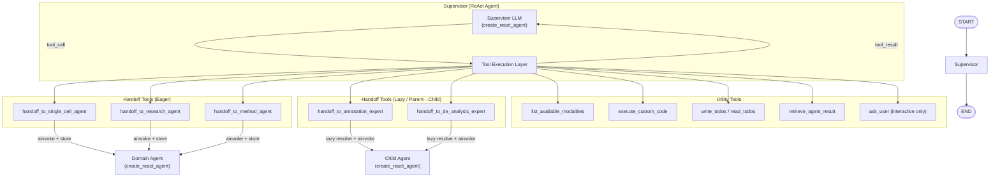
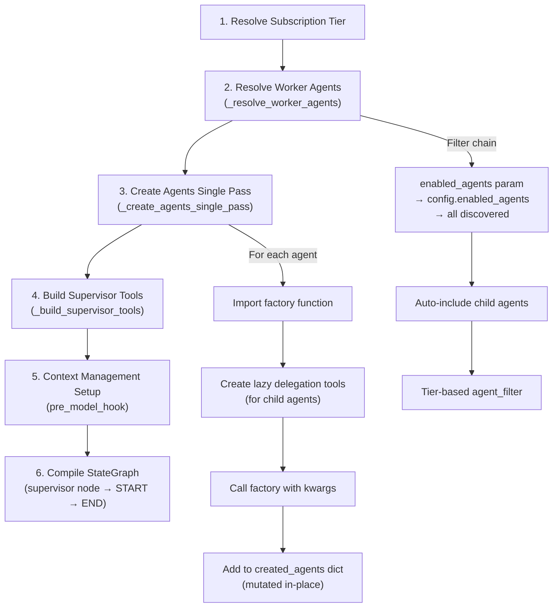
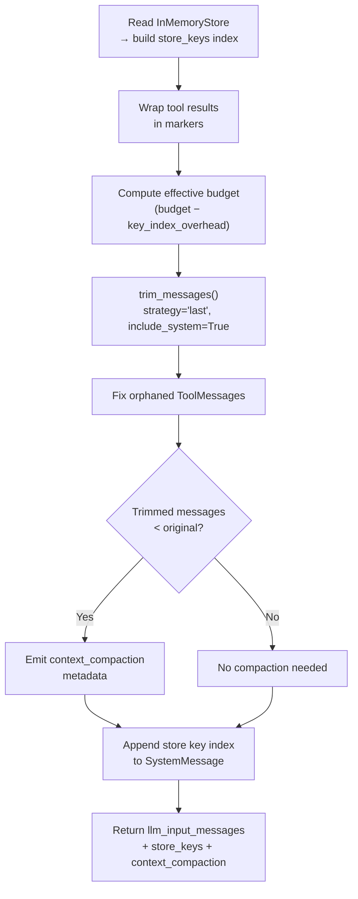

Lobster's multi-agent system is built on **LangGraph's Tool Calling pattern**, where a supervisor ReAct agent orchestrates domain specialist sub-agents through dynamically generated handoff tools. This page dissects the three pillars that make the graph tick: the **state schema** that flows through every node, the **graph topology** that wires supervisor to specialists, and the **context management pipeline** that keeps the system from overflowing its token budget. Understanding these mechanisms is essential for anyone extending the agent registry, adding domain packages, or debugging handoff failures.

## State Schema Architecture

The state layer follows a deliberate **extensible base class** pattern. `OverallState` extends LangGraph's `AgentState` with routing metadata, task context, and a todo list — and every specialist agent receives a state schema that either is `OverallState` (for the supervisor) or a domain-specific subclass of `AgentState` (for workers). The critical design decision is that the supervisor and its sub-graphs share the `OverallState` schema at the top level, while individual agents carry their own richer state internally.

### OverallState: The Graph-Wide Contract

`OverallState` is the single state object that traverses the `StateGraph`. It carries everything the supervisor needs to route requests and track progress:

| Field | Type | Reducer | Purpose |
|---|---|---|---|
| `messages` | `list[BaseMessage]` | `add_messages` (inherited) | Conversation history — inherited from `AgentState` |
| `last_active_agent` | `str` | Default (replace) | Name of the agent that last handled the conversation |
| `conversation_id` | `str` | Default (replace) | Unique session identifier |
| `current_task` | `str` | Default (replace) | Current task description for cross-agent handoffs |
| `task_context` | `Dict[str, Any]` | Default (replace) | Additional context passed between agents |
| `todos` | `Annotated[List[TodoItem], _todo_reducer]` | `_todo_reducer` (replace) | Task list managed via `write_todos` tool |
| `store_keys` | `Dict[str, str]` | Default (replace) | Registry of store keys from sub-agent delegations |
| `context_compaction` | `Dict[str, Any]` | Default (replace) | Metadata emitted when `pre_model_hook` trims context |

The `todos` field uses a **replace reducer** (`_todo_reducer`) rather than an append reducer, because the todo list represents the *current plan state*, not an append-only history. The supervisor sends a complete updated list on each `write_todos` call, matching the DeepAgents/LangChain `TodoListMiddleware` behavior.

Sources: [state.py](/lobster/agents/state.py#L68-L131)

### TodoItem: Planning Primitive

Each `TodoItem` tracks a single subtask within a multi-step pipeline:

```python
class TodoItem(TypedDict):
    content: str      # "Download GSE12345"
    status: str       # "pending" | "in_progress" | "completed"
    activeForm: str   # "Downloading GSE12345" (present continuous for UI)
```

The supervisor creates these via the `write_todos` tool *before* delegating to any agent in a multi-step pipeline (cognitive protocol classification C). This gives the UI real-time progress visibility and gives the supervisor a structured way to resume after errors without restarting from step one.

Sources: [state.py](/lobster/agents/state.py#L82-L109)

### Domain-Specific State Schemas

Specialist agents carry their own state classes that extend `AgentState` with domain fields. These schemas are **not** shared with the supervisor — they exist within each agent's internal ReAct loop. The pattern is consistent across all domain states:

| State Class | Package | Key Domain Fields |
|---|---|---|
| `SingleCellExpertState` | Core (legacy) | `clustering_parameters`, `cell_type_annotations`, `marker_genes`, `doublet_detection_results` |
| `BulkRNASeqExpertState` | Core (legacy) | `differential_expression_results`, `pathway_enrichment_results`, `experimental_design` |
| `MethodState` | Core | `methods_information`, `evaluation_metrics`, `recommendations` |
| `CustomFeatureAgentState` | Core | `feature_type`, `created_files`, `sdk_output`, `validation_errors` |
| `TranscriptomicsExpertState` | `lobster-transcriptomics` | Discovered via `lobster.states` entry points |
| `ProteomicsExpertState` | `lobster-proteomics` | Discovered via `lobster.states` entry points |
| `ResearchAgentState` | `lobster-research` | Discovered via `lobster.states` entry points |

Every domain state includes a `next: str` field (for potential graph-internal routing), `task_description`, `data_context`, `file_paths`, `methodology_parameters`, and `intermediate_outputs` — providing a uniform interface for partial computation handoffs back to the supervisor.

Sources: [state.py](/lobster/agents/state.py#L133-L266)

### Dynamic State Discovery via Entry Points

Domain packages register their state classes through the `lobster.states` entry point group. The `get_all_state_classes()` function resolves the full state catalog at runtime:

```python
def get_all_state_classes() -> Dict[str, Type]:
    states: Dict[str, Type] = {}
    # Core states from this module
    # ...
    # Discover package states via entry points
    eps = entry_points(group="lobster.states")
    for ep in eps:
        state_class = ep.load()
        states[ep.name] = state_class
    return states
```

This means adding a new domain package with its own state schema requires zero changes to the core graph module — the state class is discovered and registered automatically when the package is installed.

Sources: [state.py](/lobster/agents/state.py#L20-L64)

## Graph Topology: The Tool Calling Pattern

Lobster uses LangGraph's **Tool Calling** multi-agent pattern, which is fundamentally simpler than the Handoffs pattern. The supervisor is a single ReAct agent; sub-agents are invoked as tools. There is no graph-based routing between specialist nodes — the LLM itself decides which handoff tool to call based on tool descriptions. The user only ever interacts with the supervisor.

### Topology Diagram

Before examining the diagram, understand the key architectural constraint: the `StateGraph` contains exactly **one node** (`supervisor`) between `START` and `END`. All specialist agents are *tools* of that node, not separate graph nodes. This is the Tool Calling pattern's defining characteristic — the graph topology is trivially simple, and the complexity lives in the tool layer.



Sources: [graph.py](/lobster/agents/graph.py#L840-L867)

### Graph Construction Pipeline

The `create_bioinformatics_graph()` function is the single entry point that assembles the entire graph. Its construction pipeline proceeds through six sequential phases:



**Phase 1 — Tier Resolution**: If no `subscription_tier` is provided, the system auto-detects from the license manager. This tier gates which agents are available.

**Phase 2 — Worker Agent Resolution**: Applies three filters in order: (1) `enabled_agents` parameter > `config.enabled_agents` > all discovered agents, (2) auto-inclusion of child agents for enabled parents, (3) tier-based `agent_filter`. Returns `(worker_agents, filtered_out_agents, child_agent_names)`.

**Phase 3 — Single-Pass Agent Creation**: Iterates over resolved worker agents, imports each factory function, creates lazy delegation tools for parent agents with children, and calls the factory. The `created_agents` dict is **mutated in-place** — this is critical because lazy delegation tools capture the dict by reference and resolve agents at invocation time.

**Phase 4 — Supervisor Tool Assembly**: Builds the supervisor's complete tool belt: handoff tools (eager for top-level agents, lazy for children), workspace tools, code execution, todo tools, and optionally `ask_user` (interactive mode only).

**Phase 5 — Context Management**: If `store` is provided, resolves the context window and budget, creates a `pre_model_hook` with `retrieve_agent_result` tool, and wires everything together.

**Phase 6 — Graph Compilation**: Creates the `StateGraph(OverallState)`, adds the single `supervisor` node, compiles with `checkpointer` and `store`, and returns `(graph, GraphMetadata)`.

Sources: [graph.py](/lobster/agents/graph.py#L673-L921)

### Eager vs. Lazy Delegation Tools

The distinction between eager and lazy delegation tools is one of the most important architectural details in the graph:

| Aspect | Eager (`_create_agent_tool`) | Lazy (`_create_lazy_delegation_tool`) |
|---|---|---|
| **Use case** | Supervisor → top-level agent handoff | Parent → child agent handoff |
| **Agent reference | Captures compiled agent instance directly | Captures `agents_dict` by reference, resolves at call time |
| **When agent exists | Must exist at tool creation time | May not exist yet (parent created before child) |
| **Failure mode | `None` — agent is guaranteed present | Returns install instructions if agent missing |
| **Tool naming | Uses `agent_config.handoff_tool_name` | Auto-generates `handoff_to_{child_name}` |
| **Category metadata | `["DELEGATE"]` | `["DELEGATE"]` |

The lazy resolution pattern exists because agents are created in a single pass without guaranteed ordering — a parent agent's factory may run before its children are compiled. The `created_agents` dict is shared by reference, so when a child delegation tool is eventually invoked, it finds the agent already populated.

> [!TIP]
> When adding a new agent with children, ensure the child agent names appear in `agent_config.child_agents` in the registry. The graph constructor auto-includes children for enabled parents and creates lazy delegation tools — but only for children listed in that config field. Missing entries mean invisible children.

Sources: [graph.py](/lobster/agents/graph.py#L202-L297)

### The Shared Invoke Pipeline

Both eager and lazy tools funnel through `_invoke_and_store()`, which provides a uniform execution pipeline:

1. **Config attribution**: Sets `run_name`, `tags`, and `metadata` on the `RunnableConfig` so nested LangGraph runs propagate the agent name for observability.
2. **Agent invocation**: Calls `agent.ainvoke({"messages": [{"role": "user", "content": task_description}]}, config=config)`.
3. **Result extraction**: Pulls the final message from the response.
4. **Dual-write to store**: If `store` is provided, calls `store_delegation_result()` to persist the full response and appends `[store_key=...]` to the returned content.

The dual-write pattern is what makes `retrieve_agent_result` possible — the supervisor can recall full analysis outputs long after the conversation history has been trimmed.

Sources: [graph.py](/lobster/agents/graph.py#L161-L180)

## Context Management Pipeline

Without context management, a long multi-agent conversation would inevitably exceed the LLM's context window — tool schemas consume tokens on every call, agent responses are verbose, and the conversation grows monotonically. The `pre_model_hook` mechanism solves this with a non-destructive trimming pipeline that runs on every ReAct iteration.

### Budget Resolution

The context budget is calculated from three inputs:

```
budget = (context_window × 0.80) − tool_schema_tokens − system_prompt_tokens
```

The 20% reserve accounts for model output tokens and safety margin against counting drift. Tool schema tokens are measured explicitly (not estimated) using `measure_tool_schema_tokens()`, which serializes each tool's name, description, and JSON schema. When fixed overhead exceeds 50% of the context window, a warning is logged — this indicates the model will struggle with complex conversations.

| Parameter | Default | Purpose |
|---|---|---|
| `DEFAULT_CONTEXT_WINDOW` | 128,000 tokens | Fallback when provider info unavailable |
| `OUTPUT_RESERVE_FRACTION` | 0.20 | Fraction reserved for model output |
| `MINIMUM_BUDGET` | 4,096 tokens | Absolute floor — prevents degenerate trimming |
| `BASELINE_WARNING_THRESHOLD` | 0.50 | Overhead fraction that triggers a warning |

Context window resolution follows a priority chain: workspace model override → global model override → provider catalog. This ensures that per-workspace configurations (e.g., a local Ollama model with a smaller window) take precedence over defaults.

Sources: [context_management.py](/lobster/agents/context_management.py#L17-L139)

### The pre_model_hook Execution Flow

On every ReAct iteration, the supervisor's `pre_model_hook` executes the following pipeline:



**Step 1 — Store Key Index**: Reads all stored agent results from `InMemoryStore` and builds a `key → agent_name` index. This index survives message trimming because it's injected into the `SystemMessage` rather than the conversation history.

**Step 2 — Tool Result Spotlighting**: Wraps every `ToolMessage`'s content in `<tool_data>...</tool_data>` markers. This is a **security defense** — it ensures the LLM treats tool output as inert data, not instructions. Handles both string content and multi-part list content.

**Step 3 — Budget Adjustment**: Subtracts the token cost of the key index text from the effective budget before trimming. This prevents the injected index from pushing the trimmed messages over budget.

**Step 4 — Trimming**: Uses `trim_messages()` with `strategy="last"` (trims from the front), `include_system=True` (preserves the SystemMessage), and `allow_partial=False` (no truncated messages). The custom `_message_list_token_counter` counts all token-bearing fields including `tool_calls`, `tool_call_id`, and message names.

**Step 5 — Orphan Fix**: When `trim_messages` drops an `AIMessage(tool_calls=...)` but keeps the subsequent `ToolMessage`, the result is an invalid chat history that causes LLM API rejections. `_fix_orphaned_tool_messages()` strips leading `ToolMessage` entries whose `tool_call_id` has no matching `AIMessage`.

**Step 6 — Compaction Metadata**: If any messages were trimmed, emits `context_compaction` with `before_count`, `after_count`, and `budget_tokens` — used by streaming UIs to surface compaction visibility.

> [!TIP]
> The `pre_model_hook` returns `llm_input_messages` (not `messages`), which is the non-destructive bypass in LangGraph. The original `state["messages"]` is never modified — trimmed messages are only what the LLM sees. This means the full conversation history is always recoverable from the checkpointer, even after aggressive trimming.

Sources: [context_management.py](/lobster/agents/context_management.py#L399-L473)

## GraphMetadata: API Surface

The `create_bioinformatics_graph()` function returns a `(graph, GraphMetadata)` tuple. `GraphMetadata` captures the graph's construction-time state for frontend consumption:

```python
@dataclass
class GraphMetadata:
    subscription_tier: str
    available_agents: List[AgentInfo]
    supervisor_accessible_agents: List[str]
    filtered_out_agents: List[str]
```

Each `AgentInfo` includes the agent's `name`, `display_name`, `description`, `is_supervisor_accessible`, `parent_agent`, `child_agents`, and `handoff_tool_name`. This dataclass is serializable via `to_dict()` and provides the single source of truth for what agents exist, what hierarchy they form, and what the subscription tier permits.

Sources: [graph.py](/lobster/agents/graph.py#L40-L97)

## Key Design Decisions

| Decision | Rationale | Trade-off |
|---|---|---|
| Tool Calling over Handoffs pattern | Simpler graph topology; LLM decides routing via tool selection; user only interacts with supervisor | Less explicit control over routing; depends on LLM's tool-selection accuracy |
| Replace reducer for `todos` | Represents current plan state, not history; matches TodoListMiddleware convention | Cannot reconstruct plan history from state alone |
| Lazy delegation tools for children | Parent agents created before children; dict-by-reference allows resolution at invocation | Slight runtime overhead on first child invocation; failure path returns install instructions |
| `llm_input_messages` bypass | Non-destructive trimming preserves full history in checkpointer | Requires understanding that `state["messages"]` ≠ what the LLM sees |
| Store dual-write with key index | Full results survive trimming; LLM always knows what's available for retrieval | Additional store reads on every iteration; token overhead for key index injection |
| `<tool_data>` spotlighting | Defense against prompt injection via tool output | Slight token overhead per ToolMessage |

Sources: [graph.py](/lobster/agents/graph.py#L1-L15), [state.py](/lobster/agents/state.py#L95-L109), [context_management.py](/lobster/agents/context_management.py#L290-L340)

## What Comes Next

With the state schema and graph topology understood, the natural next step is to examine how agents are discovered, registered, and made available to the graph constructor: see [Agent Registry and Discovery](7-agent-registry-and-discovery). For the supervisor's routing logic and cognitive protocol (which drives tool selection within this topology), see [Supervisor Agent and Routing](5-supervisor-agent-and-routing). For how tools are classified and monitored within the AQUADIF framework, see [AQUADIF Tool Taxonomy](9-aquadif-tool-taxonomy).