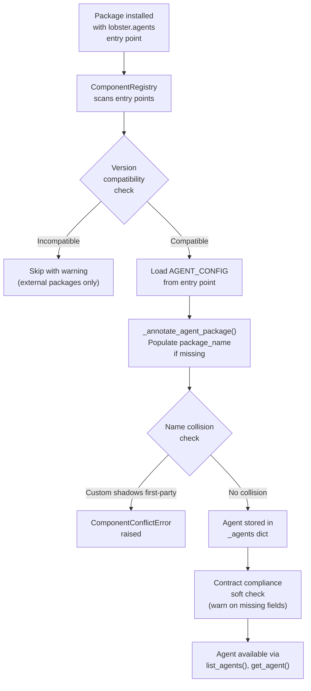
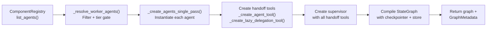
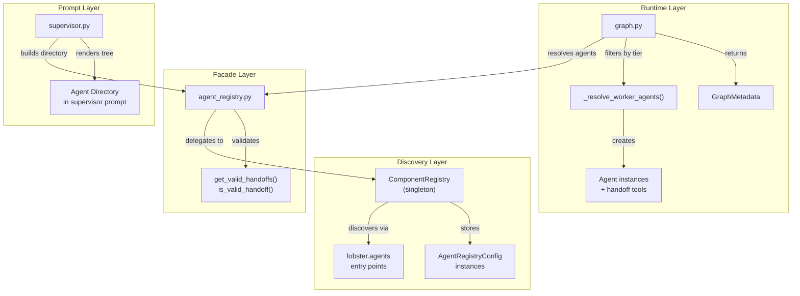

The Lobster platform routes every user request through a hierarchy of specialist agents—a transcriptomics expert for single-cell analysis, a research agent for literature searches, a drug discovery expert for cheminformatics, and so on. But before the supervisor can delegate, it must **discover** which agents exist, **validate** their configuration, and **assemble** them into a routable graph. The Agent Registry and Discovery subsystem is the machinery that makes this possible: it uses Python entry points to dynamically discover agents from any installed package, validate their contracts, resolve parent-child hierarchies, enforce subscription-tier gating, and surface the resulting topology to the supervisor's prompt and the LangGraph runtime. Understanding this subsystem is essential for anyone adding a new agent package, debugging why an agent doesn't appear, or reasoning about handoff validity in a multi-step workflow.

Sources: [component_registry.py](/lobster/core/component_registry.py#L1-L79), [agent_registry.py](/lobster/config/agent_registry.py#L1-L40)

## Discovery Architecture: Entry Points as the Single Source of Truth

Lobster eliminated a once-hardcoded agent dictionary in favor of **dynamic entry-point discovery**. Every agent—whether it ships in the core `lobster-ai` package or in a separate PyPI package like `lobster-transcriptomics`—advertises itself through a `[project.entry-points."lobster.agents"]` declaration in its `pyproject.toml`. At runtime, the `ComponentRegistry` singleton scans this entry-point group, loads each `AGENT_CONFIG` object, and indexes it by name. This means installing a new agent package is sufficient for it to appear in the system; no central registry file needs editing.

The entry-point groups that `ComponentRegistry` scans are codified in a single tuple, and each group maps to a dedicated internal dictionary. The `lobster.agents` group is the one relevant here—it stores fully-loaded `AgentRegistryConfig` instances:

| Entry-Point Group | Stored Type | Purpose |
|---|---|---|
| `lobster.agents` | `AgentRegistryConfig` | Agent configuration and routing metadata |
| `lobster.services` | Service class | Premium feature services |
| `lobster.adapters` | Factory callable | Data modality adapters |
| `lobster.providers` | Class/callable | External data providers |
| `lobster.download_services` | Class/callable | Dataset download services |
| `lobster.queue_preparers` | Class/callable | Download queue preparation |

Loading is **idempotent and lazy**—`_ensure_group_loaded` checks whether a group has already been scanned before re-scanning, and the `load_components` method returns immediately once all groups are populated. This design ensures that even if `component_registry.list_agents()` is called from multiple initialization paths, discovery runs exactly once per group.

Sources: [component_registry.py](/lobster/core/component_registry.py#L94-L132), [component_registry.py](/lobster/core/component_registry.py#L288-L330)

## AgentRegistryConfig: The Agent's Identity Card

Every discovered agent is represented as an `AgentRegistryConfig` dataclass—a structured declaration of who the agent is, how to reach it, and what constraints govern its use. The fields divide naturally into identity, routing, hierarchy, and contract categories:

```
AgentRegistryConfig
├── Identity
│   ├── name                  # Unique identifier (e.g., "transcriptomics_expert")
│   ├── display_name          # UI label (e.g., "Transcriptomics Expert")
│   └── description           # Capability summary for the supervisor
├── Routing
│   ├── factory_function      # Module path to the agent's factory (e.g., "lobster.agents.x:create_x")
│   ├── handoff_tool_name     # Tool name for delegation (e.g., "handoff_to_transcriptomics_expert")
│   └── handoff_tool_description  # When-to-use description for the supervisor's tool selection
├── Hierarchy
│   ├── child_agents          # Agents this one can delegate to (e.g., ["annotation_expert"])
│   └── supervisor_accessible # None=infer, True/False=explicit override
└── Contract (AQUADIF Phase 2)
    ├── tier_requirement      # "free", "premium", or "enterprise"
    ├── package_name          # Owning PyPI package (e.g., "lobster-transcriptomics")
    └── service_dependencies  # Required runtime services
```

The **`supervisor_accessible`** field is particularly nuanced. When left as `None` (the default), the system *infers* accessibility: if the agent's name appears in *any* other agent's `child_agents` list, it is treated as a child-only agent and hidden from the supervisor's direct routing. Setting it to `True` overrides this inference (useful for agents that are both supervisor-accessible and children of another agent), while `False` explicitly hides the agent from the supervisor regardless of hierarchy.

Sources: [agent_registry.py](/lobster/config/agent_registry.py#L26-L65)

## The Discovery Pipeline: From Entry Point to Routable Agent

The full lifecycle from "package installed" to "supervisor can delegate" follows a precise pipeline. Understanding each stage is critical for debugging missing agents or contract violations:



**Version compatibility** is checked only for external packages (not `lobster-ai` itself). The `check_plugin_compatibility` function inspects the package's declared dependency on `lobster-ai` and verifies the installed version satisfies any `>=` constraint. Incompatible plugins are silently skipped with a warning—this prevents runtime crashes from stale packages while allowing the rest of the system to function.

**Name collision detection** rejects custom packages that shadow first-party agent names. If a package named `lobster-custom-x` tries to register an agent called `transcriptomics_expert`—a name reserved for the `lobster-transcriptomics` package—the registry raises a `ComponentConflictError`. This protects the integrity of the agent namespace.

**Contract compliance checking** is intentionally soft: agents missing `tier_requirement` or other AQUADIF fields receive a warning but are not blocked. This preserves backward compatibility with pre-AQUADIF agents while encouraging migration.

Sources: [component_registry.py](/lobster/core/component_registry.py#L330-L430), [component_registry.py](/lobster/core/component_registry.py#L430-L470)

## The Facade Layer: Backward Compatibility Without Compromise

The `agent_registry.py` module serves as a **backward-compatible facade** over `ComponentRegistry`. All of its public functions—`get_all_agent_names()`, `get_worker_agents()`, `get_agent_registry_config()`—delegate internally to `component_registry.list_agents()` or `component_registry.get_agent()`. This design decision means that any code written against the old `AGENT_REGISTRY` dict continues to work, while all discovery logic flows through the single source of truth.

The facade also provides **handoff validation** through `get_valid_handoffs()` and `is_valid_handoff()`. These functions construct a directed adjacency map by examining every agent's `child_agents` list and the `supervisor_accessible` inference logic:

| Agent | Valid Handoff Targets |
|---|---|
| `supervisor` | All supervisor-accessible agents (inferred or explicit) |
| `transcriptomics_expert` | `annotation_expert`, `de_analysis_expert` |
| `research_agent` | `metadata_assistant` |
| `data_expert_agent` | `metadata_assistant` |
| Agents with no `child_agents` | ∅ (empty set) |

The `_AgentRegistryProxy` class provides dict-like access (`__getitem__`, `__contains__`, `keys()`, `values()`, `items()`) for legacy code that imports `AGENT_REGISTRY` directly. Each access lazily delegates to `ComponentRegistry`, so the proxy is never stale.

Sources: [agent_registry.py](/lobster/config/agent_registry.py#L73-L170)

## Agent Hierarchy and the Supervisor's Agent Directory

Agents are not a flat list—they form a **tree structure** that the supervisor renders into its prompt as the *Agent Directory*. The `_build_agent_directory` function in `supervisor.py` constructs this tree by separating top-level (supervisor-accessible) agents from their children, then rendering each parent with indented sub-agents:

```
├── Transcriptomics Expert (transcriptomics_expert)
│   Expert in single-cell and bulk RNA-seq analysis...
│   Keywords: scRNA-seq, clustering, DE analysis
│   ├── Annotation Expert (annotation_expert)
│   └── DE Analysis Expert (de_analysis_expert)
├── Research Agent (research_agent)
│   Literature search and knowledge retrieval...
```

This tree is built dynamically from the **currently active** agent set—not the full registry. The `active_agents` list passed to `create_supervisor_prompt` is resolved at graph construction time by `_resolve_worker_agents`, which applies three sequential filters:

1. **Enabled-agent filter**: The `enabled_agents` parameter overrides `WorkspaceAgentConfig.enabled_agents`, which in turn falls back to "all discovered agents" when neither is specified.
2. **Auto-include children**: When a parent agent is enabled, its `child_agents` are automatically pulled in—even if they weren't explicitly listed. This prevents broken handoff chains.
3. **Tier-based gating**: Each agent's `tier_requirement` is checked against the user's subscription tier. Agents above the current tier are filtered out and recorded in `GraphMetadata.filtered_out_agents`.

> [!TIP]
> When a parent agent is enabled but its child agent's package isn't installed, the directory renders the child as "(not installed)" rather than silently dropping it. This gives the supervisor visibility into the intended hierarchy and allows it to suggest installation when a user requests a capability that requires the missing child.

Sources: [supervisor.py](/lobster/agents/supervisor.py#L115-L185), [graph.py](/lobster/agents/graph.py#L268-L335)

## Graph Construction: From Registry to Routable Topology

The `graph.py` module bridges the registry and the LangGraph runtime. Its `build_graph` function (or its async equivalent) orchestrates the full assembly:



Each agent in the filtered `worker_agents` dict is instantiated via its `factory_function`, which is dynamically imported using `import_agent_factory`. The resulting compiled agent is then wrapped in one of two tool types:

- **`_create_agent_tool`**: For supervisor → agent handoffs. The agent is already created, so invocation is immediate.
- **`_create_lazy_delegation_tool`**: For parent → child handoffs. The child agent may not exist at tool-creation time (e.g., the parent was created first), so resolution is deferred to invocation time. If the child isn't found, the tool returns a diagnostic message including the install command for the missing package.

> [!TIP]
> The lazy delegation tool captures the shared `agents_dict` **by reference**, not by value. This means when the child agent is later created and added to the dict, the tool automatically resolves it on next invocation—no re-registration needed. This pattern is what allows single-pass agent creation without topological sorting.

The `GraphMetadata` dataclass captures the state of the graph at creation time for API exposure. It records the subscription tier, all available `AgentInfo` objects (with parent/child relationships), which agents the supervisor can directly access, and which were filtered out. Frontends consume this via `GraphMetadata.to_dict()` to render agent lists and capability indicators.

Sources: [graph.py](/lobster/agents/graph.py#L46-L100), [graph.py](/lobster/agents/graph.py#L130-L200), [graph.py](/lobster/agents/graph.py#L268-L335)

## Diagnostics: When an Agent Doesn't Appear

The registry provides a three-tier diagnostic model through `diagnose_missing_agent`, which distinguishes:

| Scenario | Symptom | Diagnostic Output |
|---|---|---|
| **Known agent, uninstalled package** | Entry point doesn't exist | `"Agent 'X' requires package 'Y'. Install with: uv pip install 'Y'"` |
| **Installed but broken** | Entry point exists but `load()` raises | `"Agent 'X' is installed but failed to load: <error>"` |
| **Truly unknown** | Not in `AGENT_TO_PACKAGE` mapping | `"Agent 'X' is not available. See available agents with: lobster agents list"` |

The `AGENT_TO_PACKAGE` dictionary in `component_registry.py` is the static mapping that makes the first case possible. Since entry points for uninstalled packages simply don't exist, there's no dynamic way to discover which package provides a missing agent—this mapping is the only source of that information. It must be manually updated when new first-party packages are added.

The registry also tracks **failed entry points** in `_failed_entries`, keyed by `(group, name)` tuples. This allows post-hoc inspection: `component_registry.get_failed_entry_points()` returns all agents that were discovered but couldn't be loaded, along with their error messages. The `get_info()` method provides a comprehensive diagnostic snapshot including counts, names, and failure details for all component types.

Sources: [component_registry.py](/lobster/core/component_registry.py#L180-L240), [component_registry.py](/lobster/core/component_registry.py#L680-L740)

## The Package-to-Agent Map

The `AGENT_TO_PACKAGE` dictionary serves as the authoritative mapping from agent entry-point names to their owning PyPI packages. This is essential context for understanding which packages provide which capabilities:

| Package | Agents |
|---|---|
| `lobster-research` | `research_agent`, `data_expert_agent` |
| `lobster-transcriptomics` | `transcriptomics_expert`, `annotation_expert`, `de_analysis_expert` |
| `lobster-visualization` | `visualization_expert_agent` |
| `lobster-metadata` | `metadata_assistant` |
| `lobster-structural-viz` | `protein_structure_visualization_expert` |
| `lobster-genomics` | `genomics_expert`, `variant_analysis_expert` |
| `lobster-proteomics` | `proteomics_expert`, `proteomics_de_analysis_expert`, `biomarker_discovery_expert` |
| `lobster-metabolomics` | `metabolomics_expert` |
| `lobster-ml` | `machine_learning_expert`, `feature_selection_expert`, `survival_analysis_expert` |
| `lobster-drug-discovery` | `drug_discovery_expert`, `cheminformatics_expert`, `clinical_dev_expert`, `pharmacogenomics_expert` |

Each of these packages declares its agents under `[project.entry-points."lobster.agents"]` in its `pyproject.toml`, pointing to an `AGENT_CONFIG` variable in the package's module. The `ComponentRegistry` discovers these at load time, so the mapping above is descriptive (for human reference and diagnostics) rather than prescriptive (the actual discovery mechanism is the entry points themselves).

Sources: [component_registry.py](/lobster/core/component_registry.py#L94-L160)

## How It All Connects

The relationship between the three core modules—`ComponentRegistry`, `agent_registry.py`, and the supervisor's graph-building pipeline—follows a clean dependency chain:



The `ComponentRegistry` is the foundation; the facade makes it accessible with backward-compatible APIs; the graph pipeline consumes it to build the runtime; and the supervisor prompt renderer transforms the registry into a text-based directory that the LLM actually reads. No agent exists in the system unless it flows through this entire chain.

Sources: [component_registry.py](/lobster/core/component_registry.py#L1-L79), [agent_registry.py](/lobster/config/agent_registry.py#L73-L170), [graph.py](/lobster/agents/graph.py#L268-L335), [supervisor.py](/lobster/agents/supervisor.py#L115-L185)

---

**Next steps**: Now that you understand how agents are discovered and registered, explore how the supervisor uses this registry to route requests in [Supervisor Agent and Routing](5-supervisor-agent-and-routing), or learn how the LangGraph state model carries registry metadata through the graph in [LangGraph State and Graph Topology](6-langgraph-state-and-graph-topology). If you're building a new agent package, the registration contract is detailed in [Plugin System and Entry Points](8-plugin-system-and-entry-points).