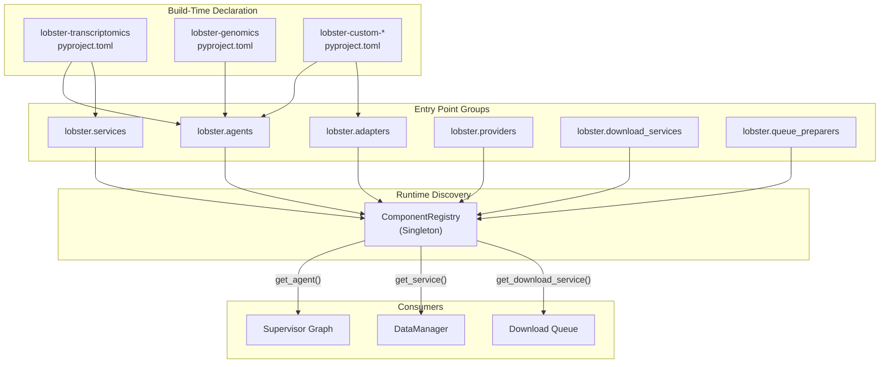
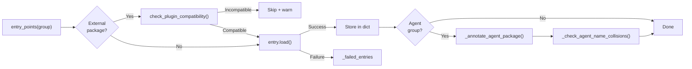
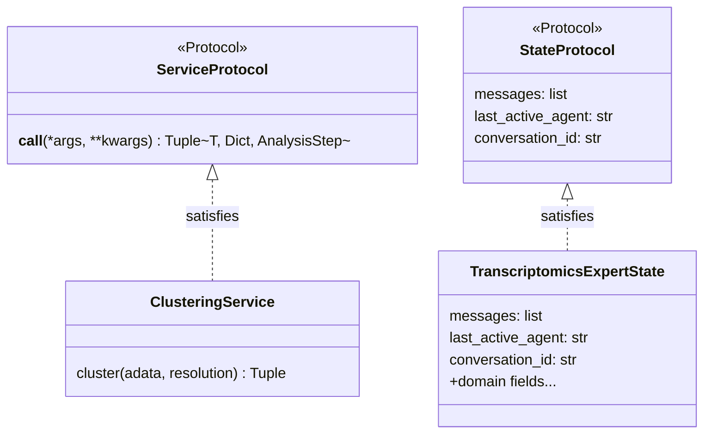

Lobster's plugin system transforms the platform from a monolithic application into a composable ecosystem of discoverable components. At its foundation lies Python's `importlib.metadata` entry point mechanism — a standards-based discovery layer that allows domain packages (transcriptomics, genomics, proteomics, and beyond) to register agents, services, adapters, and data providers without modifying core code. The **ComponentRegistry** serves as the single orchestrator for this discovery, while the scaffold toolkit and validation suite ensure that every plugin conforms to the structural and behavioral contracts the system demands.

## Architectural Overview

The plugin architecture follows a **register-at-build-time, discover-at-runtime** pattern. Package authors declare their components via `[project.entry-points]` in `pyproject.toml`; at startup, `ComponentRegistry` scans these declarations and loads them into typed dictionaries. This separation means adding a new domain agent never requires a pull request to the core repository — it only requires publishing a package that advertises the right entry point group.



The six entry point groups form the backbone of the system. Each group maps to a specific component type with its own loading semantics and storage dictionary inside `ComponentRegistry`.

Sources: [component_registry.py](lobster/core/component_registry.py#L1-L72), [pyproject.toml](pyproject.toml#L266-L316)

## Entry Point Groups and Their Contracts

Every entry point group enforces a distinct contract — the shape of the object that gets loaded determines how the registry stores and serves it. Understanding these contracts is essential for anyone building a plugin package.

| Group | Purpose | Entry Point Value | Loaded Object Type | Key API Method |
|---|---|---|---|---|
| `lobster.agents` | Agent discovery | `module:AGENT_CONFIG` | `AgentRegistryConfig` instance | `get_agent(name)` |
| `lobster.services` | Service classes | `module:ServiceClass` | Class (instantiated by consumer) | `get_service(name)` |
| `lobster.adapters` | Data adapters | `module:factory_callable` | Factory callable → adapter instance | `get_adapter(name)` |
| `lobster.providers` | Data providers | `module:ProviderClass` | Class or factory → provider instance | `get_provider(name)` |
| `lobster.download_services` | Download backends | `module:DownloadServiceClass` | Class or factory | `get_download_service(name)` |
| `lobster.queue_preparers` | Queue preparation | `module:QueuePreparerClass` | Class or factory | `get_queue_preparer(name)` |

A critical design distinction exists between **agents** and **adapters/services**: agent entry points load an `AGENT_CONFIG` dataclass instance (a declarative configuration), while adapters, providers, and download services load classes or factory callables that the consumer instantiates. This split means agent discovery is lightweight — the registry only needs the `AgentRegistryConfig`, not the full agent graph — which keeps entry point scanning under 50ms even with many packages installed.

Sources: [component_registry.py](lobster/core/component_registry.py#L275-L345), [pyproject.toml](pyproject.toml#L266-L301)

## The ComponentRegistry: Discovery and Loading

`ComponentRegistry` is a singleton (`component_registry = ComponentRegistry()`) that provides lazy, idempotent loading for each entry point group. Calling `load_components()` iterates over all six groups; each group is loaded on first access via `_ensure_group_loaded()`, meaning unused groups (e.g., `lobster.adapters` when no adapter packages are installed) incur zero cost.

The loading sequence for each group follows a consistent pipeline:

1. **Scan** — `importlib.metadata.entry_points(group=group)` retrieves all registered entry points for that group.
2. **Compatibility check** — For external packages (not `lobster-ai` itself), `check_plugin_compatibility()` validates that the plugin's declared `lobster-ai` version constraint is satisfied. Incompatible plugins are skipped with a warning.
3. **Load** — `entry.load()` imports the target module and retrieves the object. Failed loads are captured in `_failed_entries` rather than crashing the registry.
4. **Annotate** — For agents, `_annotate_agent_package()` injects the owning package name from entry point distribution metadata, ensuring `config.package_name` is always populated even if the package author omitted it.
5. **Conflict detection** — After loading `lobster.agents`, `_check_agent_name_collisions()` rejects custom agents that shadow first-party agent names by raising `ComponentConflictError`.



> [!TIP]
> When consuming the registry, prefer `required=True` on getters like `get_agent(name, required=True)` — this produces actionable error messages that include the correct `pip install` command via `diagnose_missing_agent()`, rather than a cryptic `None` return.

Sources: [component_registry.py](lobster/core/component_registry.py#L275-L438), [component_registry.py](lobster/core/component_registry.py#L598-L777)

## AgentRegistryConfig: The Agent Declaration Contract

Every agent plugin must expose an `AGENT_CONFIG` variable at the entry point target — a dataclass instance of `AgentRegistryConfig`. This object is the agent's identity card: it tells the supervisor graph how to route tasks, what tools to provide, and what tier the agent requires.

The scaffold template demonstrates the canonical declaration pattern, with `AGENT_CONFIG` positioned **before heavy imports** (LangGraph, LangChain) to ensure that entry point discovery only loads the config, not the entire agent dependency tree:

```python
from lobster.config.agent_registry import AgentRegistryConfig

AGENT_CONFIG = AgentRegistryConfig(
    name="epigenomics_expert",
    display_name="Epigenomics Expert",
    description="Epigenomics analysis tasks",
    factory_function="lobster.agents.epigenomics.epigenomics_expert.epigenomics_expert",
    handoff_tool_name="handoff_to_epigenomics_expert",
    handoff_tool_description="Assign epigenomics tasks: epigenomics analysis",
    child_agents=None,
    supervisor_accessible=True,
    tier_requirement="free",
    package_name="lobster-epigenomics",
)

# === Heavy imports below (after AGENT_CONFIG for <50ms entry point discovery) ===
from langgraph.prebuilt import create_react_agent
```

The contract tests in `tests/test_plugin_contract.py` enforce three mandatory fields:

| Field | Purpose | Default |
|---|---|---|
| `tier_requirement` | Subscription tier gate (`"free"`, `"premium"`, `"enterprise"`) | `"free"` |
| `package_name` | Owning PyPI package for install suggestions | `None` (core) |
| `service_dependencies` | Services the agent requires at runtime | `None` |

Sources: [agent.py.j2](lobster/scaffold/templates/agent.py.j2#L1-L25), [test_plugin_contract.py](tests/test_plugin_contract.py#L93-L151)

## The Plugin Package Lifecycle: Scaffold, Validate, Publish

Lobster provides a complete toolchain for creating new plugin packages: **scaffold** generates the skeleton, **validators** enforce structural compliance, and the entry point system handles runtime discovery.

### Scaffold Generation

The `scaffold_agent()` function in `lobster/scaffold/generators/agent.py` generates a complete, buildable package from a Jinja2 template context. Given an agent name like `epigenomics_expert`, it produces:

```
lobster-epigenomics/
├── pyproject.toml          # Entry points + dependencies
├── README.md
├── lobster/
│   └── agents/
│       └── epigenomics/
│           ├── __init__.py
│           ├── epigenomics_expert.py   # AGENT_CONFIG + factory
│           ├── shared_tools.py         # @tool functions
│           ├── state.py                # State schema
│           ├── config.py
│           └── prompts.py
└── tests/
    ├── __init__.py
    ├── test_contract.py
    └── conftest.py
```

> [!TIP]
> PEP 420 compliance is mandatory: no `__init__.py` may exist at the `lobster/` or `lobster/agents/` namespace boundaries. The scaffold generator enforces this automatically — the only `__init__.py` is at the domain level (`lobster/agents/epigenomics/`). Violating this breaks namespace package resolution for all installed plugins.

### Eight-Point Validation

The `validate_plugin()` function in `lobster/scaffold/validators.py` runs eight structural checks ordered by severity. Each check produces a `ValidationResult` with a pass/fail status and diagnostic message:

| # | Check | What It Catches |
|---|---|---|
| 1 | PEP 420 compliance | `__init__.py` at namespace boundaries breaks multi-package resolution |
| 2 | Entry points format | Missing `lobster.agents` group or non-`:AGENT_CONFIG` targets |
| 3 | AGENT_CONFIG position | Config after heavy imports → slow entry point scanning |
| 4 | Factory signature | Missing `data_manager`, `callback_handler`, `delegation_tools` params |
| 5 | AQUADIF metadata | `@tool` functions without `.metadata` assignments |
| 6 | Provenance calls | `provenance: True` without corresponding `log_tool_usage(ir=ir)` |
| 7 | Import boundaries | Plugin importing from `lobster.agents.*` core agents (coupling violation) |
| 8 | No ImportError guards | `try/except ImportError` in domain `__init__.py` hides dependency issues |

Checks 3 and 5–6 use AST analysis to verify code structure without importing the module, making validation safe to run on partially-implemented packages.

Sources: [agent.py](lobster/scaffold/generators/agent.py#L37-L135), [validators.py](lobster/scaffold/validators.py#L1-L62), [validators.py](lobster/scaffold/validators.py#L77-L228)

## Protocols: Structural Typing for Services and State

The plugin system uses Python `Protocol` classes (PEP 544) with `@runtime_checkable` to define contracts without requiring inheritance. This means a service or state class satisfies the protocol simply by having the right methods and attributes — no base class needed.

**`ServiceProtocol`** defines the 3-tuple return contract that all analysis services follow: `(result, stats, ir)`. The `result` is the primary output (AnnData, DataFrame), `stats` is a human-readable dictionary for logging, and `ir` is an `AnalysisStep` for provenance tracking.

**`StateProtocol`** defines the minimum contract for agent state schemas: `messages`, `last_active_agent`, and `conversation_id`. Every domain-specific state (e.g., `TranscriptomicsExpertState`) extends this implicitly by including these three fields.



Sources: [protocols.py](lobster/core/protocols.py#L1-L74)

## Version Compatibility and Conflict Resolution

The registry includes two safety mechanisms that prevent broken plugin combinations from destabilizing the system at runtime.

**Version compatibility** is checked during `_load_entry_point_group()`. For each entry point from an external package, `check_plugin_compatibility()` parses the package's dependency on `lobster-ai` and validates the `>=` version constraint against the currently installed version. Incompatible plugins are silently skipped with a warning — the system degrades gracefully rather than crashing.

**Name collision detection** protects first-party agent names from being shadowed by custom packages. The `AGENT_TO_PACKAGE` dictionary maps every known first-party agent name to its owning package (e.g., `"transcriptomics_expert"` → `"lobster-transcriptomics"`). When a custom package registers an agent with a reserved name, `_check_agent_name_collisions()` raises `ComponentConflictError`. This prevents a malicious or poorly-designed plugin from hijacking the supervisor's routing table.

The `diagnose_missing_agent()` function provides a third safety layer: when a user references an agent that doesn't exist, it distinguishes between three cases — (1) known agent in an uninstalled package (produces install command), (2) installed agent with broken dependencies (shows the load error), and (3) truly unknown agent (suggests `lobster agents list`). This diagnostic logic uses `AGENT_TO_PACKAGE` and `_failed_entries` to produce actionable messages rather than opaque errors.

Sources: [component_registry.py](lobster/core/component_registry.py#L132-L266), [component_registry.py](lobster/core/component_registry.py#L389-L438), [component_registry.py](lobster/core/component_registry.py#L550-L559)

## Entry Points in Practice: The Transcriptomics Package

The `lobster-transcriptomics` package serves as the reference implementation for the agent plugin pattern. Its `pyproject.toml` declares two entry point groups:

```toml
[project.entry-points."lobster.agents"]
transcriptomics_expert = "lobster.agents.transcriptomics.transcriptomics_expert:AGENT_CONFIG"
annotation_expert = "lobster.agents.transcriptomics.annotation_expert:AGENT_CONFIG"
de_analysis_expert = "lobster.agents.transcriptomics.de_analysis_expert:AGENT_CONFIG"

[project.entry-points."lobster.states"]
TranscriptomicsExpertState = "lobster.agents.transcriptomics.state:TranscriptomicsExpertState"
```

Three key patterns are visible here: (1) multiple agents per package, each with its own `AGENT_CONFIG` in a separate module; (2) entry point names matching agent names exactly, which the core `pyproject.toml` documents as a requirement for `queue_preparers` and `download_services` groups; and (3) the `lobster.states` group for state schema discovery, allowing the supervisor to inspect state types without importing agent code. The package depends on `lobster-ai~=1.1.0` as its core constraint, which the compatibility checker validates at load time.

The core `pyproject.toml` mirrors this pattern for service and data-access entry points, registering five database-specific download services and queue preparers:

| Entry Point Name | Download Service | Queue Preparer |
|---|---|---|
| `geo` | `GEODownloadService` | `GEOQueuePreparer` |
| `sra` | `SRADownloadService` | `SRAQueuePreparer` |
| `pride` | `PRIDEDownloadService` | `PRIDEQueuePreparer` |
| `massive` | `MassIVEDownloadService` | `MassIVEQueuePreparer` |
| `metabolights` | `MetaboLightsDownloadService` | `MetaboLightsQueuePreparer` |

Sources: [pyproject.toml (transcriptomics)](packages/lobster-transcriptomics/pyproject.toml#L66-L74), [pyproject.toml (core)](pyproject.toml#L266-L301)

## Navigation

- **Previous**: [Agent Registry and Discovery](7-agent-registry-and-discovery) — how discovered agents populate the supervisor's routing table
- **Next**: [AQUADIF Tool Taxonomy](9-aquadif-tool-taxonomy) — the metadata framework that plugin tools must implement
- **Related**: [Scaffold and Package Validation](10-scaffold-and-package-validation) — deeper dive into validation rules and template structure