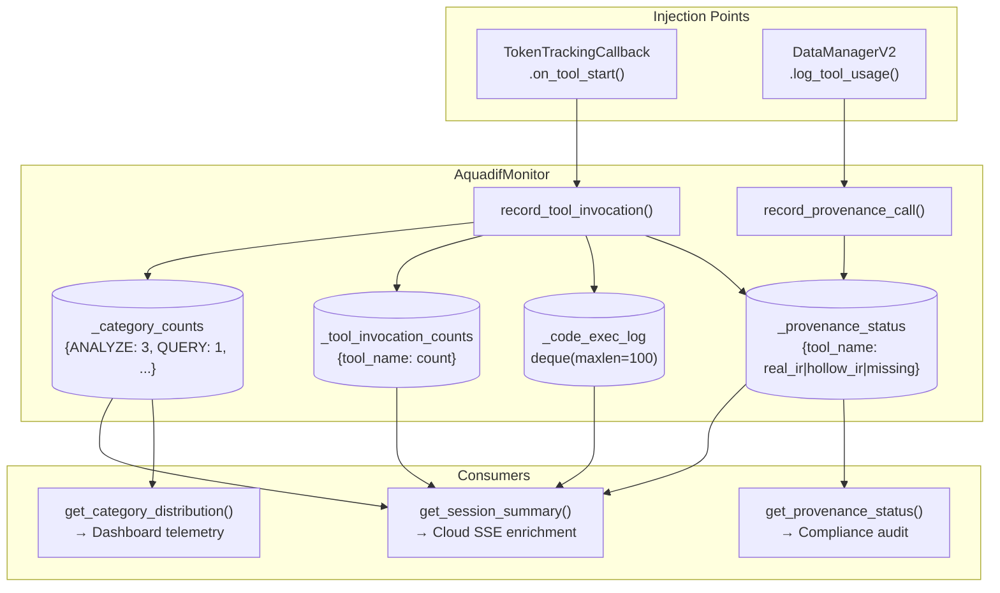

Lobster classifies every tool in its multi-agent graph under the **AQUADIF** taxonomy — a six-category scheme whose acronym encodes the full lifecycle of a bioinformatics workflow: **A**nalyze, **QU**ery, **A** (Import/Access), **D**elegate, **I** (Code Execution / Iterate), and **F**ramework (Utility). Each tool declares its AQUADIF category (or categories) via a `.metadata` dictionary attached at factory-creation time, and the runtime `AquadifMonitor` consumes this metadata to produce real-time session telemetry — category distribution, provenance compliance, and code-execution audit trails — without ever interfering with tool execution. This page explains the taxonomy's design rationale, the metadata contract every tool must satisfy, the monitor's fail-open architecture, and the patterns you follow when adding new tools or entire agent packages.

Sources: [aquadif_monitor.py](lobster/core/governance/aquadif_monitor.py#L1-L50), [graph.py](lobster/agents/graph.py#L1-L50)

## AQUADIF Category Definitions

The six categories are not merely labels — they encode behavioral contracts that the monitoring layer, the provenance system, and the supervisor's routing logic all depend on. A tool may belong to multiple categories (e.g., a knowledgebase tool that both queries an external API and returns structured data for downstream analysis), and the monitor increments counters for every category listed in the tool's metadata. The table below defines each category, its provenance expectation, and representative tools from the codebase.

| Category | Full Name | Provenance Required | Representative Tools | Primary Agent(s) |
|---|---|---|---|---|
| **ANALYZE** | Data Analysis | Yes | `execute_custom_code` (with `persist=True`) | data_expert, transcriptomics_expert |
| **QUERY** | External Data Query | Yes | `search_pubmed`, `search_geo`, `search_pride` | research_agent, metadata_assistant |
| **IMPORT** | Data Import / Access | Yes | Download orchestrator tools, `map_cross_database_ids` | data_expert, genomics_expert |
| **DELEGATE** | Agent Delegation | No | `handoff_to_research_agent`, `handoff_to_transcriptomics_expert` | supervisor |
| **CODE_EXEC** | Custom Code Execution | Yes | `execute_custom_code` (always carries CODE_EXEC) | data_expert, metadata_assistant |
| **UTILITY** | Framework / Utility | No | `list_files`, `read_file`, `retrieve_agent_result`, `get_content_from_workspace` | all agents |

> [!TIP]
> Tools in the **ANALYZE**, **QUERY**, **IMPORT**, and **CODE_EXEC** categories set `"provenance": True` in their metadata, which causes the `AquadifMonitor` to pre-set their provenance status to `"missing"` on first invocation. The status only transitions to `"real_ir"` or `"hollow_ir"` when `DataManagerV2.log_tool_usage()` is called — tools that skip this call surface as compliance gaps in the session summary.

The provenance column is not advisory — it is enforced observationally. When `record_tool_invocation` fires, the monitor checks `metadata["provenance"]`; if `True`, the tool name is seeded into `_provenance_status` with value `"missing"`. Only a subsequent call to `record_provenance_call` (triggered from `DataManagerV2.log_tool_usage`) can promote the status to `"real_ir"` or `"hollow_ir"`. Tools that never call `log_tool_usage` remain stuck at `"missing"`, surfacing as compliance gaps in `get_session_summary()`.

Sources: [aquadif_monitor.py](lobster/core/governance/aquadif_monitor.py#L82-L162), [store_tools.py](lobster/tools/store_tools.py#L95-L113), [filesystem_tools.py](lobster/tools/filesystem_tools.py#L1-L50)

## The Metadata Contract

Every LangChain `@tool` function in Lobster must carry a `.metadata` dictionary and a `.tags` list once it is wired into the agent graph. The metadata dict has two keys — `"categories"` (a list of AQUADIF category strings) and `"provenance"` (a boolean) — and the tags list mirrors the categories for downstream filtering. This contract is established at factory-creation time, not at invocation time, which means the metadata is static and inspectable before any tool runs.

```python
# Example: delegation tool metadata (DELEGATE category, no provenance)
invoke_agent.metadata = {"categories": ["DELEGATE"], "provenance": False}
invoke_agent.tags = ["DELEGATE"]

# Example: utility tool metadata (UTILITY category, no provenance)
retrieve_agent_result.metadata = {"categories": ["UTILITY"], "provenance": False}
retrieve_agent_result.tags = ["UTILITY"]
```

The factory pattern is the enforcement mechanism. All shared tools — `create_execute_custom_code_tool`, `create_filesystem_tools`, `create_retrieve_agent_result_tool`, and the delegation tool factories in `graph.py` — attach metadata inside the factory closure before returning the tool. This ensures that no tool can accidentally enter the graph without AQUADIF classification, because the factory is the only sanctioned creation path.

Sources: [graph.py](lobster/agents/graph.py#L200-L230), [store_tools.py](lobster/tools/store_tools.py#L95-L113), [custom_code_tool.py](lobster/tools/custom_code_tool.py#L1-L50)

## AquadifMonitor Architecture

The `AquadifMonitor` is a runtime introspection service instantiated once per session inside `AgentClient.__init__`. It has **zero imports from `lobster.*`** — a deliberate design choice to prevent circular imports, since the callback module that calls `record_tool_invocation` already imports the monitor. All public methods are **fail-open**: exceptions are caught internally and silently swallowed, ensuring the monitor can never crash a tool invocation.

The monitor collects three orthogonal data streams through two injection points:

1. **`record_tool_invocation(tool_name, current_agent)`** — called exclusively from `TokenTrackingCallback.on_tool_start`. This is the single injection point for invocation counting; other callback handlers (`TerminalCallbackHandler`, `StreamingCallbackHandler`) must not call it to avoid double-counting in cloud sessions.
2. **`record_provenance_call(tool_name, has_real_ir)`** — called from `DataManagerV2.log_tool_usage`. This observes the actual provenance recording at the authoritative site, using direct boolean observation rather than brittle output-string parsing.



Thread safety follows a split strategy: simple dictionary counter increments (single CPython bytecode operations protected by the GIL) run without locks, while compound mutations — deque append plus dict update, or provenance status transitions — acquire `self._lock`. Lock-held sections are kept short, and no method calls another method while holding the lock, preventing reentrancy bugs.

Sources: [aquadif_monitor.py](lobster/core/governance/aquadif_monitor.py#L52-L162), [aquadif_monitor.py](lobster/core/governance/aquadif_monitor.py#L200-L269), [aquadif_monitor.py](lobster/core/aquadif_monitor.py#L1-L12)

## Provenance Status State Machine

The provenance status for each tool follows a strict upgrade-only state machine. A tool starts at `"missing"` (seeded on first invocation if `provenance: True`), can transition to `"hollow_ir"` when `log_tool_usage` is called with `ir=None` (the bridge pattern for tools that are tracked but don't produce an `AnalysisStep` notebook), and can upgrade to `"real_ir"` when a full `AnalysisStep` is recorded. Crucially, `"real_ir"` cannot be downgraded — if a tool achieves full provenance compliance, subsequent `ir=None` calls are no-ops.

| Transition | Trigger | Semantics |
|---|---|---|
| (none) → `missing` | `record_tool_invocation` with `provenance: True` | Tool invoked, provenance expected but not yet recorded |
| `missing` → `hollow_ir` | `record_provenance_call(has_real_ir=False)` | `log_tool_usage` called with `ir=None` (bridge pattern) |
| `missing` → `real_ir` | `record_provenance_call(has_real_ir=True)` | Full `AnalysisStep` IR recorded |
| `hollow_ir` → `real_ir` | `record_provenance_call(has_real_ir=True)` | Upgraded from bridge to full provenance |
| `real_ir` → `real_ir` | `record_provenance_call(has_real_ir=True)` | No-op; cannot downgrade |

This state machine is implemented in `record_provenance_call` with an explicit guard: `if self._provenance_status.get(tool_name) != "real_ir"`, ensuring that once a tool achieves full compliance, it remains compliant regardless of subsequent invocations that might use the bridge pattern.

Sources: [aquadif_monitor.py](lobster/core/governance/aquadif_monitor.py#L142-L180)

## Tool Metadata Map Construction

The `AquadifMonitor` requires a `tool_metadata_map` at construction time — a dictionary mapping tool names to their AQUADIF metadata. However, the monitor is instantiated before the LangGraph agent graph is built, creating a temporal dependency: tools don't exist yet when the monitor is created. The codebase resolves this with a two-phase initialization pattern.

In phase one, the monitor is constructed with an empty map: `AquadifMonitor(tool_metadata_map={})`. In phase two, after `graph.py` creates all tools via their factories, it iterates the tool list and builds the metadata map from each tool's `.metadata` attribute, then assigns it to `monitor._tool_metadata_map`. This deferred assignment is safe because no tool invocations can occur before the graph is fully constructed.

```python
# Phase 1: monitor created with empty map (in AgentClient.__init__)
self.aquadif_monitor = AquadifMonitor(tool_metadata_map={})

# Phase 2: map populated after graph construction (in graph.py)
tool_metadata_map = {}
for t in all_tools:
    if hasattr(t, 'metadata') and t.metadata:
        tool_metadata_map[t.name] = t.metadata
self.aquadif_monitor._tool_metadata_map = tool_metadata_map
```

> [!TIP]
> When adding a new tool, you do not need to touch the monitor code. As long as your tool's factory attaches `.metadata = {"categories": [...], "provenance": bool}`, the graph construction phase will automatically include it in the metadata map. The only integration point is ensuring your tool calls `data_manager.log_tool_usage()` if `provenance: True`.

Sources: [aquadif_monitor.py](lobster/core/governance/aquadif_monitor.py#L75-L100), [graph.py](lobster/agents/graph.py#L399-L500)

## Category Distribution Across Tool Submodules

The following table maps each tool submodule to its primary AQUADIF categories, showing how the taxonomy spans the full tool surface. Tools in `lobster/tools/providers/` are uniformly QUERY-category (they wrap external database APIs), while tools in `lobster/tools/` proper span UTILITY, CODE_EXEC, and IMPORT depending on their function.

| Submodule | Tool(s) | AQUADIF Categories | Provenance |
|---|---|---|---|
| `custom_code_tool` | `execute_custom_code` | CODE_EXEC, ANALYZE | Yes |
| `workspace_tool` | `get_content_from_workspace`, `list_available_modalities`, `delete_from_workspace` | UTILITY | No |
| `filesystem_tools` | `list_files`, `read_file`, `write_file`, `glob_files`, `grep_files`, `shell_execute` | UTILITY | No |
| `store_tools` | `retrieve_agent_result` | UTILITY | No |
| `knowledgebase_tools` | `map_cross_database_ids`, `variant_consequence`, `sequence_retrieval` | QUERY, IMPORT | Yes |
| `download_orchestrator` | (orchestration layer, not a `@tool`) | — | — |
| `providers/pubmed_provider` | `search_pubmed` | QUERY | Yes |
| `providers/geo_provider` | `search_geo` | QUERY | Yes |
| `providers/pdb_provider` | `search_pdb` | QUERY | Yes |
| `providers/pride_provider` | `search_pride` | QUERY | Yes |
| `graph.py` (delegation) | `handoff_to_*` | DELEGATE | No |

Note that `download_orchestrator.py` is not itself a `@tool` — it is a service class that routes to `IDownloadService` implementations registered via `lobster.download_services` entry points. The actual download tools that wrap it carry the IMPORT category.

Sources: [custom_code_tool.py](lobster/tools/custom_code_tool.py#L1-L50), [workspace_tool.py](lobster/tools/workspace_tool.py#L1-L50), [filesystem_tools.py](lobster/tools/filesystem_tools.py#L1-L50), [store_tools.py](lobster/tools/store_tools.py#L1-L50), [knowledgebase_tools.py](lobster/tools/knowledgebase_tools.py#L1-L50), [download_orchestrator.py](lobster/tools/download_orchestrator.py#L1-L50)

## Adding a New Tool to the Taxonomy

When you add a new tool — whether in `lobster/tools/` or inside a domain package — you must satisfy three requirements to integrate with AQUADIF:

1. **Attach metadata in the factory function.** Every tool created via the factory pattern must set `.metadata` and `.tags` before the factory returns. Choose categories that reflect the tool's primary behavioral contract (a tool that fetches data from an external API is QUERY; one that runs user-supplied Python is CODE_EXEC). Set `provenance: True` only if the tool produces an `AnalysisStep` IR or calls `data_manager.log_tool_usage()`.

2. **Call `log_tool_usage` if provenance is required.** Tools with `provenance: True` must call `data_manager.log_tool_usage(tool_name=..., parameters=..., description=..., ir=...)` at the end of their execution. If the tool produces a full `AnalysisStep`, pass it as `ir`; if not, pass `ir=None` (the bridge pattern, which the monitor records as `"hollow_ir"`). Omitting this call leaves the tool stuck at `"missing"` in the provenance status.

3. **Register via entry points for discovery.** If the tool lives in a domain package, ensure the package's `pyproject.toml` declares the appropriate entry point group (`lobster.agents`, `lobster.providers`, `lobster.adapters`) so the `ComponentRegistry` can discover it. The graph construction phase automatically includes discovered tools in the monitor's metadata map.

```python
# Minimal pattern for a new QUERY tool with provenance
def create_my_query_tool(data_manager: DataManagerV2):
    @tool
    async def search_database(query: str) -> str:
        """Search external database for bioinformatics records."""
        result = await _do_search(query)
        data_manager.log_tool_usage(
            tool_name="search_database",
            parameters={"query": query},
            description=f"Searched for '{query}'",
            ir=None,  # Bridge pattern — no AnalysisStep
        )
        return result

    search_database.metadata = {"categories": ["QUERY"], "provenance": True}
    search_database.tags = ["QUERY"]
    return search_database
```

Sources: [custom_code_tool.py](lobster/tools/custom_code_tool.py#L140-L200), [store_tools.py](lobster/tools/store_tools.py#L88-L113), [component_registry.py](lobster/core/component_registry.py#L1-L60)

## Session Summary and Cloud Integration

The `get_session_summary()` method produces a structured snapshot of the monitor's state, designed for Omics-OS Cloud SSE (Server-Sent Events) enrichment. It acquires the lock once, builds a consistent view of all four internal data structures, and returns a dictionary with five keys:

| Key | Type | Description |
|---|---|---|
| `category_distribution` | `Dict[str, int]` | Per-category invocation counts |
| `provenance_status` | `Dict[str, List[str]]` | Tools grouped by `real_ir`, `hollow_ir`, `missing` |
| `code_exec_count` | `int` | Total CODE_EXEC invocations in the bounded log |
| `code_exec_log` | `List[Dict]` | Last 100 CODE_EXEC entries (tool_name, timestamp, agent) |
| `total_invocations` | `int` | Sum of all tool invocation counts |

This summary mirrors the pattern established by `TokenTrackingCallback.get_usage_summary()` and is consumed by the cloud layer to provide real-time session dashboards — showing which AQUADIF categories are active, whether provenance is compliant, and which agents are executing custom code. The bounded deque (`maxlen=100`) ensures memory safety in long-running sessions, auto-evicting the oldest entries when capacity is reached.

Sources: [aquadif_monitor.py](lobster/core/governance/aquadif_monitor.py#L219-L269)

## Backward Compatibility Shim

The monitor was originally defined at `lobster.core.aquadif_monitor` but has been migrated to `lobster.core.governance.aquadif_monitor` to co-locate it with other governance modules (`license_manager`). The old path now contains a thin shim that emits a `DeprecationWarning` and re-exports all names via `from lobster.core.governance.aquadif_monitor import *`. This shim will be removed in v2.0.0. All new code should import from the governance submodule directly.

Sources: [aquadif_monitor.py](lobster/core/aquadif_monitor.py#L1-L12)

## Next Steps

- **[Plugin System and Entry Points](8-plugin-system-and-entry-points)** — Understand how entry-point discovery feeds the component registry that populates the AQUADIF metadata map.
- **[DataManager and Modality Adapters](11-datamanager-and-modality-adapters)** — See how `log_tool_usage()` drives provenance status transitions in the AQUADIF monitor.
- **[Provenance Tracking and IR](12-provenance-tracking-and-ir)** — Deep dive into `AnalysisStep` IR, the difference between `real_ir` and `hollow_ir`, and how provenance compliance is audited end-to-end.
- **[Supervisor Agent and Routing](5-supervisor-agent-and-routing)** — Learn how DELEGATE-category tools are created and how the supervisor selects which agent to hand off to.