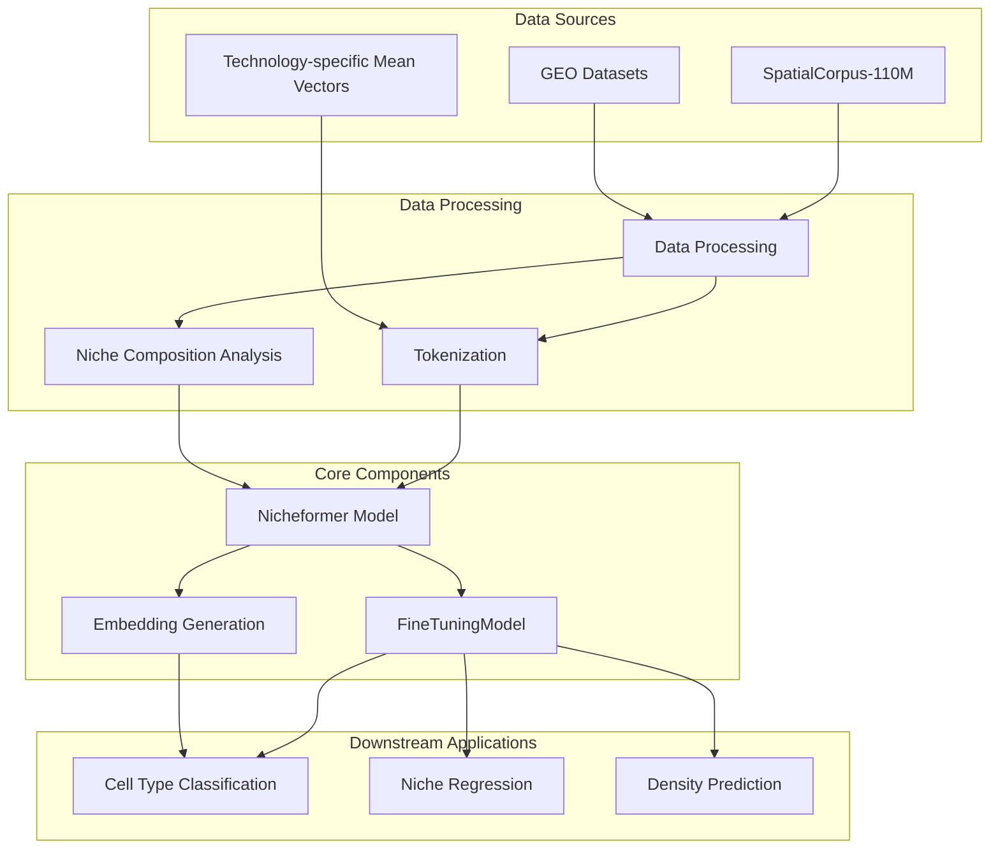
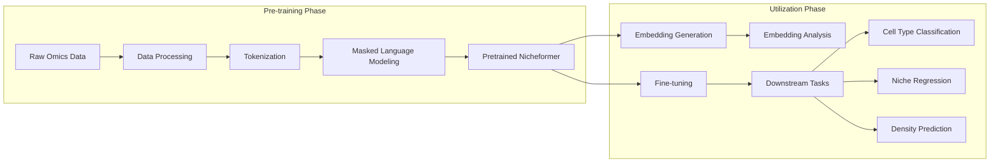
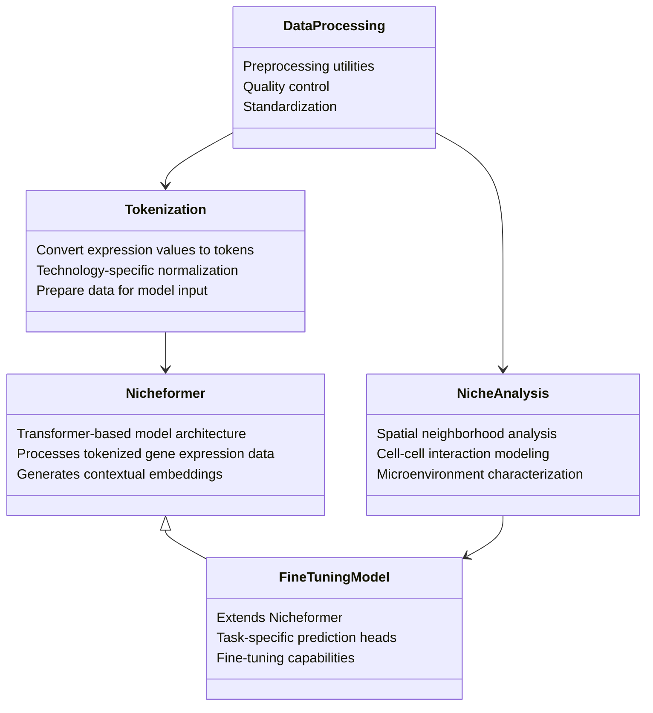

# Overview

<details>
<summary>Relevant source files</summary>

The following files were used as context for generating this wiki page:

- [README.md](README.md)
- [data/README.md](data/README.md)
- [pyproject.toml](pyproject.toml)

</details>


## Purpose and Scope

Nicheformer is a foundation model for single-cell and spatial omics data analysis. This repository provides the implementation of the Nicheformer architecture, training pipeline, and tools for working with spatial omics datasets. Nicheformer enables embedding generation, transfer learning, and downstream analysis tasks for cellular data, with a particular focus on modeling spatial neighborhoods (niches) in tissue contexts.

This overview introduces the core concepts, architecture, and components of the Nicheformer system. For detailed installation instructions, see [Installation and Setup](#2).

Sources: [README.md:1-15](), [pyproject.toml:6-9]()

## What is Nicheformer?

Nicheformer is a transformer-based foundation model specifically designed for single-cell and spatial omics data. It uses a masked language modeling pre-training approach to learn representations of gene expression patterns across diverse cell types and tissue contexts. The model can:

1. Generate embeddings for cells that capture both expression profiles and spatial neighborhood information
2. Be fine-tuned for specific downstream tasks such as niche regression, cell type classification, and density prediction
3. Transfer knowledge between different tissue types, technologies, and experimental conditions

The model is trained on the SpatialCorpus-110M dataset, which combines both dissociated single-cell and spatial omics data from various sources.

Sources: [README.md:1-15](), [pyproject.toml:6-9]()

## System Architecture

Nicheformer follows a modular architecture with several interconnected components:



**Diagram: Nicheformer High-Level System Architecture**

Sources: [README.md:49-50](), [pyproject.toml:23-45]()

### Core Components

1. **Nicheformer Model**: The foundation transformer model that processes tokenized gene expression data to generate contextual representations.

2. **FineTuningModel**: Extends the base Nicheformer model for specific downstream prediction tasks like cell type classification or niche prediction.

3. **Embedding Generation**: Utilities for extracting and analyzing embeddings from the Nicheformer model, particularly useful for transfer learning scenarios.

For detailed information about the model architecture, see [Model Architecture](#3).

### Data Processing Pipeline

The data processing pipeline consists of:

1. **Data Preprocessing**: Standardizing and quality control for input data from various sources.
2. **Tokenization**: Converting gene expression values into tokens suitable for the model.
3. **Niche Composition Analysis**: Analyzing spatial neighborhoods of cells to characterize their microenvironment.

For more details on the data processing pipeline, see [Data Processing Pipeline](#4).

## Model Training and Utilization

Nicheformer follows a two-phase approach for model training and utilization:



**Diagram: Nicheformer Training and Utilization Workflow**

### Pre-training

The Nicheformer model is pre-trained on the SpatialCorpus-110M dataset using masked language modeling. This self-supervised approach allows the model to learn patterns in gene expression data without requiring manual annotation.

### Fine-tuning and Downstream Applications

The pre-trained model can be:
1. Used directly to generate cell embeddings for analysis
2. Fine-tuned for specific downstream tasks
3. Applied to new datasets through transfer learning

Pre-trained model weights are available for download from Mendeley Data, as mentioned in the [README.md:52-53]() and [data/README.md:3-5]().

## Code Structure and Implementation

The Nicheformer implementation is organized into several key modules:



**Diagram: Nicheformer Code Structure**

The implementation relies on several key dependencies:
- PyTorch and PyTorch Lightning for model development
- AnnData, Scanpy, and Squidpy for single-cell and spatial data handling
- Merlin-core and Merlin-dataloader for efficient data loading
- Weights & Biases for experiment tracking

Sources: [pyproject.toml:23-45]()

## Getting Started

To get started with Nicheformer:

1. **Installation**: Follow the installation instructions in [Installation and Setup](#2)
2. **Data**: Example data loading scripts are provided in the `data` directory
3. **Pre-trained Weights**: Download from Mendeley Data as described in [README.md:52-53]()
4. **Usage Examples**: See [Usage Examples](#7) for code examples on data processing, tokenization, and downstream analysis

For a complete overview of how to use Nicheformer for your specific analysis needs, refer to the specific sections of this documentation.

Sources: [README.md:17-47](), [README.md:49-53](), [data/README.md:1-5]()

## Publication and Citation

Nicheformer is described in the following preprint:

```
Schaar, A.C., Tejada-Lapuerta, A., et al. Nicheformer: a foundation model for single-cell and spatial omics. bioRxiv (2024). doi: https://doi.org/10.1101/2024.04.15.589472
```

If you use Nicheformer in your research or build upon its concepts, please cite this paper.

Sources: [README.md:9-15]()

---