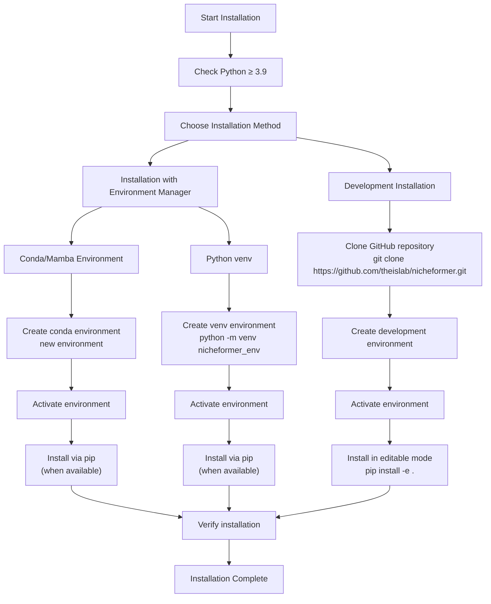
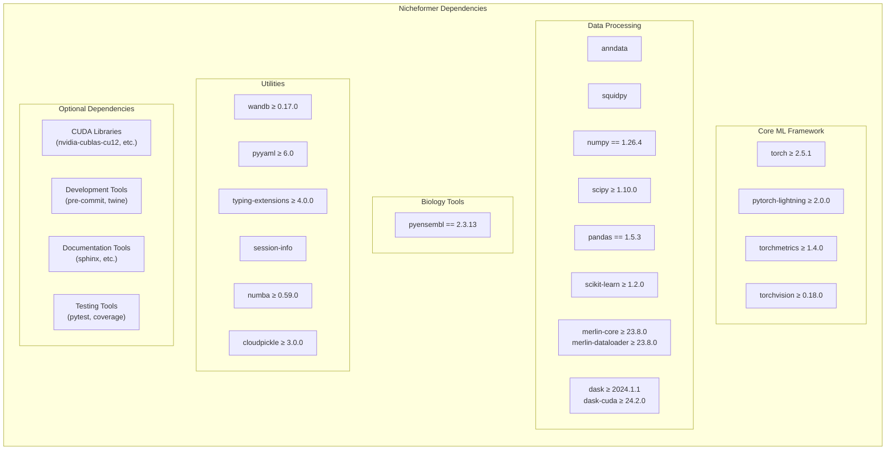
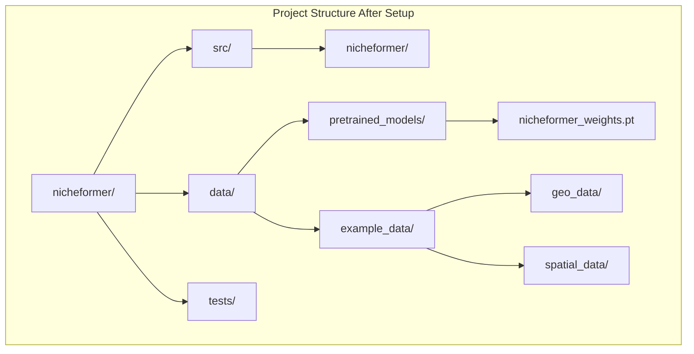

# Installation and Setup

<details>
<summary>Relevant source files</summary>

The following files were used as context for generating this wiki page:

- [README.md](README.md)
- [data/README.md](data/README.md)
- [pyproject.toml](pyproject.toml)

</details>


This page provides detailed instructions for installing and setting up the Nicheformer package. It covers system requirements, installation methods, dependencies, and configuration of the development environment. For information about using the installed package for data processing, see [Data Processing Pipeline](#4), and for training and fine-tuning the model, see [Training and Fine-tuning](#5).

## System Requirements

Before installing Nicheformer, make sure your system meets the following requirements:

- **Python**: Version 3.9 or newer
- **Operating System**: Compatible with Linux, macOS, and Windows
- **Hardware**: 
  - CPU: Modern multi-core processor 
  - RAM: Minimum 16GB recommended
  - GPU: NVIDIA GPU with CUDA support (optional, but recommended for training)
- **Storage**: At least 10GB free disk space (more if working with large datasets)

Sources: [README.md:19-20](), [pyproject.toml:10]()

## Installation Options

The following diagram illustrates the available installation options for Nicheformer:



Sources: [README.md:17-47]()

### Recommended Method: Using Conda/Mamba Environment

The recommended installation approach is using a Conda or Mamba environment manager to create an isolated environment:

1. Install [Mambaforge](https://github.com/conda-forge/miniforge#mambaforge) if you don't already have it
2. Create a new environment:
   ```bash
   mamba create -n nicheformer_env python=3.9
   ```
3. Activate the environment:
   ```bash
   mamba activate nicheformer_env
   ```
4. Clone the repository and install:
   ```bash
   git clone https://github.com/theislab/nicheformer.git
   cd nicheformer
   pip install -e .
   ```

Sources: [README.md:19-47]()

### Development Installation

For development or contributing to the Nicheformer project, install the package with development dependencies:

```bash
git clone https://github.com/theislab/nicheformer.git
cd nicheformer
pip install -e ".[dev,test]"
```

This installation includes tools for testing and code quality checks.

Sources: [README.md:41-47](), [pyproject.toml:48-70]()

## Dependencies

Nicheformer has several dependencies that are automatically installed during the installation process. The core dependencies can be categorized as shown in the diagram below:



Sources: [pyproject.toml:23-76]()

### Core Dependencies

Nicheformer relies on the following core dependencies:

| Category | Packages | Purpose |
|----------|----------|---------|
| ML Framework | torch, pytorch-lightning, torchmetrics, torchvision | Core machine learning functionality |
| Data Processing | anndata, squidpy, numpy, scipy, pandas, scikit-learn | Data handling and processing |
| Data Loading | merlin-core, merlin-dataloader, dask | Efficient data loading and processing |
| Utilities | wandb, pyyaml, typing-extensions | Experiment tracking and utilities |
| Biology | pyensembl | Genomic annotations |

Sources: [pyproject.toml:23-45]()

### Optional Dependencies

The following optional dependencies can be installed for specific use cases:

- **Development Tools**: `pip install -e ".[dev]"` - Installs pre-commit, twine
- **Documentation Tools**: `pip install -e ".[doc]"` - Installs Sphinx and related packages
- **Testing Tools**: `pip install -e ".[test]"` - Installs pytest and coverage
- **CUDA Support**: `pip install -e ".[cuda]"` - Installs NVIDIA CUDA libraries

Sources: [pyproject.toml:47-76]()

## GPU Setup (CUDA Support)

For optimal performance, especially during model training, GPU acceleration with CUDA is recommended. To set up CUDA support:

1. Ensure you have a compatible NVIDIA GPU
2. Install the CUDA dependencies:
   ```bash
   pip install -e ".[cuda]"
   ```

This will install the necessary NVIDIA CUDA libraries for Nicheformer.

Sources: [pyproject.toml:71-76]()

## Downloading Pretrained Models and Data

Nicheformer provides pretrained model weights and example data that you should download after installation.

### Pretrained Model Weights

1. Download the pretrained weights from [Mendeley Data](https://data.mendeley.com/preview/87gm9hrgm8?a=d95a6dde-e054-4245-a7eb-0522d6ea7dff)
2. Place the downloaded files in the `data` subdirectory of your Nicheformer installation



Sources: [README.md:52-53](), [data/README.md:1-5]()

### Example Data

Nicheformer provides example data loading scripts in the `data` subdirectory that can be used as templates for loading spatial omics datasets and datasets retrieved from GEO.

Sources: [README.md:49-50]()

## Verifying Installation

After installing Nicheformer, you can verify the installation by importing the package in Python:

```python
import nicheformer
print(nicheformer.__version__)
```

If the installation was successful, this should display the version of Nicheformer without any errors.

## Troubleshooting

If you encounter issues during installation, check the following:

1. Ensure you're using Python 3.9 or newer
2. Verify that all dependencies are correctly installed
3. Check for compatibility issues with CUDA if using GPU acceleration
4. Try creating a fresh environment and reinstalling

For persistent issues, please refer to the [GitHub issue tracker](https://github.com/theislab/nicheformer/issues).

Sources: [README.md:61]()

## Next Steps

After successful installation, you can proceed to:
- [Data Processing Pipeline](#4) for working with spatial omics data
- [Training and Fine-tuning](#5) for training and using the Nicheformer model
- [Usage Examples](#7) for practical examples of using Nicheformer

---