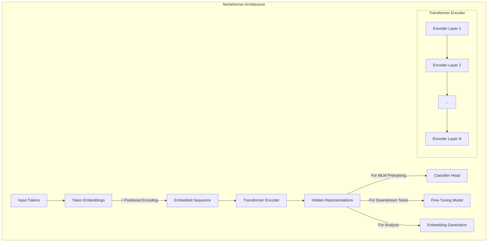
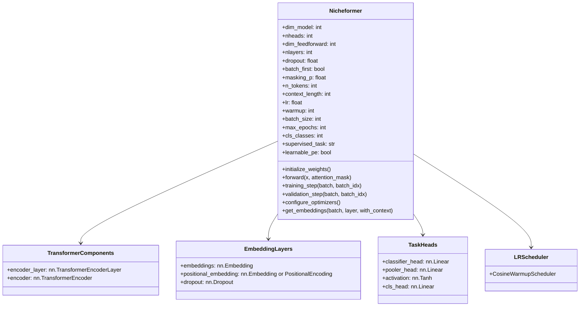
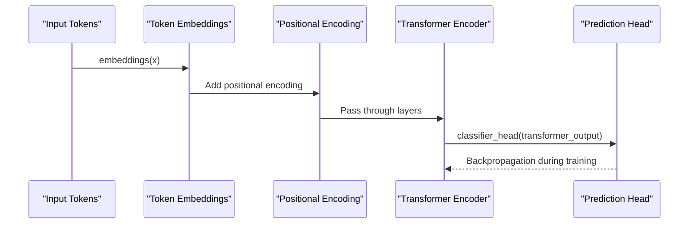
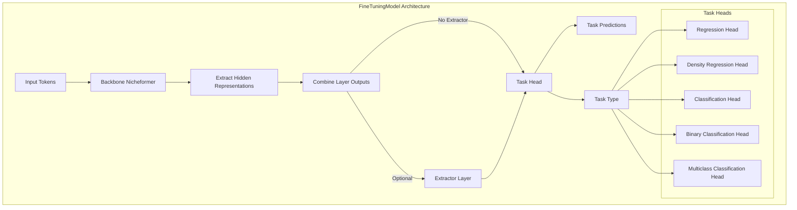
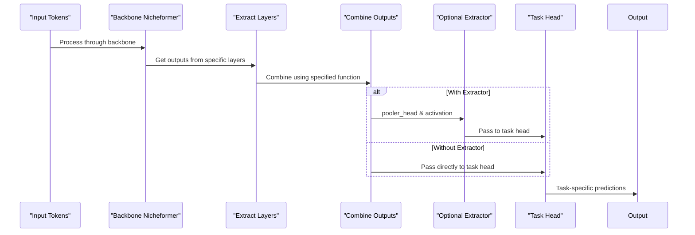
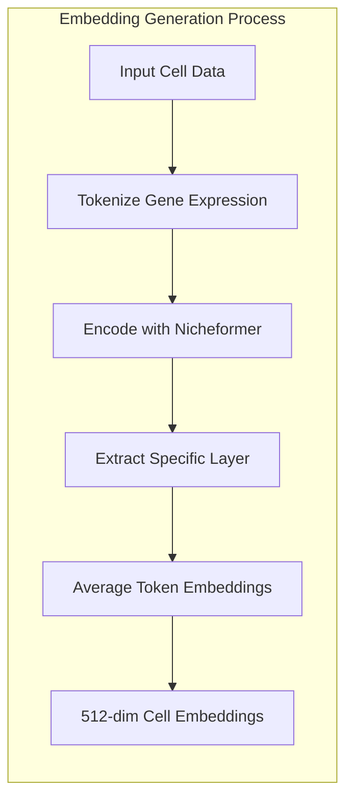

# Model Architecture

<details>
<summary>Relevant source files</summary>

The following files were used as context for generating this wiki page:

- [src/nicheformer/models/_fine_tune_model.py](src/nicheformer/models/_fine_tune_model.py)
- [src/nicheformer/models/_nicheformer.py](src/nicheformer/models/_nicheformer.py)

</details>


This page provides a comprehensive overview of the Nicheformer model architecture, explaining its core components, how it can be fine-tuned for downstream tasks, and how it generates embeddings. For information about the training process, see [Training and Fine-tuning](#5), and for details about data processing, see [Data Processing Pipeline](#4).

## Core Architecture Overview

Nicheformer is a transformer-based foundation model designed for single-cell and spatial transcriptomics data. It follows the encoder-only transformer architecture similar to BERT, with customizations specific to working with gene expression data.



Sources: [src/nicheformer/models/_nicheformer.py:15-154](), [src/nicheformer/models/_fine_tune_model.py:15-162]()

The Nicheformer architecture consists of:

1. **Token Embeddings**: Converts gene expression tokens into high-dimensional vectors
2. **Positional Encodings**: Adds information about token position in the sequence
3. **Transformer Encoder**: Multiple layers of self-attention and feed-forward networks
4. **Task-specific Heads**: For masked language modeling (pretraining) or downstream tasks

## Nicheformer Base Model

The base Nicheformer model is implemented as a PyTorch Lightning module in the `Nicheformer` class.



Sources: [src/nicheformer/models/_nicheformer.py:15-307]()

### Key Components

1. **Transformer Encoder**: The core component consisting of multiple encoder layers with multi-head self-attention and feed-forward networks.
   ```python
   # Transformer encoder initialization
   self.encoder_layer = nn.TransformerEncoderLayer(
       d_model=dim_model,
       nhead=nheads,
       dim_feedforward=dim_feedforward,
       batch_first=batch_first,
       dropout=dropout,
       layer_norm_eps=1e-12
   )
   self.encoder = nn.TransformerEncoder(
       encoder_layer=self.encoder_layer,
       num_layers=nlayers,
       enable_nested_tensor=False
   )
   ```

2. **Embedding Layers**: Converts tokens to high-dimensional vectors and adds positional information.
   - **Token Embeddings**: Maps input tokens to embedding vectors
   - **Positional Encodings**: Either learnable embeddings or fixed sinusoidal encodings

3. **Model Heads**: Specialized layers for different tasks.
   - **Classifier Head**: For masked language modeling pretraining
   - **Pooler Head**: For sequence-level representations
   - **CLS Head**: For supervised classification tasks

### Forward Pass

The forward pass of the Nicheformer model follows these steps:

1. Input tokens are embedded into high-dimensional vectors
2. Positional encodings are added to the token embeddings
3. The resulting sequence passes through the transformer encoder
4. The transformer outputs are processed by the classifier head for token prediction



Sources: [src/nicheformer/models/_nicheformer.py:133-154](), [src/nicheformer/models/_nicheformer.py:156-192]()

### Model Parameters

The Nicheformer model is highly configurable with the following key parameters:

| Parameter | Description | Default Value |
|-----------|-------------|---------------|
| `dim_model` | Dimension of the model embeddings | 512 |
| `nheads` | Number of attention heads | 8 |
| `dim_feedforward` | Dimension of feedforward network | 2048 |
| `nlayers` | Number of transformer layers | 6 |
| `dropout` | Dropout probability | 0.1 |
| `masking_p` | Token masking probability for pretraining | 0.15 |
| `n_tokens` | Total number of tokens in vocabulary | - |
| `context_length` | Maximum sequence length | 2048 |
| `learnable_pe` | Whether to use learnable positional embeddings | True |

Sources: [src/nicheformer/models/_nicheformer.py:16-36]()

## Fine-Tuning Model

The `FineTuningModel` class extends the base Nicheformer for specific downstream tasks, such as cell type classification or niche regression.



Sources: [src/nicheformer/models/_fine_tune_model.py:15-106](), [src/nicheformer/models/_fine_tune_model.py:107-162]()

### Key Components

1. **Backbone Model**: A pretrained Nicheformer model that can be frozen or fine-tuned
2. **Layer Extraction**: Ability to extract hidden representations from specific layers
3. **Combination Function**: Methods to combine outputs from different layers (mean, sum, concat)
4. **Task-specific Heads**: Specialized heads for different downstream tasks:
   - **Niche Regression**: Predicts cell type compositions in the neighborhood
   - **Density Regression**: Predicts the number of surrounding cells
   - **Classification Tasks**: Various classification tasks (niche type, binary, multiclass)

### Forward Pass

The forward pass of the FineTuningModel follows these steps:

1. Input tokens are processed by the backbone Nicheformer
2. Hidden representations are extracted from specified layers
3. These representations are combined according to the specified function (mean, sum, concat)
4. The combined representations optionally pass through an extractor
5. The task-specific head produces the final predictions



Sources: [src/nicheformer/models/_fine_tune_model.py:107-162]()

### Supported Tasks

The FineTuningModel supports several supervised tasks:

1. **Niche Regression**: Predicts the cellular composition of the neighborhood
   ```python
   self.linear_head = nn.Linear(self.backbone.hparams.dim_model, dim_prediction, bias=False)
   self.softmax = nn.Softmax(dim=1)
   self.cls_loss = nn.MSELoss()
   ```

2. **Density Regression**: Predicts the number of cells in the neighborhood
   ```python
   self.linear_head = nn.Linear(self.backbone.hparams.dim_model, 1, bias=False)
   self.cls_loss = nn.MSELoss()
   ```

3. **Niche Classification**: Classifies cell neighborhoods into predefined types
   ```python
   self.linear_head = nn.Linear(self.backbone.hparams.dim_model, n_classes, bias=False)
   self.cls_loss = nn.CrossEntropyLoss()
   ```

4. **Binary Classification**: Binary classification of cell neighborhood properties
   ```python
   self.linear_head = nn.Linear(self.backbone.hparams.dim_model, dim_prediction, bias=False)
   self.cls_loss = nn.CrossEntropyLoss()
   ```

5. **Multiclass Classification**: Multiclass classification of neighborhood compositions
   ```python
   self.linear_head = nn.Linear(self.backbone.hparams.dim_model, dim_prediction*n_classes, bias=False)
   self.cls_loss = nn.CrossEntropyLoss()
   ```

Sources: [src/nicheformer/models/_fine_tune_model.py:78-93]()

## Embedding Generation

Nicheformer can generate fixed-dimensional embeddings from cells for downstream analysis, visualization, or as input to other models.



Sources: [src/nicheformer/models/_nicheformer.py:272-306]()

The embedding generation process is implemented in the `get_embeddings` method of the Nicheformer class, which:

1. Processes token embeddings and adds positional encodings
2. Passes the sequence through the transformer encoder up to a specified layer
3. Optionally filters out context tokens (like CLS, modality, etc.)
4. Averages the token embeddings to get a fixed-size representation for each cell

```python
def get_embeddings(self, batch, layer=-1, with_context=False):
    """Get embeddings from the model."""
    
    batch = self.on_after_batch_transfer(batch, 0)
    
    batch = complete_masking(batch, 0.0, self.hparams.n_tokens + 5)
    masked_indices = batch['masked_indices']
    attention_mask = batch['attention_mask']
    
    # Get token embeddings and positional encodings
    token_embedding = self.embeddings(masked_indices)
    
    if self.hparams.learnable_pe:
        pos_embedding = self.positional_embedding(self.pos.to(token_embedding.device))
        embeddings = self.dropout(token_embedding + pos_embedding)
    else:
        embeddings = self.positional_embedding(token_embedding)
    
    # Process through transformer layers up to desired layer
    if layer < 0:
        layer = len(self.encoder.layers) + layer # -1 means last layer
    
    for i in range(layer + 1):
        embeddings = self.encoder.layers[i](
            embeddings,
            src_key_padding_mask=attention_mask,
            is_causal=False
        )
    
    if not with_context:
        embeddings = embeddings[:, 3:, :]
    
    embeddings = embeddings.mean(dim=1)
    
    return embeddings
```

These embeddings can be used for:
- Visualizing cell relationships (UMAP, t-SNE)
- Clustering cells by similarity
- Transfer learning to new datasets
- Input to other machine learning models

Sources: [src/nicheformer/models/_nicheformer.py:272-306]()

## Model Training and Optimization

The Nicheformer model uses the following components for training and optimization:

1. **Loss Functions**:
   - **Masked Language Modeling**: CrossEntropyLoss for predicting masked tokens
   - **Supervised Tasks**: Task-specific losses (MSE for regression, CrossEntropy for classification)

2. **Optimizer**: AdamW with weight decay
   ```python
   optimizer = optim.AdamW(self.parameters(), lr=self.hparams.lr, weight_decay=0.1)
   ```

3. **Learning Rate Scheduler**: Custom CosineWarmupScheduler
   ```python
   scheduler = CosineWarmupScheduler(
       optimizer,
       warmup=self.hparams.warmup,
       max_epochs=self.hparams.max_epochs
   )
   ```

Sources: [src/nicheformer/models/_nicheformer.py:253-262](), [src/nicheformer/models/_fine_tune_model.py:325-332]()

## Implementation Details

### Positional Encoding

Nicheformer supports two types of positional encodings:

1. **Learnable Positional Embeddings**:
   ```python
   self.positional_embedding = nn.Embedding(
       num_embeddings=context_length,
       embedding_dim=dim_model
   )
   ```

2. **Fixed Sinusoidal Encodings**:
   ```python
   class PositionalEncoding(nn.Module):
       def __init__(self, d_model, max_seq_len):
           super().__init__()
           encoding = torch.zeros(max_seq_len, d_model)
           position = torch.arange(0, max_seq_len, dtype=torch.float).unsqueeze(1)
           div_term = torch.exp(torch.arange(0, d_model, 2).float() * (-math.log(10000.0) / d_model))
           
           encoding[:, 0::2] = torch.sin(position * div_term)
           encoding[:, 1::2] = torch.cos(position * div_term)
           encoding = encoding.unsqueeze(0)
           
           self.register_buffer('encoding', encoding, persistent=False)
   ```

Sources: [src/nicheformer/models/_nicheformer.py:101-123](), [src/nicheformer/models/_nicheformer.py:309-326]()

### Weight Initialization

Nicheformer uses Xavier normal initialization for model weights:

```python
def initialize_weights(self):
    """Initialize model weights."""
    for m in self.modules():
        if isinstance(m, nn.Linear):
            init.xavier_normal_(m.weight)
            if m.bias is not None:
                init.zeros_(m.bias)
```

Sources: [src/nicheformer/models/_nicheformer.py:264-271]()

## Summary

The Nicheformer architecture:

1. Follows the transformer encoder design pattern
2. Uses token embeddings with positional encoding
3. Can be pretrained with masked language modeling
4. Can be fine-tuned for various downstream tasks
5. Generates meaningful embeddings for cells

This flexible architecture allows Nicheformer to serve as a foundation model for single-cell and spatial transcriptomics data, enabling a range of analyses from basic cell type identification to complex spatial relationship modeling.

---