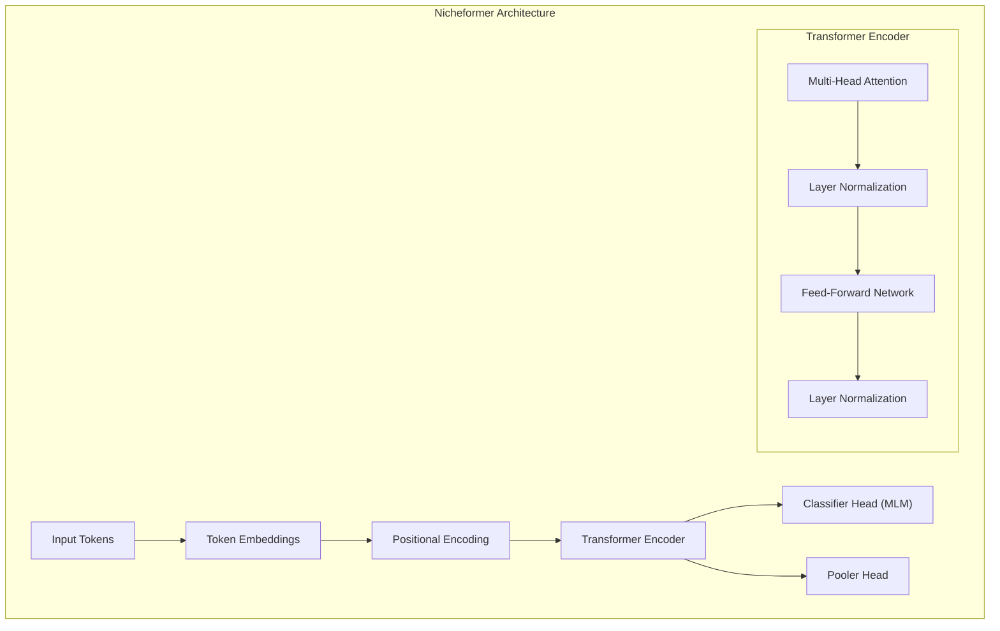
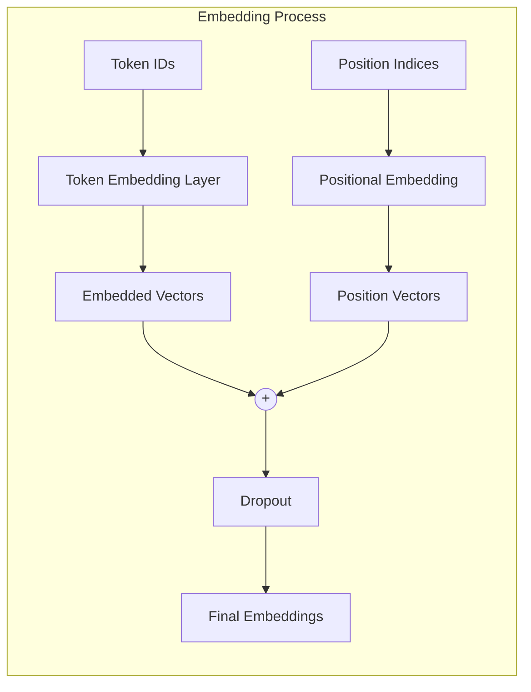
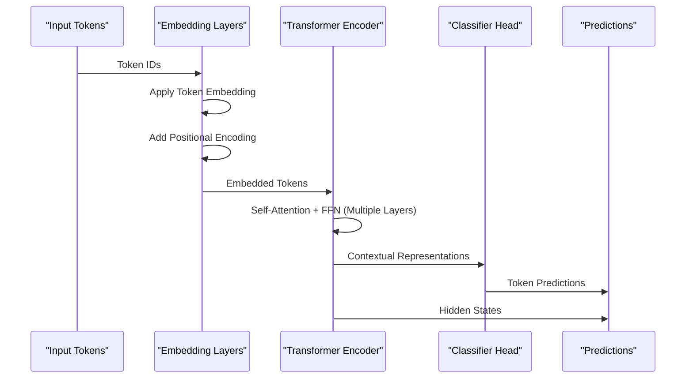
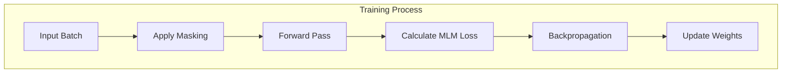
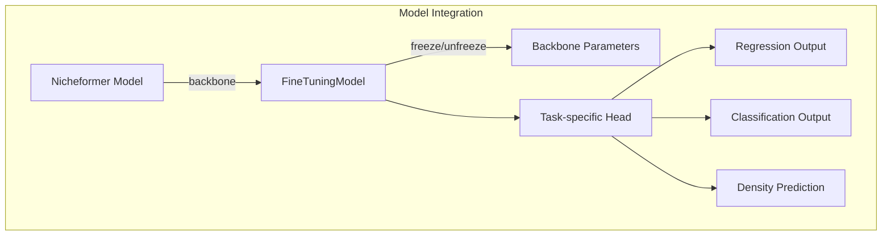

# Nicheformer Model

Relevant source files

The following files were used as context for generating this wiki page:

- [src/nicheformer/config_files/_config_fine_tune.py](src/nicheformer/config_files/_config_fine_tune.py)
- [src/nicheformer/config_files/_config_train.py](src/nicheformer/config_files/_config_train.py)
- [src/nicheformer/data/datamodules.py](src/nicheformer/data/datamodules.py)
- [src/nicheformer/fine_tune.py](src/nicheformer/fine_tune.py)
- [src/nicheformer/models/_fine_tune_model.py](src/nicheformer/models/_fine_tune_model.py)
- [src/nicheformer/models/_nicheformer.py](src/nicheformer/models/_nicheformer.py)
- [src/nicheformer/models/_utils.py](src/nicheformer/models/_utils.py)
- [src/nicheformer/train.py](src/nicheformer/train.py)

## Overview

The Nicheformer model is the core component of the Nicheformer system, serving as the foundation model for single-cell and spatial omics data analysis. It is designed as a transformer-based architecture that learns contextual representations of gene expression data through self-supervised pretraining. The model architecture follows the standard transformer encoder design but is specifically optimized for biological data representation.

This page describes the architecture and implementation details of the base Nicheformer model. For information about fine-tuning the model for specific tasks, see [Fine-Tuning Model](#3.2). For details on how to generate embeddings from the model, see [Embedding Generation](#3.3).

Sources: [src/nicheformer/models/_nicheformer.py:15-214]()

## Architecture Overview

The Nicheformer model is implemented as a PyTorch Lightning module that extends the standard transformer architecture with specific components for biological data processing.

Sources: [src/nicheformer/models/_nicheformer.py:15-133](), [src/nicheformer/models/_nicheformer.py:84-99]()

## Key Components

### 1. Embedding Layers

The model uses embedding layers to convert token indices into dense vector representations:

- **Token Embeddings**: Converts integer token IDs to dense vectors of dimension `dim_model`
- **Positional Embeddings**: Provides position information, can be learnable or fixed sinusoidal encodings

Sources: [src/nicheformer/models/_nicheformer.py:101-123](), [src/nicheformer/models/_nicheformer.py:309-326]()

### 2. Transformer Encoder

The core of the model is a standard transformer encoder with multiple layers:

- Each layer consists of multi-head self-attention and feed-forward networks
- Layer normalization and residual connections are applied as in the standard transformer architecture
- The number of layers, dimensions, and attention heads are configurable

Sources: [src/nicheformer/models/_nicheformer.py:84-99]()

### 3. Model Heads

The model includes several task-specific heads:

- **Classifier Head**: Linear layer that predicts tokens at masked positions (for pretraining)
- **Pooler Head**: Transforms sequence representations for downstream tasks
- **CLS Head**: Classification head for supervised tasks (when applicable)

Sources: [src/nicheformer/models/_nicheformer.py:124-131]()

## Model Parameters

The Nicheformer model accepts the following key parameters:

| Parameter | Description | Default Value |
|-----------|-------------|---------------|
| `dim_model` | Dimensionality of the model | 512 |
| `nheads` | Number of attention heads | 16 |
| `dim_feedforward` | Dimensionality of feed-forward networks | 1024 |
| `nlayers` | Number of transformer layers | 12 |
| `dropout` | Dropout probability | 0.0 |
| `masking_p` | Probability of masking tokens | 0.15 |
| `n_tokens` | Total number of tokens (excluding auxiliary) | 20340 |
| `context_length` | Maximum sequence length | 1500 |
| `learnable_pe` | Whether to use learnable positional embeddings | True |
| `specie/assay/modality` | Whether to include auxiliary tokens | True |

Sources: [src/nicheformer/models/_nicheformer.py:15-60](), [src/nicheformer/config_files/_config_train.py:1-25]()

## Data Flow

### Forward Pass

The forward pass processes input tokens through the following steps:
1. Token embedding converts input IDs to vectors
2. Positional encoding is added
3. The transformer encoder processes the embeddings
4. The classifier head predicts tokens at masked positions
5. Model returns both MLM predictions and transformer outputs

Sources: [src/nicheformer/models/_nicheformer.py:133-154]()

### Masking Process

During training, the model applies a masking process to the input tokens:

1. Tokens are masked with probability `masking_p` (default 0.15)
2. 80% of masked tokens are replaced with a special MASK token (0)
3. 10% are replaced with random tokens
4. 10% are left unchanged

This masking strategy follows the original BERT approach and is implemented in the `complete_masking` function.

Sources: [src/nicheformer/models/_utils.py:6-47](), [src/nicheformer/models/_nicheformer.py:156-173]()

## Training and Optimization

The Nicheformer model is trained using:

- **Loss Function**: Cross-entropy loss for masked token prediction
- **Optimizer**: AdamW with weight decay
- **Learning Rate Scheduler**: Cosine schedule with warmup

Sources: [src/nicheformer/models/_nicheformer.py:156-173](), [src/nicheformer/models/_nicheformer.py:253-262](), [src/nicheformer/models/_nicheformer.py:329-347]()

## Embedding Generation

The Nicheformer model provides a method to generate embeddings for downstream tasks through the `get_embeddings` method. This process:

1. Passes input tokens through the model without masking
2. Extracts hidden representations from a specific layer (default: last layer)
3. Optionally removes context tokens (e.g., CLS, modality, assay, specie)
4. Aggregates token representations (typically by mean pooling)

These embeddings serve as input features for various downstream tasks and analysis.

Sources: [src/nicheformer/models/_nicheformer.py:272-306]()

## Integration with Fine-Tuning

The Nicheformer model serves as the backbone for the `FineTuningModel`, which adapts it for specific downstream tasks. The fine-tuning process may:

1. Freeze the backbone parameters or allow full fine-tuning
2. Add task-specific heads for regression, classification, etc.
3. Reinitialize certain layers if needed
4. Extract and combine hidden representations from specific layers

Sources: [src/nicheformer/models/_fine_tune_model.py:15-39](), [src/nicheformer/models/_fine_tune_model.py:107-163]()

## Special Tokens and Constants

The model uses several special tokens:

| Token | ID | Purpose |
|-------|-----|---------|
| MASK_TOKEN | 0 | Used for masked positions during pretraining |
| Padding token | 1 | Used for padding sequences to equal length |
| CLS_TOKEN | 2/3 | Used as a classifier token for sequence classification |

Sources: [src/nicheformer/models/_nicheformer.py:12-13](), [src/nicheformer/models/_fine_tune_model.py:13](), [src/nicheformer/models/_utils.py:8-9]()

## Memory Efficiency Considerations

The Nicheformer model implements several techniques to manage memory efficiently:

1. Efficient masking implementation
2. Configurable batch sizes and sequence lengths
3. Support for distributed training
4. Gradient accumulation (optional)
5. Garbage collection at regular intervals

Sources: [src/nicheformer/models/_nicheformer.py:79-80](), [src/nicheformer/models/_fine_tune_model.py:100-102](), [src/nicheformer/models/_fine_tune_model.py:166-169]()

## Data Processing Integration

The model is designed to work with tokenized gene expression data loaded through the `MerlinDataModuleDistributed` class. This integration allows:

1. Efficient loading of large-scale datasets
2. Distributed training across multiple GPUs
3. Processing of auxiliary information (species, assay, modality)
4. Handling of different data splits (train, validation, test)

Sources: [src/nicheformer/data/datamodules.py:118-186](), [src/nicheformer/models/_nicheformer.py:223-251]()

---