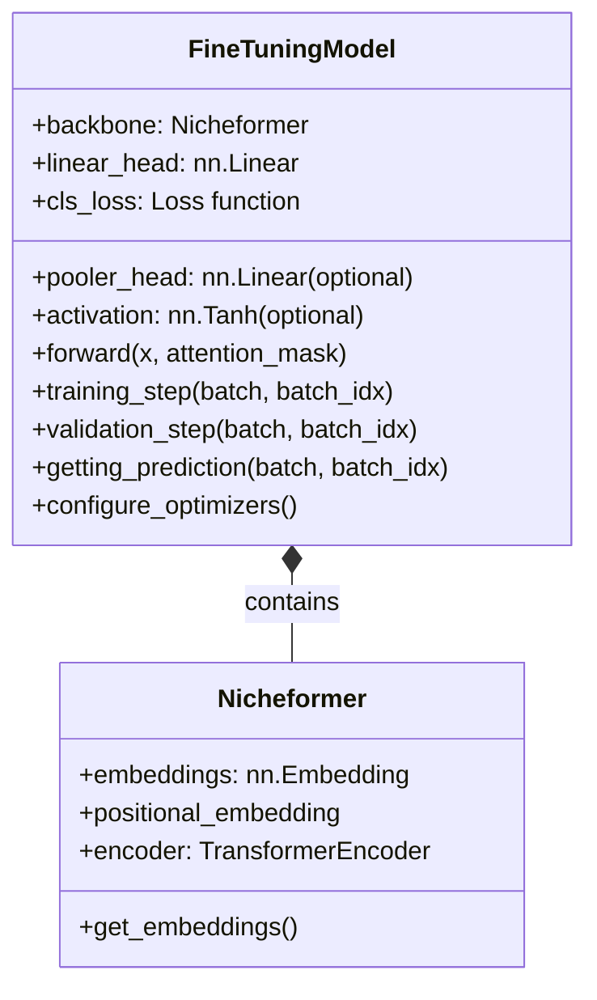
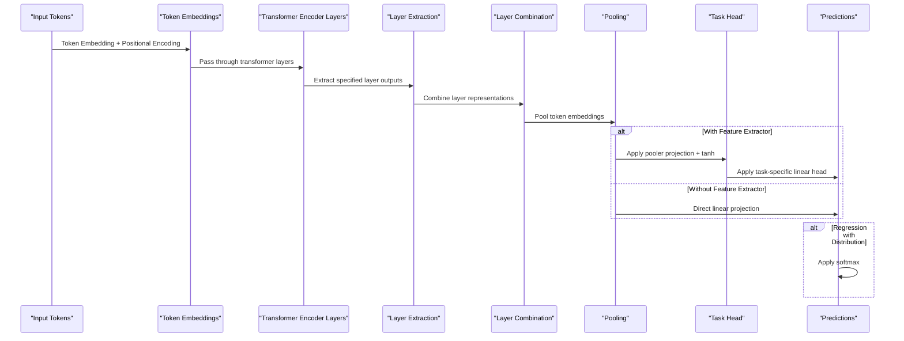
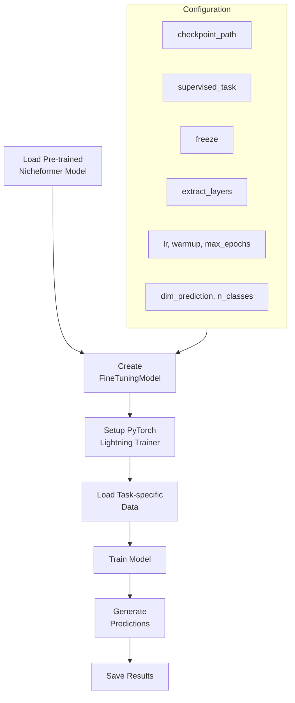

# Fine-Tuning Model

<details>
<summary>Relevant source files</summary>

The following files were used as context for generating this wiki page:

- [src/nicheformer/_fine_tune.py](src/nicheformer/_fine_tune.py)
- [src/nicheformer/models/_fine_tune_model.py](src/nicheformer/models/_fine_tune_model.py)
- [src/nicheformer/models/_nicheformer.py](src/nicheformer/models/_nicheformer.py)

</details>


## Purpose and Scope

This document describes the Fine-Tuning Model architecture in Nicheformer, which adapts the pre-trained Nicheformer base model for specific downstream tasks. The fine-tuning model provides a flexible framework for using Nicheformer's learned representations to solve supervised learning tasks such as cell type classification, niche composition regression, and cellular density prediction.

For information about the core Nicheformer model architecture, see [Nicheformer Model](#3.1). For details on the fine-tuning pipeline, see [Fine-tuning Pipeline](#5.2).

## Architecture Overview

The Fine-Tuning Model wraps around a pre-trained Nicheformer backbone and adds task-specific heads for different downstream analyses. It can be configured to freeze the backbone parameters, extract specific layer representations, and use different pooling strategies.

```mermaid
flowchart TD
    subgraph "FineTuningModel"
        direction TB
        Input["Input Tokens"] --> Backbone["Nicheformer Backbone"]
        
        Backbone -- "Extract Representations" --> LayerCombination["Layer Combination\n(mean/sum/concat)"]
        LayerCombination --> Pooling["Pooling\n(mean pooling)"]
        
        Pooling --> TaskPath{"Task Type"}
        
        TaskPath -- "Regression" --> RegressionHead["Regression Head"]
        TaskPath -- "Classification" --> ClassificationHead["Classification Head"]
        
        RegressionHead --> Output["Task-specific Output"]
        ClassificationHead --> Output
    end
    
    subgraph "Configuration Options"
        direction TB
        Freeze["Freeze Backbone"]
        ExtractLayers["Extract Specific Layers"]
        ReinitLayers["Reinitialize Layers"]
        PoolStrategy["Pooling Strategy"]
    end
    
    Configuration["Configuration Parameters"] --> FineTuningModel
    Configuration --> Configuration Options
```

Sources: [src/nicheformer/models/_fine_tune_model.py:15-39](), [src/nicheformer/models/_fine_tune_model.py:107-161]()

## Key Components

The `FineTuningModel` class implements a PyTorch Lightning module that wraps around a pre-trained Nicheformer model for downstream task fine-tuning.

### Core Components



Sources: [src/nicheformer/models/_fine_tune_model.py:15-100]()

### Backbone Integration

The `FineTuningModel` takes a pre-trained Nicheformer model as its backbone and offers several integration options:

1. **Freeze Option**: The backbone parameters can be optionally frozen to prevent updates during fine-tuning
2. **Layer Extraction**: The model can extract hidden representations from specific encoder layers
3. **Layer Reinitialization**: Specified backbone layers can be reinitialized for the fine-tuning task
4. **Layer Combination**: Multiple methods to combine extracted layer representations:
   - Mean: Averaging representations across selected layers
   - Sum: Summing representations across selected layers 
   - Concatenation: Concatenating representations from selected layers

Sources: [src/nicheformer/models/_fine_tune_model.py:62-72](), [src/nicheformer/models/_fine_tune_model.py:107-135]()

### Task-Specific Heads

The model implements different heads depending on the downstream task:

1. **Niche Regression Head**:
   - Linear layer projecting to the dimensionality of prediction (number of cell types)
   - Optional softmax activation for distribution prediction
   - Uses MSE loss for training

2. **Density Regression Head**:
   - Linear layer projecting to a single value
   - Uses MSE loss for training

3. **Classification Heads**:
   - Niche Classification: Linear projection to number of classes
   - Binary Classification: Linear projection to dimension of prediction with binary targets
   - Multiclass Classification: Linear projection to dimension of prediction × number of classes
   - All use Cross Entropy loss

4. **Optional Feature Extractor**:
   - Additional projection and non-linearity (tanh activation) before the task-specific head
   - Similar to the BERT pooler layer design

Sources: [src/nicheformer/models/_fine_tune_model.py:73-98](), [src/nicheformer/models/_fine_tune_model.py:140-161]()

## Forward Pass

The forward pass through the `FineTuningModel` follows these steps:



The model processes input data through these steps:

1. Tokenized data is passed through the backbone's embedding layer and positional encoding
2. The embedded tokens go through transformer encoder layers 
3. Hidden representations from specific layers are extracted
4. These representations are combined according to the specified function (mean, sum, concatenation)
5. Token representations are pooled (typically mean-pooled, excluding context tokens)
6. The pooled representation is passed through the task-specific head
7. For distribution regression, an additional softmax activation is applied

Sources: [src/nicheformer/models/_fine_tune_model.py:107-161]()

## Supported Tasks

The `FineTuningModel` supports several downstream tasks:

| Task Type | Description | Output Dimensionality | Loss Function |
|-----------|-------------|----------------------|---------------|
| Niche Regression | Predict cellular neighborhood composition | dim_prediction (number of cell types) | MSE Loss |
| Density Regression | Predict number of surrounding cells | 1 | MSE Loss |
| Niche Classification | Classify cell into one of several niches | n_classes | Cross Entropy Loss |
| Binary Classification | Predict presence/absence of cell types | dim_prediction | Cross Entropy Loss |
| Multiclass Classification | Predict cell count categories | dim_prediction × n_classes | Cross Entropy Loss |

Sources: [src/nicheformer/models/_fine_tune_model.py:73-94](), [src/nicheformer/models/_fine_tune_model.py:164-257]()

## Training and Validation Process

The `FineTuningModel` implements PyTorch Lightning's training and validation steps:

1. **Training Step**:
   - Input data is passed through the model without masking (masking_p = 0.0)
   - Task-specific loss is calculated based on the prediction type
   - For regression tasks, optional distribution normalization with softmax
   - For classification tasks, reshaping and class conversion as needed

2. **Validation Step**:
   - Similar to training step but used for evaluation
   - Task-specific metrics are logged (loss, accuracy for classification)

3. **Prediction Extraction**:
   - The `getting_prediction` method extracts raw model predictions
   - Used for generating final predictions after training

Sources: [src/nicheformer/models/_fine_tune_model.py:164-280]()

## Fine-Tuning Process

The fine-tuning workflow is orchestrated by the `fine_tune_predictions` function:



The function handles:

1. Loading a pre-trained Nicheformer model from a checkpoint
2. Creating a fine-tuning model with the specified configuration
3. Setting up training with PyTorch Lightning
4. Loading the appropriate dataset for the task
5. Training the model
6. Generating and saving predictions

Sources: [src/nicheformer/_fine_tune.py:12-129]()

## Data Handling

The `FineTuningModel` has specialized data handling logic:

1. **Batch Transfer Processing**:
   - Handles adding auxiliary tokens (modality, assay, species) if configured
   - Extracts the appropriate label from the batch based on the specified task
   - Optionally adds CLS tokens for pooling

2. **Context Length Management**:
   - Ensures inputs are truncated to the backbone's context length

3. **Prediction Generation**:
   - The `getting_prediction` method processes batches and returns task-specific predictions
   - Handles classification vs. regression outputs appropriately

Sources: [src/nicheformer/models/_fine_tune_model.py:261-323]()

## Optimization

The model uses:

1. **AdamW Optimizer** with weight decay for regularization
2. **CosineWarmupScheduler** for learning rate scheduling:
   - Warmup phase to gradually increase learning rate
   - Cosine annealing to gradually decrease learning rate

Sources: [src/nicheformer/models/_fine_tune_model.py:325-332]()

## Key Configuration Parameters

| Parameter | Description | Default |
|-----------|-------------|---------|
| freeze | Whether to freeze backbone parameters | Varies by task |
| extract_layers | Indices of transformer layers to extract representations from | Typically [-1] (last layer) |
| function_layers | How to combine extracted representations (mean, sum, concat) | "mean" |
| extractor | Whether to use a feature extractor before task head | Varies by task |
| regress_distribution | For regression, whether to predict a distribution | False |
| supervised_task | Task type (niche_regression, density_regression, etc.) | Required parameter |
| dim_prediction | Dimensionality of prediction vector | Depends on dataset |
| n_classes | Number of classes for classification | Depends on dataset |
| without_context | Whether to exclude context tokens from pooling | True |

Sources: [src/nicheformer/models/_fine_tune_model.py:17-39](), [src/nicheformer/_fine_tune.py:16-40]()

---