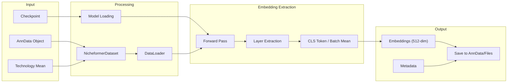
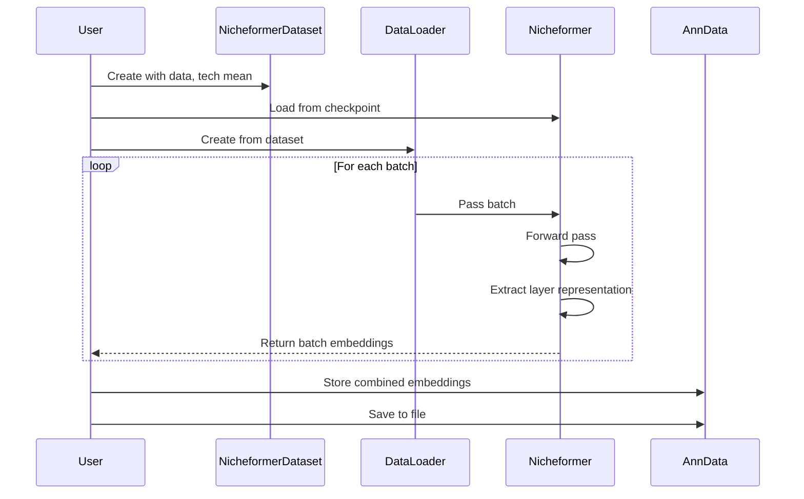
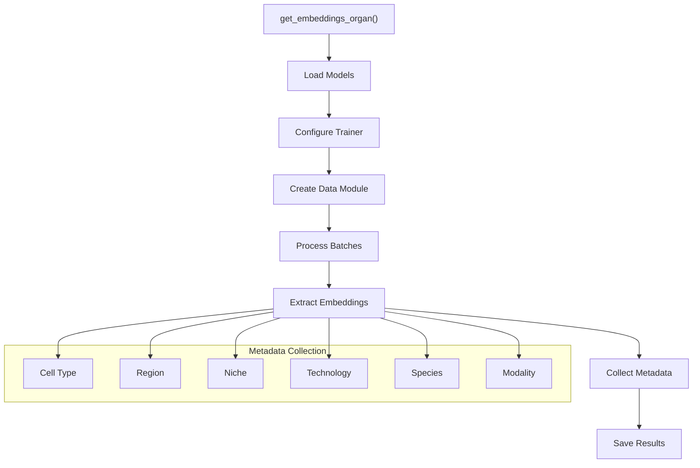

# Embedding Generation

<details>
<summary>Relevant source files</summary>

The following files were used as context for generating this wiki page:

- [data/model_means/dissociated_mean_script.npy](data/model_means/dissociated_mean_script.npy)
- [notebooks/experiments/get_embeddings.ipynb](notebooks/experiments/get_embeddings.ipynb)
- [src/nicheformer/_embeddings.py](src/nicheformer/_embeddings.py)
- [src/nicheformer/config_files/_config_embeddings.py](src/nicheformer/config_files/_config_embeddings.py)
- [src/nicheformer/get_embeddings.py](src/nicheformer/get_embeddings.py)

</details>


## Purpose and Scope

This document describes the embedding generation system in the Nicheformer repository. It explains how to extract and utilize embeddings from pre-trained Nicheformer models for single-cell and spatial omics data. Embeddings represent high-dimensional feature vectors that capture cell state information and can be used for downstream analysis such as visualization, clustering, and classification.

For information about the core Nicheformer model architecture, see [Nicheformer Model](#3.1). For details on fine-tuning the model, see [Fine-Tuning Model](#3.2).

## Overview of Embedding Generation

Embedding generation is the process of transforming tokenized gene expression data into dense vector representations using a pre-trained Nicheformer model. These embeddings capture biologically meaningful information in a lower-dimensional space that can be used for various downstream analyses.



Sources: [notebooks/experiments/get_embeddings.ipynb:1-351](), [src/nicheformer/_embeddings.py:1-143]()

## Key Components and Architecture

The embedding generation system consists of the following key components:

```mermaid
classDiagram
    class "Nicheformer" {
        +get_embeddings(batch, layer)
    }
    
    class "FineTuningModel" {
        +getting_prediction(batch, dataloader_idx, transformer_output)
    }
    
    class "NicheformerDataset" {
        +tokenize_cell(cell_vector, metadata)
    }
    
    class "MerlinDataModuleDistributed" {
        +val_dataloader()
    }
    
    class "EmbeddingGenerator" {
        +extract_embeddings()
        +save_embeddings()
    }
    
    Nicheformer <|-- FineTuningModel
    NicheformerDataset --> MerlinDataModuleDistributed
    EmbeddingGenerator --> Nicheformer
    EmbeddingGenerator --> MerlinDataModuleDistributed
```

Sources: [notebooks/experiments/get_embeddings.ipynb:15-38](), [src/nicheformer/_embeddings.py:1-9]()

### Configuration Parameters

Embedding generation requires several configuration parameters:

| Parameter | Description | Default |
|-----------|-------------|---------|
| `checkpoint_path` | Path to the pre-trained Nicheformer model checkpoint | Required |
| `fine_tuned_checkpoint_path` | Path to fine-tuned model (if using fine-tuned model) | Required for fine-tuned embeddings |
| `data_path` | Path to AnnData file containing the data | Required |
| `technology_mean_path` | Path to technology mean file used for tokenization | Required |
| `batch_size` | Number of samples per batch | 32 |
| `max_seq_len` | Maximum sequence length | 1500 |
| `aux_tokens` | Number of auxiliary tokens | 30 |
| `embedding_layer` | Which layer to extract embeddings from (-1 for last layer) | -1 |
| `organ` | Specific organ dataset identifier | "everything" |

Sources: [notebooks/experiments/get_embeddings.ipynb:50-69](), [src/nicheformer/config_files/_config_embeddings.py:1-5]()

## Embedding Generation Methods

There are two main approaches to generating embeddings from the Nicheformer model:

### 1. Using the Notebook Approach

This method uses the `get_embeddings` method of the Nicheformer model directly and is well-suited for interactive exploration:

1. Load the data and technology mean
2. Create a NicheformerDataset
3. Load the pre-trained model
4. Extract embeddings from specific layer
5. Store embeddings in AnnData object



Sources: [notebooks/experiments/get_embeddings.ipynb:79-318]()

### 2. Using the Module Function Approach

This method uses the `get_embeddings_model` function which is optimized for batch processing and pipeline integration:

1. Load both the base and fine-tuned models
2. Set up data module for specified organ
3. Process all batches through the model
4. Extract and collect embeddings
5. Save embeddings and metadata to files



Sources: [src/nicheformer/_embeddings.py:10-142]()

## Technical Implementation Details

### Model Embedding Extraction

The Nicheformer model extracts embeddings using the transformer's hidden state representations. The embeddings are 512-dimensional vectors that capture the semantic information of each cell's gene expression profile.

Key steps in the extraction process:

1. The input tokens are passed through the model's embedding layer
2. The embedded tokens go through the transformer encoder blocks
3. Hidden representations from a specific layer (typically the last layer) are extracted
4. These representations are collected and concatenated for all cells

Example code structure for embedding extraction:

```
with torch.no_grad():
    for batch in dataloader:
        # Process batch
        emb = model.get_embeddings(batch, layer=-1)
        # Collect embeddings
        embeddings.append(emb.cpu().numpy())
```

Sources: [notebooks/experiments/get_embeddings.ipynb:282-303]()

### Data Preparation for Embedding Generation

Before generating embeddings, the data must be properly prepared:

1. Load the AnnData object containing gene expression data
2. Add necessary metadata (modality, species, assay)
3. Create a NicheformerDataset with the tokenized data
4. Configure a DataLoader with appropriate batch size

The data preparation ensures that the input to the model is correctly tokenized and formatted with all necessary metadata.

Sources: [notebooks/experiments/get_embeddings.ipynb:102-112](), [notebooks/experiments/get_embeddings.ipynb:156-170]()

## Using Generated Embeddings

After generating embeddings, they can be used in various ways:

1. **Visualization**: Dimensionality reduction techniques like UMAP or t-SNE can be applied to visualize cells in a 2D space
2. **Clustering**: Cells can be clustered based on their embeddings to identify cell types or states
3. **Classification**: Machine learning models can be trained on embeddings to classify cells
4. **Integration**: Embeddings can be used to integrate data from different technologies or experiments
5. **Feature Analysis**: Analysis of embedding dimensions to understand important biological features

The embeddings are typically stored in the `obsm` attribute of the AnnData object with a key like `X_niche_embeddings` or saved as separate numpy arrays with corresponding metadata.

Sources: [notebooks/experiments/get_embeddings.ipynb:318-327](), [src/nicheformer/_embeddings.py:138-141]()

## Usage Examples

### Basic Usage for Embedding Generation

To generate embeddings using the notebook approach:

1. Configure the necessary parameters (data path, checkpoint path, etc.)
2. Load the data and create a dataset
3. Load the pre-trained model
4. Extract embeddings using the model's get_embeddings method
5. Store the embeddings in the AnnData object and save

For pipeline integration, the module function can be called with a configuration dictionary:

```
config = {
    'checkpoint_path': '/path/to/pretrained_model.ckpt',
    'fine_tuned_checkpoint_path': '/path/to/finetuned_model.ckpt',
    'organ': 'brain'  # Or other supported organ identifier
}

get_embeddings_organ(config=config)
```

Sources: [src/nicheformer/get_embeddings.py:1-18](), [src/nicheformer/config_files/_config_embeddings.py:1-5]()

## Organ-Specific Configuration

The embedding generation system supports various organ-specific datasets with different configurations:

| Organ Identifier | Description | Label Keys |
|-----------------|-------------|------------|
| `dissociated_merfish` | Dissociated brain data with MERFISH technology | ['assay', 'specie', 'modality', 'X', 'idx'] |
| `healthy_liver` | Healthy liver data from CosMx | Multiple niche features |
| `brain` | Brain data from MERFISH | Cell type, region, niche features |
| `liver` | Liver data from CosMx | Cell type, region, niche features |
| `lung` | Lung data from CosMx | Cell type, region, niche features |
| `dissociated_brain` | Dissociated brain data | ['assay', 'specie', 'modality', 'cell_type', 'X', 'idx'] |
| `everything` | All available data | ['X', 'specie', 'assay', 'modality', 'idx'] |

Each organ configuration specifies the data path and which label keys to include in the metadata.

Sources: [src/nicheformer/_embeddings.py:26-73]()

---