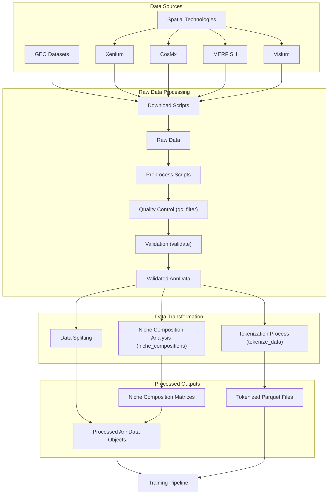
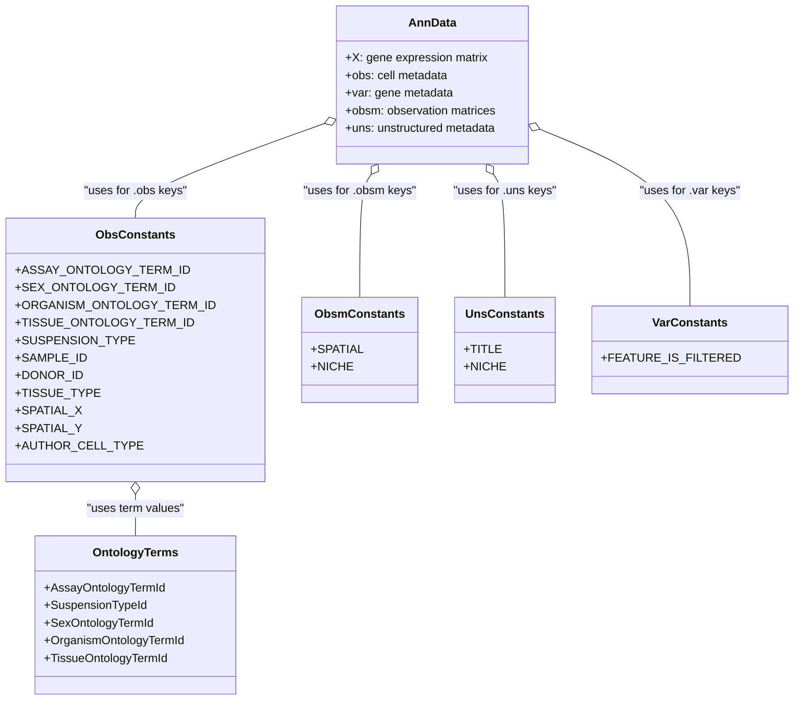
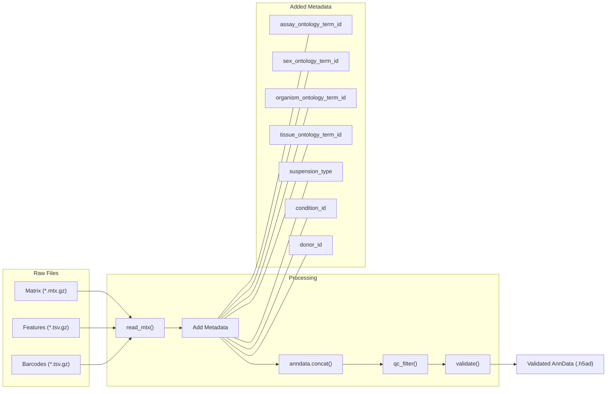
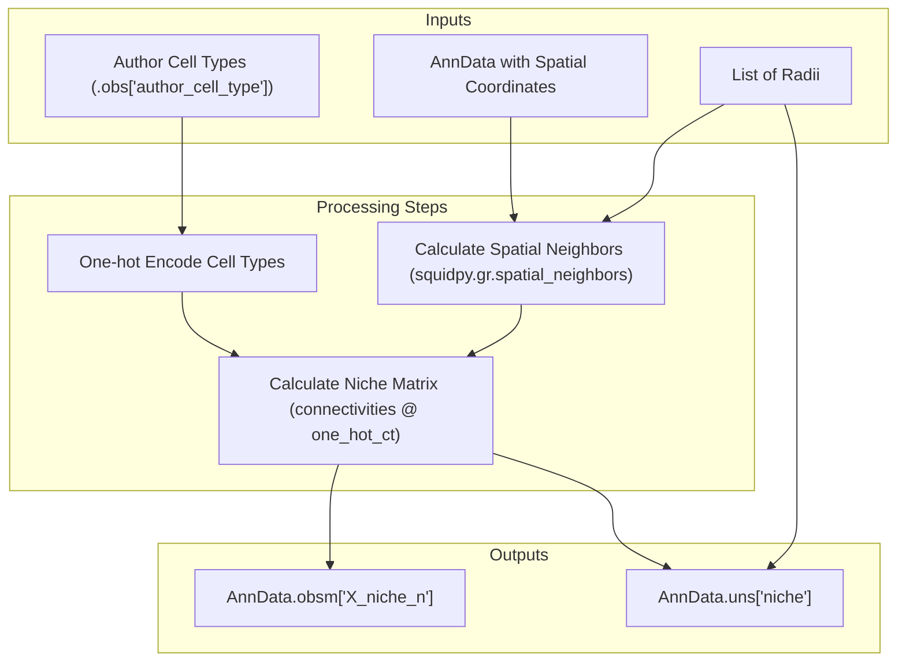

# Data Processing Pipeline

Relevant source files

The following files were used as context for generating this wiki page:

- [data/spatialcorpus-110M/dissociated/Lu_2021/preprocess_Lu_2021.py](data/spatialcorpus-110M/dissociated/Lu_2021/preprocess_Lu_2021.py)
- [src/nicheformer/data/constants.py](src/nicheformer/data/constants.py)
- [src/nicheformer/data/tools/niche_compositions.py](src/nicheformer/data/tools/niche_compositions.py)

## Purpose and Scope

This document describes the data processing pipeline in the Nicheformer system, which transforms raw spatial and single-cell omics data into formats suitable for model training and analysis. The pipeline covers data acquisition, preprocessing, quality control, tokenization, and niche analysis. For detailed information about how the tokenized data is used for model training, see [Training and Fine-tuning](#5).

## Pipeline Overview

The Nicheformer data processing pipeline transforms raw data from various spatial and single-cell technologies into standardized formats used for model training and downstream analyses.

Sources: [data/spatialcorpus-110M/dissociated/Lu_2021/preprocess_Lu_2021.py:1-87](), [src/nicheformer/data/tools/niche_compositions.py:1-51]()

## Data Standards and Constants

The Nicheformer pipeline enforces standardized data structures through defined constants that specify key attributes in AnnData objects.

Sources: [src/nicheformer/data/constants.py:1-124]()

## Data Preprocessing

### Data Loading and Standardization

The preprocessing stage involves:
1. Loading raw data (MTX, CSV, TSV, etc.) from source locations
2. Converting to standardized AnnData objects
3. Adding required metadata with controlled vocabulary using ontology terms
4. Ensuring all objects follow the Nicheformer data schema

Here's a typical preprocessing workflow shown with the Lu_2021 dataset as an example:

Sources: [data/spatialcorpus-110M/dissociated/Lu_2021/preprocess_Lu_2021.py:23-75]()

### Quality Control and Validation

Quality control is performed using the `qc_filter` function, which applies standard filtering criteria:
- Removes cells with abnormally high or low gene counts
- Filters out genes with low expression across cells
- Normalizes and transforms data when needed

The validation step (`validate` function) ensures:
- All required metadata fields are present
- Values conform to expected ontology terms
- Data structure is compatible with downstream processing

Sources: [data/spatialcorpus-110M/dissociated/Lu_2021/preprocess_Lu_2021.py:74-87]()

## Niche Composition Analysis

### Purpose and Process

For spatial data, Nicheformer calculates niche compositions representing the cell type environment surrounding each cell. This creates a representation of cellular neighborhoods used for spatial context analysis.

The `niche_compositions` function:
1. Takes an AnnData object with spatial coordinates and cell type annotations
2. Creates one-hot encoded matrix of cell types
3. For each specified radius:
   - Builds a spatial neighbor graph using squidpy
   - Calculates niche composition by multiplying connectivities with cell type matrix
   - Stores results in `.obsm[f"X_niche_{n}"]` 
4. Records metadata about the niche calculation in `.uns['niche']`

Sources: [src/nicheformer/data/tools/niche_compositions.py:9-51]()

### Output Structure

The niche composition analysis adds:

1. **Obsm entries**: 
   - For each radius `n`: `.obsm[f"X_niche_{n}"]` - Matrix of cell count by type in neighborhood
   - Dimensions: n_cells × n_cell_types

2. **Uns metadata**:
   - `.uns['niche']['columns']` - List of cell type names
   - For each radius `n`: `.uns[f"niche_{n}"]` - Configuration parameters including:
     - `radius`: Spatial distance used
     - `coord_type`: Coordinate system type
     - `node_degree`: Average number of neighbors
     - `library_key`: Library identifier field

Sources: [src/nicheformer/data/tools/niche_compositions.py:27-51]()

## Data Format Standardization

The Nicheformer pipeline enforces several standards through specified constants:

### Key AnnData Attributes

| Component | Key Constants | Description |
|-----------|---------------|-------------|
| `.obs` | `ObsConstants` | Cell metadata (assay type, organism, cell type, spatial coordinates) |
| `.obsm` | `ObsmConstants` | Spatial coordinates (`SPATIAL`) and niche compositions (`NICHE`) |
| `.uns` | `UnsConstants` | Dataset metadata and niche computation parameters |
| `.var` | `VarConstants` | Gene metadata including filtering status |

### Ontology Terms

Controlled vocabulary ensures data consistency through ontology terms:

| Category | Example Terms | Usage |
|----------|--------------|-------|
| Assay | `TENX_3`, `SMART_SEQ2`, `MERFISH_SPATIAL` | Technology identification |
| Organism | `MOUSE`, `HUMAN` | Species identification |
| Tissue | `BRAIN`, `LIVER`, `LUNG` | Tissue source |
| Suspension | `TENX_CELL`, `TENX_NUCLEUS`, `SPATIAL` | Sample preparation type |

Sources: [src/nicheformer/data/constants.py:4-124]()

## Integration with Model Training

The processed data serves as input to the Nicheformer training pipeline. For detailed information about tokenization and training procedures, see [Data Tokenization](#4.2) and [Training Pipeline](#5.1).

---