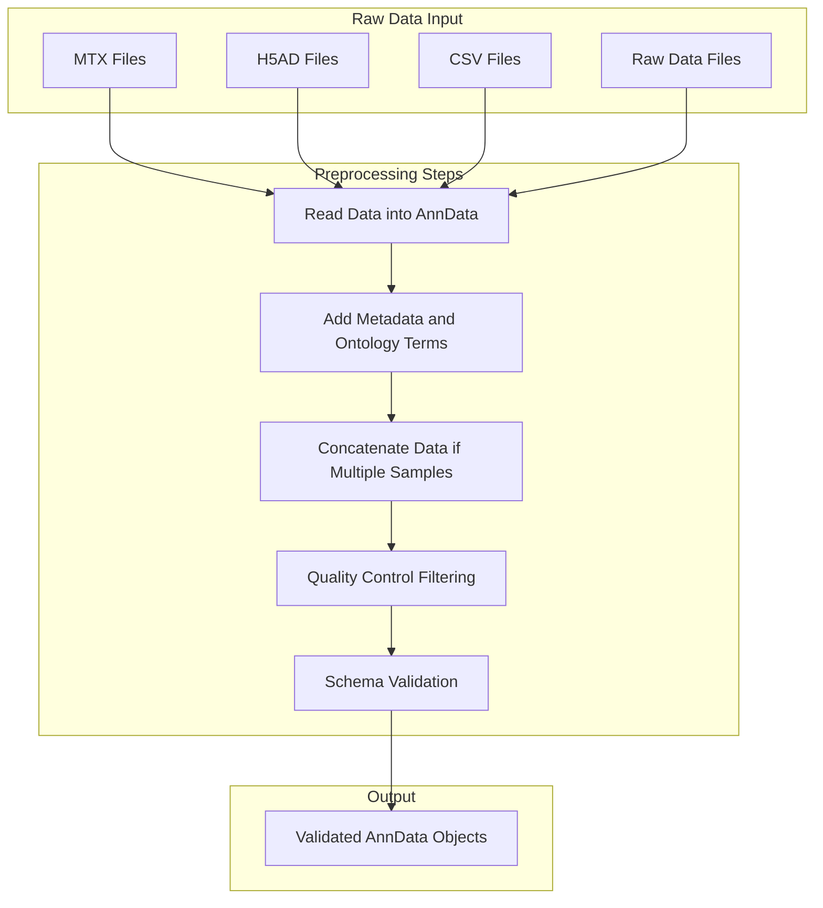
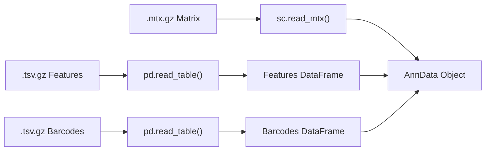
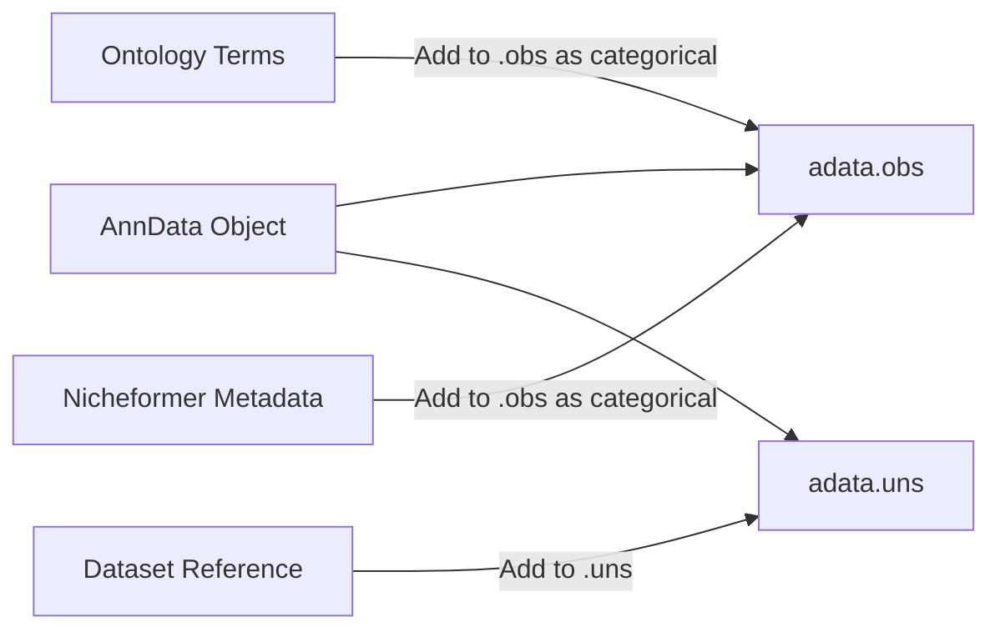
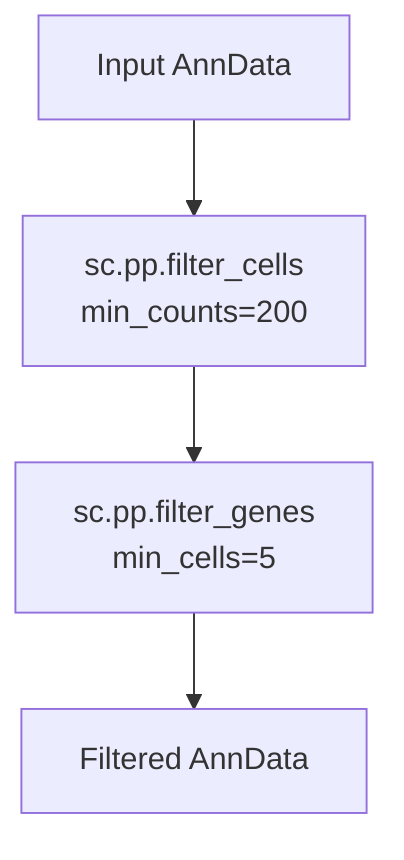
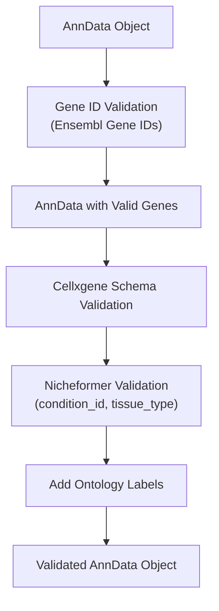

# Data Preprocessing

Relevant source files

The following files were used as context for generating this wiki page:

- [data/spatialcorpus-110M/dissociated/Lu_2021/preprocess_Lu_2021.py](data/spatialcorpus-110M/dissociated/Lu_2021/preprocess_Lu_2021.py)
- [src/nicheformer/data/tools/__init__.py](src/nicheformer/data/tools/__init__.py)
- [src/nicheformer/data/tools/basic_filtering.py](src/nicheformer/data/tools/basic_filtering.py)
- [src/nicheformer/data/tools/niche_compositions.py](src/nicheformer/data/tools/niche_compositions.py)
- [src/nicheformer/data/validate.py](src/nicheformer/data/validate.py)

## Purpose and Scope

This document outlines the data preprocessing pipeline used in Nicheformer to transform raw single-cell and spatial omics data into a standardized format suitable for model training and analysis. The preprocessing pipeline ensures data quality, adds required metadata, validates against schema requirements, and prepares the data for tokenization. For information about tokenization, see [Data Tokenization](#4.2). For details on niche composition analysis that occurs after preprocessing, see [Niche Composition Analysis](#4.3).

## Preprocessing Pipeline Overview

The Nicheformer preprocessing pipeline transforms raw data from various sources into validated AnnData objects that conform to project-specific requirements.

Sources: [data/spatialcorpus-110M/dissociated/Lu_2021/preprocess_Lu_2021.py:1-87]()

## Data Reading and Transformation

The first step in preprocessing involves reading raw data from various file formats into AnnData objects, which serve as the standard data structure for Nicheformer. The process typically varies based on the source data format:

1. **MTX files**: Read using `scanpy.read_mtx()` 
2. **Feature/barcode files**: Read using `pandas.read_table()`
3. **H5AD files**: Read directly with `anndata.read_h5ad()`

Example from a preprocessing script:

Sources: [data/spatialcorpus-110M/dissociated/Lu_2021/preprocess_Lu_2021.py:40-49]()

## Metadata and Ontology Annotation

Nicheformer requires specific metadata fields and ontology terms for each dataset. The preprocessing scripts add these fields to the `obs` and `uns` attributes of the AnnData object.

### Required Metadata Fields

| Category | Field | Description | Example |
|----------|-------|-------------|---------|
| **Ontology Terms** | `assay_ontology_term_id` | Assay technology used | `"EFO:0009922"` (10x v3) |
| | `sex_ontology_term_id` | Biological sex | `"PATO:0000383"` (female) |
| | `organism_ontology_term_id` | Species | `"NCBITaxon:10090"` (mouse) |
| | `tissue_ontology_term_id` | Tissue type | `"UBERON:0002107"` (liver) |
| **Nicheformer Specific** | `suspension_type` | Type of cell suspension | `"SMART-seq cell"` |
| | `condition_id` | Experimental condition | `"wild type"` |
| | `donor_id` | Sample/donor identifier | Sample ID |
| | `tissue_type` | Type of tissue | `"tissue"` or `"organoid"` |
| **Unstructured Data** | `title` | Dataset reference | DOI or publication title |

The metadata is added using categorical pandas Series:

Sources: 
- [data/spatialcorpus-110M/dissociated/Lu_2021/preprocess_Lu_2021.py:27-36]() 
- [data/spatialcorpus-110M/dissociated/Lu_2021/preprocess_Lu_2021.py:52-61]()
- [src/nicheformer/data/validate.py:187-199]()

## Quality Control Filtering

Nicheformer applies basic quality control filtering to remove low-quality cells and rarely expressed genes. This is implemented through the `qc_filter` function in the `nicheformer.data.tools` module.

The filtering uses two main parameters:
- `min_counts`: Minimum number of UMI counts required for a cell to pass filtering (default: 200)
- `min_cells`: Minimum number of cells in which a gene must be expressed to pass filtering (default: 5)

This permissive filtering is designed to remove clearly problematic cells and genes while retaining as much data as possible for downstream analysis.

Sources: 
- [src/nicheformer/data/tools/basic_filtering.py:1-40]()
- [data/spatialcorpus-110M/dissociated/Lu_2021/preprocess_Lu_2021.py:76]()

## Schema Validation

After quality control, Nicheformer validates the AnnData object to ensure it conforms to both the cellxgene schema and Nicheformer-specific requirements. The validation process:

1. Checks gene IDs against organism-specific Ensembl Gene IDs
2. Validates required metadata fields from the cellxgene schema 
3. Validates Nicheformer-specific fields like `condition_id` and `tissue_type`
4. Adds ontology labels to the validated AnnData

If validation fails, errors are reported, and the preprocessing pipeline stops. This ensures that only properly formatted data proceeds to the next stages of the Nicheformer pipeline.

Sources: 
- [src/nicheformer/data/validate.py:24-87]()
- [src/nicheformer/data/validate.py:187-210]()
- [data/spatialcorpus-110M/dissociated/Lu_2021/preprocess_Lu_2021.py:80]()

## Output Format

After successful preprocessing, the validated AnnData objects are saved as `.h5ad` files in a designated preprocessing directory. These files serve as the starting point for tokenization and other downstream analyses in the Nicheformer pipeline.

A properly preprocessed AnnData object contains:

| Component | Contains | Purpose |
|-----------|----------|---------|
| `X` | Gene expression matrix | Core data for model training |
| `obs` | Cell metadata with all required fields | Cell annotations and categorization |
| `var` | Gene metadata | Gene annotations and filtering flags |
| `uns` | Unstructured metadata | Dataset information and schema versions |

The output AnnData objects are ready for tokenization ([Data Tokenization](#4.2)) or, for spatial data, niche composition analysis ([Niche Composition Analysis](#4.3)).

Sources: 
- [data/spatialcorpus-110M/dissociated/Lu_2021/preprocess_Lu_2021.py:83-87]()
- [src/nicheformer/data/validate.py:226-258]()

## Preprocessing Script Example

Nicheformer includes preprocessing scripts for individual datasets in the SpatialCorpus-110M collection. These scripts follow a standard pattern:

1. Read raw data files
2. Add required metadata
3. Concatenate samples if needed
4. Apply QC filtering
5. Validate against schema
6. Save the processed AnnData

The standardized preprocessing ensures all datasets are compatible with the Nicheformer model and downstream analysis tools.

Sources: [data/spatialcorpus-110M/dissociated/Lu_2021/preprocess_Lu_2021.py:1-87]()

---