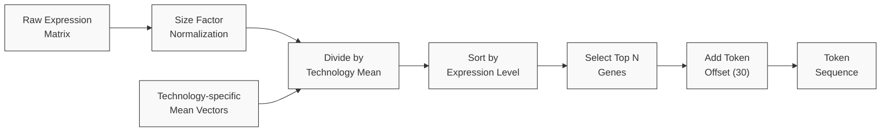
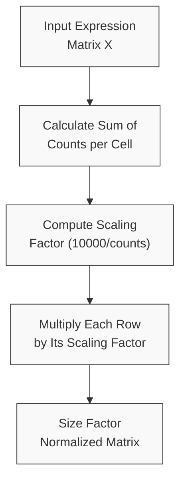
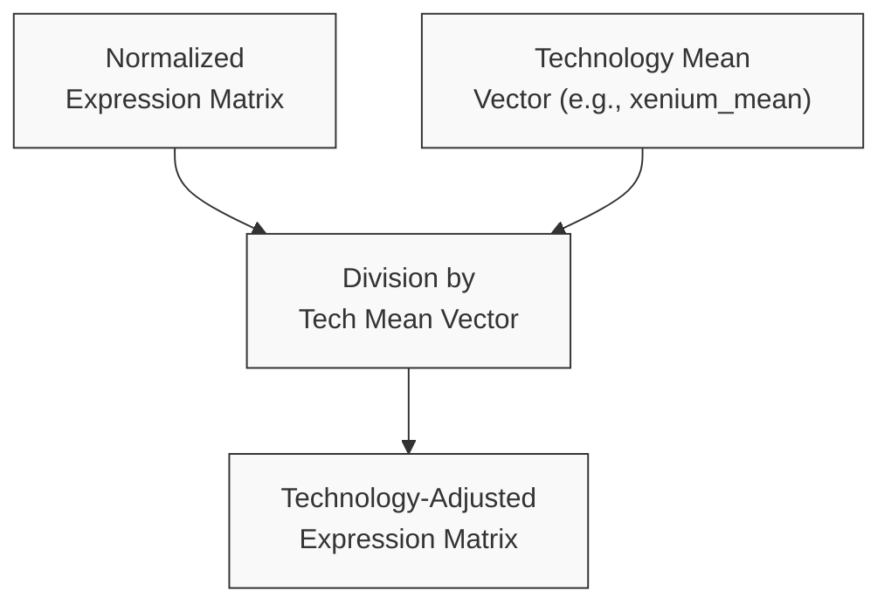
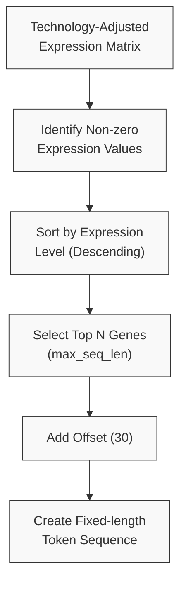
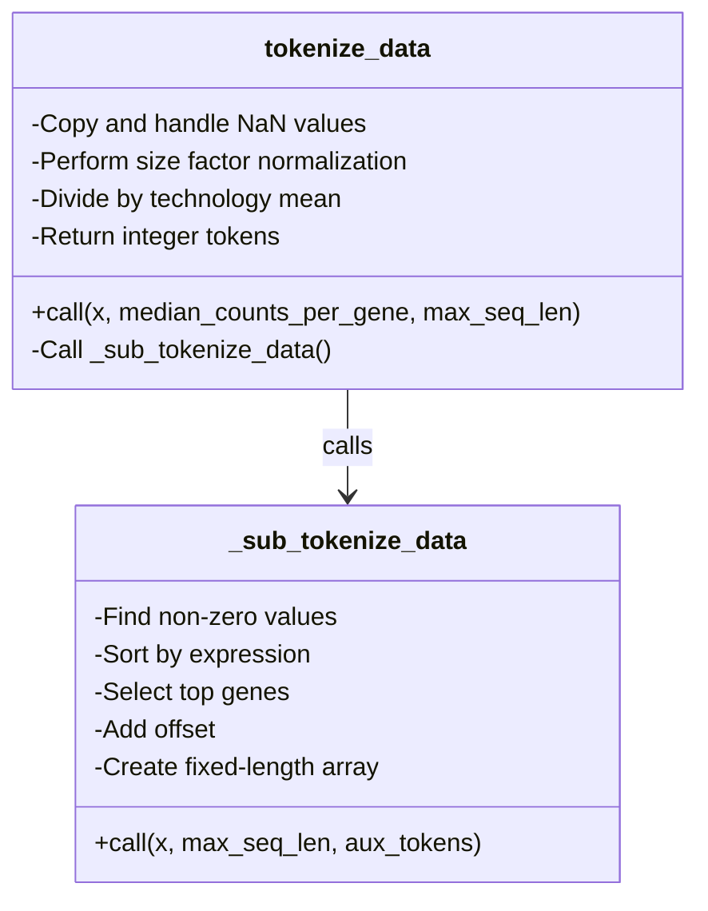
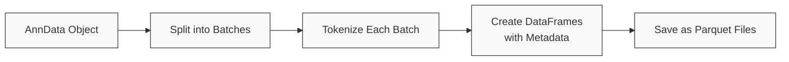
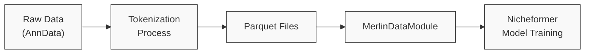

# Data Tokenization

<details>
<summary>Relevant source files</summary>

The following files were used as context for generating this wiki page:

- [data/model_means/cosmx_mean_script.npy](data/model_means/cosmx_mean_script.npy)
- [data/model_means/iss_mean_script.npy](data/model_means/iss_mean_script.npy)
- [data/model_means/xenium_mean_script.npy](data/model_means/xenium_mean_script.npy)
- [notebooks/tokenization/cosmx_human_liver.ipynb](notebooks/tokenization/cosmx_human_liver.ipynb)
- [notebooks/tokenization/cosmx_human_lung.ipynb](notebooks/tokenization/cosmx_human_lung.ipynb)
- [notebooks/tokenization/scRNAseq_mouse_brain_haviv.ipynb](notebooks/tokenization/scRNAseq_mouse_brain_haviv.ipynb)
- [notebooks/tokenization/xenium_human_colon.ipynb](notebooks/tokenization/xenium_human_colon.ipynb)
- [notebooks/tokenization/xenium_human_lung.ipynb](notebooks/tokenization/xenium_human_lung.ipynb)

</details>


Data tokenization is a critical preprocessing step in the Nicheformer pipeline that converts gene expression data into a format suitable for input to the foundation model. This process transforms the raw or preprocessed gene expression matrix into sequences of integer tokens that represent the most highly expressed genes in each cell, normalized by technology-specific mean expression values.

## Purpose and Scope

The purpose of data tokenization in Nicheformer is to:

1. Convert variable-length gene expression vectors into fixed-length sequences of tokens
2. Normalize data across different sequencing technologies and platforms
3. Focus on the most informative (highly expressed) genes in each cell
4. Create a unified representation that works for both spatial and dissociated data

This page covers the tokenization process implemented in the Nicheformer codebase, including the algorithms, input requirements, and output formats. For information about the overall data processing pipeline, see [Data Processing Pipeline](#4).

## Tokenization Process Overview

The tokenization process transforms gene expression data in several steps, as illustrated below:



**Diagram: Data Tokenization Process Overview**

Sources: [notebooks/tokenization/xenium_human_colon.ipynb:121-174](), [notebooks/tokenization/cosmx_human_lung.ipynb:151-204]()

## Key Components of Tokenization

### Size Factor Normalization

The first step in tokenization is to normalize the gene expression data using size factor normalization. This process scales the expression values for each cell to a common library size (10,000 counts), making cells with different sequencing depths comparable.



**Diagram: Size Factor Normalization Process**

Sources: [notebooks/tokenization/xenium_human_colon.ipynb:130-142](), [notebooks/tokenization/cosmx_human_lung.ipynb:161-174]()

The implementation of size factor normalization handles both sparse and dense matrices:

```python
def sf_normalize(X):
    X = X.copy()
    counts = np.array(X.sum(axis=1))
    # avoid zero division error
    counts += counts == 0.
    # normalize to 10000. counts
    scaling_factor = 10000. / counts

    if issparse(X):
        sparsefuncs.inplace_row_scale(X, scaling_factor)
    else:
        np.multiply(X, scaling_factor.reshape((-1, 1)), out=X)

    return X
```

Sources: [notebooks/tokenization/xenium_human_colon.ipynb:121-142](), [notebooks/tokenization/cosmx_human_lung.ipynb:161-174]()

### Technology-Specific Mean Adjustment

After normalization, the expression values are divided by technology-specific mean values to account for platform-specific biases. Each technology (Xenium, CosMx, etc.) has a precomputed vector of mean expression values for each gene, stored as NumPy arrays.



**Diagram: Technology-Specific Mean Adjustment**

Sources: [notebooks/tokenization/xenium_human_colon.ipynb:199-201](), [notebooks/tokenization/cosmx_human_lung.ipynb:242-244](), [data/model_means/cosmx_mean_script.npy](), [data/model_means/xenium_mean_script.npy]()

### Token Generation

The final step converts the adjusted expression matrix into integer tokens:

1. For each cell, identify non-zero expressed genes
2. Sort genes by their expression values (descending)
3. Select the top N genes (up to a maximum sequence length, default 4096)
4. Add an offset (30) to reserve tokens for special purposes
5. Create a fixed-length sequence of integers, padding with zeros if needed



**Diagram: Token Generation Process**

Sources: [notebooks/tokenization/xenium_human_colon.ipynb:145-173](), [notebooks/tokenization/cosmx_human_lung.ipynb:176-204]()

## Implementation Details

The core tokenization logic is implemented in two main functions:

1. `_sub_tokenize_data`: A numba-accelerated function that performs the sorting, selection, and offset addition
2. `tokenize_data`: The main function that orchestrates the whole tokenization process

Here's how they work together:



**Diagram: Tokenization Function Relationships**

Sources: [notebooks/tokenization/xenium_human_colon.ipynb:144-173](), [notebooks/tokenization/cosmx_human_lung.ipynb:176-204]()

The `_sub_tokenize_data` function is optimized using numba to improve performance when processing large datasets. It iterates through each cell in the input matrix, identifies the most highly expressed genes, and converts them to integer tokens:

```python
@numba.jit(nopython=True, nogil=True)
def _sub_tokenize_data(x: np.array, max_seq_len: int = -1, aux_tokens: int = 30):
    scores_final = np.empty((x.shape[0], max_seq_len if max_seq_len > 0 else x.shape[1]))
    for i, cell in enumerate(x):
        nonzero_mask = np.nonzero(cell)[0]    
        sorted_indices = nonzero_mask[np.argsort(-cell[nonzero_mask])][:max_seq_len] 
        sorted_indices = sorted_indices + aux_tokens # we reserve some tokens for padding etc (just in case)
        if max_seq_len:
            scores = np.zeros(max_seq_len, dtype=np.int32)
        else:
            scores = np.zeros_like(cell, dtype=np.int32)
        scores[:len(sorted_indices)] = sorted_indices.astype(np.int32)
        
        scores_final[i, :] = scores
        
    return scores_final
```

Sources: [notebooks/tokenization/xenium_human_colon.ipynb:145-160](), [notebooks/tokenization/cosmx_human_lung.ipynb:176-191]()

## Technology-Specific Mean Vectors

The tokenization process relies on technology-specific mean vectors that represent the average expression level of each gene across a particular sequencing platform. These vectors are used to normalize data across different technologies:

| Technology | Mean Vector File |
|------------|------------------|
| Xenium     | xenium_mean_script.npy |
| CosMx      | cosmx_mean_script.npy |
| ISS        | iss_mean_script.npy |

When a new dataset is being tokenized, the appropriate technology mean vector is loaded:

```python
xenium_mean = np.load(f"{BASE_PATH}/xenium_mean_script.npy")
xenium_mean = np.nan_to_num(xenium_mean)
rounded_values = np.where((xenium_mean % 1) >= 0.5, np.ceil(xenium_mean), np.floor(xenium_mean))
xenium_mean = np.where(xenium_mean == 0, 1, rounded_values)
```

Sources: [notebooks/tokenization/xenium_human_colon.ipynb:211-237](), [notebooks/tokenization/cosmx_human_lung.ipynb:242-267]()

## Batch Processing and Output Format

For large datasets, the tokenization is typically performed in batches to manage memory efficiently. The tokenized data is then saved in Parquet format, which is efficient for storing columnar data and supports fast loading during model training.



**Diagram: Batch Processing and Output Format**

Sources: [notebooks/tokenization/cosmx_human_lung.ipynb:402-471]()

Each Parquet file contains:
- Token sequences for each cell
- Metadata including assay type, species, modality
- Spatial neighborhood information (for spatial datasets)

Example output data structure:

```python
{'assay': 8,                    # Technology identifier
 'specie': 5,                   # Species identifier
 'modality': 4,                 # Spatial or dissociated
 'idx': 123456,                 # Cell index
 'author_cell_type': 2,         # Cell type annotation
 'niche': 8,                    # Niche annotation
 'region': 0,                   # Tissue region
 'X': [252, 18331, 2140, ...],  # Token sequence
 'X_niche_0': [...],            # Niche composition data
 # ... additional niche levels ...
}
```

Sources: [notebooks/tokenization/cosmx_human_lung.ipynb:553-591]()

## Gene Index Mapping

An important aspect of tokenization is maintaining consistent gene indexing across different datasets. This is achieved by using a reference "model.h5ad" file that contains the canonical gene ordering. When tokenizing a new dataset, it is first concatenated with this reference to ensure gene alignment:

```python
# Ensure consistent gene ordering by concatenating with reference model
adata = ad.concat([model, xenium], join='inner', axis=0)
# Extract the dataset with correct gene ordering
xenium = adata[1:].copy()
```

Sources: [notebooks/tokenization/xenium_human_colon.ipynb:193-198]()), [notebooks/tokenization/cosmx_human_lung.ipynb:321-326]()

## Integration with Training Pipeline

The tokenized data is used as input to the Nicheformer model during training. The tokens represent the most highly expressed genes in each cell, allowing the model to learn patterns of gene expression across different cell types and spatial contexts.



**Diagram: Integration with Training Pipeline**

Sources: [notebooks/tokenization/cosmx_human_lung.ipynb:458-471]()

## Additional Metadata Encoding

During tokenization, various metadata attributes are also encoded as integer values to be included in the dataset:

```python
modality_dict = {
    'dissociated': 3,
    'spatial': 4,}

specie_dict = {
    'human': 5,
    'Homo sapiens': 5,
    'Mus musculus': 6,
    'mouse': 6,}

technology_dict = {
    "merfish": 7,
    "MERFISH": 7,
    "cosmx": 8,
    "NanoString digital spatial profiling": 8,
    "Xenium": 9,
    # ... other technologies ...
}
```

Sources: [notebooks/tokenization/xenium_human_colon.ipynb:56-91]()), [notebooks/tokenization/cosmx_human_lung.ipynb:56-123]()

These encoded metadata values are included in the tokenized output, allowing the model to be aware of data modality, species, and technology information during training.

## Summary

Data tokenization is a crucial step in the Nicheformer pipeline that transforms gene expression data into a format suitable for deep learning. By normalizing data across technologies, focusing on the most highly expressed genes, and creating fixed-length sequences of tokens, this process enables the Nicheformer model to learn from diverse single-cell and spatial transcriptomic datasets.

The implementation uses optimized Python functions with numba acceleration for efficiency, and the tokenized data is stored in Parquet format for fast loading during model training. Technology-specific mean vectors ensure proper normalization across different sequencing platforms, maintaining consistency in the tokenized representation.

---